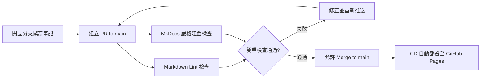

# Windcold 知識庫 (Knowledge Base)

基於 **[Material for MkDocs](https://squidfunk.github.io/mkdocs-material/)** 與 **GitHub Pages** 打造的個人技術筆記與知識管理站點。

:earth_americas: **線上網址**：[https://windcoldchen.github.io/windcold-kb/](https://windcoldchen.github.io/windcold-kb/)

---

## :sparkles: 特色

- **Material Design**：現代化精美介面、繁體中文支援、深色 / 淺色主題隨心切換。
- **全域極速搜尋**：即時字詞建議、內容高亮與分享。
- **豐富外掛生態**：內建 11 項實用外掛（Git 貢獻者頭像、在地化更新時間、異動紀錄、靜態資源壓縮、AI 摘要、LLMs.txt 規範、別名引用、核取清單等）。
- **嚴格品質把關**：開立 PR 時自動執行 Markdown Lint 與靜態建置檢查，通過後才允許合併。
- **自動化發布**：合併至 `main` 分支時由 GitHub Actions 自動發布至 GitHub Pages。

---

## :shield: 分支保護與發布流程 (CI/CD)

本儲存庫啟用了 **GitHub Ruleset 分支保護機制**，**禁止直接 push 到 `main` 分支**。所有內容更新皆須透過分支與 Pull Request 流程：



1. **PR 階段（CI 語法與樣式檢查）**：
   - 建立 PR 時觸發 [ci.yml](.github/workflows/ci.yml)。
   - **Markdown Lint Check**：使用 `markdownlint-cli2` 依據 [.markdownlint.yaml](.markdownlint.yaml) 檢查 Markdown 格式規範。
   - **MkDocs Build Check**：執行 `mkdocs build --strict` 進行語法與斷鏈嚴格檢查。
   - 兩項檢查皆通過後，GitHub 才會解鎖合併按鈕（Required Status Checks）。
2. **合併階段（CD 自動部署）**：
   - PR 合併至 `main` 時觸發 [deploy.yml](.github/workflows/deploy.yml)。
   - 產出純靜態檔案並透過 GitHub Pages 官方 Artifact 機制部署上線。

---

## :rocket: 本地開發指引

### 1. 建立並啟動 Python 虛擬環境

```bash
python3 -m venv .venv
source .venv/bin/activate
```

### 2. 安裝相依套件

```bash
pip install -r requirements.txt
```

### 3. 啟動本地即時預覽

```bash
mkdocs serve
```

開啟瀏覽器前往 [http://127.0.0.1:8000](http://127.0.0.1:8000) 即可即時預覽。修改任何 `.md` 或 `mkdocs.yml` 會自動重新載入（Hot Reload）。

### 4. 本地檢查語法與 Markdown Lint

```bash
# 執行 Markdown Lint 檢查
npx markdownlint-cli2 "**/*.md"

# 自動修正 Markdown 格式問題
npx markdownlint-cli2 --fix "**/*.md"

# MkDocs 嚴格模式建置檢查
mkdocs build --strict
```

---

## :writing_hand: 日常更新工作流

```bash
# 1. 切換至新分支
git checkout -b docs/add-new-note

# 2. 撰寫筆記並確認格式
npx markdownlint-cli2 --fix "**/*.md"
mkdocs build --strict

# 3. 提交並推送分支至 GitHub
git add .
git commit -m "docs: 新增某某筆記"
git push -u origin docs/add-new-note

# 4. 發起 PR，等待 CI 檢核通過後點擊 Merge 即可發布
```

---

## :file_folder: 專案架構

```text
windcold-kb/
├── .github/
│   └── workflows/
│       ├── ci.yml            # PR 語法與 Markdown Lint 檢查 (CI)
│       └── deploy.yml        # main 分支 Pages 部署 (CD)
├── docs/                     # 存放 Markdown 筆記
│   ├── getting-started/      # 入門與語法指引
│   │   ├── configuration.md  # 知識庫設定與部署說明
│   │   └── syntax-cheatsheet.md # 語法元件示範
│   ├── notes/                # 知識筆記分類
│   │   ├── example.md        # 筆記範本
│   │   └── workflow.md       # 日常工作流
│   ├── about.md              # 關於本站
│   └── index.md              # 首頁
├── .gitignore
├── .markdownlint.yaml        # Markdownlint 規範設定
├── .markdownlint-cli2.yaml   # Markdownlint-cli2 執行設定
├── mkdocs.yml                # MkDocs 核心設定
├── package.json              # Lint 腳本配置
├── README.md                 # 專案說明文件
└── requirements.txt          # Python 依賴清單
```
