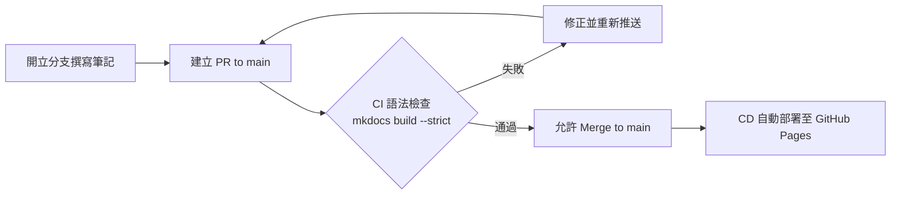

# Windcold 知識庫 (Knowledge Base)

基於 **[Material for MkDocs](https://squidfunk.github.io/mkdocs-material/)** 與 **GitHub Pages** 打造的個人技術筆記與知識管理站點。

:earth_americas: **線上網址**：[https://windcoldchen.github.io/windcold-kb/](https://windcoldchen.github.io/windcold-kb/)

---

## :sparkles: 特色

- **Material Design**：現代化精美介面、繁體中文支援、深色 / 淺色主題隨心切換。
- **全域極速搜尋**：即時字詞建議、內容高亮與分享。
- **豐富語法擴充**：支援程式碼分頁、複製按鈕、程式碼註解、Admonition 提示方塊、Mermaid 圖表。
- **嚴格品質把關**：開立 PR 時自動執行嚴格語法與靜態建置檢查，通過後才允許合併。
- **自動化發布**：合併至 `main` 分支時由 GitHub Actions 自動發布至 GitHub Pages。

---

## :shield: 分支保護與發布流程 (CI/CD)

本儲存庫啟用了 **GitHub Ruleset 分支保護機制**，**禁止直接 push 到 `main` 分支**。所有內容更新皆須透過分支與 Pull Request 流程：



1. **PR 階段（CI 語法檢查）**：
   - 建立 PR 時觸發 [ci.yml](.github/workflows/ci.yml)。
   - 執行 `mkdocs build --strict` 進行語法與斷鏈嚴格檢查。
   - 檢查通過後 GitHub 才會解鎖合併按鈕（Required Status Check）。
2. **合併階段（CD 自動部署）**：
   - PR 合併至 `main` 時觸發 [deploy.yml](.github/workflows/deploy.yml)。
   - 產出純靜態檔案並透過 GitHub Pages 官方 Artifact 機制部署上線。

---

## :rocket: 本地開發指引

### 1. 建立並啟動 Python 虛擬環境

```bash
python3 -m venv .venv
source .venv/bin/activate
```

### 2. 安裝相依套件

```bash
pip install -r requirements.txt
```

### 3. 啟動本地即時預覽

```bash
mkdocs serve
```

開啟瀏覽器前往 [http://127.0.0.1:8000](http://127.0.0.1:8000) 即可即時預覽。修改任何 `.md` 或 `mkdocs.yml` 會自動重新載入（Hot Reload）。

### 4. 嚴格模式建置檢查

```bash
mkdocs build --strict
```

---

## :writing_hand: 日常更新工作流

```bash
# 1. 切換至新分支
git checkout -b docs/add-new-note

# 2. 撰寫筆記並提交
git add .
git commit -m "docs: 新增某某筆記"

# 3. 推送分支至 GitHub
git push -u origin docs/add-new-note

# 4. 發起 PR 並由 CI 自動檢核，通過後點擊 Merge 即可發布
```

---

## :file_folder: 專案架構

```text
windcold-kb/
├── .github/
│   └── workflows/
│       ├── ci.yml            # PR 語法與建置檢查 (CI)
│       └── deploy.yml        # main 分支 Pages 部署 (CD)
├── docs/                     # 存放 Markdown 筆記
│   ├── getting-started/      # 入門與語法指引
│   │   ├── configuration.md  # 知識庫設定與部署說明
│   │   └── syntax-cheatsheet.md # 語法元件示範
│   ├── notes/                # 知識筆記分類
│   │   ├── example.md        # 筆記範本
│   │   └── workflow.md       # 日常工作流
│   ├── about.md              # 關於本站
│   └── index.md              # 首頁
├── .gitignore
├── mkdocs.yml                # MkDocs 核心設定
├── README.md                 # 專案說明文件
└── requirements.txt          # 依賴清單
```