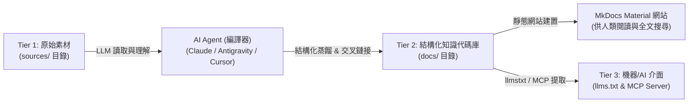

# LLM-Wiki Knowledge Schema & Compiler Specification

本規範定義 **Windcold 知識庫** 在「**LLM-Wiki + MkDocs**」架構下的知識本體（Ontology）、文檔編譯標準與 AI Agent 維護規範。

---

## 1. 架構核心理念 (Architecture Philosophy)

> **"Markdown is the codebase, LLM is the compiler, MkDocs is the runtime & renderer."**
> （Markdown 是代碼庫，LLM 是編譯器，MkDocs 是運行時與渲染引擎。）

本專案拒絕傳統 RAG（無狀態、片段化、遺失整體脈絡）的缺點，採用 **Andrej Karpathy** 所倡導的「**持續編譯式知識庫（Compiling Stateful Wiki）**」模式：



---

## 2. 知識編譯流水線四階段 (The 4-Stage Compilation Pipeline)

當 AI Agent 接收到新增或更新知識的請求時，必須嚴格執行以下四階段流水線：

### 階段一：Ingest（素材攝取與範疇界定）

- **輸入來源**：`sources/` 下的文件、使用者對話中的原始素材、或指定的外部技術文檔。
- **任務**：
  1. 判斷主題所屬領域（如：可觀測性、DevOps、Kubernetes、雲端架構、工具流）。
  2. 檢查知識庫目前是否已存在相關主題文檔（透過 `grep`、目錄檢索或 `mkdocs.yml` 導航）。

### 階段二：Synthesize & Structure（概念蒸餾與結構化編排）

- **輸出目標**：`docs/notes/<topic-slug>.md`。
- **核心結構**：
  1. **YAML Frontmatter**：包含 `icon`、`description`（100~200 字精準摘要）與 `tags`。
  2. **問題背景與痛點分析**：說明為什麼需要此技術/方案。
  3. **架構全景圖**：使用 Mermaid 圖表（必須遵循括號引號規範）。
  4. **實戰落地與代碼/配置範例**：提供生產可用（Production-Ready）的真實配置。
  5. **踩坑指南與最佳實踐**：記錄注意事項與常見排錯。

### 階段三：Cross-Link & Graph Integration（雙向鏈接與圖譜收斂）

- **原則**：知識絕非孤島。每篇新文檔必須主動與現有相關文檔建立**相對路徑 Markdown 鏈接**。
- **範例**：
  - 撰寫 OTel 文檔時，主動鏈接至既有的 [VictoriaMetrics 全家桶實戰](otel-victoriametrics-fullstack-guide.md)。
  - 撰寫 Jira 變更管理時，主動鏈接至既有的 [發布管理實戰指南](jira-release-management-guide.md)。
  - 撰寫 RunWhen 時，主動鏈接至既有的 [AIOps 智慧可觀測性方案](observability-aiops-architecture.md)。

### 階段四：Quality Assurance & Verification（語法驗證與發布）

- **驗證項目**：
  1. 執行 `npm run lint:md`（確認 0 errors）。
  2. 執行 MkDocs 嚴格建置：`mkdocs build --strict`（確認無任何斷鏈或警告）。
  3. 更新 `mkdocs.yml` 中的 `nav` 導航清單。

---

## 3. 文檔格式與風格規範 (Document Formatting Standard)

### 3.1 YAML Frontmatter 樣板

```yaml
---
icon: material/<icon-name>
description: 說明文檔主旨、適用情境與技術核心重點（100 ~ 200 字繁體中文摘要）。
tags:
  - 核心標籤1
  - 核心標籤2
  - DevOps
  - SRE
---
```

### 3.2 表格與 Mermaid 圖表規範

1. **表格規範 (MD060)**：
   - 管道符號 `|` 前後必須各保留一個空格（如 `| **欄位** | 說明 |`）。
2. **Mermaid 圖表規範**：
   - 節點文字與連線標籤內若包含括號、中括號、斜線或 `<br/>`，**必須以雙引號包裹**：

     ```mermaid
     flowchart TD
         A["用戶端請求 (HTTP/JSON)"] --> B["API 閘道器"]
     ```

---

## 4. AI Agent 編譯者 Prompt 模板 (Agent System Prompt)

當要求 AI 扮演「知識庫編譯器」時，可使用以下提示語：

```text
你現在是 Windcold 知識庫的專屬 LLM 編譯器（Knowledge Compiler）。
請依據 WIKI_SCHEMA.md 的四大階段工作流：
1. 讀取素材並蒸餾出架構原理、落地步驟與防坑實踐；
2. 撰寫至 docs/notes/ 下，並嚴格遵循 YAML Frontmatter 與 Markdownlint 規範；
3. 與知識庫現有的相關文檔進行雙向 cross-link；
4. 更新 mkdocs.yml 導航並執行驗證。
```
