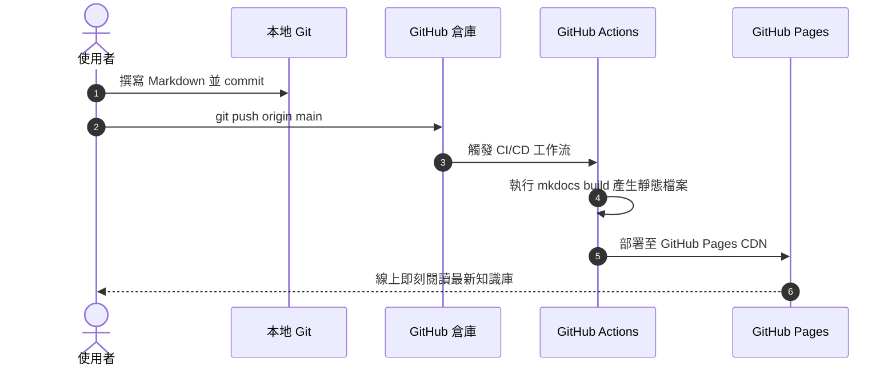

# Markdown 語法與元件示範

Material for MkDocs 提供了豐富的排版元件與擴充功能。撰寫筆記時可隨時參考本頁面提供的語法範例。

---

## 1. 提示區塊 (Admonitions)

使用 `!!! <類型> "標題"` 建立不同風格的提示框：

!!! note "筆記 (Note)"
    這是一個一般的提示方塊，用來補充一般背景資訊。

!!! tip "小技巧 (Tip)"
    使用快捷鍵 ++ctrl+alt+t++ 或 ++cmd+option+t++ 可以快速在 IDE 中調出終端機。

!!! warning "警告 (Warning)"
    在覆蓋設定檔前，請務必先將原有檔案進行備份。

!!! danger "危險 (Danger)"
    執行 `rm -rf` 指令時請特別小心當前目錄路徑！

???+ question "可摺疊區塊 (Collapsible)"
    將 `!!!` 改為 `???` 或 `???+`（預設展開），即可建立可收合的內容面板。

    展開後可以看到更多詳細的補充說明。

---

## 2. 程式碼區塊 (Code Blocks)

### 分頁顯示多語言 / 指令

=== "Python"

    ```python linenums="1"
    def greet(name: str) -> str:
        """返回個人化問候語"""
        return f"Hello, {name}!"

    print(greet("Windcold"))
    ```

=== "TypeScript"

    ```typescript linenums="1"
    interface User {
      id: string;
      name: string;
    }

    const greet = (user: User): string => {
      return `Hello, ${user.name}!`;
    };
    ```

=== "Bash"

    ```bash
    curl -fsSL https://get.example.com | sh
    ```

### 程式碼行號標記與註解 (Annotations)

```yaml hl_lines="2 4"
site_name: Windcold 知識庫
theme:
  name: material # (1)!
  language: zh-Hant
```

1. :man_technologist: 採用官方極致美觀的 Material 主題。

---

## 3. 圖表視覺化 (Mermaid)

直接在 Markdown 中以 Mermaid 繪製流程圖、序列圖或狀態圖：



---

## 4. 內容分欄卡片 (Grid Cards)

<div class="grid cards" markdown>

-   __結構化筆記__

    ---

    將筆記按主題、架構或年份妥善分門別類。

-   __全文極速檢索__

    ---

    即使累積上百篇文章，本地與線上搜尋引擎皆能秒級定位。

</div>

---

## 5. 待辦事項與標記 (Task Lists & Marks)

- [x] 安裝 Material for MkDocs
- [x] 設定自動化 GitHub Actions 流程
- [ ] 撰寫第一篇核心架構筆記
- [ ] 連結自訂網域名稱 (Custom Domain)

你可以使用 ==高亮標記==、~~刪除線~~，或是 ++ctrl+k++ 鍵盤樣式。
