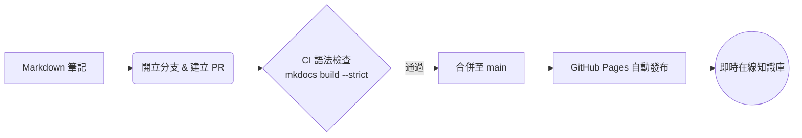

# 歡迎來到 Windcold 知識庫 :material-book-open-page-variant:

> 記錄技術經驗、架構思維與日常工具的個人數位花園。

本知識庫使用 [Material for MkDocs](https://squidfunk.github.io/mkdocs-material/) 搭建，並透過 **GitHub Actions** 進行嚴格語法檢核與自動化發布至 **GitHub Pages**。

---

## :material-compass-outline: 快速導覽

<div class="grid cards" markdown>

-   :material-rocket-launch:{ .lg .middle } __快速上手__

    ---

    了解知識庫的建置流程、設定方式以及如何透過 GitHub Pages 發布。

    [:octicons-arrow-right-24: 前往設定指南](getting-started/configuration.md)

-   :material-format-paint:{ .lg .middle } __語法與元件示範__

    ---

    探索 Material for MkDocs 的豐富功能：摺疊面板、程式碼分頁、提示框與流程圖。

    [:octicons-arrow-right-24: 查看語法指南](getting-started/syntax-cheatsheet.md)

-   :material-notebook-edit-outline:{ .lg .middle } __技術筆記__

    ---

    涵蓋後端開發、系統架構、DevOps 與工程最佳實踐。

    [:octicons-arrow-right-24: 探索筆記](notes/example.md)

-   :material-information-outline:{ .lg .middle } __關於知識庫__

    ---

    關於此知識庫的緣起、維護原則與聯絡方式。

    [:octicons-arrow-right-24: 了解更多](about.md)

</div>

---

## :material-lightning-bolt: 核心特色與發布流程



- **全域即時搜尋**：支援關鍵字即時提示、語意高亮與分享連結。
- **深色 / 淺色模式切換**：隨系統設定自動切換，亦可手動一鍵點選。
- **程式碼語法支援**：行號顯示、行標記、複製按鈕以及代碼註解。
- **品質守護 CI/CD**：開立 PR 自動執行嚴格語法建置檢查，通過後自動部署上線。

---

## :material-source-branch: 本地即時預覽

在本地終端機中執行以下指令即可啟動即時預覽伺服器：

=== "使用虛擬環境 (Virtualenv)"

    ```bash
    # 啟動現有虛擬環境
    source .venv/bin/activate

    # 啟動本地開發伺服器
    mkdocs serve
    ```

=== "新環境建立"

    ```bash
    python3 -m venv .venv
    source .venv/bin/activate
    pip install -r requirements.txt
    mkdocs serve
    ```

伺服器啟動後，開啟瀏覽器前往 [http://127.0.0.1:8000](http://127.0.0.1:8000) 即可同步查看編輯效果（支援 Hot Reloading）。
