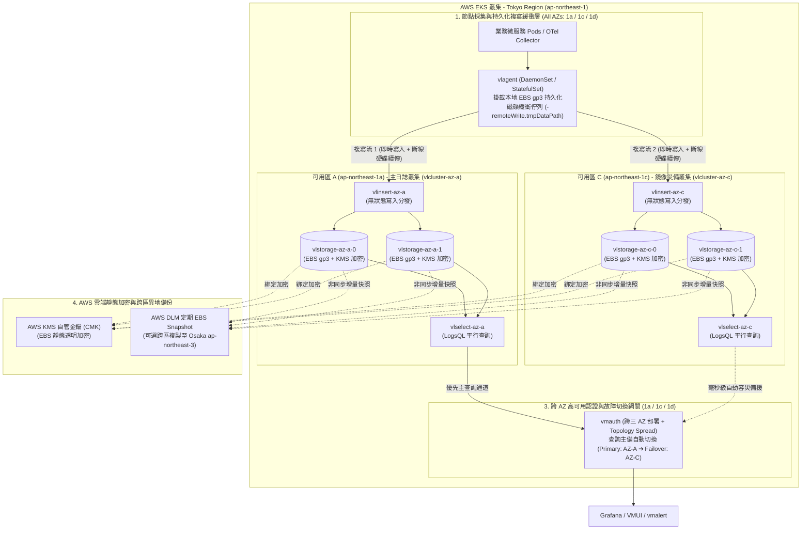

# AWS EKS (Tokyo Region) 部署 VictoriaLogs Cluster 跨 AZ 高可用與資料複寫安全實戰指南 :material-aws:

> 在企業級生產環境中，將 **VictoriaLogs Cluster** 部署於 **AWS EKS 東京區域（`ap-northeast-1`）** 時，架構師必須同時面對三大核心挑戰：**AWS EBS 區塊儲存無法跨可用區（AZ）掛載的物理限制**、**VictoriaLogs 原生分片（Sharding）無內部節點複製的架構特性**，以及**跨 AZ 網路傳輸費用（Data Transfer Cost）與資料加密合規要求**。本指南深入剖析東京區域的 AZ 拓撲特性，提供「跨 AZ 雙活鏡像叢集（Active-Active Multi-AZ Replication）」與「單一分片叢集跨 AZ 拓撲容災」兩套生產級落地方案，確保日誌系統兼具 **RPO = 0（零資料遺失）**、**RTO ≈ 0（秒級查詢故障切換）** 與極致儲存性價比。

---

## 1. 核心架構挑戰與東京區域 (`ap-northeast-1`) 設計前提

### 1.1 AWS Tokyo Region (`ap-northeast-1`) 可用區拓撲要點

在規劃東京區域的 EKS 節點池（Node Groups / Karpenter）與儲存拓撲時，務必注意以下區域特性：

1. **生產可用區選擇（避開 `1b` 陷阱）**：
   - 東京區域對外開放的三個標準生產可用區為 **`ap-northeast-1a`**、**`ap-northeast-1c`** 與 **`ap-northeast-1d`**。
   - **重要避坑**：`ap-northeast-1b` 為早期歷史可用區，多數 AWS 帳號無法在其中佈建新型 EC2 實例（如 `m7i` / `r7i` / `i4i`）或 EKS 節點。所有 `topologySpreadConstraints` 與 Node Affinity 應明確鎖定 `1a`、`1c`、`1d`。
2. **AWS EBS 單一 AZ 綁定限制**：
   - `vlstorage` 依賴高效能本地或區塊儲存（AWS EBS `gp3`）。由於 EBS Volume 屬於單一 AZ 資源（例如建立於 `ap-northeast-1a` 的 PVC 無法跨區掛載至 `ap-northeast-1c` 的節點），若單一 AZ 發生區域性中斷，該 AZ 內的 `vlstorage` 分片將暫時無法存取。

### 1.2 VictoriaLogs Cluster 的資料分片與複寫本質

理解 [VictoriaMetrics 全家桶生態](victoriametrics-ecosystem-guide.md) 中 **VictoriaLogs Cluster (`victoria-logs-cluster`)** 的內部機制，是設計高可用架構的關鍵：

| 核心組件 | K8s 工作負載型態 | 核心職責與複寫行為解析 |
| :--- | :--- | :--- |
| **`vlinsert`** | `Deployment` (無狀態) | 接收來自 `vlagent`、[OpenTelemetry Collector](otel-victoriametrics-fullstack-guide.md) 等端點的日誌流，並以**分片（Sharding）**方式均勻分發至各個 `vlstorage` 節點。**注意：`vlinsert` 內部不執行跨 `vlstorage` 節點的多副本複製！** |
| **`vlstorage`** | `StatefulSet` (有狀態 + PVC) | 將接收到的日誌進行高倍率壓縮（15x~30x）並落盤至 AWS EBS `gp3` 卷，同時負責執行本地資料塊的快速檢索。 |
| **`vlselect`** | `Deployment` (無狀態) | 接收 Grafana 或 API 的 `LogsQL` 查詢請求，平行向所有 `vlstorage` 節點拉取結果並進行聚合排序。 |
| **`vlagent`** | `DaemonSet` / `StatefulSet` | **實現跨 AZ 資料複寫的核心關鍵**：支援本地持久化磁碟佇列（Disk Queue）與**多目標並發寫入（Multi-Destination Fan-out）**，可將日誌流 1:1 同步複寫至位於不同 AZ 的獨立 VictoriaLogs 叢集。 |
| **`vmauth`** | `Deployment` (無狀態) | 統一安全認證閘道與高可用路由器，支援多租戶（`AccountID` / `ProjectID`）隔離，並具備**主備叢集自動故障切換（Failover Routing）**能力。 |

> [!IMPORTANT]
> **為什麼 VictoriaLogs 推薦透過 `vlagent` + 雙叢集實現跨 AZ 複寫？**
> 若在單一叢集的 `vlinsert` 內部進行跨 AZ 節點同步複製，不僅會因跨 AZ 網路延遲拖慢整體寫入吞吐量，更會在單一 `vlstorage` 異常時引發複雜的一致性協調問題。官方標準最佳實踐是：**每個 AZ 部署獨立、高速的 `vlstorage` 分片池，由前端 `vlagent` 進行跨 AZ 雙寫複寫（附帶磁碟斷線續傳佇列），並由 `vmauth` 負責查詢自動容災切換**。

---

## 2. 兩大生產級部署架構方案對比與選型

在 AWS EKS (`ap-northeast-1`) 上，可依據企業對 **RTO / RPO** 與 **跨 AZ 流量成本** 的權衡，選擇以下兩種架構模式：

| 評估維度 | 架構模式 A：跨 AZ 雙活鏡像叢集 (Multi-AZ Active-Active) | 架構模式 B：單一分片叢集跨三 AZ 分佈 (Single Cluster Multi-AZ) |
| :--- | :--- | :--- |
| **資料複寫機制** | **應用層 2x 完整複寫**（`vlagent` 同時雙寫至 `1a` 叢集與 `1c` 叢集） + 底層 EBS 同 AZ 冗餘 | **無應用層重複寫入**（僅依賴 AWS EBS `gp3` 在單一 AZ 內部的多伺服器物理複寫 + 定期 EBS 快照） |
| **單一 AZ 故障影響** | **零停機、零數據缺失 (RTO ≈ 0, RPO = 0)**<br/>`vmauth` 自動將查詢切換至存活 AZ；`vlagent` 磁碟佇列暫存故障 AZ 數據並於恢復後自動補齊 | **故障 AZ 的分片歷史數據暫時無法查詢**<br/>新寫入數據由存活 AZ 的 `vlstorage` 繼續承接，待故障 AZ 恢復後歷史數據重新上線 |
| **EBS 儲存與 EC2 成本** | 雙倍儲存空間（2x PVC），但因 VictoriaLogs 壓縮率高達 20x，實際 EBS 成本依然極低 | 單倍儲存空間（1x PVC），硬體成本最低 |
| **AWS 跨 AZ 流量費用** | 中等（雙寫時產生 1 次跨 AZ 傳輸，可透過同 AZ 優先查詢消除讀取跨 AZ 流量） | 低（可搭配 Kubernetes Topology Aware Hints 減少跨 AZ 轉發） |
| **適用場景** | **金融、核心交易、合規稽核、生產關鍵日誌平台（強烈推薦）** | **一般業務日誌、測試/預發環境、預算敏感型專案** |

---

## 3. 架構模式 A（推薦）：跨 AZ 雙活鏡像與零遺失複寫架構

以下展示在 AWS EKS `ap-northeast-1`（橫跨 `ap-northeast-1a`、`ap-northeast-1c`、`ap-northeast-1d`）實現 **100% 資料複寫安全** 與 **AZ 級容災** 的完整拓撲：



---

## 4. 生產級落地實戰步驟 (Step-by-Step)

### 步驟一：建立 AWS EBS CSI `gp3` KMS 加密 StorageClass

在 AWS EKS 中，為確保靜態資料安全（Encryption at Rest）與正確的可用區延遲綁定，必須配置 `volumeBindingMode: WaitForFirstConsumer`（確保 EBS 卷必定建立在 Pod 被排程到的同一個東京 AZ 內），並啟用 AWS KMS 加密：

```yaml
# 01-storageclass-ebs-gp3-encrypted.yaml
apiVersion: storage.k8s.io/v1
kind: StorageClass
metadata:
  name: ebs-gp3-tokyo-encrypted
  annotations:
    storageclass.kubernetes.io/is-default-class: "false"
provisioner: ebs.csi.aws.com
# 關鍵設定：等待 Pod 確定排程至特定 AZ (如 ap-northeast-1a) 後才於該 AZ 建立 EBS 卷
volumeBindingMode: WaitForFirstConsumer
allowVolumeExpansion: true
reclaimPolicy: Retain
parameters:
  type: gp3
  fsType: ext4
  # 啟用靜態資料加密 (符合金融與 ISO27001 / SOC2 合規)
  encrypted: "true"
  # （選用）指定東京區域自管 KMS Key ARN；若省略則使用 AWS 預設 EBS KMS Key
  # kmsKeyId: "arn:aws:kms:ap-northeast-1:123456789012:key/xxxxxxxx-xxxx-xxxx-xxxx-xxxxxxxxxxxx"
  # 針對高吞吐日誌寫入與查詢調優 gp3 IOPS 與頻寬
  iops: "6000"
  throughput: "250"
```

套用配置：

```bash
kubectl apply -f 01-storageclass-ebs-gp3-encrypted.yaml
```

---

### 步驟二：使用 VictoriaMetrics Operator 部署跨 AZ 雙叢集 (`VLCluster`)

透過 `victoria-metrics-operator` 的 **`VLCluster`** CRD（或官方 `victoria-logs-cluster` Helm Chart），我們在 `ap-northeast-1a` 與 `ap-northeast-1c` 分別宣告兩個獨立的儲存叢集，實現物理隔離的雙副本保護：

```yaml
# 02-vlcluster-multi-az.yaml
apiVersion: operator.victoriametrics.com/v1beta1
kind: VLCluster
metadata:
  name: vl-tokyo-aza
  namespace: logging
spec:
  retentionPeriod: "90d"
  # 1. 無狀態寫入層 (鎖定於 ap-northeast-1a 避免內部寫入跨 AZ 流量費)
  vlinsert:
    replicaCount: 2
    nodeSelector:
      topology.kubernetes.io/zone: ap-northeast-1a
    resources:
      requests:
        cpu: "500m"
        memory: "1Gi"
      limits:
        cpu: "2"
        memory: "4Gi"

  # 2. 有狀態儲存層 (分片落盤於 ap-northeast-1a 的加密 EBS gp3)
  vlstorage:
    replicaCount: 2
    nodeSelector:
      topology.kubernetes.io/zone: ap-northeast-1a
    # 強制同 AZ 內不同 vlstorage Pod 分散於不同 EC2 實體主機
    affinity:
      podAntiAffinity:
        requiredDuringSchedulingIgnoredDuringExecution:
          - labelSelector:
              matchLabels:
                app.kubernetes.io/name: vlstorage
                app.kubernetes.io/instance: vl-tokyo-aza
            topologyKey: kubernetes.io/hostname
    storageDataPath: "/vlstorage-data"
    storage:
      volumeClaimTemplate:
        spec:
          storageClassName: ebs-gp3-tokyo-encrypted
          accessModes: ["ReadWriteOnce"]
          resources:
            requests:
              storage: 500Gi
    resources:
      requests:
        cpu: "1"
        memory: "4Gi"
      limits:
        cpu: "4"
        memory: "16Gi"

  # 3. 無狀態查詢層
  vlselect:
    replicaCount: 2
    nodeSelector:
      topology.kubernetes.io/zone: ap-northeast-1a
    resources:
      requests:
        cpu: "500m"
        memory: "2Gi"
      limits:
        cpu: "2"
        memory: "8Gi"
---
apiVersion: operator.victoriametrics.com/v1beta1
kind: VLCluster
metadata:
  name: vl-tokyo-azc
  namespace: logging
spec:
  retentionPeriod: "90d"
  # 鏡像叢集完整部署於 ap-northeast-1c
  vlinsert:
    replicaCount: 2
    nodeSelector:
      topology.kubernetes.io/zone: ap-northeast-1c
    resources:
      requests:
        cpu: "500m"
        memory: "1Gi"
      limits:
        cpu: "2"
        memory: "4Gi"

  vlstorage:
    replicaCount: 2
    nodeSelector:
      topology.kubernetes.io/zone: ap-northeast-1c
    affinity:
      podAntiAffinity:
        requiredDuringSchedulingIgnoredDuringExecution:
          - labelSelector:
              matchLabels:
                app.kubernetes.io/name: vlstorage
                app.kubernetes.io/instance: vl-tokyo-azc
            topologyKey: kubernetes.io/hostname
    storageDataPath: "/vlstorage-data"
    storage:
      volumeClaimTemplate:
        spec:
          storageClassName: ebs-gp3-tokyo-encrypted
          accessModes: ["ReadWriteOnce"]
          resources:
            requests:
              storage: 500Gi
    resources:
      requests:
        cpu: "1"
        memory: "4Gi"
      limits:
        cpu: "4"
        memory: "16Gi"

  vlselect:
    replicaCount: 2
    nodeSelector:
      topology.kubernetes.io/zone: ap-northeast-1c
    resources:
      requests:
        cpu: "500m"
        memory: "2Gi"
      limits:
        cpu: "2"
        memory: "8Gi"
```

---

### 步驟三：配置 `VLAgent` 雙寫複寫與持久化磁碟防丟失佇列

`vlagent` 負責接收叢集內所有節點（Fluent Bit / Vector / OTel Collector）送來的日誌，並同時複製寫入 `vl-tokyo-aza` 與 `vl-tokyo-azc`。即使某個 AZ 完全斷網數小時，`vlagent` 也會將該 AZ 未寫入的日誌安全保存於本地 EBS 佇列中，待 AZ 恢復後自動重傳補齊：

```yaml
# 03-vlagent-replication.yaml
apiVersion: operator.victoriametrics.com/v1beta1
kind: VLAgent
metadata:
  name: vlagent-replicator
  namespace: logging
spec:
  replicaCount: 3
  # 橫跨東京三個可用區 (1a, 1c, 1d) 均勻分佈
  topologySpreadConstraints:
    - maxSkew: 1
      topologyKey: topology.kubernetes.io/zone
      whenUnsatisfiable: DoNotSchedule
      labelSelector:
        matchLabels:
          app.kubernetes.io/name: vlagent
          app.kubernetes.io/instance: vlagent-replicator

  # 關鍵設定：同時雙寫複寫至 AZ-A 與 AZ-C 兩座獨立叢集
  remoteWrite:
    - url: "http://vlinsert-vl-tokyo-aza.logging.svc.cluster.local:9481/insert/native"
    - url: "http://vlinsert-vl-tokyo-azc.logging.svc.cluster.local:9481/insert/native"

  # 為每個遠端目標保留最高 50Gi 本地磁碟緩衝佇列，確保單一 AZ 停機期間資料零遺失
  extraArgs:
    remoteWrite.maxDiskUsagePerURL: "50GiB"

  # 掛載加密 EBS 持久化佇列卷
  storage:
    volumeClaimTemplate:
      spec:
        storageClassName: ebs-gp3-tokyo-encrypted
        accessModes: ["ReadWriteOnce"]
        resources:
          requests:
            storage: 120Gi

  resources:
    requests:
      cpu: "500m"
      memory: "1Gi"
    limits:
      cpu: "2"
      memory: "4Gi"
```

---

### 步驟四：配置 `VMAuth` 實現查詢自動故障轉移 (Auto-Failover)

當 Grafana 或查詢端發起 `LogsQL` 查詢時，透過跨三 AZ 部署的 `vmauth` 提供單一入口：平時由 `vl-tokyo-aza` 處理查詢，一旦 `aza` 發生故障或維護重啟，`vmauth` 會自動將查詢無縫切換至 `vl-tokyo-azc`：

```yaml
# 04-vmauth-ha-gateway.yaml
apiVersion: v1
kind: Secret
metadata:
  name: vmauth-vl-config
  namespace: logging
stringData:
  config.yml: |
    users:
      - username: "grafana-reader"
        password: "${GRAFANA_READ_PASSWORD}"
        url_map:
          - src_paths:
              - "/select/.*"
            # 依序配置主備叢集端點，實現自動 Failover
            url_prefix:
              - "http://vlselect-vl-tokyo-aza.logging.svc.cluster.local:9471"
              - "http://vlselect-vl-tokyo-azc.logging.svc.cluster.local:9471"
            load_balancing_policy: first_available
            retry_status_codes: [500, 502, 503, 504]
---
apiVersion: apps/v1
kind: Deployment
metadata:
  name: vmauth-logs-gateway
  namespace: logging
spec:
  replicas: 3
  selector:
    matchLabels:
      app: vmauth-logs-gateway
  template:
    metadata:
      labels:
        app: vmauth-logs-gateway
    spec:
      topologySpreadConstraints:
        - maxSkew: 1
          topologyKey: topology.kubernetes.io/zone
          whenUnsatisfiable: DoNotSchedule
          labelSelector:
            matchLabels:
              app: vmauth-logs-gateway
      containers:
        - name: vmauth
          image: victoriametrics/vmauth:v1.106.0
          args:
            - "-auth.config=/etc/vmauth/config.yml"
            - "-httpListenAddr=:8427"
            - "-discoverBackendIPs=true"
          ports:
            - containerPort: 8427
          volumeMounts:
            - name: config
              mountPath: /etc/vmauth
              readOnly: true
      volumes:
        - name: config
          secret:
            secretName: vmauth-vl-config
```

---

## 5. 架構模式 B（輕量替代方案）：單一 Helm 叢集跨三 AZ 分佈配置

若業務允許在單一 AZ 短暫斷線期間「僅部分歷史分片暫時唯讀，但無須支付雙份 EBS 儲存成本」，可直接使用官方 `victoria-logs-cluster` Helm Chart 搭配跨三 AZ (`1a` / `1c` / `1d`) 拓撲分散與 `PodDisruptionBudget`：

```yaml
# values-tokyo-single-cluster.yaml
vlstorage:
  replicaCount: 6 # 每個 AZ (1a, 1c, 1d) 各分配 2 個分片節點
  retentionPeriod: "90d"
  retentionMaxDiskSpaceUsageBytes: "420GiB" # 預留 15% 磁碟緩衝空間防滿盤
  persistentVolume:
    enabled: true
    size: 500Gi
    storageClassName: "ebs-gp3-tokyo-encrypted"
  topologySpreadConstraints:
    - maxSkew: 1
      topologyKey: topology.kubernetes.io/zone
      whenUnsatisfiable: DoNotSchedule
      labelSelector:
        matchLabels:
          app.kubernetes.io/name: victoria-logs-cluster
          app.kubernetes.io/component: vlstorage
  podDisruptionBudget:
    enabled: true
    maxUnavailable: 1

vlinsert:
  replicaCount: 3
  topologySpreadConstraints:
    - maxSkew: 1
      topologyKey: topology.kubernetes.io/zone
      whenUnsatisfiable: DoNotSchedule
      labelSelector:
        matchLabels:
          app.kubernetes.io/name: victoria-logs-cluster
          app.kubernetes.io/component: vlinsert

vlselect:
  replicaCount: 3
  topologySpreadConstraints:
    - maxSkew: 1
      topologyKey: topology.kubernetes.io/zone
      whenUnsatisfiable: DoNotSchedule
      labelSelector:
        matchLabels:
          app.kubernetes.io/name: victoria-logs-cluster
          app.kubernetes.io/component: vlselect

vmauth:
  enabled: true
  replicaCount: 3
```

安裝指令：

```bash
helm repo add vm https://victoriametrics.github.io/helm-charts/
helm repo update
helm upgrade --install vlc vm/victoria-logs-cluster \
  --namespace logging --create-namespace \
  -f values-tokyo-single-cluster.yaml
```

---

## 6. 資料安全、災難復原與維運最佳實踐 (Best Practices & Gotchas)

### 6.1 防止 `StatefulSet` 滾動升級期間遺失資料

- **設定優雅終止（Graceful Shutdown）**：`vlstorage` 在收到 `SIGTERM` 時會將記憶體緩衝區刷入磁碟（Flush）並安全關閉檔案鎖。務必確認 Pod 的 `terminationGracePeriodSeconds` 設定為 `120` 秒以上。
- **啟用 `PodDisruptionBudget (PDB)`**：當 EKS 執行節點升級或 Karpenter 進行節點整併（Consolidation）時，透過設定 `maxUnavailable: 1` 確保不會同時驅逐多個 `vlstorage` 節點。

### 6.2 磁碟空間防爆保護（預留 Compaction 緩衝區）

- VictoriaLogs 底層採用類似 LSM-Tree 的背景合併（Merge / Compaction）機制。若 EBS 磁碟寫滿至 100%，將導致無法進行 Compaction 甚至無法啟動。
- **強制最佳實踐**：除了設定 `-retentionPeriod=90d` 外，務必同時設定 `-retention.maxDiskSpaceUsageBytes` 為 PVC 總容量的 **$80\% \sim 85\%$**（例如 500Gi PVC 設為 `420GiB`），讓系統在達到容量上限時自動淘汰最舊的日誌分塊。

### 6.3 結合 AWS DLM 實現跨區域（Tokyo ➔ Osaka）異地災備

- 針對綁定 `ebs-gp3-tokyo-encrypted` 的 PVC，建議在 AWS Console 或透過 Terraform 啟用 **Amazon Data Lifecycle Manager (DLM)**：
  1. 自動篩選標籤 `kubernetes.io/created-for/pvc/namespace: logging` 的 EBS 卷。
  2. 每 6 小時建立一次增量 EBS Snapshot（保留 14 天）。
  3. 針對合規要求極高的系統，開啟 **Cross-Region Copy** 自動將快照非同步複製至 **大阪區域（`ap-northeast-3`）**，防禦極端區域級災難。

### 6.4 延伸整合與相關文檔

- 欲於同一個 AWS EKS 東京區域叢集建置高可用時序指標與告警底座，請參閱姊妹篇 [AWS EKS (Tokyo Region) 部署 VictoriaMetrics Stack 跨 AZ 高可用與資料複寫安全實戰指南](aws-eks-victoriametrics-stack-guide.md)。
- 欲於同一個 AWS EKS 東京區域叢集建置高可用分散式鏈路追蹤，請參閱姊妹篇 [AWS EKS (Tokyo Region) 部署 VictoriaTraces Cluster 跨 AZ 高可用與資料複寫安全實戰指南](aws-eks-victoriatraces-cluster-guide.md)。
- 欲將容器日誌、應用程式指標與分散式追蹤統一收斂至本叢集，請參閱 [OpenTelemetry + VictoriaMetrics 全家桶實戰指南](otel-victoriametrics-fullstack-guide.md)。
- 欲了解混合雲或多叢集 Kubernetes 底座管理，可參考 [Proxmox + EKS Distro + Rancher 混合雲架構](proxmox-eksd-rancher-guide.md) 與 [AIOps 智慧可觀測性方案](observability-aiops-architecture.md)。
