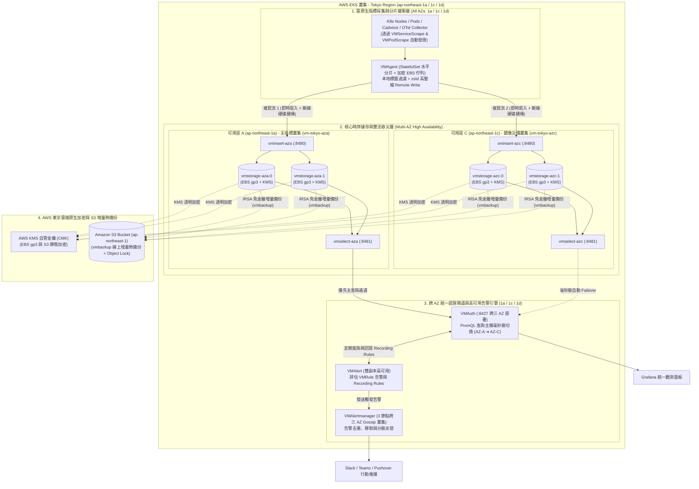

# AWS EKS (Tokyo Region) 部署 VictoriaMetrics Stack 跨 AZ 高可用與資料複寫安全實戰指南 :material-chart-areaspline:

> 在完成了 [AWS EKS 部署 VictoriaLogs 日誌叢集](aws-eks-victorialogs-cluster-guide.md) 與 [AWS EKS 部署 VictoriaTraces 鏈路叢集](aws-eks-victoriatraces-cluster-guide.md) 後，監控體系的最後一塊核心基石便是時序指標與告警平台——**VictoriaMetrics Kubernetes Monitoring Stack (`victoria-metrics-k8s-stack`)**。與日誌、鏈路引擎不同，[VictoriaMetrics 全家桶](victoriametrics-ecosystem-guide.md) 的 **`VMCluster`** 原生內建了 **`replicationFactor` 多副本分片寫入**與**`vmselect` 查詢自動去重（Deduplication）**機制，同時還具備與 **AWS S3 原生整合的 `vmbackup` 線上增量熱備份**能力。本指南針對 **AWS EKS 東京區域（`ap-northeast-1`）** 的生產環境，完整解析如何結合東京三可用區（`1a`、`1c`、`1d`）拓撲、EBS `gp3` KMS 加密、EKS Pod Identity (IRSA) 與雙層資料複寫防護，打造 **RPO = 0、RTO ≈ 0** 的企業級指標監控大底座。

---

## 1. 核心架構設計與東京區域 (`ap-northeast-1`) 複寫機制解析

### 1.1 AWS Tokyo Region 可用區與儲存安全基本準則

1. **鎖定三個標準生產可用區（避開 `1b`）**：
   - 東京區域（`ap-northeast-1`）的 EKS 節點池與 `topologySpreadConstraints` 應嚴格部署於 **`ap-northeast-1a`**、**`ap-northeast-1c`** 與 **`ap-northeast-1d`**，避開不支援新世代 EC2 機型的歷史可用區 `ap-northeast-1b`。
2. **AWS EBS 單一 AZ 限制與三層資料保護網**：
   - `vmstorage` 掛載的 AWS EBS `gp3` PVC 無法跨 AZ 掛載。為確保任何單一 AZ 停機或底層硬體損壞時**指標查詢不中斷、歷史資料零遺失**，本指南建立三層防線：
     - **第一層（即時多副本複寫）**：透過 `VMCluster` 原生 `replicationFactor: 2` 或跨 AZ 雙叢集 `VMAgent` 雙寫，確保每筆指標即時落盤於至少 2 個獨立節點。
     - **第二層（採集端斷線緩衝）**：`VMAgent` 掛載加密 EBS 持久化佇列（`-remoteWrite.maxDiskUsagePerURL`），吸收後端維護或網路抖動。
     - **第三層（S3 雲端增量熱備份）**：透過 `vmbackup` 結合 AWS S3 (`ap-northeast-1`) 定期執行不停機增量快照，防禦人為誤刪或極端災難。

### 1.2 `VMCluster` 原生複寫 (`replicationFactor`) vs 跨 AZ 雙叢集複寫

與 `VLCluster` / `VTCluster` 相比，`VMCluster` 多了一項原生武器——**叢集內多副本複製（In-Cluster Replication）**。在 AWS EKS 上可依規模與跨 AZ 流量預算選擇以下兩種高可用模式：

| 評估維度 | 架構模式 A：跨 AZ 獨立雙 `VMCluster` + `VMAgent` 雙寫 | 架構模式 B：單一 `VMCluster` (`replicationFactor: 2`) 跨三 AZ 分佈 |
| :--- | :--- | :--- |
| **資料複寫方式** | **`VMAgent` 遠端雙寫複寫**<br/>於 `1a` 與 `1c` 各部署一座 `VMCluster` (`replicationFactor: 1`)，由 `VMAgent` 同步寫入兩座叢集 | **`vminsert` 內部一致性雜湊複製**<br/>單一 `VMCluster` 的 `vmstorage` 打散於 `1a`/`1c`/`1d`，設定 `replicationFactor: 2` 與 `dedup.minScrapeInterval: 15s` |
| **AZ 物理隔離保證** | **100% 保證跨 AZ 異地副本**<br/>兩份完整指標必然分別存放在 `ap-northeast-1a` 與 `ap-northeast-1c` | **機率性跨 AZ（一致性雜湊環不感知 AZ 標籤）**<br/>搭配 `topologySpreadConstraints` 與每 AZ 至少 2 節點可大幅降低同 AZ 碰撞率，並由 `vmbackup` S3 備份兜底 |
| **AWS 跨 AZ 流量費用** | **極低（讀取零跨 AZ 流量）**<br/>`vmselect` 與 `vmstorage` 同處單一 AZ 內部查詢，僅雙寫時產生一次精簡壓縮的跨 AZ 傳輸 | **較高**<br/>每次 `vmselect` 查詢與 `vminsert` 寫入皆會跨越 `1a`/`1c`/`1d` 網路，大規模叢集需注意 AWS Data Transfer 帳單 |
| **維運複雜度** | 中（由 Operator 同時管理兩份 `VMCluster` CR） | **極低（官方 `victoria-metrics-k8s-stack` Helm Chart 一鍵開箱即用）** |
| **適用場景** | **超大規模叢集、嚴格要求 100% AZ 容災與跨 AZ 流量成本控管（金融/大型生產環境首選）** | **中大型標準 EKS 叢集、追求單一 Stack 極簡維運與原生多副本去重（最普及方案）** |

---

## 2. 全景架構圖：AWS EKS Tokyo 跨 AZ 高可用 VictoriaMetrics Stack

以下展示整合 `VMAgent`、`VMCluster`、`VMAlert`、`VMAlertmanager`、`VMAuth` 與 `vmbackup (AWS S3)` 的完整生產級架構：



---

## 3. 生產級落地實戰步驟 (Step-by-Step)

### 步驟一：建立 AWS EBS `gp3` KMS 加密 StorageClass

與同叢集的 [VictoriaLogs](aws-eks-victorialogs-cluster-guide.md) 及 [VictoriaTraces](aws-eks-victoriatraces-cluster-guide.md) 共用相同的加密 StorageClass，確保 EBS 卷延遲綁定於 Pod 排程所在的東京可用區：

```yaml
# 01-storageclass-ebs-gp3-encrypted.yaml
apiVersion: storage.k8s.io/v1
kind: StorageClass
metadata:
  name: ebs-gp3-tokyo-encrypted
provisioner: ebs.csi.aws.com
volumeBindingMode: WaitForFirstConsumer
allowVolumeExpansion: true
reclaimPolicy: Retain
parameters:
  type: gp3
  fsType: ext4
  encrypted: "true"
  # （選用）指定東京區域自管 KMS Key ARN
  # kmsKeyId: "arn:aws:kms:ap-northeast-1:123456789012:key/xxxxxxxx-xxxx-xxxx-xxxx-xxxxxxxxxxxx"
  iops: "6000"
  throughput: "250"
```

---

### 步驟二：部署 `victoria-metrics-k8s-stack`（含跨三 AZ 拓撲、多副本複寫與高可用告警）

以下提供開箱即用的生產級 `values-tokyo-ha.yaml`，可直接透過 Helm 部署完整的 Operator、`VMCluster`、`VMAgent`、`VMAlert`、`VMAlertmanager`、Node Exporter 與 Kube-State-Metrics：

- **資料複寫安全設計**：
  1. 啟用 `vmcluster.spec.replicationFactor: 2`（每筆時間序列同時寫入 2 個不同的 `vmstorage` 節點）。
  2. 啟用 `vmselect` 的 `-dedup.minScrapeInterval=15s`（查詢時自動合併去重雙副本資料，單節點停機時查詢無縫且零斷點）。
  3. 將 6 個 `vmstorage` 節點透過 `topologySpreadConstraints` 嚴格均勻打散至 **`ap-northeast-1a`、`ap-northeast-1c`、`ap-northeast-1d`**（每個 AZ 各 2 節點），並搭配 Hostname 反親和性（Anti-Affinity）。

```yaml
# 02-values-tokyo-vm-k8s-stack.yaml
# 停用單機版，啟用生產級叢集版 (VMCluster)
vmsingle:
  enabled: false

vmcluster:
  enabled: true
  spec:
    retentionPeriod: "90d"
    # 核心複寫設定：每筆指標寫入 2 份副本
    replicationFactor: 2

    # 1. 有狀態儲存節點 (橫跨東京 1a, 1c, 1d 三個 AZ，共 6 節點)
    vmstorage:
      replicaCount: 6
      storageDataPath: "/vm-data"
      extraArgs:
        # 預留 15% 空間供背景 Merge / Compaction，防止滿盤鎖死
        retention.maxDiskSpaceUsageBytes: "420GiB"
      storage:
        volumeClaimTemplate:
          spec:
            storageClassName: ebs-gp3-tokyo-encrypted
            accessModes: ["ReadWriteOnce"]
            resources:
              requests:
                storage: 500Gi
      topologySpreadConstraints:
        - maxSkew: 1
          topologyKey: topology.kubernetes.io/zone
          whenUnsatisfiable: DoNotSchedule
          labelSelector:
            matchLabels:
              app.kubernetes.io/name: vmstorage
      affinity:
        podAntiAffinity:
          requiredDuringSchedulingIgnoredDuringExecution:
            - labelSelector:
                matchLabels:
                  app.kubernetes.io/name: vmstorage
              topologyKey: kubernetes.io/hostname
      resources:
        requests:
          cpu: "1"
          memory: "4Gi"
        limits:
          cpu: "4"
          memory: "16Gi"

    # 2. 無狀態寫入路由節點 (跨三 AZ 部署)
    vminsert:
      replicaCount: 3
      topologySpreadConstraints:
        - maxSkew: 1
          topologyKey: topology.kubernetes.io/zone
          whenUnsatisfiable: DoNotSchedule
          labelSelector:
            matchLabels:
              app.kubernetes.io/name: vminsert
      resources:
        requests:
          cpu: "500m"
          memory: "1Gi"
        limits:
          cpu: "2"
          memory: "4Gi"

    # 3. 無狀態查詢聚合節點 (自動對多副本進行 15s 視窗去重)
    vmselect:
      replicaCount: 3
      extraArgs:
        dedup.minScrapeInterval: "15s"
      topologySpreadConstraints:
        - maxSkew: 1
          topologyKey: topology.kubernetes.io/zone
          whenUnsatisfiable: DoNotSchedule
          labelSelector:
            matchLabels:
              app.kubernetes.io/name: vmselect
      resources:
        requests:
          cpu: "500m"
          memory: "2Gi"
        limits:
          cpu: "2"
          memory: "8Gi"

# 4. VMAgent 採集器 (StatefulSet 模式 + 加密 EBS 斷線緩衝佇列)
vmagent:
  enabled: true
  spec:
    replicaCount: 2
    # 啟用水平分片抓取，避免重複抓取放大流量
    shardCount: 2
    scrapeInterval: "15s"
    extraArgs:
      remoteWrite.maxDiskUsagePerURL: "50GiB"
    statefulMode: true
    statefulStorage:
      volumeClaimTemplate:
        spec:
          storageClassName: ebs-gp3-tokyo-encrypted
          accessModes: ["ReadWriteOnce"]
          resources:
            requests:
              storage: 60Gi

# 5. VMAlert 規則評估引擎 (雙副本跨 AZ 高可用)
vmalert:
  enabled: true
  spec:
    replicaCount: 2
    evaluationInterval: "15s"
    extraArgs:
      remoteWrite.disablePathAppend: "true"

# 6. Alertmanager (跨三 AZ 3 節點 Gossip 高可用叢集)
alertmanager:
  enabled: true
  spec:
    replicaCount: 3
    topologySpreadConstraints:
      - maxSkew: 1
        topologyKey: topology.kubernetes.io/zone
        whenUnsatisfiable: DoNotSchedule
        labelSelector:
          matchLabels:
            app.kubernetes.io/name: vmalertmanager
    storage:
      volumeClaimTemplate:
        spec:
          storageClassName: ebs-gp3-tokyo-encrypted
          accessModes: ["ReadWriteOnce"]
          resources:
            requests:
              storage: 10Gi
```

執行安裝指令：

```bash
helm repo add vm https://victoriametrics.github.io/helm-charts/
helm repo update

helm upgrade --install vms vm/victoria-metrics-k8s-stack \
  --namespace monitoring --create-namespace \
  -f 02-values-tokyo-vm-k8s-stack.yaml
```

---

### 步驟三：（進階雙活方案）配置跨 AZ 獨立雙 `VMCluster` + `VMAgent` 雙寫複寫

若企業規範要求**「單一可用區（如 `ap-northeast-1a`）整體斷電時，絕不允許任何指標缺少副本，且平時查詢完全不跨越 AZ 網路」**，可比照 `VictoriaLogs` / `VictoriaTraces` 模式，部署 `vm-tokyo-aza` 與 `vm-tokyo-azc` 兩座獨立 `VMCluster`，並在 `VMAgent` 配置雙寫與 `VMAuth` 主備切換：

```yaml
# 03-vmagent-multi-az-replication.yaml
apiVersion: operator.victoriametrics.com/v1beta1
kind: VMAgent
metadata:
  name: vmagent-tokyo-ha
  namespace: monitoring
spec:
  replicaCount: 2
  shardCount: 2
  scrapeInterval: "15s"
  selectAllByDefault: true
  statefulMode: true
  statefulStorage:
    volumeClaimTemplate:
      spec:
        storageClassName: ebs-gp3-tokyo-encrypted
        accessModes: ["ReadWriteOnce"]
        resources:
          requests:
            storage: 100Gi
  # 關鍵設定：同時將指標雙寫複寫至 AZ-A (1a) 與 AZ-C (1c) 兩座獨立 VMCluster
  remoteWrite:
    - url: "http://vminsert-vm-tokyo-aza.monitoring.svc.cluster.local:8480/insert/0/prometheus/api/v1/write"
    - url: "http://vminsert-vm-tokyo-azc.monitoring.svc.cluster.local:8480/insert/0/prometheus/api/v1/write"
  extraArgs:
    remoteWrite.maxDiskUsagePerURL: "50GiB"
---
apiVersion: operator.victoriametrics.com/v1beta1
kind: VMAuth
metadata:
  name: vmauth-metrics-gateway
  namespace: monitoring
spec:
  replicaCount: 3
  unauthorizedAccessConfig:
    - src_paths:
        - "/select/.*"
      # 優先查詢 AZ-A 叢集，當 AZ-A 異常時毫秒級自動 Failover 至 AZ-C 叢集
      url_prefix:
        - "http://vmselect-vm-tokyo-aza.monitoring.svc.cluster.local:8481"
        - "http://vmselect-vm-tokyo-azc.monitoring.svc.cluster.local:8481"
      load_balancing_policy: first_available
      retry_status_codes: [500, 502, 503, 504]
```

---

### 步驟四：整合 `vmbackup` + AWS S3 (`ap-northeast-1`) 自動增量熱備份

VictoriaMetrics 提供原生的 **`vmbackup`** 工具，能在**完全不停機、不影響讀寫效能**的情況下，利用硬連結快照（Instant Snapshot）將新增的數據塊增量同步至 **Amazon S3**。

#### 1. 配置 EKS Pod Identity / IRSA（免靜態 AWS 金鑰）

為 `monitoring` Namespace 的 ServiceAccount 綁定最小權限 IAM Role（僅允許存取 `arn:aws:s3:::windcold-vm-backup-ap-northeast-1/*`）：

```json
{
  "Version": "2012-10-17",
  "Statement": [
    {
      "Effect": "Allow",
      "Action": [
        "s3:ListBucket",
        "s3:GetBucketLocation"
      ],
      "Resource": "arn:aws:s3:::windcold-vm-backup-ap-northeast-1"
    },
    {
      "Effect": "Allow",
      "Action": [
        "s3:PutObject",
        "s3:GetObject",
        "s3:DeleteObject"
      ],
      "Resource": "arn:aws:s3:::windcold-vm-backup-ap-northeast-1/*"
    }
  ]
}
```

#### 2. 配置 `vmbackup` 自動增量備份範例

在 `vmstorage` Pod 中掛載 `vmbackup` 定時任務（或啟用企業版 `vmbackupmanager`），每小時自動將差異資料塊備份至東京區域 S3：

```yaml
# 04-vmbackup-sidecar-example.yaml (可透過 vmstorage.extraContainers 注入)
extraContainers:
  - name: vmbackup-hourly
    image: victoriametrics/vmbackup:v1.106.0
    command:
      - /bin/sh
      - -c
      - |
        while true; do
          echo "[$(date)] Starting incremental backup to Tokyo S3..."
          /vmbackup-prod \
            -storageDataPath=/vm-data \
            -snapshot.createURL=http://localhost:8482/snapshot/create \
            -dst="s3://windcold-vm-backup-ap-northeast-1/$(HOSTNAME)/latest" \
            -concurrency=4
          sleep 3600
        done
    env:
      - name: AWS_REGION
        value: "ap-northeast-1"
      - name: HOSTNAME
        valueFrom:
          fieldRef:
            fieldPath: metadata.name
    volumeMounts:
      - name: vmstorage-db
        mountPath: /vm-data
```

> [!TIP]
> **災難還原 (`vmrestore`) 機制**：
> 當某個 `vmstorage` 的 EBS 磁碟意外損毀需要重建於新的可用區時，可在 `initContainers` 中配置 `victoriametrics/vmrestore:v1.106.0`，自動從 `s3://windcold-vm-backup-ap-northeast-1/$(HOSTNAME)/latest` 拉取快照還原至 `/vm-data` 後再啟動 `vmstorage`，達成跨 AZ 無損自癒。

---

## 4. 資料安全、高基數防護與維運最佳實踐 (Best Practices & Gotchas)

### 4.1 高基數指標防爆護欄 (Cardinality Limiter)

- 在 Kubernetes 環境中，若開發人員不慎將 `user_id`、`request_id` 或動態 URL 寫入 Prometheus Label，會引發時間序列基數爆炸（Cardinality Explosion），耗盡 `vmstorage` 記憶體與磁碟。
- **強制安全防線**：在 `vminsert` 或 `vmstorage` 的 `extraArgs` 中加入基數上限保護：

  ```yaml
  extraArgs:
    # 限制每小時新增的時間序列不超過 50 萬條，總活躍時間序列不超過 500 萬條
    storage.maxHourlySeries: "500000"
    storage.maxDailySeries: "5000000"
  ```

### 4.2 滾動升級零中斷保護 (`PodDisruptionBudget` & 優雅終止)

- **設定 `PodDisruptionBudget`**：當 `replicationFactor: 2` 時，最多允許同時離線 1 個 `vmstorage` 節點。務必配置 `maxUnavailable: 1`，防止 EKS 節點升級或 Karpenter 縮容時同時重啟 2 個儲存節點導致分片短暫不可讀。
- **預留磁碟空間 (`retention.maxDiskSpaceUsageBytes`)**：務必將最大磁碟使用量設定為 PVC 容量的 **80%~85%**（如 500Gi PVC 設為 `420GiB`），確保 LSM-Tree 背景合併（Merge）永遠有充足的暫存空間。

### 4.3 AWS 東京區域全棧可觀測性三位一體整合

透過本指南與另外兩篇 AWS EKS 東京區域實戰手冊，即可在同一個 EKS 叢集完成 **Metrics + Logs + Traces** 跨 AZ 高可用大底座：

1. **指標與告警 (Metrics & Alerting)**：本篇 `VictoriaMetrics Stack`（搭配 [Pushover 行動推播指南](pushover-guide.md) 實現秒級告警通知）。
2. **日誌叢集 (Logs)**：[AWS EKS (Tokyo Region) 部署 VictoriaLogs Cluster 跨 AZ 高可用與資料複寫安全實戰指南](aws-eks-victorialogs-cluster-guide.md)。
3. **鏈路追蹤叢集 (Traces)**：[AWS EKS (Tokyo Region) 部署 VictoriaTraces Cluster 跨 AZ 高可用與資料複寫安全實戰指南](aws-eks-victoriatraces-cluster-guide.md)。
4. **應用層埋點與 Grafana 聯動**：[OpenTelemetry + VictoriaMetrics 全家桶實戰指南](otel-victoriametrics-fullstack-guide.md)。
5. **AWS MSK 訊息佇列全棧觀測與遙測削峰**：[利用 VictoriaMetrics + VictoriaLogs + VictoriaTraces 收集與整理 AWS MSK 全棧實戰指南](aws-msk-victoria-observability-guide.md)。
6. **AWS ElastiCache for Valkey 快取叢集全棧觀測**：[利用 VictoriaMetrics + VictoriaLogs + VictoriaTraces 收集與整理 AWS ElastiCache for Valkey 全棧實戰指南](aws-elasticache-valkey-victoria-guide.md)。
