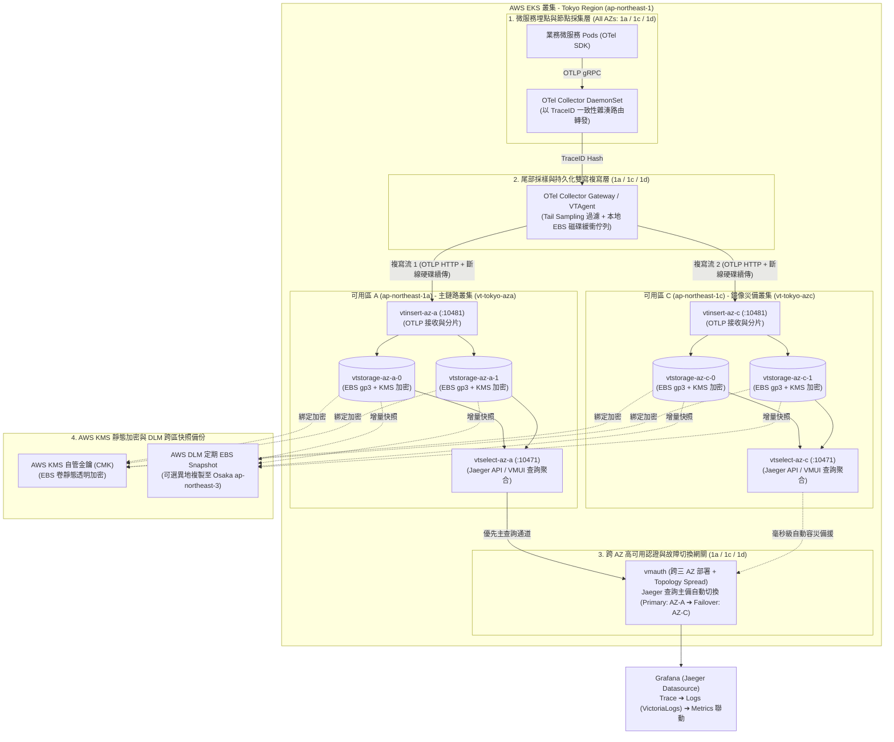

# AWS EKS (Tokyo Region) 部署 VictoriaTraces Cluster 跨 AZ 高可用與資料複寫安全實戰指南 :material-transit-connection-variant:

> 在雲原生微服務架構中，分散式鏈路追蹤（Distributed Tracing）是定位跨服務延遲瓶頸與連動異常根因的關鍵支柱。**VictoriaTraces** 作為 [VictoriaMetrics 全家桶生態](victoriametrics-ecosystem-guide.md) 的次世代鏈路追蹤資料庫，底層共享與 [VictoriaLogs](aws-eks-victorialogs-cluster-guide.md) 相同的極速列式壓縮引擎，無須依賴龐大的 S3 物件儲存或 Cassandra / Elasticsearch 即可提供 **15x ~ 25x 的超高壓縮比**與毫秒級 Jaeger / TraceQL 相容查詢。本指南針對 **AWS EKS 東京區域（`ap-northeast-1`）** 的生產環境，完整解析如何克服 **AWS EBS 單一 AZ 物理限制**與**跨 AZ 鏈路 Span 聚合問題**，打造具備 **RPO = 0（零鏈路遺失）** 與 **RTO ≈ 0（查詢自動容災）** 的企業級跨可用區雙活架構。

---

## 1. 核心架構挑戰與東京區域 (`ap-northeast-1`) 設計前提

### 1.1 分散式鏈路追蹤在 AWS Tokyo Region 的三大挑戰

將 `VictoriaTraces Cluster` 部署於 AWS EKS 東京區域時，除了與 [AWS EKS 部署 VictoriaLogs Cluster 實戰指南](aws-eks-victorialogs-cluster-guide.md) 相同的可用區規範（**鎖定生產可用區 `ap-northeast-1a`、`ap-northeast-1c`、`ap-northeast-1d`，避開歷史區域 `ap-northeast-1b`**）外，還需解決鏈路追蹤特有的三大工程挑戰：

1. **同一條 Trace 的跨 AZ Span 碎片化問題**：
   - 一次使用者請求可能依序流經位於 `1a` 的 API Gateway、`1c` 的訂單服務與 `1d` 的支付服務。若在採集層啟用**尾部採樣（Tail-based Sampling）**（如：100% 保留發生錯誤或延遲 `> 500ms` 的異常鏈路，正常鏈路僅採樣 5%），必須確保同一個 `TraceID` 的所有 Spans 被路由至同一個採樣節點處理。
2. **VictoriaTraces 分片機制與跨 AZ 複寫設計**：
   - `VictoriaTraces Cluster` 由 `vtinsert`（埠 `10481`）、`vtstorage`（埠 `10491`）與 `vtselect`（埠 `10471`）組成。
   - 為實現極致寫入吞吐量，**`vtinsert` 預設將 OTLP Spans 以分片（Sharding）方式分散寫入各個 `vtstorage` 節點，內部不進行跨節點同步複製**。若單一 AZ 故障，綁定於該 AZ 的 AWS EBS `gp3` 磁碟無法跨區掛載至其他 AZ。
3. **跨 AZ 高吞吐傳輸成本與磁碟斷線防丟**：
   - 原始未採樣的 Trace Spans 流量極高。最佳實踐是在進入跨 AZ 雙寫複寫前，先透過 **OTel Collector Gateway** 完成尾部採樣與批次壓縮（Batch + Zstd），再透過 **`vtagent`**（或 OTel 持久化磁碟佇列）進行跨 AZ 1:1 雙寫複寫，兼顧 **資料安全** 與 **AWS 跨 AZ 流量成本控制**。

### 1.2 VictoriaTraces Cluster 核心組件職責與預設埠號

| 核心組件 | K8s 工作負載型態 | 預設服務埠與 API 路徑 | 核心職責與高可用行為 |
| :--- | :--- | :--- | :--- |
| **`vtinsert`** | `Deployment` (無狀態) | `10481`<br/>`/insert/opentelemetry/v1/traces` | 接收標準 OpenTelemetry (OTLP/HTTP 與 OTLP/gRPC) 鏈路資料，解析 Span 標籤並分片路由至 `vtstorage`。 |
| **`vtstorage`** | `StatefulSet` (有狀態 + PVC) | `10491` | 將 Trace Spans 進行高倍率列式壓縮並持久化至加密 AWS EBS `gp3` 卷，負責依 `TraceID`、服務名稱與耗時快速檢索。 |
| **`vtselect`** | `Deployment` (無狀態) | `10471`<br/>`/select/jaeger/api/...`<br/>`/select/vmui/` | 向所有 `vtstorage` 節點平行拉取 Span 分片，重組完整调用鏈（Trace Tree），提供相容 **Jaeger Query API** 與內建 **VMUI** 的查詢端點。 |
| **`vtagent`** / **OTel Gateway** | `StatefulSet` | `4317` (gRPC) / `4318` (HTTP) | **跨 AZ 資料複寫核心**：提供本地持久化磁碟佇列（Persistent Disk Queue）並同時將鏈路資料雙寫至 `AZ-A` 與 `AZ-C` 兩座獨立 `VTCluster`。 |
| **`vmauth`** | `Deployment` (無狀態) | `8427` | 統一安全認證與高可用查詢閘道，當主查詢叢集異常時毫秒級自動切換至備援 AZ 叢集。 |

---

## 2. 兩大生產級部署架構方案對比與選型

依據企業對 **鏈路追蹤容災等級（RTO / RPO）** 與 **儲存成本** 的要求，提供以下兩種部署模式：

| 評估維度 | 架構模式 A：跨 AZ 雙活鏡像叢集 (Multi-AZ Active-Active) | 架構模式 B：單一分片叢集跨三 AZ 分佈 (Single Cluster Multi-AZ) |
| :--- | :--- | :--- |
| **資料複寫機制** | **應用層 2x 完整複寫**（經尾部採樣後，透過 `vtagent` / OTel 同時雙寫至 `1a` 與 `1c` 兩座獨立 `VTCluster`） | **無應用層重複寫入**（單一 `VTCluster` 的 `vtstorage` 跨 `1a`/`1c`/`1d` 分散，依賴 EBS 同 AZ 物理冗餘与快照） |
| **單一 AZ 故障影響** | **零停機、完整调用鏈不缺頁 (RTO ≈ 0, RPO = 0)**<br/>`vmauth` 自動切換查詢至存活 AZ 叢集，不會出現單條 Trace 缺少部分服務 Span 的斷鏈現象 | **故障 AZ 上的部分 Span 暫時無法顯示**<br/>在故障 AZ 恢復前，查詢到的调用鏈可能缺失落在該分片的少數 Span |
| **為什麼對 Tracing 特別重要** | 一條完整的分散式 Trace 包含數十個跨服務 Spans；若採用無複製分片且某個分片離線，整張火焰圖（Flame Graph）會出現斷層。**雙活鏡像可確保任何時刻皆有 100% 完整的调用鏈** | 適合非關鍵環境或可容忍單一 AZ 異常期間火焰圖部分節點暫缺之場景 |
| **適用場景** | **核心金融交易、電商結帳鏈路、SLA 嚴格之生產環境（強烈推薦）** | **一般內部系統、開發測試環境、追求極致最低儲存成本之場景** |

---

## 3. 架構模式 A（推薦）：跨 AZ 雙活鏡像與 TraceID 路由全景架構

以下架構展示在 AWS EKS `ap-northeast-1`（橫跨 `1a`、`1c`、`1d`）結合 [OpenTelemetry Collector](otel-victoriametrics-fullstack-guide.md)、`vtagent`、`VTCluster` 與 `vmauth` 的端到端高可用拓撲：



---

## 4. 生產級落地實戰步驟 (Step-by-Step)

### 步驟一：建立 AWS EBS CSI `gp3` KMS 加密 StorageClass

與日誌叢集一致，我們配置 `volumeBindingMode: WaitForFirstConsumer` 確保 EBS `gp3` 磁碟精準建立於 Pod 所在的東京可用區（`1a`、`1c` 或 `1d`），並強制開啟 AWS KMS 靜態加密：

```yaml
# 01-storageclass-ebs-gp3-encrypted.yaml
apiVersion: storage.k8s.io/v1
kind: StorageClass
metadata:
  name: ebs-gp3-tokyo-encrypted
provisioner: ebs.csi.aws.com
volumeBindingMode: WaitForFirstConsumer
allowVolumeExpansion: true
reclaimPolicy: Retain
parameters:
  type: gp3
  fsType: ext4
  encrypted: "true"
  # （選用）指定東京區域自管 KMS CMK ARN
  # kmsKeyId: "arn:aws:kms:ap-northeast-1:123456789012:key/xxxxxxxx-xxxx-xxxx-xxxx-xxxxxxxxxxxx"
  iops: "6000"
  throughput: "250"
```

---

### 步驟二：使用 VictoriaMetrics Operator 部署跨 AZ 雙叢集 (`VTCluster`)

透過 `victoria-metrics-operator` 的 **`VTCluster`** CRD，在 `ap-northeast-1a` 與 `ap-northeast-1c` 分別建立獨立的鏈路追蹤叢集（`vt-tokyo-aza` 與 `vt-tokyo-azc`），消除跨 AZ 內部寫入延遲並達成完整物理隔離：

```yaml
# 02-vtcluster-multi-az.yaml
apiVersion: operator.victoriametrics.com/v1beta1
kind: VTCluster
metadata:
  name: vt-tokyo-aza
  namespace: tracing
spec:
  retentionPeriod: "14d"
  # 1. 無狀態 OTLP 寫入層 (鎖定於 ap-northeast-1a)
  vtinsert:
    replicaCount: 2
    nodeSelector:
      topology.kubernetes.io/zone: ap-northeast-1a
    resources:
      requests:
        cpu: "500m"
        memory: "1Gi"
      limits:
        cpu: "2"
        memory: "4Gi"

  # 2. 有狀態鏈路儲存層 (分片落盤於 ap-northeast-1a 加密 EBS gp3)
  vtstorage:
    replicaCount: 2
    nodeSelector:
      topology.kubernetes.io/zone: ap-northeast-1a
    # 強制同 AZ 內不同 vtstorage 分片分散於不同 EC2 實體節點
    affinity:
      podAntiAffinity:
        requiredDuringSchedulingIgnoredDuringExecution:
          - labelSelector:
              matchLabels:
                app.kubernetes.io/name: vtstorage
                app.kubernetes.io/instance: vt-tokyo-aza
            topologyKey: kubernetes.io/hostname
    storageDataPath: "/vtstorage-data"
    storage:
      volumeClaimTemplate:
        spec:
          storageClassName: ebs-gp3-tokyo-encrypted
          accessModes: ["ReadWriteOnce"]
          resources:
            requests:
              storage: 300Gi
    resources:
      requests:
        cpu: "1"
        memory: "4Gi"
      limits:
        cpu: "4"
        memory: "12Gi"

  # 3. 無狀態查詢層 (提供 Jaeger Query API 與 VMUI)
  vtselect:
    replicaCount: 2
    nodeSelector:
      topology.kubernetes.io/zone: ap-northeast-1a
    resources:
      requests:
        cpu: "500m"
        memory: "2Gi"
      limits:
        cpu: "2"
        memory: "6Gi"
---
apiVersion: operator.victoriametrics.com/v1beta1
kind: VTCluster
metadata:
  name: vt-tokyo-azc
  namespace: tracing
spec:
  retentionPeriod: "14d"
  # 鏡像災備叢集完整部署於 ap-northeast-1c
  vtinsert:
    replicaCount: 2
    nodeSelector:
      topology.kubernetes.io/zone: ap-northeast-1c
    resources:
      requests:
        cpu: "500m"
        memory: "1Gi"
      limits:
        cpu: "2"
        memory: "4Gi"

  vtstorage:
    replicaCount: 2
    nodeSelector:
      topology.kubernetes.io/zone: ap-northeast-1c
    affinity:
      podAntiAffinity:
        requiredDuringSchedulingIgnoredDuringExecution:
          - labelSelector:
              matchLabels:
                app.kubernetes.io/name: vtstorage
                app.kubernetes.io/instance: vt-tokyo-azc
            topologyKey: kubernetes.io/hostname
    storageDataPath: "/vtstorage-data"
    storage:
      volumeClaimTemplate:
        spec:
          storageClassName: ebs-gp3-tokyo-encrypted
          accessModes: ["ReadWriteOnce"]
          resources:
            requests:
              storage: 300Gi
    resources:
      requests:
        cpu: "1"
        memory: "4Gi"
      limits:
        cpu: "4"
        memory: "12Gi"

  vtselect:
    replicaCount: 2
    nodeSelector:
      topology.kubernetes.io/zone: ap-northeast-1c
    resources:
      requests:
        cpu: "500m"
        memory: "2Gi"
      limits:
        cpu: "2"
        memory: "6Gi"
```

---

### 步驟三：配置 `VTAgent` / OTel Gateway 實現持久化雙寫複寫

可根據團隊現有採集架構，選擇使用輕量級 **`VTAgent`** CRD 或 **OpenTelemetry Collector Gateway（掛載 `file_storage` 磁碟佇列）** 將 Trace Spans 同步複寫至 `vt-tokyo-aza` 與 `vt-tokyo-azc`：

=== "方式一：使用 Operator `VTAgent` 雙寫複寫"

    ```yaml
    # 03-vtagent-replication.yaml
    apiVersion: operator.victoriametrics.com/v1beta1
    kind: VTAgent
    metadata:
      name: vtagent-replicator
      namespace: tracing
    spec:
      replicaCount: 3
      # 橫跨東京三個可用區 (1a, 1c, 1d) 均勻分佈
      topologySpreadConstraints:
        - maxSkew: 1
          topologyKey: topology.kubernetes.io/zone
          whenUnsatisfiable: DoNotSchedule
          labelSelector:
            matchLabels:
              app.kubernetes.io/name: vtagent
              app.kubernetes.io/instance: vtagent-replicator

      # 同時雙寫複寫至 AZ-A 與 AZ-C 兩座獨立 VTCluster
      remoteWrite:
        - url: "http://vtinsert-vt-tokyo-aza.tracing.svc.cluster.local:10481/insert/opentelemetry/v1/traces"
        - url: "http://vtinsert-vt-tokyo-azc.tracing.svc.cluster.local:10481/insert/opentelemetry/v1/traces"

      # 為每個目標保留 50Gi 本地磁碟緩衝佇列，單一 AZ 停機維護時自動排隊續傳
      extraArgs:
        remoteWrite.maxDiskUsagePerURL: "50GiB"

      storage:
        volumeClaimTemplate:
          spec:
            storageClassName: ebs-gp3-tokyo-encrypted
            accessModes: ["ReadWriteOnce"]
            resources:
              requests:
                storage: 120Gi
    ```

=== "方式二：使用 OpenTelemetry Collector Gateway（含尾部採樣 + 磁碟佇列雙寫）"

    ```yaml
    # 03-otel-gateway-replication-config.yaml
    extensions:
      # 啟用持久化磁碟緩衝佇列 (掛載 EBS gp3 卷至 /var/lib/otelcol/storage)
      file_storage:
        directory: /var/lib/otelcol/storage
        timeout: 10s

    receivers:
      otlp:
        protocols:
          grpc:
            endpoint: 0.0.0.0:4317
          http:
            endpoint: 0.0.0.0:4318

    processors:
      memory_limiter:
        check_interval: 1s
        limit_percentage: 75
        spike_limit_percentage: 15

      # 智慧尾部採樣：100% 保留錯誤與慢請求 (>500ms)，其餘正常請求採樣 10%
      tail_sampling:
        decision_wait: 10s
        num_traces: 100000
        policies:
          - name: errors-policy
            type: status_code
            status_code: { status_codes: [ERROR] }
          - name: latency-policy
            type: latency
            latency: { threshold_ms: 500 }
          - name: probabilistic-policy
            type: probabilistic
            probabilistic: { sampling_percentage: 10 }

      batch:
        send_batch_size: 2048
        timeout: 2s

    exporters:
      # 複寫目標 1：寫入可用區 A (ap-northeast-1a) 主叢集
      otlphttp/vt_aza:
        traces_endpoint: "http://vtinsert-vt-tokyo-aza.tracing.svc.cluster.local:10481/insert/opentelemetry/v1/traces"
        compression: zstd
        sending_queue:
          enabled: true
          num_consumers: 10
          queue_size: 10000
          storage: file_storage
        retry_on_failure:
          enabled: true
          initial_interval: 5s
          max_interval: 60s
          max_elapsed_time: 0s # 無限重試直到故障 AZ 恢復

      # 複寫目標 2：寫入可用區 C (ap-northeast-1c) 災備鏡像叢集
      otlphttp/vt_azc:
        traces_endpoint: "http://vtinsert-vt-tokyo-azc.tracing.svc.cluster.local:10481/insert/opentelemetry/v1/traces"
        compression: zstd
        sending_queue:
          enabled: true
          num_consumers: 10
          queue_size: 10000
          storage: file_storage
        retry_on_failure:
          enabled: true
          initial_interval: 5s
          max_interval: 60s
          max_elapsed_time: 0s

    service:
      extensions: [file_storage]
      pipelines:
        traces:
          receivers: [otlp]
          processors: [memory_limiter, tail_sampling, batch]
          exporters: [otlphttp/vt_aza, otlphttp/vt_azc]
    ```

---

### 步驟四：配置 `VMAuth` 實現 Jaeger 查詢與 VMUI 自動故障轉移

Grafana 的 Jaeger 資料來源（Datasource）統一指向跨三 AZ 部署的 `vmauth`。平時優先查詢 `vt-tokyo-aza`，一旦 `aza` 發生異常或進行維護，`vmauth` 會在毫秒內自動切換至 `vt-tokyo-azc`：

```yaml
# 04-vmauth-traces-gateway.yaml
apiVersion: v1
kind: Secret
metadata:
  name: vmauth-vt-config
  namespace: tracing
stringData:
  config.yml: |
    users:
      - username: "grafana-traces-reader"
        password: "${GRAFANA_TRACES_PASSWORD}"
        url_map:
          - src_paths:
              - "/select/.*"
            # 主備叢集自動 Failover (埠 10471 為 vtselect 服務埠)
            url_prefix:
              - "http://vtselect-vt-tokyo-aza.tracing.svc.cluster.local:10471"
              - "http://vtselect-vt-tokyo-azc.tracing.svc.cluster.local:10471"
            load_balancing_policy: first_available
            retry_status_codes: [500, 502, 503, 504]
```

> [!TIP]
> **Grafana 資料來源配置路徑**：
> 在 Grafana 新增 **Jaeger** 類型資料來源時，將 URL 設定為：
> `http://vmauth-traces-gateway.tracing.svc.cluster.local:8427/select/jaeger`
> 並啟用 **Trace to Logs** 關聯至同區域的 [VictoriaLogs 叢集](aws-eks-victorialogs-cluster-guide.md)，即可從任何異常 Span 一鍵跳轉檢視該時間點的容器日誌。

---

## 5. 架構模式 B（輕量替代方案）：單一 Helm 叢集跨三 AZ 分佈配置

若專案屬於非關鍵業務或預算有限，可直接使用官方 `victoria-traces-cluster` Helm Chart，將單一叢集的 `vtstorage` 均勻打散至東京三個可用區（`1a`、`1c`、`1d`）：

```yaml
# values-tokyo-traces-single-cluster.yaml
vtstorage:
  replicaCount: 6 # 橫跨 1a, 1c, 1d 每個 AZ 各部署 2 個分片節點
  retentionPeriod: "14d"
  retentionMaxDiskSpaceUsageBytes: "250GiB" # 預留 15% 空間供 LSM-Tree Compaction
  persistentVolume:
    enabled: true
    size: 300Gi
    storageClassName: "ebs-gp3-tokyo-encrypted"
  topologySpreadConstraints:
    - maxSkew: 1
      topologyKey: topology.kubernetes.io/zone
      whenUnsatisfiable: DoNotSchedule
      labelSelector:
        matchLabels:
          app.kubernetes.io/name: victoria-traces-cluster
          app.kubernetes.io/component: vtstorage
  podDisruptionBudget:
    enabled: true
    maxUnavailable: 1

vtinsert:
  replicaCount: 3
  topologySpreadConstraints:
    - maxSkew: 1
      topologyKey: topology.kubernetes.io/zone
      whenUnsatisfiable: DoNotSchedule
      labelSelector:
        matchLabels:
          app.kubernetes.io/name: victoria-traces-cluster
          app.kubernetes.io/component: vtinsert

vtselect:
  replicaCount: 3
  topologySpreadConstraints:
    - maxSkew: 1
      topologyKey: topology.kubernetes.io/zone
      whenUnsatisfiable: DoNotSchedule
      labelSelector:
        matchLabels:
          app.kubernetes.io/name: victoria-traces-cluster
          app.kubernetes.io/component: vtselect

vmauth:
  enabled: true
  replicaCount: 3
```

安裝指令：

```bash
helm repo add vm https://victoriametrics.github.io/helm-charts/
helm repo update
helm upgrade --install vtc vm/victoria-traces-cluster \
  --namespace tracing --create-namespace \
  -f values-tokyo-traces-single-cluster.yaml
```

---

## 6. 資料安全、成本優化與維運最佳實踐 (Best Practices & Gotchas)

### 6.1 啟用 `zstd` 壓縮大幅削減 AWS 跨 AZ 網路傳輸費

- 在 AWS EKS 中，跨可用區傳輸費用為雙向計費（`$0.01/GB` in + `$0.01/GB` out）。
- 由於 Trace Spans 包含大量重複的 Resource Attributes（如 Pod 名稱、K8s Labels、HTTP Headers），在 OTel Collector Exporter 或 `vtagent` 強制開啟 **`compression: zstd`**，可將跨 AZ 網路封包體積壓縮達 **85% ~ 90%**，直接省下近九成的跨 AZ 流量帳單。

### 6.2 敏感資料脫敏（PII Redaction）與靜態加密合規

- 鏈路 Span 的 `http.url`、`db.statement` 或自訂 Attribute 經常意外夾帶使用者 Token、Email 或信用卡號。
- **雙重安全防線**：
  1. **寫入前脫敏**：在 OTel Collector 的 `transform` 或 `redaction` Processor 中，利用正則表達式先遮蔽敏感欄位，再雙寫進入 `VTCluster`。
  2. **落盤靜態加密**：所有 `vtstorage` 與 `vtagent` 佇列的 EBS `gp3` PVC 一律啟用 AWS KMS 加密，並搭配 **AWS DLM** 定期產生加密增量快照。

### 6.3 延伸整合與相關文檔

- 欲同步建置高可用日誌叢集，請參閱姊妹篇 [AWS EKS (Tokyo Region) 部署 VictoriaLogs Cluster 跨 AZ 高可用與資料複寫安全實戰指南](aws-eks-victorialogs-cluster-guide.md)。
- 欲了解完整的 Metrics、Logs、Traces 三位一體埋點與 Grafana 跨維度跳轉配置，請參閱 [OpenTelemetry + VictoriaMetrics 全家桶實戰指南](otel-victoriametrics-fullstack-guide.md) 與 [Prometheus+Loki+Tempo vs VM 全家桶評比](prometheus-loki-tempo-vs-victoriametrics.md)。
