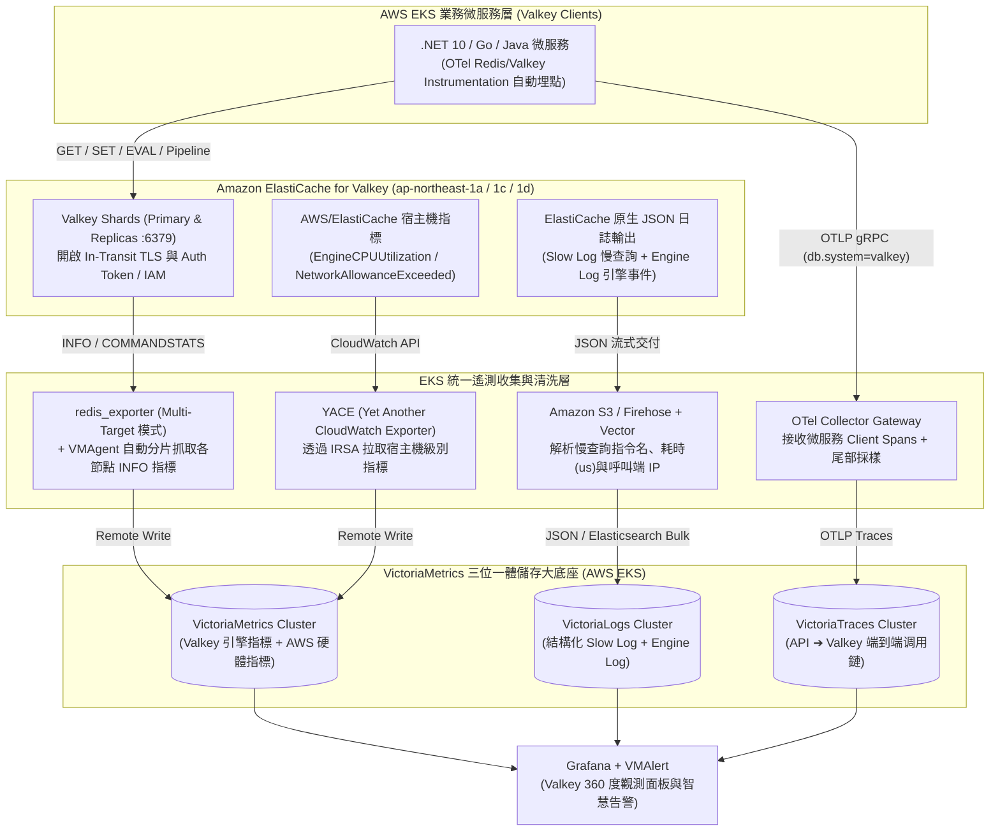
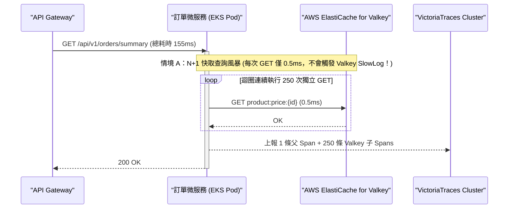

# 利用 VictoriaMetrics + VictoriaLogs + VictoriaTraces 收集與整理 AWS ElastiCache for Valkey 全棧實戰指南 :material-database-clock-outline:

> **Amazon ElastiCache for Valkey**（作為開源社群由 Linux 基金會主導、完全相容於 Redis 的高效能記憶體資料庫，AWS 提供最高達 33% 的價格降幅與多執行緒 I/O 強化）已成為現代雲原生架構的首選快取與分散式鎖底座。然而在生產環境中，工程團隊常遇到三大排障盲點：**「為什麼總 CPU 只有 20% 快取卻全面超時？」**、**「哪個微服務發出了阻塞主執行緒的大 Key 指令（如 `HGETALL` / `KEYS`）？」**，以及**「為什麼 Valkey 端沒有慢查詢，應用程式讀取快取卻要 100ms？」**。本指南完整解析如何利用部署於 AWS EKS 的 [VictoriaMetrics](aws-eks-victoriametrics-stack-guide.md)、[VictoriaLogs](aws-eks-victorialogs-cluster-guide.md) 與 [VictoriaTraces](aws-eks-victoriatraces-cluster-guide.md) 三位一體底座，對 AWS ElastiCache for Valkey 進行全方位收集、整理與跨維度根因定位。

---

## 1. 為什麼需要 Metrics + Logs + Traces 三維聯動觀測 ElastiCache Valkey

單靠 AWS CloudWatch 預設面板無法回答應用層與快取層交界處的效能瓶頸。透過 Victoria 全家桶將三維訊號收斂於同一平台，能精準區分「**伺服器端引擎瓶頸**」、「**慢指令阻塞**」與「**客戶端連線池 / N+1 迴圈問題**」：

| 觀測維度 | 收集來源與工具管線 | 寫入目標 | 負責解決的核心生產問題 |
| :--- | :--- | :--- | :--- |
| **指標 (Metrics)** | 1. **`redis_exporter` (Multi-Target)**：抓取 Valkey `INFO ALL`、`LATENCY`、`COMMANDSTATS`<br/>2. **`YACE` (CloudWatch Exporter)**：補充 AWS 底層 `EngineCPUUtilization` 與網卡超限指標 | **`VictoriaMetrics`** | 監控快取命中率（Hit Ratio）、記憶體碎片率、Key 驅逐率（Evictions）、主從複製偏移量（Replication Lag）與主執行緒 CPU 飽和度 |
| **日誌 (Logs)** | **ElastiCache Native Log Delivery (JSON)** ➔ Firehose / S3 + **Vector** | **`VictoriaLogs`** | 永久留存並秒級檢索 **Slow Log（慢查詢日誌）** 與 **Engine Log（主從切換 Failover / Full Resync 日誌）**，克服記憶體 `SLOWLOG GET` 僅保留最近 128 筆的限制 |
| **鏈路 (Traces)** | **微服務 OTel SDK (`StackExchange.Redis` / `Lettuce` / `ioredis`)** ➔ **OTel Gateway** | **`VictoriaTraces`** | 抓出「單筆僅 0.5ms 但單次 API 迴圈呼叫 300 次」的 **N+1 快取風暴**，以及區分「客戶端連線池排隊耗時」與「Valkey 實際執行耗時」 |

---

## 2. 全景架構圖：AWS ElastiCache for Valkey 三位一體收集管線

以下架構展示在 AWS 東京區域（`ap-northeast-1`）中，如何同時收集 **ElastiCache for Valkey（Cluster Mode Enabled 分片叢集）** 與 **EKS 微服務客戶端** 的三維遙測資料：



---

## 3. 第一支柱：利用 `VictoriaMetrics` 收集整理 Valkey 引擎與宿主機指標

### 3.1 為什麼需要「`redis_exporter` + `YACE`」雙軌採集

在 AWS ElastiCache 中，有兩類指標缺一不可：

1. **Valkey 引擎內部細粒度指標（透過 `oliver006/redis_exporter` 直接連線 `:6379` 抓取）**：
   - 提供每種指令（`GET`、`SET`、`HGETALL`、`EVAL`）的平均耗時與 QPS、各 DB 的 Key 數量、過期與驅逐（Evicted Keys）速率。
   - **零 CloudWatch 費用**，且支援高頻率（如每 `15s`）抓取。
2. **AWS 託管宿主機關鍵指標（透過 `YACE` 每 `60s` 從 CloudWatch 補充）**：
   - **`EngineCPUUtilization`（引擎主執行緒 CPU 使用率）**：這是 ElastiCache 最關鍵的黃金指標！由於 Valkey 處理核心命令屬於單一主執行緒（Main Thread），在 4 vCPU 或 8 vCPU 的節點上，當總 `CPUUtilization` 僅有 **25%** 時，`EngineCPUUtilization` 可能已經達到 **99% 滿載卡死**。
   - **`NetworkBandwidthInAllowanceExceeded` / `OutAllowanceExceeded`**：偵測是否因為讀取超大 Key（Big Key）而觸發 AWS EC2 網卡頻寬限流（Network Throttling）。

### 3.2 部署 Multi-Target `redis_exporter` 並配置 `VMStaticScrape`

無須為每個 Valkey 節點部署一個 Exporter，只需在 EKS 部署單一 `redis_exporter` Deployment，並透過 `VMStaticScrape` 的 **Multi-Target 模式（`/scrape?target=...`）** 集中抓取所有 ElastiCache 節點：

```yaml
# 01-valkey-multi-target-scrape.yaml
apiVersion: operator.victoriametrics.com/v1beta1
kind: VMStaticScrape
metadata:
  name: aws-elasticache-valkey-nodes
  namespace: monitoring
spec:
  jobName: "elasticache-valkey"
  targetEndpoints:
    - targets:
        # 填入 ElastiCache for Valkey 各個分片或讀寫節點端點
        - "rediss://prod-valkey-0001-001.xxxxxx.apne1.cache.amazonaws.com:6379"
        - "rediss://prod-valkey-0001-002.xxxxxx.apne1.cache.amazonaws.com:6379"
        - "rediss://prod-valkey-0002-001.xxxxxx.apne1.cache.amazonaws.com:6379"
        - "rediss://prod-valkey-0002-002.xxxxxx.apne1.cache.amazonaws.com:6379"
      interval: "15s"
      scrapeTimeout: "10s"
      path: /scrape
      labels:
        valkey_cluster: "prod-valkey-tokyo"
      relabelConfigs:
        - sourceLabels: [__address__]
          targetLabel: __param_target
        - sourceLabels: [__param_target]
          targetLabel: instance
        # 將實際抓取轉發至 EKS 內部的 redis-exporter 服務
        - targetLabel: __address__
          replacement: "redis-exporter.monitoring.svc.cluster.local:9121"
```

### 3.3 關鍵 ElastiCache for Valkey 生產告警規則 (`VMRule`)

將整理好的指標設定為自動化黃金告警（可連動 `VMAlertmanager` 與 [Pushover 行動推播](pushover-guide.md)）：

```yaml
# 02-valkey-alert-rules.yaml
apiVersion: operator.victoriametrics.com/v1beta1
kind: VMRule
metadata:
  name: aws-elasticache-valkey-alerts
  namespace: monitoring
spec:
  groups:
    - name: elasticache-valkey.rules
      interval: 30s
      rules:
        # 1. Valkey 引擎主執行緒 CPU 飽和告警 (最關鍵：防止單執行緒阻塞導致全站雪崩)
        - alert: ValkeyEngineCPUHigh
          expr: aws_elasticache_engine_cpuutilization_average > 80
          for: 2m
          labels:
            severity: critical
          annotations:
            summary: "ElastiCache Valkey 節點 ({{ $labels.dimension_CacheClusterId }}) 引擎主執行緒 CPU 超過 80%！"
            description: "目前 EngineCPUUtilization 為 {{ $value | printf \"%.1f\" }}%，請立即至 VictoriaLogs 檢查 Slow Log 慢查詢指令。"

        # 2. 記憶體不足引發 Key 強制驅逐告警 (Evictions > 0)
        - alert: ValkeyKeyEvictionDetected
          expr: rate(redis_evicted_keys_total[5m]) > 0
          for: 1m
          labels:
            severity: warning
          annotations:
            summary: "Valkey 叢集 ({{ $labels.valkey_cluster }}) 正在強制驅逐 Key (Evictions)"
            description: "節點 {{ $labels.instance }} 每秒驅逐 {{ $value | printf \"%.2f\" }} 個 Key，代表可用記憶體已觸頂。"

        # 3. 快取命中率過低告警 (低於 85% 可能有快取穿透風險)
        - alert: ValkeyCacheHitRatioLow
          expr: |
            (
              rate(redis_keyspace_hits_total[5m])
              /
              (rate(redis_keyspace_hits_total[5m]) + rate(redis_keyspace_misses_total[5m]) + 1)
            ) * 100 < 85
          for: 10m
          labels:
            severity: warning
          annotations:
            summary: "Valkey 節點 ({{ $labels.instance }}) 快取命中率低於 85%"

        # 4. 記憶體碎片率過高告警 (超過 1.5 且使用量大於 1GB)
        - alert: ValkeyMemoryFragmentationHigh
          expr: redis_mem_fragmentation_ratio > 1.5 and redis_memory_used_bytes > 1073741824
          for: 15m
          labels:
            severity: info
          annotations:
            summary: "Valkey 節點 ({{ $labels.instance }}) 記憶體碎片率高達 {{ $value }}"
```

---

## 4. 第二支柱：利用 `VictoriaLogs` 收集整理 Valkey Slow Log 與 Engine Log

在傳統運維中，當 Valkey 發生瞬間尖峰卡頓時，記憶體內的 `SLOWLOG` 環狀緩衝區（預設僅保留 128 筆）很快就會被後續紀錄洗掉，導致事後無法追查元兇。透過開啟 **ElastiCache 原生 JSON 日誌交付（Log Delivery）** 並匯入 `VictoriaLogs`，可長期留存並秒級聚合分析所有慢查詢與主從切換紀錄。

### 4.1 啟用 ElastiCache 原生 JSON 日誌並透過 Vector 寫入 `VictoriaLogs`

1. **在 AWS ElastiCache 啟用日誌輸出**：
   - **Slow Log（慢查詢日誌）**：格式選 **`JSON`**，輸出至 Amazon Data Firehose 或 S3。
   - **Engine Log（引擎日誌）**：格式選 **`JSON`**，輸出至同一管道。
2. **ElastiCache Slow Log 原生 JSON 結構範例**：

   ```json
   {
     "CacheClusterId": "prod-valkey-0001-001",
     "CacheNodeId": "0001",
     "Id": 48291,
     "Timestamp": 1762077600,
     "Duration (us)": 45280,
     "Command": "HGETALL user:profile:session:8839201",
     "ClientAddress": "10.24.18.142:54312",
     "ClientName": "order-service-pod-7b9f"
   }
   ```

3. **配置 `Vector` 清洗欄位（提取指令類型與 Key 前綴）並寫入 `VictoriaLogs`**：

```yaml
# 03-vector-valkey-logs-to-victorialogs.yaml
transforms:
  enrich_valkey_slowlog:
    type: remap
    inputs:
      - aws_elasticache_logs
    source: |
      .service = "aws-elasticache-valkey"
      .cluster_id = .CacheClusterId
      .duration_us = to_int(."Duration (us)") ?? 0
      .duration_ms = .duration_us / 1000.0
      .client_ip = split(string!(.ClientAddress), ":")[0] ?? ""
      .client_name = .ClientName ?? "unknown"

      # 自動從 Command 拆解出「指令動詞 (如 HGETALL / EVAL)」與「目標 Key」
      cmd_parts = split(string!(.Command), " ")
      .valkey_cmd = upcase(cmd_parts[0] ?? "UNKNOWN")
      .valkey_key = cmd_parts[1] ?? ""
      ._msg = "SlowLog [" + .valkey_cmd + "] took " + to_string(.duration_ms) + "ms: " + string!(.Command)

sinks:
  victorialogs_cluster:
    type: elasticsearch
    inputs:
      - enrich_valkey_slowlog
    endpoints:
      - "http://vlinsert-vl-tokyo-aza.logging.svc.cluster.local:9481/insert/elasticsearch/"
      - "http://vlinsert-vl-tokyo-azc.logging.svc.cluster.local:9481/insert/elasticsearch/"
    api_version: "v8"
    compression: gzip
    query:
      _msg_field: "_msg"
      _time_field: "Timestamp"
      _stream_fields: "service,cluster_id,valkey_cmd"
```

### 4.2 常用 ElastiCache Valkey 排障 `LogsQL` 查詢語法

在 Grafana 或 `VictoriaLogs` VMUI 中，可立即執行以下高效排障查詢：

```sql
-- 1. 找出過去 1 小時內執行耗時超過 20ms (20,000 us) 的慢查詢，依耗時由高到低排序
{service="aws-elasticache-valkey"} duration_us:>20000 | sort by (duration_us desc)

-- 2. 統計哪種指令動詞 (如 EVAL, HGETALL, SMEMBERS) 造成最多慢查詢與總阻塞時間
{service="aws-elasticache-valkey"} | stats by (valkey_cmd) count() as slow_count, sum(duration_ms) as total_blocked_ms | sort by (total_blocked_ms desc)

-- 3. 揪出發出最多慢查詢的微服務客戶端 (依 ClientName 與 Pod IP 分組)
{service="aws-elasticache-valkey"} | stats by (client_name, client_ip) count() as slow_calls | sort by (slow_calls desc)

-- 4. 查詢 Engine Log 中的主從切換 (Failover)、同步中斷 (Replication) 或 OOM 紀錄
{service="aws-elasticache-valkey"} ("failover" OR "SYNC" OR "Connection with replica" OR "OOM")
```

---

## 5. 第三支柱：利用 `VictoriaTraces` 追蹤微服務 ➔ Valkey 調用鏈與 N+1 快取風暴

在實際生產排障中，最常發生的懸案是：**「業務團隊抱怨讀取 Valkey 超慢（耗時 120ms），但 SRE 檢查 `VictoriaMetrics` 的 `EngineCPU` 只有 5%，且 `VictoriaLogs` 的 Slow Log 完全沒有慢查詢紀錄！」**。此時唯有透過 **`VictoriaTraces`** 的客戶端分散式追蹤才能一針見血找出真因。

### 5.1 客戶端 OTel 自動埋點與 `VictoriaTraces` 火焰圖分析

以本知識庫的 [.NET 10 + OTel + VictoriaMetrics 全家桶實戰專案](otel-victoriametrics-dotnet-demo.md) 為例，透過啟用 `AddRedisInstrumentation`（或 Java / Go / Node.js 對應的 OTel 套件），微服務每次執行快取操作皆會產生帶有以下標準屬性的 Client Span 並送入 `VictoriaTraces`：

- `db.system`: `redis` / `valkey`
- `db.statement`: `HMGET cart:user:1092 item:1 item:2`
- `net.peer.name`: `prod-valkey-0001-001.xxxxxx.apne1.cache.amazonaws.com`
- `db.redis.database_index`: `0`



### 5.2 三維交叉比對排障決策矩陣（SRE 實戰精華）

當微服務呼叫 ElastiCache for Valkey 出現延遲告警時，結合三大底座即可在 1 分鐘內鎖定根因：

| `VictoriaTraces` 表現 (Client 端視角) | `VictoriaLogs` 表現 (Valkey SlowLog) | `VictoriaMetrics` 表現 (引擎與硬體) | 精準根因診斷與解決方案 |
| :--- | :--- | :--- | :--- |
| 單一請求內出現**數十至數百條**短促（`< 1ms`）的 Valkey 子 Spans | 無任何 Slow Log 紀錄 | QPS 偏高，但每次指令平均耗時極低 | **N+1 快取查詢風暴（Chatty I/O）**<br/>**解法**：將迴圈內的單筆 `GET` 改寫為 `MGET`、Valkey `Pipeline` 或 Lua Script 批次執行。 |
| 單筆 Valkey Span 高達 **`80ms`** | 同時間點有對應的 `80ms` Slow Log（如 `HGETALL` / `SUNION`） | `EngineCPUUtilization` 瞬間衝高至 `90%+` | **慢指令 / 大集合操作阻塞主執行緒**<br/>**解法**：拆分 Big Hash/Set，改用 `HSCAN` / `SSCAN` 分批讀取，或將讀請求分流至 ElastiCache Read Replicas。 |
| 單筆 Valkey Span 高達 **`50ms`** | **完全沒有 Slow Log**（代表 Valkey 內部執行 `< 1ms`） | `NetworkBandwidthOutAllowanceExceeded > 0` | **單一 Value 體積過大（Big Value）觸發 AWS 網卡限流**<br/>**解法**：在客戶端啟用 Zstd/LZ4 壓縮序列化，或升級具有更高網路頻寬的 ElastiCache 節點機型（如 `r7g.xlarge` 以上）。 |
| 單筆 Valkey Span 高達 **`100ms`** | **完全沒有 Slow Log** | Valkey CPU、記憶體與網路皆極低 | **微服務客戶端連線池耗盡、Thread Pool Starvation 或 GC 暫停**<br/>**解法**：檢查客戶端（如 `StackExchange.Redis`）是否發生同步阻塞呼叫或 ThreadPool 飢餓。 |

---

## 6. 踩坑指南與最佳實踐 (Best Practices & Gotchas)

### 6.1 開啟叢集模式（Cluster Mode Enabled）時的拓扑發現與抓取

- 在 ElastiCache for Valkey 開啟 **Cluster Mode Enabled**（具有多個 Shards，每個 Shard 包含 1 Primary + N Replicas）時，請勿讓 `redis_exporter` 僅抓取單一 `Configuration Endpoint`（因為該端點每次只會隨機解析到其中一個節點）。
- **最佳實踐**：使用 AWS Service Discovery 或定期透過 `CLUSTER NODES` / Terraform 將每個 Shard 的個別 Node Endpoint 注入至 `VMStaticScrape`，確保每一個 Primary 與 Replica 分片節點的記憶體與 CPU 皆被完整收集。

### 6.2 利用 Read Replica 就近可用區讀取降低 AWS 跨 AZ 流量費

- 在 AWS 東京區域（`ap-northeast-1a`、`1c`、`1d`）部署 ElastiCache for Valkey 時，每個 Shard 建議配置跨越不同 AZ 的 **Read Replicas**。
- 在 EKS 微服務的 Valkey Client（如 Lettuce / Go-Redis / StackExchange.Redis）啟用 **AZ Affinity（同可用區優先讀取 Replica）**，不僅能分擔 Primary 節點的 `EngineCPUUtilization` 負載，更能大幅削減 EKS 到 ElastiCache 的跨 AZ 網路傳輸費用。

### 6.3 延伸參考文檔

- [AWS EKS (Tokyo Region) 部署 VictoriaMetrics Stack 跨 AZ 高可用與資料複寫安全實戰指南](aws-eks-victoriametrics-stack-guide.md)
- [AWS EKS (Tokyo Region) 部署 VictoriaLogs Cluster 跨 AZ 高可用與資料複寫安全實戰指南](aws-eks-victorialogs-cluster-guide.md)
- [AWS EKS (Tokyo Region) 部署 VictoriaTraces Cluster 跨 AZ 高可用與資料複寫安全實戰指南](aws-eks-victoriatraces-cluster-guide.md)
- [利用 VictoriaMetrics + VictoriaLogs + VictoriaTraces 收集與整理 AWS MSK 全棧實戰指南](aws-msk-victoria-observability-guide.md)
- [【實戰專案】 .NET 10 + OTel + VictoriaMetrics 全家桶實戰專案 (含 Valkey 9 整合)](otel-victoriametrics-dotnet-demo.md)
