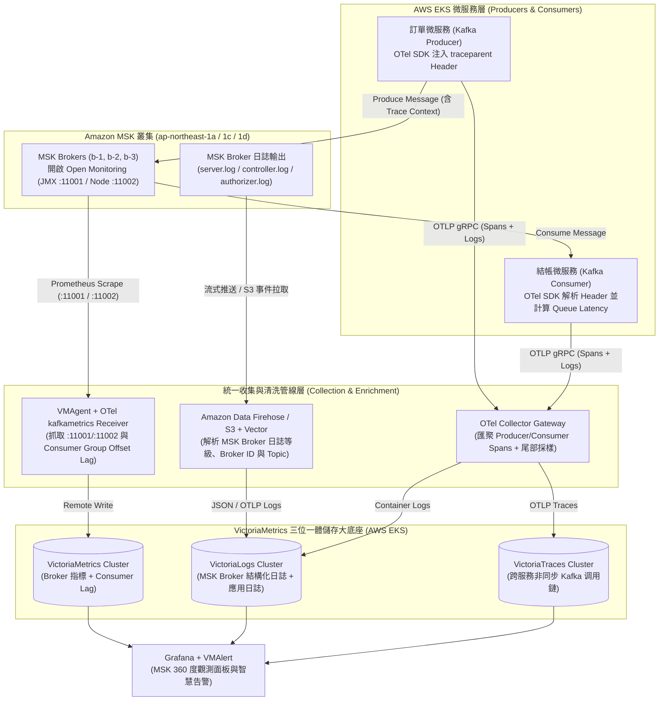
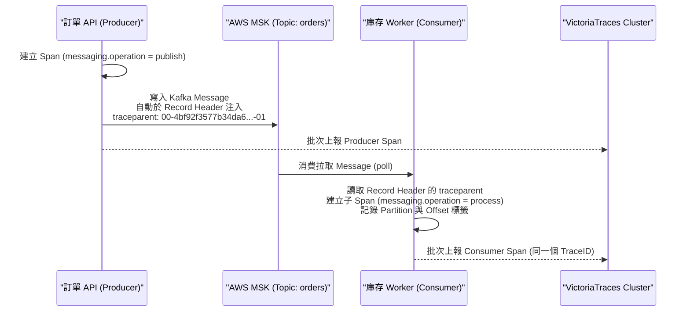
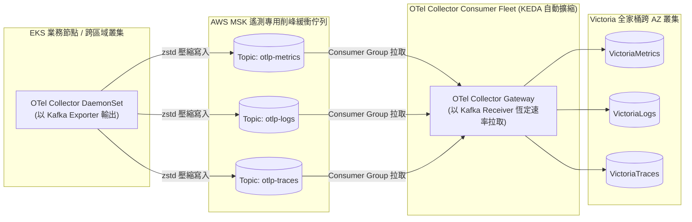

# 利用 VictoriaMetrics + VictoriaLogs + VictoriaTraces 收集與整理 AWS MSK 全棧實戰指南 :material-apache-kafka:

> **Amazon MSK (Managed Streaming for Apache Kafka)** 是 AWS 雲端架構中最核心的事件驅動中樞與高吞吐訊息佇列。然而在生產環境中，由於 AWS 託管了底層 Broker 節點，工程團隊常面臨三大盲區：**Broker 內部 JMX 效能與 Consumer Lag 難以統一告警**、**Broker 控制器與授權日誌分散於 CloudWatch / S3 檢索昂貴**，以及**非同步訊息（Producer ➔ MSK Topic ➔ Consumer）發生延遲或掉單時無法追蹤完整上下文鏈路**。本指南完整解析如何利用部署於 AWS EKS 的 [VictoriaMetrics](aws-eks-victoriametrics-stack-guide.md)、[VictoriaLogs](aws-eks-victorialogs-cluster-guide.md) 與 [VictoriaTraces](aws-eks-victoriatraces-cluster-guide.md) 三位一體底座，實現對 AWS MSK 的 **360 度深度收集整理**，並進一步示範如何將 AWS MSK 作為遙測管線的高可用削峰匯流排。

---

## 1. 為什麼用 Victoria 全家桶取代 CloudWatch 收集整理 AWS MSK

在預設配置下，若將 AWS MSK 的增強型監控（Enhanced Monitoring）與 Broker Logs 全數保留在 Amazon CloudWatch，當 Topic 與 Partition 數量擴展至數百個時，每月的自訂指標（Custom Metrics）與日誌攝取（Log Ingestion）費用極為驚人，且難以與 EKS 內的微服務鏈路進行關聯分析。

| 觀測維度 | AWS 原生預設方案 (CloudWatch + X-Ray) | Victoria 全家桶方案 (VM + VLogs + VTraces) | 核心工程優勢 |
| :--- | :--- | :--- | :--- |
| **指標 (Metrics)** | CloudWatch Metrics (按每個 Topic/Partition 指標數量計費) | **MSK Open Monitoring (Prometheus JMX/Node) + `kminion` ➔ `VictoriaMetrics`** | 免除昂貴的 CloudWatch 自訂指標費，支援完整 PromQL / MetricsQL 計算精準 Consumer Group Lag |
| **日誌 (Logs)** | CloudWatch Logs Insights (按 GB 寫入與掃描量計費) | **MSK Firehose / S3 ➔ Vector / OTel Collector ➔ `VictoriaLogs`** | 15x~30x 超高壓縮比，透過 `LogsQL` 秒級檢索 `server.log`、`controller.log` 與 `kafka-authorizer.log` |
| **鏈路 (Traces)** | AWS X-Ray (對 Kafka Header 傳遞與尾部採樣支援受限) | **OTel SDK (`traceparent` Header) ➔ OTel Gateway ➔ `VictoriaTraces`** | 完整呈現 `Producer Send ➔ MSK Partition 排隊耗時 ➔ Consumer Process` 的端到端火焰圖 |
| **跨維度關聯** | 需在不同 AWS Console 頁面手動比對時間戳 | **Grafana 單一畫布三維聯動 (Metrics ➔ Logs ➔ Traces)** | 從 Consumer Lag 飆高告警一鍵下鑽至慢消費 Trace 與對應 Broker 異常日誌 |

---

## 2. 全景架構圖：AWS MSK 三位一體收集與整理管線

以下架構展示在 AWS 同一區域（如東京 `ap-northeast-1`）中，如何從 **AWS MSK 叢集** 與 **EKS 生產/消費微服務** 收集指標、日誌與鏈路，並收斂至 Victoria 全家桶：



---

## 3. 第一支柱：利用 `VictoriaMetrics` 收集整理 MSK 指標与 Consumer Lag

收集 AWS MSK 指標必須雙管齊下：**「Broker 伺服器與 JMX 內部指標」** + **「業務最關心的 Consumer Group Offset Lag（消費延遲指標）」**。

### 3.1 啟用 MSK Open Monitoring 並由 `VMAgent` 自動抓取

1. **於 AWS MSK 啟用 Open Monitoring**：
   在建立或修改 MSK 叢集時，啟用 **Open monitoring with Prometheus**（AWS 會在每台 Broker 自動啟動 `JMX Exporter` 於埠 **`11001`**，以及 `Node Exporter` 於埠 **`11002`**）。
2. **確認 EKS 到 MSK 的 Security Group 放行**：
   在 MSK 的 Security Group 入站規則中，允許來自 EKS 節點 Security Group 的 TCP `11001`、`11002`（以及 Kafka 通訊埠 `9092`/`9094`/`9098`）。
3. **配置 `VMStaticScrape` 抓取 MSK Brokers**：

```yaml
# 01-msk-broker-scrape.yaml
apiVersion: operator.victoriametrics.com/v1beta1
kind: VMStaticScrape
metadata:
  name: aws-msk-production-brokers
  namespace: monitoring
spec:
  jobName: "aws-msk-brokers"
  targetEndpoints:
    # 1. 抓取 MSK Broker JMX 指標 (Throughput, UnderReplicatedPartitions, Controller, JVM)
    - targets:
        - "b-1.prod-msk.xxxxxx.c2.kafka.ap-northeast-1.amazonaws.com:11001"
        - "b-2.prod-msk.xxxxxx.c2.kafka.ap-northeast-1.amazonaws.com:11001"
        - "b-3.prod-msk.xxxxxx.c2.kafka.ap-northeast-1.amazonaws.com:11001"
      interval: "30s"
      scrapeTimeout: "25s"
      labels:
        msk_cluster: "prod-msk-tokyo"
        exporter_type: "jmx"
      relabelConfigs:
        # 自動從目標域名擷取 Broker ID (如 b-1, b-2, b-3) 作為標籤
        - sourceLabels: [__address__]
          regex: "(b-[0-9]+)\\..*"
          targetLabel: broker_id
          replacement: "$1"

    # 2. 抓取 MSK Broker 主機層 Node Exporter 指標 (CPU, Memory, EBS Disk IO & Space)
    - targets:
        - "b-1.prod-msk.xxxxxx.c2.kafka.ap-northeast-1.amazonaws.com:11002"
        - "b-2.prod-msk.xxxxxx.c2.kafka.ap-northeast-1.amazonaws.com:11002"
        - "b-3.prod-msk.xxxxxx.c2.kafka.ap-northeast-1.amazonaws.com:11002"
      interval: "30s"
      labels:
        msk_cluster: "prod-msk-tokyo"
        exporter_type: "node"
      relabelConfigs:
        - sourceLabels: [__address__]
          regex: "(b-[0-9]+)\\..*"
          targetLabel: broker_id
          replacement: "$1"
```

### 3.2 利用 OTel Collector `kafkametrics` 收集精準 Consumer Group Lag

僅靠 JMX 指標難以直觀取得所有 Consumer Group 在每個 Partition 的即時積壓筆數（Lag）。我們在 [OpenTelemetry Collector](otel-victoriametrics-fullstack-guide.md) 啟用官方 `kafkametrics` Receiver，直接向 MSK 查詢 Topic Offset 與 Consumer Group Committed Offset 並寫入 `VictoriaMetrics`：

```yaml
# 02-otel-msk-kafkametrics.yaml
receivers:
  kafkametrics:
    brokers:
      - "b-1.prod-msk.xxxxxx.c2.kafka.ap-northeast-1.amazonaws.com:9094"
      - "b-2.prod-msk.xxxxxx.c2.kafka.ap-northeast-1.amazonaws.com:9094"
      - "b-3.prod-msk.xxxxxx.c2.kafka.ap-northeast-1.amazonaws.com:9094"
    protocol_version: 3.5.0
    scrapers:
      - brokers
      - topics
      - consumers
    collection_interval: 15s
    auth:
      tls:
        insecure: false

exporters:
  prometheusremotewrite:
    endpoint: "http://vminsert-vm-tokyo-aza.monitoring.svc.cluster.local:8480/insert/0/prometheus/api/v1/write"
```

### 3.3 關鍵 MSK 生產告警規則 (`VMRule`)

將整理好的 MSK 指標轉化為自動化黃金告警（可對接 `VMAlertmanager` 與 [Pushover 行動推播](pushover-guide.md)）：

```yaml
# 03-msk-alert-rules.yaml
apiVersion: operator.victoriametrics.com/v1beta1
kind: VMRule
metadata:
  name: aws-msk-critical-alerts
  namespace: monitoring
spec:
  groups:
    - name: aws-msk.rules
      interval: 30s
      rules:
        # 1. 離線分區告警 (最嚴重：代表部分 Partition 無可用 Leader，讀寫中斷)
        - alert: MSKOfflinePartitionsDetected
          expr: sum by (msk_cluster) (kafka_controller_KafkaController_Value{name="OfflinePartitionsCount"}) > 0
          for: 1m
          labels:
            severity: critical
          annotations:
            summary: "AWS MSK 叢集 ({{ $labels.msk_cluster }}) 出現離線分區！"
            description: "目前有 {{ $value }} 個 Partition 無可用 Leader，請立即檢查對應 Broker 日誌。"

        # 2. 副本未同步告警 (代表 ISR 縮小，資料複寫安全降級)
        - alert: MSKUnderReplicatedPartitions
          expr: sum by (msk_cluster, broker_id) (kafka_server_ReplicaManager_Value{name="UnderReplicatedPartitions"}) > 0
          for: 3m
          labels:
            severity: warning
          annotations:
            summary: "MSK Broker ({{ $labels.broker_id }}) 出現未同步副本 (Under-Replicated)"
            description: "Broker {{ $labels.broker_id }} 有 {{ $value }} 個分區落後於 Leader。"

        # 3. Broker 磁碟空間不足告警 (超過 80%)
        - alert: MSKBrokerDiskSpaceHigh
          expr: (1 - (node_filesystem_avail_bytes{msk_cluster!="", mountpoint="/kafka"} / node_filesystem_size_bytes{msk_cluster!="", mountpoint="/kafka"})) * 100 > 80
          for: 5m
          labels:
            severity: warning
          annotations:
            summary: "MSK Broker ({{ $labels.broker_id }}) 磁碟使用率超過 80%"

        # 4. Consumer Group 消費積壓告警 (Lag 持續增長)
        - alert: MSKConsumerGroupLagHigh
          expr: sum by (group, topic) (kafka_consumer_group_lag) > 10000
          for: 5m
          labels:
            severity: warning
          annotations:
            summary: "Kafka 消費群組 ({{ $labels.group }}) 在 Topic ({{ $labels.topic }}) 積壓超過 1 萬筆"
```

---

## 4. 第二支柱：利用 `VictoriaLogs` 收集整理與結構化解析 MSK Broker 日誌

AWS MSK 產生的 Broker 日誌（包含 `server.log`、`kafka-request.log`、`controller.log`、`state-change.log` 與 `kafka-authorizer.log`）預設為非結構化的 Java Log4j 文字格式。透過 **Amazon S3 / Firehose + Vector** 管線進行正規表達式結構化拆解後匯入 `VictoriaLogs`，可發揮最大的檢索效能。

### 4.1 配置 Vector 收集解析 MSK 日誌並寫入 `VictoriaLogs`

在 AWS MSK 啟用 **Broker log delivery to Amazon S3**（並開啟 S3 Event Notification 推播至 SQS），在 EKS 內部部署輕量級 `Vector` 自動拉取、解析出 `log_level`、`broker_id`、`logger` 與 `topic`，再透過 Elasticsearch Bulk / Native 端點寫入 `VictoriaLogs`：

```yaml
# 04-vector-msk-logs-to-victorialogs.yaml
sources:
  aws_msk_s3_logs:
    type: aws_s3
    region: ap-northeast-1
    sqs:
      queue_url: "https://sqs.ap-northeast-1.amazonaws.com/123456789012/msk-broker-logs-sqs"
    compression: gzip

transforms:
  parse_msk_log4j:
    type: remap
    inputs:
      - aws_msk_s3_logs
    source: |
      # 範例原始日誌: [2026-11-02 09:15:22,410] WARN [ReplicaFetcher replicaId=2, leaderId=1, fetcherId=0] Partition [orders-events,3] reset offset (kafka.server.ReplicaFetcherThread)
      parsed, err = parse_regex(
        string!(.message),
        r'^\[(?P<timestamp>\d{4}-\d{2}-\d{2} \d{2}:\d{2}:\d{2},\d{3})\]\s+(?P<level>[A-Z]+)\s+(?P<msg>.*)\s+\((?P<logger>[^\)]+)\)$'
      )
      if err == null {
        .level = parsed.level
        .logger = parsed.logger
        ._msg = parsed.msg
      } else {
        ._msg = string!(.message)
      }
      .service = "aws-msk"
      .msk_cluster = "prod-msk-tokyo"

sinks:
  victorialogs_cluster:
    type: elasticsearch
    inputs:
      - parse_msk_log4j
    endpoints:
      - "http://vlinsert-vl-tokyo-aza.logging.svc.cluster.local:9481/insert/elasticsearch/"
      - "http://vlinsert-vl-tokyo-azc.logging.svc.cluster.local:9481/insert/elasticsearch/"
    api_version: "v8"
    compression: gzip
    healthcheck:
      enabled: false
    query:
      _msg_field: "_msg"
      _time_field: "timestamp"
      _stream_fields: "service,msk_cluster,level"
```

### 4.2 常用 MSK 故障排查 `LogsQL` 查詢語法

日誌匯入 `VictoriaLogs` 後，在 Grafana 或 VMUI 中可使用極速 `LogsQL` 定位 MSK 疑難雜症：

```sql
-- 1. 查詢過去 1 小時內所有發生 ISR 震盪 (Shrinking / Expanding ISR) 的 Topic 與分區
{service="aws-msk", msk_cluster="prod-msk-tokyo"} "Shrinking ISR" OR "Expanding ISR"

-- 2. 查詢特定 Topic (如 orders-events) 的 Leader 選舉與分區狀態變更紀錄
{service="aws-msk"} "orders-events" AND ("LeaderAndIsr" OR "Offline" OR "NotLeaderOrFollowerException")

-- 3. 統計各個日誌類別 (logger) 的 ERROR / WARN 出現次數排行
{service="aws-msk", level=~"ERROR|WARN"} | stats by (logger, level) count() as err_count | sort by (err_count desc)
```

---

## 5. 第三支柱：利用 `VictoriaTraces` 串聯 Producer ➔ MSK ➔ Consumer 完整调用鏈

在微服務架構（如本知識庫的 [.NET 10 + OTel + VictoriaMetrics 實戰專案](otel-victoriametrics-dotnet-demo.md)）中，一旦請求進入 Kafka 非同步佇列，傳統的 HTTP Trace 往往會在此斷開。

### 5.1 跨 Kafka Header 的 W3C Trace Context 傳遞原理

透過 OpenTelemetry Kafka Instrumentation，可在不侵入業務邏輯的情況下自動完成上下文接力：



### 5.2 在 `VictoriaTraces` 攜帶的關鍵 Kafka 標準語意屬性 (Semantic Conventions)

當 Producer 與 Consumer 的 Spans 匯入 `VictoriaTraces` 後，每一筆 Span 皆包含以下標準欄位，可直接在 Grafana 篩選查詢：

| OTel 標準 Span 屬性名稱 | 範例值 | 在排障中的核心價值 |
| :--- | :--- | :--- |
| `messaging.system` | `kafka` | 識別所有經過 AWS MSK 的非同步調用鏈路 |
| `messaging.destination.name` | `orders.created.v1` | 精確鎖定特定 Topic 的上下游微服務依賴關係 |
| `messaging.kafka.destination.partition` | `3` | 當某個 Partition 發生熱點傾斜（Hot Partition）時，直接定位受影響的消費者實例 |
| `messaging.kafka.message.offset` | `9482015` | 精準對應訊息在 MSK 分區中的絕對位置，方便重播（Replay）或核對資料 |
| `messaging.kafka.consumer.group` | `inventory-worker-group` | 區分同一個 Topic 下不同訂閱服務的消費耗時差異 |

---

## 6. 進階架構：將 AWS MSK 作為 Victoria 全家桶的高吞吐遙測削峰緩衝層

除了「監控 AWS MSK 本身」之外，在每日產生數十 TB 日誌與鏈路的大型企業環境中，**AWS MSK 本身更是保護後端 `VictoriaMetrics`、`VictoriaLogs` 與 `VictoriaTraces` 不被突發流量打垮的最佳削峰緩衝佇列（Telemetry Buffer Backbone）**：



### OTel Collector 透過 AWS MSK 雙向收發配置範本

=== "前端 Agent：寫入 AWS MSK (`kafka` Exporter)"

    ```yaml
    exporters:
      kafka/telemetry_buffer:
        brokers:
          - "b-1.telemetry-msk.xxxxxx.c2.kafka.ap-northeast-1.amazonaws.com:9094"
          - "b-2.telemetry-msk.xxxxxx.c2.kafka.ap-northeast-1.amazonaws.com:9094"
          - "b-3.telemetry-msk.xxxxxx.c2.kafka.ap-northeast-1.amazonaws.com:9094"
        protocol_version: 3.5.0
        encoding: otlp_proto
        producer:
          compression: zstd
          max_message_bytes: 10000000
        # 依資料類型自動分流至對應 Topic
        logs:
          topic: "otlp-logs"
        metrics:
          topic: "otlp-metrics"
        traces:
          topic: "otlp-traces"
    ```

=== "後端 Gateway：從 AWS MSK 消費並寫入 Victoria 全家桶 (`kafka` Receiver)"

    ```yaml
    receivers:
      kafka/telemetry_buffer:
        brokers:
          - "b-1.telemetry-msk.xxxxxx.c2.kafka.ap-northeast-1.amazonaws.com:9094"
          - "b-2.telemetry-msk.xxxxxx.c2.kafka.ap-northeast-1.amazonaws.com:9094"
          - "b-3.telemetry-msk.xxxxxx.c2.kafka.ap-northeast-1.amazonaws.com:9094"
        protocol_version: 3.5.0
        group_id: "otel-victoria-ingester-group"
        encoding: otlp_proto
        logs:
          topic: "otlp-logs"
        metrics:
          topic: "otlp-metrics"
        traces:
          topic: "otlp-traces"

    service:
      pipelines:
        metrics:
          receivers: [kafka/telemetry_buffer]
          processors: [batch]
          exporters: [prometheusremotewrite/victoriametrics]
        logs:
          receivers: [kafka/telemetry_buffer]
          processors: [batch]
          exporters: [otlphttp/victorialogs]
        traces:
          receivers: [kafka/telemetry_buffer]
          processors: [tail_sampling, batch]
          exporters: [otlphttp/victoriatraces]
    ```

---

## 7. 踩坑指南與最佳實踐 (Best Practices & Gotchas)

### 7.1 控制 MSK Partition 級別指標的高基數問題

- **問題**：當 AWS MSK 擁有數千個 Partitions 時，`JMX Exporter (:11001)` 會暴露極大量 `kafka_log_Log_*` 與每個 Partition 細粒度的 Percentiles 指標，導致抓取超時（Scrape Timeout）。
- **最佳實踐**：
  1. 在 `VMStaticScrape` 將 `scrapeTimeout` 調高至 `25s`、`interval` 設為 `30s`。
  2. 利用 `metricRelabelConfigs` 過濾掉不需要的 DEBUG 級別 JMX 指標（如丟棄無流量的內部 `__consumer_offsets` 分區細項），僅保留核心吞吐量、ISR 與延遲指標。

### 7.2 啟用 Rack Awareness (`client.rack`) 降低 AWS MSK 跨 AZ 流量費

- 在 AWS 東京區域（`ap-northeast-1a`、`1c`、`1d`）運行 EKS Consumer（包含業務 Consumer 與 OTel Collector Kafka Receiver）時，務必將 K8s 節點的 `topology.kubernetes.io/zone` 注入至 Kafka Consumer 的 **`client.rack`** 參數（例如設為 `apne1-az4` / `ap-northeast-1a`）。
- 如此一來，Kafka 2.4+ 的 **Follower Fetching（就近副本讀取）** 機制會讓 EKS Pod 直接從位於**同一個 AZ 的 MSK Broker 副本**拉取訊息，直接省下 **100% 的 Consumer 跨 AZ 讀取流量費用**！

### 7.3 延伸參考文檔

- [AWS EKS (Tokyo Region) 部署 VictoriaMetrics Stack 跨 AZ 高可用與資料複寫安全實戰指南](aws-eks-victoriametrics-stack-guide.md)
- [AWS EKS (Tokyo Region) 部署 VictoriaLogs Cluster 跨 AZ 高可用與資料複寫安全實戰指南](aws-eks-victorialogs-cluster-guide.md)
- [AWS EKS (Tokyo Region) 部署 VictoriaTraces Cluster 跨 AZ 高可用與資料複寫安全實戰指南](aws-eks-victoriatraces-cluster-guide.md)
- [OpenTelemetry + VictoriaMetrics 全家桶架構與落地實戰指南](otel-victoriametrics-fullstack-guide.md)
