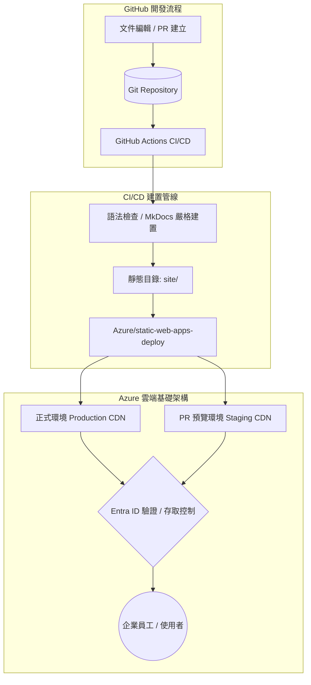

# Azure Static Web Apps 部署方案 :material-microsoft-azure:

> 將 Material for MkDocs 知識庫部署至微軟 Azure Static Web Apps (SWA)，實現全域邊緣 CDN 加速、PR 預覽環境、企業級 Microsoft Entra ID 身分驗證與彈性自訂路由。

---

## 1. 方案概述與架構優勢

雖然 GitHub Pages 適合公開的開源或個人專案，但在企業場景、內部知識庫或需要進階邊緣控制時，**Azure Static Web Apps (SWA)** 提供了顯著的架構優勢：

- **企業級身分驗證與存取控制**：內建整合 Microsoft Entra ID (Azure AD)、GitHub 等身份識別提供者，僅需數行設定檔即可將知識庫轉為內部私有站點。
- **全域 Anycast 邊緣 CDN**：靜態資產自動快取於微軟全球邊緣伺服器節點，提供極低延遲與高頻寬。
- **PR 預覽預發布環境 (Staging Environments)**：每次開立 Pull Request 時，系統會自動生成獨立的預覽網址（例如 `https://agreeable-sea-xxx-1.centralus.azurestaticapps.net`），方便團隊校閱內容，並於 PR 關閉時自動銷毀。
- **自訂網域與自動受控 SSL 憑證**：支援免費自動簽發與續期 TLS/SSL 憑證。
- **彈性路由與安全性標頭**：透過單一 `staticwebapp.config.json` 配置自訂標頭、重定向規則與自訂 404 頁面。

### 部署架構圖



---

## 2. 事前準備 (Prerequisites)

在開始部署前，請備妥以下資源：

1. **Azure 帳戶與訂用帳戶 (Subscription)**：免費層 (Free Tier) 已足夠支援大部分知識庫需求。
2. **GitHub 儲存庫**：包含 MkDocs 專案架構（`mkdocs.yml`、`docs/`、`requirements.txt`）。
3. **Azure CLI**（選用，便於快速以指令操作）：本地終端機可安裝 `az` 工具。

---

## 3. 建立 Azure Static Web App 資源

您可以透過 **Azure CLI** 或 **Azure Portal** 建立靜態 Web 應用程式。

### 方式 A：透過 Azure CLI 快速建立（推薦）

```bash
# 1. 登入 Azure 帳戶
az login

# 2. 建立資源群組 (若尚未建立)
az group create \
  --name rg-knowledge-base \
  --location eastasia

# 3. 建立 Azure Static Web App
az staticwebapp create \
  --name swa-windcold-kb \
  --resource-group rg-knowledge-base \
  --location eastasia \
  --sku Free

# 4. 取得部署 API 金鑰 (Deployment Token)
az staticwebapp secrets list \
  --name swa-windcold-kb \
  --resource-group rg-knowledge-base \
  --query "properties.apiKey" -o tsv
```

將取得的 API 金鑰儲存至 GitHub 儲存庫的 Secrets 中：
前往 GitHub 倉庫 ➔ **Settings** ➔ **Secrets and variables** ➔ **Actions** ➔ **New repository secret**：

- **Name**: `AZURE_STATIC_WEB_APPS_API_TOKEN`
- **Secret**: 貼上剛才取得的 API Key。

### 方式 B：透過 Azure Portal 介面建立

1. 登入 [Azure Portal](https://portal.azure.com/)。
2. 在頂端搜尋列輸入 **靜態 Web 應用程式** (Static Web Apps)，點選 **建立** (Create)。
3. 設定基本資料：
   - **訂用帳戶** 與 **資源群組**：選擇現有或新建。
   - **名稱**：例如 `swa-windcold-kb`。
   - **方案類型**：`Free`（個人與多數組織適用）或 `Standard`（需要自訂身分驗證提供者或企業 SLA）。
   - **區域**：選擇離使用者最近的區域（如 `East Asia`）。
   - **部署詳細資料**：可選擇直接連接 GitHub，或選擇「其他 (Other)」手動管理 GitHub Actions。
4. 點選 **檢閱 + 建立** 完成佈署。
5. 建立完成後，進入該資源頁面，點選頂部工具列的 **管理部署權杖 (Manage deployment token)**，複製字串備用。

---

## 4. 設定 GitHub Actions 自動化部署工作流程

在專案中建立 `.github/workflows/azure-static-web-apps.yml`：

```yaml
name: Deploy MkDocs to Azure Static Web Apps

on:
  push:
    branches:
      - main
  pull_request:
    types: [opened, synchronize, reopened, closed]
    branches:
      - main

permissions:
  contents: read
  pull-requests: write
  issues: write

concurrency:
  group: ${{ github.workflow }}-${{ github.ref }}
  cancel-in-progress: true

jobs:
  build_and_deploy_job:
    if: github.event_name == 'push' || (github.event_name == 'pull_request' && github.event.action != 'closed')
    runs-on: ubuntu-latest
    name: Build MkDocs and Deploy to Azure SWA
    steps:
      - name: 檢出儲存庫代碼 (完整歷史以支援 git 外掛)
        uses: actions/checkout@v7
        with:
          fetch-depth: 0
          ref: ${{ github.head_ref || github.ref }}

      - name: 設定 Python 環境
        uses: actions/setup-python@v7
        with:
          python-version: "3.11"
          cache: "pip"

      - name: 安裝相依套件
        run: pip install -r requirements.txt

      - name: 建置 MkDocs 靜態網站
        env:
          MKDOCS_GIT_COMMITTERS_APIKEY: ${{ secrets.GITHUB_TOKEN }}
          DISABLE_MKDOCS_2_WARNING: "true"
        run: mkdocs build --strict

      - name: 部署至 Azure Static Web Apps
        id: builddeploy
        uses: Azure/static-web-apps-deploy@v1
        with:
          azure_static_web_apps_api_token: ${{ secrets.AZURE_STATIC_WEB_APPS_API_TOKEN }}
          repo_token: ${{ secrets.GITHUB_TOKEN }}
          action: "upload"
          app_location: "/"               # 應用程式原始碼位置
          api_location: ""                # 無後端 Azure Function API 時保持為空
          output_location: "site"         # MkDocs 預設建置產出目錄
          skip_app_build: true            # 由前置步驟完成建置，略過 SWA 內建 Oryx 預設建置

  close_pull_request_job:
    if: github.event_name == 'pull_request' && github.event.action == 'closed'
    runs-on: ubuntu-latest
    name: Close Pull Request Preview Environment
    steps:
      - name: 關閉 Azure SWA PR 預覽環境
        uses: Azure/static-web-apps-deploy@v1
        with:
          azure_static_web_apps_api_token: ${{ secrets.AZURE_STATIC_WEB_APPS_API_TOKEN }}
          action: "close"
```

### 關鍵參數設定說明

| 參數 | 設定值 | 說明 |
| :--- | :--- | :--- |
| `skip_app_build` | `true` | **極重要**。因為 MkDocs 是以 Python 建置，設為 `true` 可避免 Azure 預設的 Oryx 建置引擎因判斷錯誤而失敗。 |
| `output_location` | `"site"` | 指定靜態檔案目錄。MkDocs 執行 `mkdocs build` 後的預設產出目錄即為 `./site`。 |
| `app_location` | `"/"` | 專案根目錄位置。 |
| `api_location` | `""` | 若無整合 Azure Functions，請留空字串。 |
| `fetch-depth: 0` | `0` | 若有使用 `git-revision-date`、`git-committers` 或 `git-latest-changes` 等外掛，必須完整抓取 Git 歷史紀錄。 |

---

## 5. 進階配置：`staticwebapp.config.json`

Azure Static Web Apps 透過 `staticwebapp.config.json` 設定路由、安全防護與身分驗證。

### 設定檔擺放方式

在 MkDocs 專案中，請將設定檔放置於 `docs/staticwebapp.config.json`，並在 `mkdocs.yml` 透過額外設定複製，或在建置指令後加入拷貝步驟：

```bash
# 建置完成後將設定檔拷貝至產出目錄
mkdocs build --strict && cp staticwebapp.config.json site/
```

### 設定檔內容範例

以下為針對技術知識庫推薦之設定範例：

```json
{
  "$schema": "https://json.schemastore.org/staticwebapp.config.json",
  "routes": [
    {
      "route": "/admin/*",
      "allowedRoles": ["administrator"]
    }
  ],
  "navigationFallback": {
    "rewrite": "/404.html",
    "exclude": ["/assets/*", "/*.{png,jpg,gif,svg,css,js,ico}"]
  },
  "responseOverrides": {
    "404": {
      "rewrite": "/404.html"
    }
  },
  "globalHeaders": {
    "Content-Security-Policy": "default-src 'self' https: 'unsafe-inline' 'unsafe-eval';",
    "X-Frame-Options": "DENY",
    "X-Content-Type-Options": "nosniff",
    "Referrer-Policy": "strict-origin-when-cross-origin",
    "Strict-Transport-Security": "max-age=31536000; includeSubDomains"
  },
  "mimeTypes": {
    ".json": "application/json",
    ".svg": "image/svg+xml"
  }
}
```

### 企業內部私有知識庫方案 (Microsoft Entra ID 整合)

若希望知識庫**僅限公司內部員工查閱**，只需在 `staticwebapp.config.json` 的 `routes` 加上以下規則：

```json
{
  "routes": [
    {
      "route": "/*",
      "allowedRoles": ["authenticated"]
    }
  ],
  "responseOverrides": {
    "401": {
      "redirect": "/.auth/login/aad",
      "statusCode": 302
    }
  }
}
```

> [!TIP]
> 任何未登入訪客存取任何頁面時，將會被自動導向至微軟企業登入頁面（`/.auth/login/aad`），登入成功後才會回到原閱讀頁面。

---

## 6. 方案評估：Azure SWA 與 GitHub Pages 差異比較

| 評估維度 | GitHub Pages | Azure Static Web Apps (SWA) |
| :--- | :--- | :--- |
| **費用方案** | 公開儲存庫免費；私有庫需 GitHub Pro / Team | Free 方案每月 100 GB 頻寬，自訂網域免費 |
| **私有存取保護** | 僅支援 GitHub Enterprise 組織限定發布 | 內建支援 Microsoft Entra ID、GitHub 等企業 SSO 整合 |
| **PR 預發布預覽** | 需額外自行建置或第三方工具 | **原生支援**，開立 PR 自動產生獨立預覽環境與網址 |
| **CDN 與效能** | Fastly 支援之全球 CDN | 微軟全球 Anycast 邊緣骨幹網路 |
| **路由與標頭自訂** | 功能較基本，無法客製化 HTTP Headers | 完整支援 `staticwebapp.config.json` 設定安全標頭與重導向 |
| **伺服器端 API 擴展** | 不支援（僅純靜態） | 可隨時無縫整合 Azure Functions (Python / Node / C#) |

> [!TIP]
> 若您希望結合 Cloudflare 的全球邊緣安全防護與無限制頻寬，並使用相同的 Microsoft 365 Entra ID 進行單一登入，亦可參考 [Cloudflare Pages + Access (Entra ID) 部署方案](cloudflare-pages-entra-id.md)。

---

## 7. 常見問題與除錯要點 (Troubleshooting)

### Q1: 部署 Action 執行失敗，提示找不到 Python 或建置錯誤？

**原因**：Azure 的 `static-web-apps-deploy` 預設會使用 Oryx 嘗試識別並建置前端專案（例如 React、Vue）。
**解法**：在 GitHub Actions 中務必加入 `skip_app_build: true`，並在 Action 前方自行執行 `mkdocs build`。

### Q2: 重新整理子頁面時出現 404 Not Found？

**原因**：MkDocs 預設採用目錄型網址結構（例如 `/getting-started/configuration/`）。
**解法**：在 `staticwebapp.config.json` 中配置 `navigationFallback`，或確認 MkDocs 的 `use_directory_urls` 設定符合需求。

### Q3: Git 外掛（作者頭像、最近修改日期）未正常顯示？

**原因**：CI 環境中若執行預設的 `actions/checkout`，通常只會拉取最新 1 筆 commit（Shallow Clone）。
**解法**：在 `actions/checkout` 步驟務必明確指定 `fetch-depth: 0`。
