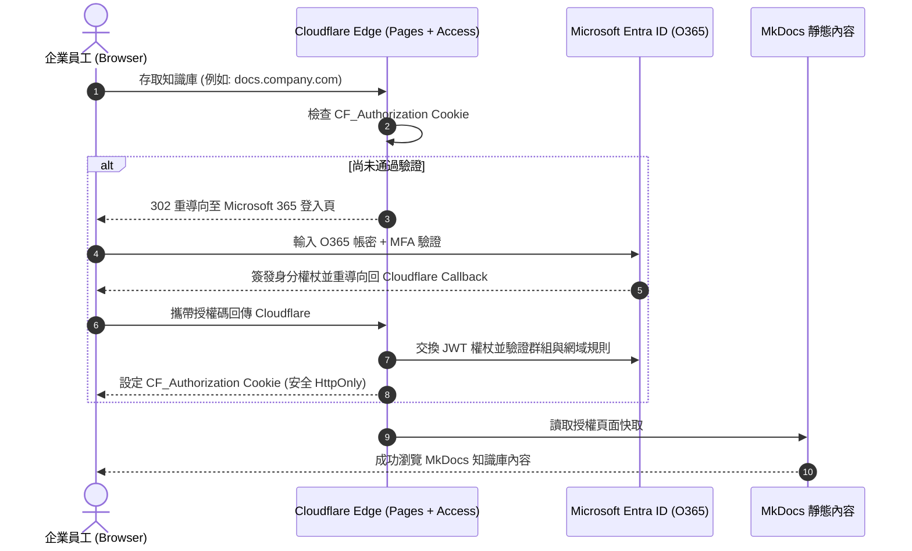

# Cloudflare Pages + Access (綁定 O365 Entra ID) 部署方案 :material-cloud-lock:

> 運用 **Cloudflare Pages** 的全球高速邊緣 CDN 託管 Material for MkDocs，並透過 **Cloudflare Zero Trust Access** 與 **Microsoft 365 / Microsoft Entra ID (Azure AD)** 單一登入 (SSO) 整合，打造無須架設 VPN 的企業級零信任內部私有知識庫。

---

## 1. 方案架構與核心優勢

傳統企業內部文件庫往往依賴內部伺服器搭配公司 VPN 存取，常面臨連線延遲高、維護負擔重與行動裝置體驗不佳等痛點。本方案採用 **Cloudflare 邊緣零信任 (Edge-based Zero Trust)** 架構：

- **零信任安全邊緣防護 (Zero Trust Network Access, ZTNA)**：所有對知識庫的 HTTP 請求在抵達靜態檔案前，直接在 Cloudflare 全球 300+ 邊緣節點進行身分攔截與驗證，未授權者無法接觸站點內容。
- **無縫整合 Microsoft 365 (Entra ID)**：員工直接使用現有的公司 O365 帳號、企業多因素驗證 (MFA) 與安全性群組 (Security Groups) 登入。
- **全球邊緣極速體驗**：Cloudflare Pages 提供無上限頻寬與極低延遲，靜態資源秒開。
- **慷慨的免費方案 (Free Tier)**：
  - **Cloudflare Pages**：免費版提供無限制頻寬與請求數。
  - **Cloudflare Zero Trust**：提供高達 **50 個免費使用者名額**，非常適合中小企業或團隊內部技術庫。
- **自動化 PR 預覽環境**：每次送出 Pull Request 時自動產生獨立預覽環境，且同樣能套用 Access 防護規則。

### 驗證與存取流程架構圖



---

## 2. 事前準備 (Prerequisites)

在配置前，請備妥以下管理權限與資源：

1. **Cloudflare 帳戶**：已將自訂網域託管於 Cloudflare（若使用預設 `*.pages.dev` 亦可，但自訂網域可獲得最完整的 Access 政策控制）。
2. **Microsoft 365 / Microsoft Entra ID 管理員權限**：具備在 Entra ID 系統管理中心建立「應用程式註冊 (App Registration)」之權限。
3. **GitHub 儲存庫**：包含 MkDocs 專案原始碼（`mkdocs.yml`、`docs/`、`requirements.txt`）。

---

## 3. 步驟一：在 Microsoft Entra ID 註冊應用程式

首先需在微軟雲端建立應用程式，供 Cloudflare Access 進行 OpenID Connect (OIDC) 驗證。

### 1. 建立應用程式註冊

1. 登入 [Microsoft Entra 系統管理中心](https://entra.microsoft.com/)（或 Azure Portal ➔ Microsoft Entra ID）。
2. 前往 **身分識別 (Identity)** ➔ **應用程式 (Applications)** ➔ **應用程式註冊 (App registrations)**。
3. 點選 **+ 新增註冊 (New registration)**：
    - **名稱**：輸入易辨識的名稱，例如 `Cloudflare Access - Tech Docs`。
    - **支援的帳戶類型**：選擇「僅此組織目錄中的帳戶 (僅限單一租用戶 Single tenant)」。
    - **重新導向 URI (Redirect URI)**：
        - 平台選擇 **Web**。
        - URI 填入：`https://<your-team-name>.cloudflareaccess.com/cdn-cgi/access/callback`
        - *(註：`<your-team-name>` 為您在 Cloudflare Zero Trust 設定的團隊網域名稱)*。
4. 點選 **註冊 (Register)**。

### 2. 記錄重要參數

在註冊完成的「概觀 (Overview)」頁面，記錄以下資訊：

- **應用程式 (用戶端) 識別碼 (Application / Client ID)**
- **目錄 (租用戶) 識別碼 (Directory / Tenant ID)**

### 3. 產生用戶端密碼 (Client Secret)

1. 在左側選單進入 **憑證與密碼 (Certificates & secrets)** ➔ **用戶端密碼 (Client secrets)** 標籤頁。
2. 點選 **+ 新增用戶端密碼 (New client secret)**。
3. 設定說明與有效期限（例如 180 天或 24 個月），點選 **新增**。
4. **立即複製「值 (Value)」**（離開頁面後將無法再次查看）。

### 4. 設定 API 權限 (API Permissions)

1. 前往 **API 權限 (API permissions)**，確認已預設具備 Microsoft Graph 的 `User.Read` (Delegated)。
2. 若需要依據 Entra ID 安全性群組 (Security Groups) 進行存取授權：
    - 點選 **權杖設定 (Token configuration)** ➔ **+ 新增群組宣告 (Add groups claim)**。
    - 勾選 **安全性群組 (Security groups)**，確定新增。

---

## 4. 步驟二：在 Cloudflare Zero Trust 配置身分識別提供者 (IdP)

將微軟 Entra ID 綁定為 Cloudflare Access 的登入驗證源。

1. 登入 [Cloudflare One / Zero Trust 控制台](https://one.dash.cloudflare.com/)。
2. 進入 **Settings (設定)** ➔ **Authentication (驗證)**。
3. 在 **Login methods (登入方式)** 區塊點選 **Add new (新增)**。
4. 選擇 **Azure AD / Microsoft Entra ID**：
    - **Name**：自訂名稱（例如 `Microsoft 365 Entra ID`）。
    - **Application ID**：貼上步驟一記錄的 `Client ID`。
    - **Application secret**：貼上步驟一記錄的 `Client Secret`。
    - **Directory (Tenant) ID**：貼上步驟一記錄的 `Tenant ID`。
    - **Support groups**：若需要依群組篩選權限，請切換為開啟。
5. 點選 **Save (儲存)**。
6. 儲存後可點擊該登入方式旁的 **Test (測試)** 按鈕，會彈出微軟登入視窗，確認能成功授權並抓取到使用者身分與群組資訊。

---

## 5. 步驟三：部署 MkDocs 至 Cloudflare Pages

可以選擇透過 **GitHub Actions 自動化發布** 或 **Cloudflare Pages 內建 Git 整合** 進行建置。

### 推薦做法：使用 GitHub Actions 發布

此方式可沿用既有的語法檢查與嚴格建置規範，並將建置完成的 `site/` 目錄直接推送至 Cloudflare Pages。

建立 `.github/workflows/deploy-cloudflare-pages.yml`：

```yaml
name: Deploy MkDocs to Cloudflare Pages

on:
  push:
    branches:
      - main
  pull_request:
    branches:
      - main

permissions:
  contents: read
  deployments: write

concurrency:
  group: ${{ github.workflow }}-${{ github.ref }}
  cancel-in-progress: true

jobs:
  build-and-deploy:
    runs-on: ubuntu-latest
    name: Build & Deploy to Cloudflare Pages
    steps:
      - name: 檢出儲存庫代碼 (完整歷史以支援 git 外掛)
        uses: actions/checkout@v7
        with:
          fetch-depth: 0
          ref: ${{ github.head_ref || github.ref }}

      - name: 設定 Python 環境
        uses: actions/setup-python@v7
        with:
          python-version: "3.11"
          cache: "pip"

      - name: 安裝相依套件
        run: pip install -r requirements.txt

      - name: 建置 MkDocs 靜態網站 (嚴格模式)
        env:
          MKDOCS_GIT_COMMITTERS_APIKEY: ${{ secrets.GITHUB_TOKEN }}
          DISABLE_MKDOCS_2_WARNING: "true"
        run: mkdocs build --strict

      - name: 發布至 Cloudflare Pages
        uses: cloudflare/wrangler-action@v3
        with:
          apiToken: ${{ secrets.CLOUDFLARE_API_TOKEN }}
          accountId: ${{ secrets.CLOUDFLARE_ACCOUNT_ID }}
          command: pages deploy site --project-name=windcold-kb
```

> [!NOTE]
> 需在 GitHub 儲存庫 Secrets 中配置：
>
> - `CLOUDFLARE_API_TOKEN`：具備 `Cloudflare Pages: Edit` 權限之 API Token。
> - `CLOUDFLARE_ACCOUNT_ID`：Cloudflare 儀表板中的帳戶 ID。

---

## 6. 步驟四：在 Cloudflare Access 建立存取防護政策

在專案部署上線後，需套用 Access Application 政策，限制未經授權之訪客。

### 1. 建立 Access Application

1. 在 Cloudflare Zero Trust 控制台，點選 **Access (存取)** ➔ **Applications (應用程式)**。
2. 點選 **Add an application (新增應用程式)** ➔ 選擇 **Self-hosted (自託管)**。
3. 設定基本設定：
    - **Application name**：例如 `內部技術知識庫`。
    - **Session Duration**：憑證有效期間（例如 `24 小時` 或 `1 個月`）。
    - **Application domain**：
        - 填入綁定之自訂子網域（例如 `docs.yourcompany.com`）或 Pages 預設網域名稱。
4. 在 **Identity providers** 區塊：
    - 勾選剛才建立的 **Microsoft 365 Entra ID**。
    - （選用）取消勾選 One-time PIN，以強制全員必須使用 O365 登入。

### 2. 配置存取規則 (Access Policies)

點選 **Next** 進入政策制定頁面：

- **Policy name**：例如 `僅限全體正職員工`。
- **Action**：選擇 **Allow (允許)**。
- **Configure rules (設定規則)**：
  - **方式一（依 Email 網域）**：
    - Selector 選擇 `Emails ending in` ➔ 填入公司企業網域 `@yourcompany.com`。
  - **方式二（依 Entra ID 安全性群組）**：
    - Selector 選擇 `Azure Group` / `SAML Group` ➔ 填入 Entra ID 中對應群組之 Object ID（如研發部門、架構小組）。
- 點選 **Save** 完成防護設定。

---

## 7. 最佳實踐與安全性強化

### A. 關閉或限制 `*.pages.dev` 原始網域存取

Cloudflare Pages 在建立時會預設附帶一個 `project.pages.dev` 網址。為防止外部人員繞過自訂網域的 Access 防護：

1. **做法一（最推薦）**：將 Access Application 的 Application Domain 同時涵蓋 `*.pages.dev` 網址。
2. **做法二**：在 Cloudflare Pages 專案設定中的 **Custom Domains** 啟用 Access 保護，並在 Access 政策中將預設網域納入防護清單。

### B. HTTP 安全標頭設定 (`_headers`)

可在 MkDocs 的 `docs/` 或根目錄建立 `_headers` 檔案，MkDocs 建置後複製到 `site/_headers`，Cloudflare Pages 會自動解析並注入安全回應標頭：

```text
/*
  X-Frame-Options: DENY
  X-Content-Type-Options: nosniff
  Referrer-Policy: strict-origin-when-cross-origin
  Permissions-Policy: document-domain=()
```

### C. 取得當前已登入使用者資訊（選用）

當使用者通過 Cloudflare Access 驗證後，Cloudflare 會在轉發的請求中注入 JWT Header：

- `Cf-Access-Authenticated-User-Email`：登入者的 Email。
- `Cf-Access-Jwt-Assertion`：可供客戶端 JavaScript 或 Worker 驗證的完整加密 JWT。

---

## 8. 常見問題與除錯要點 (Troubleshooting)

### Q1: 微軟登入時出現 `AADSTS50011: The reply URL specified in the request does not match`？

**原因**：Entra ID 應用程式註冊中的重新導向 URI (Redirect URI) 與 Cloudflare 送出的回呼網址不一致。
**解法**：檢查 Entra ID 的「驗證 (Authentication)」設定，Redirect URI 格式必須完全符合：
`https://<your-team-name>.cloudflareaccess.com/cdn-cgi/access/callback`（注意末尾無多餘斜線，協定為 `https`）。

### Q2: 員工登入成功，但出現 Cloudflare Access 403 Forbidden？

**原因**：該員工帳號不符合 Access Policy 的規則（例如群組未匹配，或 Email 網域不相符）。
**解法**：在 Cloudflare Zero Trust 儀表板檢視 **Logs** ➔ **Access**，查看該筆連線的評估記錄 (Audit Logs)，確認其攜帶的 Email 與 Groups 宣告是否符合 Policy 條件。

### Q3: 本地執行 `mkdocs serve` 時是否需要登入？

**原因**：不需要。Cloudflare Access 運作於 Cloudflare 的雲端邊緣伺服器上，本地開發與預覽完全不受影響。
