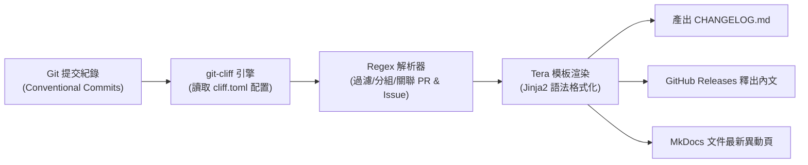
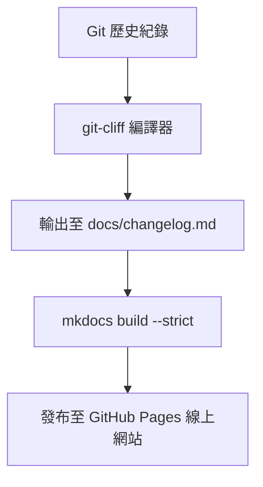

# git-cliff 自動化變更日誌 (Changelog) 實戰指南 :material-history:

> 在軟體工程與 DevOps 發布流程中，維護一份詳盡、清晰且符合語意化版本（Semantic Versioning）的**變更日誌（Changelog / Release Notes）**，是團隊對外溝通技術進展、對內稽核發布範圍的核心基石。然而，人工手動比對 Git 提交記錄不僅耗時繁瑣，更極易遺漏重要修復與 PR 連結。**git-cliff** 是一款以 Rust 打造、極速且高度自訂化的開源 Changelog 自動生成工具。它能深度解析 **Conventional Commits（約定式提交）**，透過強大的 **Tera 模板引擎** 渲染出結構優美、自動關聯 PR/Issue 的變更日誌。

---

## 1. 為什麼選擇 git-cliff？

### 1.1 傳統手動維護 vs git-cliff 自動化

| 評比維度 | 傳統人工手動編寫 | 傳統腳本工具 (如 standard-version) | git-cliff (本指南推薦) |
| :--- | :--- | :--- | :--- |
| **執行效能** | 人工翻查 Git Log，耗時數十分鐘 | 基於 Node.js，大型專案執行緩慢 | **Rust 原生二進位**，數千個 Commit 秒級渲染 |
| **格式彈性** | 格式常隨不同維護者而紊亂 | 模板固定，難以深度自訂分組與樣式 | **內建 Tera 模板引擎**，支援自由分組與條件判斷 |
| **Commit 解析** | 依賴人工肉眼篩選 | 僅支援標準 Angular 規範 | 支援自訂 **Regex 正則匹配、替換與過濾** |
| **版本推算** | 人工估計版本號 | 支援 semver 自動遞增 | 原生支援 **`--bump` 自動推算下一個版本** |
| **外部生態整合** | 手動複製貼上 GitHub Release | 依賴 npm 生態系與龐大 node_modules | 提供官方 **GitHub Actions** 與 Docker 映像檔 |

### 1.2 git-cliff 自動化運作流程



---

## 2. 安裝與環境準備

`git-cliff` 為單一獨立二進位檔案，無任何外部語言執行環境依賴（免安裝 Node.js 或 Python）。

### 2.1 各作業系統安裝方式

**macOS (Homebrew)**：

```bash
brew install git-cliff
```

**Linux (預先編譯二進位檔 / Shell 腳本)**：

```bash
curl --proto '=https' --tlsv1.2 -sSf https://raw.githubusercontent.com/orhun/git-cliff/main/install.sh | sh
```

**Rust / Cargo**：

```bash
cargo install git-cliff
```

**Docker 容器映像檔**：

```bash
docker run --rm -v "$(pwd):/repo" ghcr.io/orhun/git-cliff/git-cliff:latest
```

安裝完成後，執行驗證：

```bash
git-cliff --version
# 輸出: git-cliff 2.14.x
```

---

## 3. 設定檔 `cliff.toml` 深度解構與最佳配置

`git-cliff` 預設會在儲存庫根目錄尋找 `cliff.toml`（亦可透過 `git-cliff --init` 初始化預設設定檔）。

以下為適用於企業級專案與 GitHub 儲存庫的標準 `cliff.toml` 範本：

```toml
# ==============================================================================
# git-cliff 企業級標準設定檔 (cliff.toml)
# ==============================================================================

[changelog]
# 文件開頭標題樣板
header = """
# 變更日誌 (Changelog)

本專案所有顯著變更均記錄於此文件。格式遵循 [Keep a Changelog](https://keepachangelog.com/zh-TW/1.0.0/)，
並嚴格遵循 [語意化版本 2.0.0 (Semantic Versioning)](https://semver.org/lang/zh-TW/) 規範。\n
"""

# 每一個版本區塊的 Tera 模板
body = """
\
    ## [{{ version | trim_start_matches(pat="v") }}] - {{ timestamp | date(format="%Y-%m-%d") }}
\
    ## [Unreleased] (即將發布)
\

    ### {{ group | upper_first }}
    
        - *({{ commit.scope }})* \
          {{ commit.message | upper_first }}\
           ([#{{ commit.remote.pr_number }}](https://github.com/{{ remote.github.owner }}/{{ remote.github.repo }}/pull/{{ commit.remote.pr_number }}))\
           by @{{ commit.github.username }}\
    

"""

# 文件結尾註腳
footer = """
<!-- 由 git-cliff 自動產生 -->
"""
trim = true

[git]
# 啟用 Conventional Commits 語意化解析
conventional_commits = true
# 是否過濾不符合規範的 commit (false 表示保留於 Miscellaneous)
filter_unconventional = false
# 分割多行提交訊息
split_commits = false

# 提交訊息預處理器 (利用正規表達式將 Issue/PR 轉為 Markdown 超連結)
commit_preprocessors = [
    { pattern = '\(#([0-9]+)\)', replace = "([#${1}](https://github.com/windcoldchen/windcold-kb/pull/${1}))" },
]

# 提交訊息分組與過濾規則 (commit_parsers)
commit_parsers = [
    { message = "^feat", group = "🚀 Features (新功能)" },
    { message = "^fix", group = "🐛 Bug Fixes (錯誤修復)" },
    { message = "^doc", group = "📚 Documentation (文件修訂)" },
    { message = "^perf", group = "⚡ Performance (效能調優)" },
    { message = "^refactor", group = "🚜 Refactor (代碼重構)" },
    { message = "^style", group = "🎨 Styling (代碼樣式)" },
    { message = "^test", group = "🧪 Testing (測試用例)" },
    { message = "^chore\\(release\\)", skip = true },
    { message = "^chore\\(deps\\)", group = "📦 Dependencies (依賴升級)" },
    { message = "^chore", group = "⚙️ Miscellaneous Chores (雜項維護)" },
    { message = "^ci", group = "🛠️ CI/CD (持續整合與發布)" },
    { body = ".*security", group = "🛡️ Security (安全性修補)" },
]

# 保護包含破壞性改動的 Commit
protect_breaking_commits = false
# 忽略的 Commit (不列入日誌)
filter_commits = false

# Git Tag 匹配規則 (例如 v1.0.0, v2.1.0)
tag_pattern = "v[0-9].*"
# 忽略特定標籤
ignore_tags = ""
# 排序方式 (按時間最新在前)
sort_commits = "newest"

[remote.github]
owner = "windcoldchen"
repo = "windcold-kb"
```

---

## 4. 常用 CLI 指令與實戰技巧

### 4.1 基本生成與即時預覽

**預覽尚未標記 Tag 的最新變更 (Unreleased)**：

```bash
git-cliff --unreleased
```

**生成全量日誌並直接覆寫至 `CHANGELOG.md`**：

```bash
git-cliff -o CHANGELOG.md
```

**僅輸出最新一個版本的變更（適用於 GitHub Release 內文）**：

```bash
git-cliff --latest --strip header
```

### 4.2 語意化版本自動推算 (Semantic Version Bumping)

`git-cliff` 能根據 Git 歷史中的 Commit 類型自動推算下一個版本號：

- 若歷史包含 `BREAKING CHANGE:` 或 `feat!:` ➔ 自動升級 **Major** 版本（如 `1.2.0` ➔ `2.0.0`）。
- 若歷史包含 `feat:` ➔ 自動升級 **Minor** 版本（如 `1.2.0` ➔ `1.3.0`）。
- 若僅包含 `fix:` 或其他 ➔ 自動升級 **Patch** 版本（如 `1.2.0` ➔ `1.2.1`）。

**查詢下一個推算版本號**：

```bash
git-cliff --bumped-version
# 輸出: v1.3.0
```

**直接以推算版本生成 Changelog**：

```bash
git-cliff --bump -o CHANGELOG.md
```

---

## 5. CI/CD 自動化實戰：GitHub Actions 整合

在現代 DevOps 管線中，強烈建議將 `git-cliff` 納入 GitHub Actions，實現「**發布即日誌**」的無人值守流程。

### 5.1 工作流一：建立 Release Tag 時自動生成 GitHub Release

當推送版本標籤（如 `v1.2.0`）時，自動執行 `git-cliff` 擷取該次更新摘要，並建立 GitHub Release：

```yaml
# .github/workflows/release.yml
name: Release & Changelog

on:
  push:
    tags:
      - "v*.*.*"

permissions:
  contents: write

jobs:
  release:
    runs-on: ubuntu-latest
    steps:
      - name: Checkout Code
        uses: actions/checkout@v4
        with:
          # 關鍵設定：必須設為 0 以抓取完整 Git 歷史與所有 Tags
          fetch-depth: 0

      - name: Generate Changelog with git-cliff
        uses: orhun/git-cliff-action@v4
        id: git-cliff
        with:
          config: cliff.toml
          args: --latest --strip header
        env:
          OUTPUT: RELEASE_NOTES.md
          GITHUB_REPO: ${{ github.repository }}

      - name: Create GitHub Release
        uses: softprops/action-gh-release@v2
        with:
          body: ${{ steps.git-cliff.outputs.content }}
          prerelease: false
          draft: false
        env:
          GITHUB_TOKEN: ${{ secrets.GITHUB_TOKEN }}
```

### 5.2 工作流二：Push 到 main 分支自動同步更新 `CHANGELOG.md`

每當有 PR 合併進入 `main` 分支，自動重新編譯 `CHANGELOG.md` 並自動 Commit 回儲存庫：

```yaml
# .github/workflows/update-changelog.yml
name: Auto Update Changelog

on:
  push:
    branches:
      - main

permissions:
  contents: write

jobs:
  update-changelog:
    runs-on: ubuntu-latest
    steps:
      - name: Checkout Code
        uses: actions/checkout@v4
        with:
          fetch-depth: 0

      - name: Run git-cliff
        uses: orhun/git-cliff-action@v4
        with:
          config: cliff.toml
          args: --verbose
        env:
          OUTPUT: CHANGELOG.md

      - name: Commit and Push if changed
        run: |
          git config user.name "github-actions[bot]"
          git config user.email "github-actions[bot]@users.noreply.github.com"
          git diff --quiet || (git add CHANGELOG.md && git commit -m "docs: 自動更新 CHANGELOG.md [skip ci]" && git push)
        env:
          GITHUB_TOKEN: ${{ secrets.GITHUB_TOKEN }}
```

---

## 6. 在 MkDocs 知識庫專案中的整合實踐

在類似本知識庫（MkDocs + GitHub Pages）的架構中，可以將 `git-cliff` 作為靜態網站的文件生產管線之一：



### 實踐配置建議

1. **輸出目標對齊**：將 `OUTPUT` 指向 `docs/changelog.md`，即可無縫取代手動記錄的異動清單。
2. **與 `git-latest-changes` 外掛互補**：
   - `git-latest-changes` 外掛：用於**首頁動態展示**最近修改過的 5 篇文件檔案。
   - `git-cliff`：用於**全域異動頁籤**展示結構化、按版本與主題分組的正式工程日誌。

---

## 7. 踩坑指南與最佳實踐 (Gotchas & Best Practices)

### 1. `fetch-depth: 0` 遺漏陷阱

- **問題**：在 GitHub Actions 中執行 `git-cliff` 發現日誌只有一筆，或找不到任何舊版本 Tag。
- **原因**：GitHub Actions 的 `actions/checkout` 預設採用 Shallow Clone（深度為 1）。
- **解決方案**：必須在 `checkout` 步驟明確指定 `with: fetch-depth: 0`。

### 2. 破壞性變更 (Breaking Changes) 標記規範

- 在 Conventional Commits 中，若有重大破壞性變更，應在 Type 後方加上驚嘆號（例如 `feat!: 移除舊版 v1 API 端點`）或在 Commit 內文加上 `BREAKING CHANGE: ...`。
- `git-cliff` 會自動辨識並將其排在最頂端醒目處，提醒調用方注意升級風險。

### 3. 避免迴圈觸發 CI

- 當 GitHub Actions 自動將更新後的 `CHANGELOG.md` 推回儲存庫時，務必在 Commit 訊息中加上 `[skip ci]`，避免無限觸發 CI 流水線。
