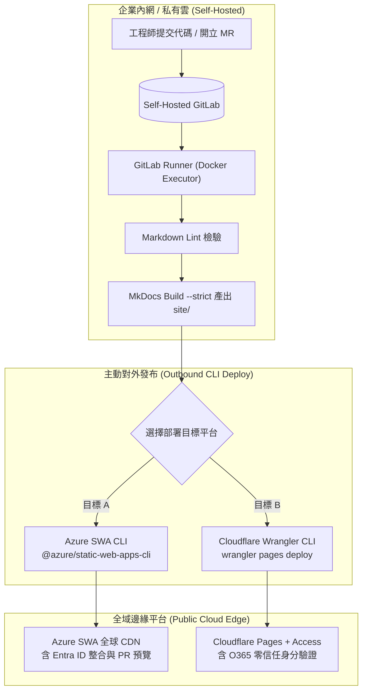

# Self-Hosted GitLab CI/CD 部署方案 :material-gitlab:

> 在企業自建 **Self-Hosted GitLab**（地端或私有雲 VPC）架構下，透過 **GitLab CI/CD** 與 **GitLab Runner** 實現 Material for MkDocs 知識庫的語法檢驗、嚴格建置，並主動推送部署至 **Azure Static Web Apps (SWA)** 或 **Cloudflare Pages + Access (Entra ID)**。

---

## 1. 方案背景與企業架構特點

許多企業基於資安合規、內部機密防護或既有基礎架構，選擇將原始碼託管於自架的 **Self-Hosted GitLab**（如企業內網或私有 VPC 實例）。在這種情境下，若要將技術文檔發布至雲端高速邊緣平台（Azure SWA 或 Cloudflare Pages），會面臨以下網路與架構特點：

- **單向對外出站 (Outbound-only)**：企業內網防火牆通常**禁止外部雲端服務主動連入 (Inbound Blocked)**，因此 Azure 或 Cloudflare 無法像對 GitHub 那樣透過 Webhook 自動拉取代碼。
- **GitLab Runner 主動推送模式 (Direct Upload / CLI Push)**：由座落於企業內網的 GitLab Runner 完成 MkDocs 建置後，使用各平台提供的官方 CLI 工具（如 `swa` 或 `wrangler`）**主動發布 (Push)** 至雲端邊緣網路。
- **Merge Request (MR) 流程整合**：相容於 GitLab 的 MR 機制，在發起 MR 時自動執行語法檢驗與產出臨時預覽環境（Preview Environment）。

### 架構運作流程圖



---

## 2. GitLab 專案與 Runner 環境準備

### 1. GitLab Runner 執行器 (Executor) 建議

建議使用 **Docker Executor** 或 **Kubernetes Executor**，能確保每次 Pipeline 均在乾淨且隔離的容器中執行。

### 2. Git 歷史深度設定 (`GIT_DEPTH`)

MkDocs 的 Git 外掛（例如 `git-revision-date-localized`、`git-committers` 以及 `git-latest-changes`）需要讀取完整的 Git Commit 歷史紀錄。
GitLab CI 預設為淺層複製（Shallow Clone，預設抓取 50 筆），必須在 `.gitlab-ci.yml` 中明確關閉限制：

```yaml
variables:
  GIT_DEPTH: "0"
  GIT_STRATEGY: clone
```

### 3. GitLab CI/CD 變數設定 (Variables)

請進入 GitLab 專案頁面 ➔ **Settings** ➔ **CI/CD** ➔ 展開 **Variables**，依部署目標配置以下金鑰：

| 變數名稱 | 適用平台 | 類型 | 屬性建議 | 說明 |
| :--- | :--- | :--- | :--- | :--- |
| `AZURE_STATIC_WEB_APPS_API_TOKEN` | Azure SWA | Variable | Masked, Protected | 自 Azure SWA 資源管理取得之部署權杖 (API Token) |
| `CLOUDFLARE_API_TOKEN` | Cloudflare | Variable | Masked, Protected | 具備 `Cloudflare Pages: Edit` 權限之 API Token |
| `CLOUDFLARE_ACCOUNT_ID` | Cloudflare | Variable | Masked | Cloudflare 帳戶 ID (可在 Dashboard 側邊欄取得) |
| `GITLAB_TOKEN` | 通用 | Variable | Masked | 自架 GitLab Personal Access Token，供外掛抓取作者資訊 |

---

## 3. 部署方案 A：部署至 Azure Static Web Apps (SWA)

在自架環境中，最可靠的發布方式是使用微軟官方的 **Azure Static Web Apps CLI (`swa`)**。

### 部署原理

1. 在 Python 映像檔中執行 `pip install` 與 `mkdocs build --strict` 產生 `./site`。
2. 使用 Node.js 映像檔安裝 `@azure/static-web-apps-cli`。
3. 執行 `swa deploy ./site`，傳入部署權杖即可完成上傳。

### 部署指令重點

- **正式環境部署 (`main` 分支)**：

  ```bash
  npx @azure/static-web-apps-cli deploy ./site \
    --env production \
    --deployment-token $AZURE_STATIC_WEB_APPS_API_TOKEN
  ```

- **MR 預覽環境部署 (Merge Request)**：

  ```bash
  npx @azure/static-web-apps-cli deploy ./site \
    --env mr-$CI_MERGE_REQUEST_IID \
    --deployment-token $AZURE_STATIC_WEB_APPS_API_TOKEN
  ```

---

## 4. 部署方案 B：部署至 Cloudflare Pages + Access (Entra ID)

將自架 GitLab 的建置產出物推送至 Cloudflare Pages，使用官方 **Cloudflare Wrangler CLI**。

### 部署原理

1. 於 GitLab CI 完成 MkDocs 建置產出 `./site`。
2. 使用 Node.js 執行 `wrangler pages deploy site`。
3. Cloudflare Pages 接收靜態資產後即時布署至邊緣節點，並自動受 Cloudflare Access (Entra ID) 政策防護。

### 部署指令重點

- **正式環境部署 (`main` 分支)**：

  ```bash
  npx wrangler pages deploy ./site \
    --project-name=windcold-kb \
    --branch=main
  ```

- **MR 預覽環境部署 (Merge Request)**：

  ```bash
  npx wrangler pages deploy ./site \
    --project-name=windcold-kb \
    --branch=$CI_COMMIT_REF_SLUG
  ```

---

## 5. 完整 `.gitlab-ci.yml` 企業實戰配置

以下提供整合「Markdown 語法檢查」、「MkDocs 嚴格建置」與「雙平台部署選擇」的企業級 `.gitlab-ci.yml` 完整範本：

```yaml
# ==============================================================================
# GitLab CI/CD Pipeline for Material for MkDocs
# 支援語法檢查、嚴格模式建置、Azure SWA 與 Cloudflare Pages 自動部署
# ==============================================================================

stages:
  - lint
  - build
  - deploy

variables:
  # 關閉 Shallow Clone，確保抓取完整 Git 歷史紀錄以相容 git-* 外掛
  GIT_DEPTH: "0"
  GIT_STRATEGY: clone
  PIP_CACHE_DIR: "$CI_PROJECT_DIR/.cache/pip"
  DISABLE_MKDOCS_2_WARNING: "true"

# 全域快取設定（加速 pip 相依套件安裝）
cache:
  key: "${CI_COMMIT_REF_SLUG}"
  paths:
    - .cache/pip
    - .venv/

default:
  interruptible: true

# ------------------------------------------------------------------------------
# 1. 語法檢查階段 (Lint)
# ------------------------------------------------------------------------------
markdownlint:
  stage: lint
  image: node:20-alpine
  script:
    - npx --yes markdownlint-cli2 "**/*.md"
  rules:
    - if: $CI_PIPELINE_SOURCE == "merge_request_event"
    - if: $CI_COMMIT_BRANCH == $CI_DEFAULT_BRANCH

# ------------------------------------------------------------------------------
# 2. 建置階段 (Build)
# ------------------------------------------------------------------------------
build-mkdocs:
  stage: build
  image: python:3.11-slim
  before_script:
    - python -m venv .venv
    - source .venv/bin/activate
    - pip install -r requirements.txt
  script:
    - source .venv/bin/activate
    - mkdocs build --strict
  artifacts:
    name: "mkdocs-site-$CI_COMMIT_REF_SLUG"
    expire_in: 3 days
    paths:
      - site/
  rules:
    - if: $CI_PIPELINE_SOURCE == "merge_request_event"
    - if: $CI_COMMIT_BRANCH == $CI_DEFAULT_BRANCH

# ------------------------------------------------------------------------------
# 3. 部署階段 (Deploy) - 選擇 A: Azure Static Web Apps
# ------------------------------------------------------------------------------
deploy-azure-swa-production:
  stage: deploy
  image: node:20-slim
  dependencies:
    - build-mkdocs
  script:
    - npx @azure/static-web-apps-cli deploy ./site --env production --deployment-token $AZURE_STATIC_WEB_APPS_API_TOKEN
  rules:
    - if: $CI_COMMIT_BRANCH == $CI_DEFAULT_BRANCH && $AZURE_STATIC_WEB_APPS_API_TOKEN

deploy-azure-swa-preview:
  stage: deploy
  image: node:20-slim
  dependencies:
    - build-mkdocs
  script:
    - npx @azure/static-web-apps-cli deploy ./site --env mr-$CI_MERGE_REQUEST_IID --deployment-token $AZURE_STATIC_WEB_APPS_API_TOKEN
  rules:
    - if: $CI_PIPELINE_SOURCE == "merge_request_event" && $AZURE_STATIC_WEB_APPS_API_TOKEN

# ------------------------------------------------------------------------------
# 3. 部署階段 (Deploy) - 選擇 B: Cloudflare Pages (+ Access)
# ------------------------------------------------------------------------------
deploy-cloudflare-pages-production:
  stage: deploy
  image: node:20-slim
  dependencies:
    - build-mkdocs
  script:
    - npx wrangler pages deploy ./site --project-name=windcold-kb --branch=main
  rules:
    - if: $CI_COMMIT_BRANCH == $CI_DEFAULT_BRANCH && $CLOUDFLARE_API_TOKEN

deploy-cloudflare-pages-preview:
  stage: deploy
  image: node:20-slim
  dependencies:
    - build-mkdocs
  script:
    - npx wrangler pages deploy ./site --project-name=windcold-kb --branch=$CI_COMMIT_REF_SLUG
  rules:
    - if: $CI_PIPELINE_SOURCE == "merge_request_event" && $CLOUDFLARE_API_TOKEN
```

---

## 6. 自架企業環境專屬排錯與進階技巧

### A. 企業內部自簽憑證 (Corporate Root CA) 問題

若自架 GitLab 使用企業內部 CA 簽發之 SSL 憑證，GitLab Runner 在執行容器內可能出現 `certificate verify failed` 錯誤。

**解決方法**：在 `before_script` 將內部 Root CA 加入系統信任憑證鏈，或掛載 CA 至 Runner：

```yaml
before_script:
  # Python Requests 信任企業 CA
  - export REQUESTS_CA_BUNDLE=/etc/ssl/certs/corporate-root-ca.crt
  # Node.js 信任企業 CA
  - export NODE_EXTRA_CA_CERTS=/etc/ssl/certs/corporate-root-ca.crt
```

### B. 企業 Proxy / 防火牆設定

若 Runner 位於需透過 HTTP Proxy 才能出外網的受限網段，需在 Runner 的 `config.toml` 或 `.gitlab-ci.yml` 中宣告代理變數：

```yaml
variables:
  HTTP_PROXY: "http://proxy.corp.internal:8080"
  HTTPS_PROXY: "http://proxy.corp.internal:8080"
  NO_PROXY: "localhost,127.0.0.1,gitlab.corp.internal"
```

### C. 與 GitHub Actions 之重要差異對照表

| 功能特性 | GitHub Actions | Self-Hosted GitLab CI/CD |
| :--- | :--- | :--- |
| **工作流程定義檔** | `.github/workflows/*.yml` | 專案根目錄 `.gitlab-ci.yml` |
| **執行環境 (Runner)** | GitHub 託管 (Hosted) Ubuntu 虛擬機 | 自架 GitLab Runner (Docker / K8s / Shell) |
| **Git 歷史抓取** | `actions/checkout` + `fetch-depth: 0` | `variables: GIT_DEPTH: "0"` + `GIT_STRATEGY: clone` |
| **中繼產出物傳遞** | `actions/upload-artifact` / `download-artifact` | 內建 `artifacts: paths: [site/]` 與 `dependencies:` |
| **外部網路存取權** | 雙向存取便利 | 通常僅支援出站 (Outbound)，以 CLI 推送為最佳實踐 |
