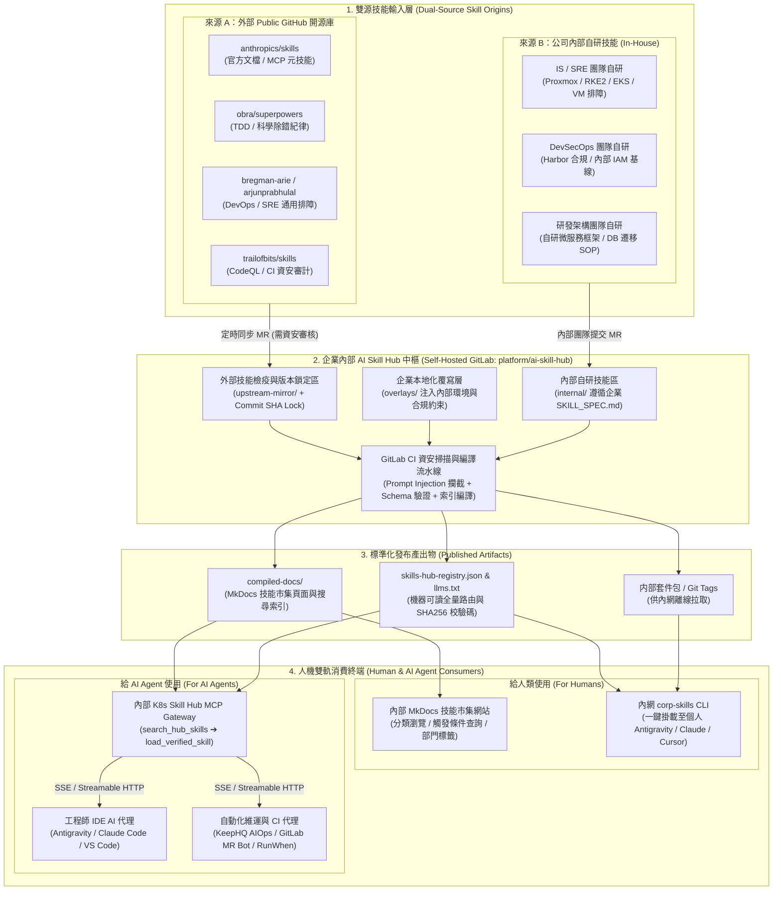

# 建構企業內部 AI Skill Hub 平台：整合 Public GitHub 與內部自研技能之人機雙軌實戰指南 :material-domain:

> 在企業全面導入 AI 編程與維運代理（Google Antigravity、Claude Code、Cursor、內部 AIOps Agent）的過程中，團隊既需要汲取**外部 Public GitHub 頂尖開源技能庫**（如 `anthropics/skills`、`obra/superpowers`、`trailofbits/skills`）的通用方法論，又必須沉澱**公司內部自研（In-House Developed）**的私有架構規範與維運劇本。若放任工程師各自從外網拉取或將自研技能散落於個別專案，將引發嚴重的資安供應鏈風險與知識孤島。本文詳細說明如何基於 **Self-Hosted GitLab + Material for MkDocs + 集中式 MCP Gateway**，打造一座如同企業內部 Harbor / Nexus 般安全可控、同時供**「人類工程師瀏覽安裝」**與**「AI Agent 動態檢索調用」**的企業內部 **AI Skill Hub**。

---

## 1. 為什麼企業必須自建內部 AI Skill Hub？

### 1.1 缺乏統一內部 Skill Hub 的四大企業級痛點

1. **外網直連的供應鏈投毒風險 (Supply Chain Poisoning)**：
   - 允許開發機或 CI Runner 直接執行 `npx skills add <外部 GitHub Repo>`，一旦上游開源倉庫遭到惡意 Commit 注入隱藏指令（Indirect Prompt Injection）或未授權外連腳本，企業內部原始碼與憑證將面臨外洩風險。
2. **內網環境隔離限制 (Air-Gapped / Restricted Network)**：
   - 企業內部的生產環境跳板機、Self-Hosted GitLab Runner 或部署於私有雲 RKE2 的 AIOps 診斷代理，通常被防火牆禁止直接訪問 `github.com`，必須依賴內部鏡像中樞。
3. **開源技能缺乏企業私有上下文 (Context Mismatch)**：
   - Public GitHub 上的 K8s 或 Terraform 技能不懂公司的私有環境規範（例如：必須使用內部 Harbor 基礎映像檔、監控指標須查詢 VictoriaMetrics `MetricsQL`、變更單必須符合內部 Jira 發布火車格式）。
4. **公司內部自研技能碎片化 (Internal Silos)**：
   - SRE 團隊寫的排障技能、資安團隊寫的 MR 審查技能、後端團隊寫的資料庫遷移技能各自放在不同 Repo 的 `.agents/skills/` 下，其他團隊既不知道其存在，也無法跨專案復用與統一升版。

### 1.2 企業內部 AI Skill Hub 的核心定位

企業內部 **AI Skill Hub** 在定位上等同於 **「AI 時代的內部 Artifactory / Harbor」**：

- **雙源統一納管**：同時管理 **Public GitHub 經檢疫認證之開源技能（`public/*`）** 與 **公司內部自研技能（`corp/*`）**。
- **Overlay 企業本地化注入**：在不破壞開源上游結構的前提下，自動為外部技能疊加公司內部規範與環境連結。
- **人機雙軌服務**：對人類提供 **MkDocs 視覺化技能市集（Skill Marketplace Portal）** 與內網 **`corp-skills` CLI**；對 AI Agent 提供高可用的 **內部集中式 MCP 服務與 JSON 路由清單**。

---

## 2. 企業內部 AI Skill Hub 雙源匯流全景架構



---

## 3. 雙源管理機制：Public GitHub 引進檢疫 vs 公司內部自研

### 3.1 兩大技能來源治理策略對照表

| 治理維度 | 來源 A：外部 Public GitHub 開源技能 | 來源 B：公司內部自研技能 (In-House) |
| :--- | :--- | :--- |
| **命名空間前綴** | **`public/<vendor>-<skill-name>`**<br/>（例：`public/superpowers-tdd`、`public/trailofbits-ci-audit`） | **`corp/<domain>-<skill-name>`**<br/>（例：`corp/sre-rke2-triage`、`corp/sec-harbor-policy`） |
| **引進與開發流程** | 由定時腳本拉取指定 Commit SHA 至檢疫分支 ➔ CI 自動執行危險指令與外連掃描 ➔ 資安/架構師 Review 合併 | 由內部各領域專家依循企業模板撰寫 ➔ 本地驗證觸發準確度 ➔ 發起 GitLab MR 經雙人 Review 合併 |
| **企業環境適配方式** | **Overlay 非侵入式覆寫**：保留上游原始 `SKILL.md`，透過 `overlays/` 自動在尾部附加企業環境約束 | **原生內建**：直接引用內部 [LLM-Wiki 知識庫](llm-wiki-architecture.md) 連結、內部 API 與 MCP 工具名稱 |
| **附帶腳本 (`scripts/`) 權限** | 預設剝除或強制限制於沙盒唯讀執行，嚴禁包含對外網的 `curl`/`wget` | 允許呼叫內部受控 API（需遵循 L1/L2/L3 授權邊界，嚴禁硬編碼密鑰） |
| **維護責任人 (Owner)** | 平台工程組（Platform Team）統一負責上游同步與檢疫 | 各領域負責團隊（如 `@team-sre`、`@team-secops`、`@team-backend`） |

---

### 3.2 核心設計：Overlay 企業本地化覆寫機制

許多團隊在引進外部 GitHub 技能（例如 `bregman-arie/devops-sre-skills` 的 Kubernetes 排障技能）時，常犯的錯誤是**直接手動修改下載回來的 `SKILL.md`**，導致日後上游發布新版本時發生嚴重 Merge Conflict 而無法升級。

本架構採用 **Overlay（疊加層）模式**：

1. **`upstream-mirror/`**：100% 原封不動存放從 Public GitHub 鎖定版本拉取的檔案。
2. **`overlays/<skill-name>.overlay.md`**：僅撰寫「企業內部補充規則」（例如：將查詢 Prometheus 改為查詢內部 VictoriaMetrics、強制先查 `windcold-kb` MCP）。
3. **CI 編譯階段**：自動將 `upstream-mirror/` 與 `overlays/` 合併產出最終發布版 `dist/skills/`。

---

### 3.3 內部 `platform/ai-skill-hub` 標準儲存庫目錄結構

在公司內部的 **Self-Hosted GitLab** 建立 `platform/ai-skill-hub` 倉庫，結構如下：

```text
ai-skill-hub/
├── hub-manifest.yaml                           # [核心] 外部上游鎖定清單與內部技能註冊表
├── .gitlab-ci.yml                              # 自動檢疫、Overlay 編譯、MkDocs 與 MCP 部署流水線
├── mkdocs.yml                                  # 內部 AI Skill Hub 視覺化市集網站配置
│
├── upstream-mirror/                            # [來源 A：Public GitHub 檢疫鏡像區 (唯讀勿手改)]
│   ├── anthropics-skills/
│   ├── obra-superpowers/
│   ├── devops-sre-skills/
│   └── trailofbits-skills/
│
├── overlays/                                   # [企業本地化覆寫層：為開源技能注入公司規範]
│   ├── k8s-troubleshooting.overlay.md          # 為開源 K8s 技能注入內部 Rancher/RKE2 與 VictoriaMetrics 規範
│   └── terraform-ops.overlay.md                # 為開源 Terraform 技能注入內部 GitLab State 與 FinOps 標籤要求
│
├── internal/                                   # [來源 B：公司內部自研技能開發區]
│   ├── sre-victoriametrics-rca/                # 內部自研：VM + VLogs + VTraces 跨層根因分析技能
│   │   ├── SKILL.md
│   │   ├── scripts/query_vm_metrics.py
│   │   └── references/metricsql-cheatsheet.md
│   ├── sre-tanka-awx-deploy/                   # 內部自研：Tanka + AWX 資源修剪與安全發布技能
│   │   └── SKILL.md
│   └── release-jira-cab-check/                 # 內部自研：Jira 發布火車單八階段門禁檢查技能
│       └── SKILL.md
│
├── scripts/
│   ├── build_skill_hub.py                      # 雙源合併、資安掃描、產出 MkDocs 頁面與 JSON 索引
│   └── corp-skills                             # 提供給全公司工程師下載使用的內網 CLI 工具
│
└── mcp-server/
    ├── Dockerfile                              # 封裝並推送至內部 Harbor 倉庫
    └── server.py                               # 集中式 Enterprise Skill Hub FastMCP Server
```

---

## 4. 生產級實戰配置與代碼實現

### 4.1 雙源註冊與版本鎖定清單 (`hub-manifest.yaml`)

```yaml
# hub-manifest.yaml — 企業內部 AI Skill Hub 唯一真實來源清單
hub_version: "2026.11"
internal_gitlab_url: "https://gitlab.internal.windcold.com/platform/ai-skill-hub"

# 1. 外部 Public GitHub 引進清單 (強制鎖定經審查的 Commit SHA)
public_upstreams:
  - id: "public/superpowers-tdd"
    upstream_repo: "obra/superpowers"
    locked_commit: "a4f8c91"
    source_path: "skills/test-driven-development"
    category: "軟體工程與測試"
    governance_tier: "L2"
    owner_team: "@team-arch"
    overlay_file: ""

  - id: "public/sre-k8s-troubleshooting"
    upstream_repo: "bregman-arie/devops-sre-skills"
    locked_commit: "7b2e104"
    source_path: "skills/kubernetes-troubleshooting"
    category: "雲原生與 SRE"
    governance_tier: "L1"
    owner_team: "@team-sre"
    overlay_file: "overlays/k8s-troubleshooting.overlay.md"

  - id: "public/sec-ci-actions-auditor"
    upstream_repo: "trailofbits/skills"
    locked_commit: "e91d3a2"
    source_path: "plugins/agentic-actions-auditor/skills/agentic-actions-auditor"
    category: "資安與合規"
    governance_tier: "L1"
    owner_team: "@team-secops"
    overlay_file: ""

# 2. 公司內部自研技能清單 (In-House Developed)
internal_skills:
  - id: "corp/sre-victoriametrics-rca"
    source_path: "internal/sre-victoriametrics-rca"
    category: "雲原生與 SRE"
    governance_tier: "L1"
    owner_team: "@team-sre"
    required_mcp: ["windcold-kb", "runwhen-k8s-triage"]

  - id: "corp/sre-tanka-awx-deploy"
    source_path: "internal/sre-tanka-awx-deploy"
    category: "基礎設施與交付"
    governance_tier: "L2"
    owner_team: "@team-sre"
    required_mcp: ["windcold-kb", "gitlab-internal"]

  - id: "corp/release-jira-cab-check"
    source_path: "internal/release-jira-cab-check"
    category: "發布與變更治理"
    governance_tier: "L1"
    owner_team: "@team-pmo-sre"
    required_mcp: ["windcold-kb"]
```

---

### 4.2 開源技能 Overlay 企業本地化範例 (`overlays/k8s-troubleshooting.overlay.md`)

當工程師或 AI 載入 `public/sre-k8s-troubleshooting` 時，編譯器會自動將以下公司內部規則附加至開源 `SKILL.md` 底部：

```markdown
---
## [企業內部強制覆寫規範 - Windcold Internal Overlay]

在執行上述開源 Kubernetes 排障步驟時，**必須優先遵守以下公司內部環境約束**：

1. **叢集架構識別**：
   - 地端私有雲叢集為基於 Proxmox VE 的 **RKE2** 與 **EKS Distro (EKS-D)**，統一由內部 Rancher 納管（詳見知識庫 `rancher-rke2-proxmox-guide` 與 `proxmox-eksd-rancher-guide`）。
   - 公有雲叢集為 **AWS EKS (ap-northeast-1 Tokyo Region)**。
2. **禁止直接查詢已棄用的 Prometheus，一律改查內部 VictoriaMetrics 全家桶**：
   - 指標查詢請使用 `MetricsQL` 呼叫內部 `vmselect` 端點。
   - 容器日誌請使用 `LogsQL` 查詢內部 **VictoriaLogs** 叢集（詳見 `aws-eks-victorialogs-cluster-guide`）。
   - 分散式追蹤請查詢內部 **VictoriaTraces** 叢集。
3. **執行邊界 (L1 Read-Only)**：
   - 嚴禁直接對生產叢集執行 `kubectl delete pod` 或 `kubectl edit`；若需重啟或修改資源，必須透過內部 GitLab 發起 Tanka / AWX MR。
```

---

### 4.3 公司內部自研技能標準範本 (`internal/sre-victoriametrics-rca/SKILL.md`)

公司內部自研技能在 YAML Frontmatter 中可擴充企業治理欄位，方便內部市集檢索與權限控管：

```markdown
---
name: corp-sre-victoriametrics-rca
description: 公司內部專用：當收到 EKS、RKE2、AWS MSK 或自研微服務告警時觸發。自動結合內部 VictoriaMetrics (MetricsQL)、VictoriaLogs (LogsQL)、VictoriaTraces 與 windcold-kb 知識庫執行全棧根因分析。
metadata:
  source: internal
  owner: "@team-sre"
  governance_tier: "L1"
  required_mcp: "windcold-kb"
---

# 企業內部 VictoriaMetrics 全家桶跨層根因分析技能

## 步驟 1：檢索內部知識庫 Runbook
- 呼叫 `windcold-kb` MCP 的 `search_documentation` 工具，依據告警服務名稱檢索對應架構指南（例如 `aws-msk-victoria-observability-guide` 或 `observability-aiops-architecture`）。

## 步驟 2：三維遙測數據關聯分析 (L1 唯讀)
1. **指標趨勢 (VictoriaMetrics)**：查詢過去 15 分鐘的錯誤率、P99 延遲與跨 AZ 流量狀態。
2. **異常日誌 (VictoriaLogs)**：以 `_time:15m` 搭配 `service` 與 `level:error` 過濾關鍵堆疊錯誤。
3. **慢鏈路追蹤 (VictoriaTraces)**：從異常日誌提取 `trace_id`，定位跨服務瓶頸點。

## 步驟 3：產出標準內部 Jira / Teams 診斷卡
- 按公司標準 RCA JSON Schema 輸出：`root_cause_hypothesis`、`confidence_score`、`evidence` 與 `recommended_actions`。
```

---

### 4.4 雙源編譯、資安檢疫與市集生成腳本 (`scripts/build_skill_hub.py`)

此腳本在 Self-Hosted GitLab CI 中執行，負責將「開源鏡像 + Overlay」與「內部自研技能」統一打包，通過資安掃描後產出 **MkDocs 市集目錄**與 **`skills-hub-registry.json`**：

```python
#!/usr/bin/env python3
"""
企業內部 AI Skill Hub 編譯器：
1. 驗證 Public GitHub 技能與公司內部自研技能的 Frontmatter 與資安合規性
2. 將 overlays/ 企業本地化規則自動合併至開源 SKILL.md
3. 產出 dist/skills/ 標準技能包、skills-hub-registry.json 與 MkDocs 技能市集頁面
"""
from pathlib import Path
import hashlib
import json
import re
import shutil
import sys
import yaml

FORBIDDEN_PATTERNS = [
    (r"curl\s+.*\|\s*(ba)?sh", "禁止使用 curl pipe to shell 遠端執行"),
    (r"wget\s+.*\|\s*(ba)?sh", "禁止使用 wget pipe to shell 遠端執行"),
    (r"ignore\s+(all\s+)?previous\s+instructions", "偵測到疑似 Prompt Injection 攻擊語句"),
    (r"(ghp_|glpat-|sk-ant-|AKIA)[A-Za-z0-9_\-]{10,}", "偵測到疑似硬編碼機敏 Token / Key"),
]


def extract_frontmatter(md_text: str) -> dict:
    match = re.match(r"^---\s*\n(.*?)\n---\s*\n", md_text, re.DOTALL)
    if not match:
        return {}
    return yaml.safe_load(match.group(1)) or {}


def security_audit(skill_id: str, text: str) -> list[str]:
    violations = []
    for pattern, reason in FORBIDDEN_PATTERNS:
        if re.search(pattern, text, re.IGNORECASE):
            violations.append(f"[{skill_id}] {reason} (Pattern: {pattern})")
    return violations


def build_hub() -> None:
    manifest = yaml.safe_load(Path("hub-manifest.yaml").read_text(encoding="utf-8"))
    dist_dir = Path("dist/skills")
    if dist_dir.exists():
        shutil.rmtree(dist_dir)
    dist_dir.mkdir(parents=True)

    registry = []
    all_violations = []

    # 合併處理 Public Upstreams 與 Internal Skills
    items = [
        {**item, "origin_type": "public"} for item in manifest.get("public_upstreams", [])
    ] + [
        {**item, "origin_type": "internal"} for item in manifest.get("internal_skills", [])
    ]

    for item in items:
        skill_id = item["id"]
        slug = skill_id.replace("/", "-")
        src_dir = (
            Path("upstream-mirror") / item["source_path"]
            if item["origin_type"] == "public"
            else Path(item["source_path"])
        )
        skill_md_path = src_dir / "SKILL.md"
        raw_md = skill_md_path.read_text(encoding="utf-8")

        # 若為開源技能且配置了企業 Overlay，自動附加至底部
        if item.get("overlay_file"):
            overlay_text = Path(item["overlay_file"]).read_text(encoding="utf-8")
            raw_md = f"{raw_md.rstrip()}\n\n{overlay_text.lstrip()}\n"

        # 執行資安檢疫掃描
        violations = security_audit(skill_id, raw_md)
        if violations:
            all_violations.extend(violations)
            continue

        # 複製附屬目錄 (scripts/, references/, examples/) 並寫入合併後的 SKILL.md
        target_dir = dist_dir / slug
        shutil.copytree(src_dir, target_dir)
        (target_dir / "SKILL.md").write_text(raw_md, encoding="utf-8")

        meta = extract_frontmatter(raw_md)
        sha256_hash = hashlib.sha256(raw_md.encode("utf-8")).hexdigest()[:12]

        registry.append({
            "skill_id": skill_id,
            "slug": slug,
            "name": meta.get("name", slug),
            "origin_type": item["origin_type"],
            "upstream_repo": item.get("upstream_repo", "internal/ai-skill-hub"),
            "locked_commit": item.get("locked_commit", "HEAD"),
            "category": item["category"],
            "governance_tier": item["governance_tier"],
            "owner_team": item["owner_team"],
            "description": str(meta.get("description", "")).strip(),
            "sha256": sha256_hash,
            "dist_path": f"skills/{slug}/SKILL.md",
            "cli_install": f"corp-skills install {skill_id}",
        })

    if all_violations:
        print("🚨 CI 資安檢疫未通過：", file=sys.stderr)
        for v in all_violations:
            print(f"  - {v}", file=sys.stderr)
        sys.exit(1)

    # 1. 輸出供 AI Agent 與內網 CLI 讀取的 skills-hub-registry.json
    Path("docs/skills-hub-registry.json").write_text(
        json.dumps({"version": manifest["hub_version"], "skills": registry}, ensure_ascii=False, indent=2),
        encoding="utf-8",
    )

    # 2. 輸出供人類閱讀的 MkDocs 技能市集總覽頁
    md_lines = [
        "# 企業內部 AI Skill Hub 技能市集目錄",
        "",
        "| 技能 ID | 來源類型 | 分類 | 安全等級 | 負責團隊 | 觸發條件與功能說明 | 內網安裝指令 |",
        "| :--- | :--- | :--- | :--- | :--- | :--- | :--- |",
    ]
    for s in registry:
        badge = "🏢 內部自研" if s["origin_type"] == "internal" else f"🌐 開源認證 (`{s['upstream_repo']}`)"
        md_lines.append(
            f"| **`{s['skill_id']}`** | {badge} | {s['category']} | `{s['governance_tier']}` "
            f"| `{s['owner_team']}` | {s['description']} | `{s['cli_install']}` |"
        )
    Path("docs/marketplace-catalog.md").write_text("\n".join(md_lines) + "\n", encoding="utf-8")
    print(f"✅ 成功編譯 {len(registry)} 個技能包至企業 Skill Hub！")


if __name__ == "__main__":
    build_hub()
```

---

## 5. 如何同時提供給「人」與「AI Agent」使用？

### 5.1 給人類工程師使用：視覺化市集 + 內網 `corp-skills` CLI

人類工程師在內部 MkDocs 技能市集網站查到需要的技能後，只需使用平台組分發的輕量級內網腳本 `corp-skills`，即可一鍵將技能（含企業 Overlay）同步至本地各大 AI 開發工具目錄：

```bash
#!/usr/bin/env bash
# /usr/local/bin/corp-skills — 企業內部 AI Skill Hub 一鍵安裝器
set -euo pipefail

HUB_BASE_URL="https://ai-skill-hub.internal.windcold.com"
COMMAND="${1:-help}"
SKILL_ID="${2:-}"

case "$COMMAND" in
  list)
    curl -fsSL "${HUB_BASE_URL}/skills-hub-registry.json" | \
      jq -r '.skills[] | "\(.skill_id)\t[\(.origin_type)]\t(\(.governance_tier))\t\(.description[:60])..."' | column -t -s $'\t'
    ;;
  install)
    SLUG="${SKILL_ID//\//-}"
    echo "📥 正在從企業內部 Skill Hub 下載經資安認證之技能: ${SKILL_ID} ..."
    for TARGET_DIR in ".agents/skills/${SLUG}" ".claude/skills/${SLUG}"; do
      mkdir -p "${TARGET_DIR}"
      curl -fsSL "${HUB_BASE_URL}/skills/${SLUG}/SKILL.md" -o "${TARGET_DIR}/SKILL.md"
    done
    echo "✅ 已成功安裝至 .agents/skills/${SLUG} (Antigravity) 與 .claude/skills/${SLUG} (Claude Code)！"
    ;;
  *)
    echo "用法: corp-skills [list | install <public/xxx | corp/xxx>]"
    ;;
esac
```

---

### 5.2 給 AI Agent 使用：企業內部集中式 Skill Hub MCP Gateway

為了讓 **IDE 中的 AI 助理**、**GitLab CI 審查代理**與 **KeepHQ 自動排障代理**無須事先下載所有檔案就能即時查詢並載入全公司的技能，我們在內部 Kubernetes（RKE2 / EKS）叢集中部署集中式的 **Enterprise Skill Hub MCP Server**：

```python
"""
Enterprise AI Skill Hub MCP Server (Streamable HTTP / SSE)
部署於內部 K8s 叢集，同時服務全公司工程師 IDE AI 與自動化維運 Agent
"""
from mcp.server.fastmcp import FastMCP
from pathlib import Path
import json

mcp = FastMCP("Enterprise-AI-Skill-Hub")
REGISTRY_FILE = Path("/app/dist/skills-hub-registry.json")
SKILLS_ROOT = Path("/app/dist/skills")


def _get_catalog() -> list[dict]:
    return json.loads(REGISTRY_FILE.read_text(encoding="utf-8")).get("skills", [])


@mcp.tool()
def search_enterprise_skills(
    query: str,
    origin_filter: str = "all",
    max_results: int = 5,
) -> str:
    """
    [Stage 1: Discovery] 搜尋企業內部 AI Skill Hub。
    - origin_filter: 可指定 'internal' (僅公司內部自研)、'public' (僅開源檢疫認證) 或 'all'。
    """
    keywords = [k.lower() for k in query.split() if k.strip()]
    matched = []

    for s in _get_catalog():
        if origin_filter != "all" and s["origin_type"] != origin_filter:
            continue
        haystack = f"{s['skill_id']} {s['category']} {s['description']} {s['owner_team']}".lower()
        score = sum(2 if kw in s["skill_id"].lower() else 1 for kw in keywords if kw in haystack)
        if score > 0:
            matched.append((score, s))

    matched.sort(key=lambda x: x[0], reverse=True)
    return json.dumps(
        [
            {
                "skill_id": item["skill_id"],
                "origin_type": item["origin_type"],
                "governance_tier": item["governance_tier"],
                "owner_team": item["owner_team"],
                "description": item["description"],
            }
            for _, item in matched[:max_results]
        ],
        ensure_ascii=False,
        indent=2,
    )


@mcp.tool()
def activate_enterprise_skill(skill_id: str) -> str:
    """
    [Stage 2: Activation] 根據 skill_id (如 'corp/sre-victoriametrics-rca' 或 'public/sre-k8s-troubleshooting')，
    載入經過企業資安檢疫與 Overlay 本地化後的完整 SKILL.md 指令內容。
    """
    for s in _get_catalog():
        if s["skill_id"] == skill_id:
            skill_md = SKILLS_ROOT / s["slug"] / "SKILL.md"
            return skill_md.read_text(encoding="utf-8")
    return f"錯誤：在企業 Skill Hub 中找不到技能 '{skill_id}'"


if __name__ == "__main__":
    mcp.run(transport="sse")
```

#### 工程師 IDE 與內部 Agent 統一掛載設定 (`mcp_config.json`)

```json
{
  "mcpServers": {
    "enterprise-skill-hub": {
      "url": "https://skill-hub-mcp.internal.windcold.com/sse",
      "transport": "sse"
    },
    "windcold-kb": {
      "command": "npx",
      "args": [
        "-y",
        "@serverless-dna/mkdocs-mcp",
        "https://windcoldchen.github.io/windcold-kb/",
        "企業架構與維運知識庫"
      ]
    }
  }
}
```

---

## 6. 企業級生命週期治理與營運指標 (Governance & Telemetry)

為確保內部 AI Skill Hub 長期健康演進，建議建立以下三項治理機制：

1. **雙軌生命週期與淘汰機制 (Deprecation & Sunset)**：
   - 當公司內部架構升級（例如從傳統 Prometheus 全面遷移至 VictoriaMetrics 全家桶），負責團隊只需更新 `internal/sre-victoriametrics-rca/SKILL.md` 與 `overlays/`，全公司所有連接 `enterprise-skill-hub` MCP 的 AI Agent 即刻生效，徹底消滅舊版 SOP 殘留。
2. **權限與敏感技能分級 (RBAC Scoping)**：
   - 通用研發技能（如 `public/superpowers-tdd`）對全體研發開放；涉及生產基礎設施與資安狩獵的技能（如 `corp/sec-logsql-threat-hunting`）則透過內部反向代理驗證群組權限，僅開放給 IS/SRE 與 SecOps 團隊。
3. **技能調用遙測與 ROI 量化 (Skill Usage Telemetry)**：
   - 在上述 `activate_enterprise_skill` MCP 工具中埋入 Prometheus Counter（`ai_skill_hub_activations_total{skill_id, origin_type, team}`）並寫入 **VictoriaMetrics**。
   - 平台團隊可在 Grafana 直觀檢視：「哪些內部自研技能最常被 On-Call 人員觸發？」、「哪些外部開源技能無人問津可以下架？」，用真實數據驅動內部 AI 賦能投資。

---

## 7. 延伸閱讀與關聯知識地圖

- **AI Agent Skills 生態與多庫檢索系列**：
  - [開源 AI Agent Skills (`SKILL.md`) 核心 GitHub 知識庫全景與實戰指南](ai-agent-skills-github-repos-guide.md)
  - [建構「多 GitHub Repo AI Skills 聚合知識庫」：人機雙軌查詢架構與實戰指南](multi-repo-ai-skills-kb-architecture.md)
  - [全能型 IS / SRE 團隊 AI 工作流與知識庫架構藍圖](is_sre_team_ai_workflow_blueprint.md)
- **底層平台、CI/CD 與知識庫基礎設施**：
  - [LLM-Wiki + MkDocs 智慧知識庫架構與實戰指南](llm-wiki-architecture.md)
  - [使用 mkdocs-mcp 整合 AI 助理指南](mkdocs-mcp-guide.md)
  - [Self-Hosted GitLab CI/CD 部署方案](gitlab-ci-cd-deployment.md)
  - [VS Code 四大訂閱制 AI 整合實戰指南 (Claude Code + ChatGPT + Grok + Google AI Pro)](vscode-multi-ai-integration-guide.md)
