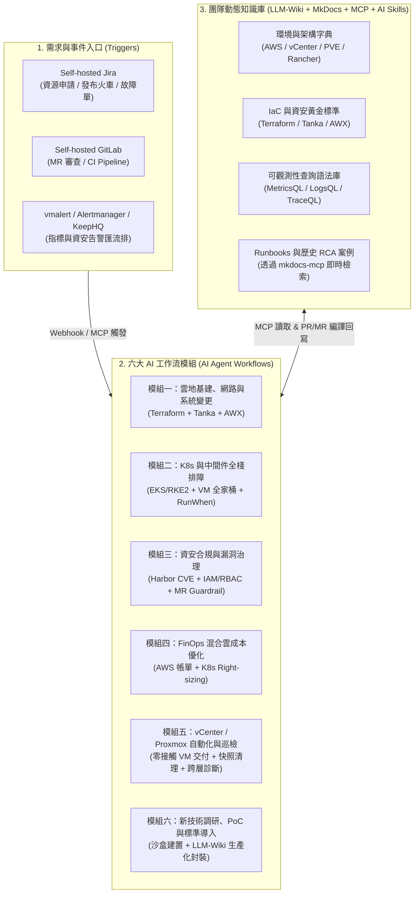
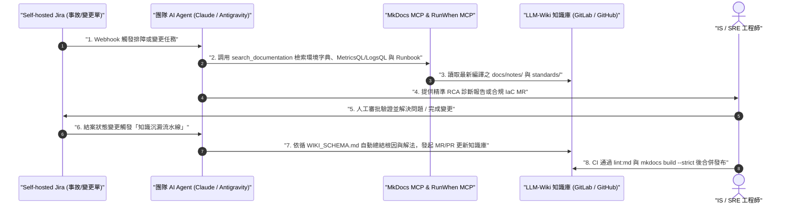

# 全能型 IS / SRE 團隊 AI 工作流與知識庫架構藍圖 :material-robot-industrial:

> 本藍圖專為兼具 **IS（基礎設施與資安）**、**SRE（網站可靠性工程）** 與 **Platform Engineering（平台工程）** 職責的全棧基礎設施團隊設計，旨在透過「**AI 工作流 × 人機協同治理 × LLM-Wiki 動態知識庫**」三位一體架構，降低跨領域上下文切換成本、消除重複性維運雜務（Toil），並強化混合雲環境的可靠性與資安合規。

---

## 1. 團隊定位、痛點剖析與技術棧全景

### 1.1 跨領域基礎設施團隊面臨的核心痛點

現代企業的基礎設施與可靠性團隊往往同時背負地端虛擬化、公有雲、Kubernetes 多叢集、CI/CD 內部平台與資安合規等多重職責，日常維運普遍存在四大結構性痛點：

1. **極高的跨領域上下文切換成本**：工程師需在 AWS、VMware vCenter / Proxmox VE、Rancher / RKE2 / EKS、Terraform 與 AWX (Ansible) 之間頻繁切換，單人難以精通所有底層指令與最佳實踐。
2. **重複性工單（Toil）侵蝕工程產能**：常規 VM 交付、防火牆申請、K8s 資源調整與憑證更新佔據大量工時，排擠了架構演進與可靠性建設。
3. **告警疲勞與跨層排障斷鏈**：當應用異常時，指標、日誌、追蹤鏈路與底層虛擬化狀態分散於不同系統，缺乏自動化的跨層關聯分析（RCA）。
4. **傳統維運文件迅速腐化**：靜態 Wiki 與實際生產環境（Git 狀態）脫節，不僅新進輪值人員難以查找，若直接接入通用 LLM 更易因資訊過期而產生嚴重幻覺（Hallucination）。

### 1.2 團隊涵蓋之 11 大核心職責

1. **Infrastructure / Cloud Infrastructure Engineer**：混合雲底層架構與 IaC 標準化建設。
2. **Cloud Engineer / Cloud Architect**：AWS 公有雲與混合雲架構設計及高可用規劃。
3. **System Administrator / System Engineer (SE)**：Linux OS、自建核心系統與地端虛擬化維運。
4. **Virtualization Platform Administrator (VMware vCenter / Proxmox VE)**：地端 vSphere / ESXi / Datastore / vSwitch 與 [Proxmox VE 私有雲底座](rancher-rke2-proxmox-guide.md) 管理。
5. **Network Reliability Engineer (NRE)**：雲地網路拓撲、VPC、防火牆、CNI 與負載均衡可靠性。
6. **Cloud Native / Kubernetes Engineer**：AWS EKS、[EKS Distro (EKS-D)](proxmox-eksd-rancher-guide.md)、地端 [RKE2 與 Rancher 多叢集生命週期管理](rancher-provision-rke2-cluster.md)。
7. **Middleware Engineer**：K8s 共用組件、內部平台（Jira / GitLab / Harbor / AWX）與可觀測性叢集維運。
8. **DevSecOps / SecOps Engineer**：CI/CD 資安左移、Harbor 映像檔漏洞治理、執行期安全管控。
9. **Cloud Security Engineer**：AWS IAM、K8s RBAC、網路隔離、憑證與稽核日誌管理。
10. **FinOps Engineer**：AWS 雲端帳單優化、K8s 與地端虛擬化資源利用率分析與閒置回收。
11. **Tech Scouting & Onboarding (新技術調研與導入)**：新技術評估、PoC 實驗沙盒與生產級標準化封裝。

### 1.3 核心技術棧與 AI 接入邊界

| 領域 | 團隊工具棧 | AI 接入方式 (MCP / CLI / API) | 預設權限邊界 | 關聯知識庫實戰指南 |
| :--- | :--- | :--- | :--- | :--- |
| **工單與發布管控** | Self-hosted Jira | Jira REST API / MCP Server | 讀取工單、自動回寫診斷與變更報告、更新狀態 | [Jira 企業級發布管理實戰](jira-release-management-guide.md) |
| **代碼與版控流水線** | Self-hosted GitLab | GitLab API / `glab` CLI / MCP | 讀取倉庫與 CI 日誌、建立分支與發起 MR（**禁止直接 Merge 生產主幹**） | [Self-Hosted GitLab CI/CD 方案](gitlab-ci-cd-deployment.md) |
| **IaC 基礎設施** | Terraform / OpenTofu | `terraform` CLI / State 解析 | 自動生成 `.tf`、執行 `fmt` / `validate` / `plan`（**禁止直接 `apply`**） | [開發工作流與變更規範](workflow.md) |
| **配置與部署平台** | AWX (Ansible) + Grafana Tanka | AWX REST API / `awx` CLI / `tk` CLI | 查詢 Job Template、讀取失敗日誌、渲染與 Diff 預檢（生產觸發需審批） | [Grafana Tanka + AWX 資源修剪實戰](tanka-awx-k8s-pruning-guide.md) |
| **地端虛擬化平台** | VMware vCenter / Proxmox VE | vSphere / PVE API / Terraform / AWX | 唯讀巡檢 VM / Snapshot / Datastore；變更統一經由 Terraform / AWX | [Rancher + RKE2 + Proxmox 私有雲架構](rancher-rke2-proxmox-guide.md) |
| **容器與多叢集管理** | AWS EKS, EKS-D, RKE2, Rancher | `kubectl` (Read-only) / Rancher API / RunWhen | 唯讀查詢叢集狀態與 Events；寫入與變更走 GitOps / IaC | [Proxmox + EKS Distro + Rancher 混合雲架構](proxmox-eksd-rancher-guide.md) |
| **映像檔倉庫** | Harbor | Harbor REST API / Trivy Report | 掃描報告分析、Tag 合規檢查、過期 Artifact 盤點 | - |
| **可觀測性全家桶** | OTel, VictoriaMetrics, VictoriaLogs, VictoriaTraces / Tempo | MetricsQL / LogsQL / TraceQL API | **純唯讀（Read-only）**，供 AI 自動關聯指標、日誌與分散式追蹤鏈路 | [OTel + VictoriaMetrics 全家桶實戰指南](otel-victoriametrics-fullstack-guide.md) |
| **AIOps 與排障中樞** | KeepHQ, RunWhen, GoAlert, Pushover | Keep Workflow / RunWhen MCP / Webhook | 自動聚合告警、執行唯讀 Digital Runbooks、發送穿透靜音強提醒 | [AIOps 智慧可觀測性方案](observability-aiops-architecture.md)、[RunWhen 智慧排障實戰](runwhen-kubernetes-guide.md) |
| **團隊動態知識庫** | LLM-Wiki + Material for MkDocs | `@serverless-dna/mkdocs-mcp` / `llms.txt` | AI 透過 MCP 即時檢索 SOP，並透過 PR/MR 持續編譯沉澱新知 | [LLM-Wiki 智慧知識架構](llm-wiki-architecture.md)、[mkdocs-mcp 使用指南](mkdocs-mcp-guide.md) |

---

## 2. 六大核心 AI 工作流模組



### 2.1 模組一：雲地基建、網路與系統變更工作流 (Ticket-to-IaC & Playbook)

- **適用角色**：`Infra Engineer`、`Cloud Architect`、`SysAdmin`、`NRE`
- **標準流程**：
  1. **需求解析**：讀取 **Self-hosted Jira** 上的資源申請或網路開通工單（VPC、Security Group、防火牆、OS 配置），並對齊 [Jira 企業級發布管理實戰](jira-release-management-guide.md) 中的變更分級（Standard Change vs Release Train）。
  2. **代碼生成**：AI 透過 MCP 檢索知識庫中的環境字典，自動編寫符合團隊規範的 **Terraform** 模組調用代碼、**Grafana Tanka** Jsonnet 配置或 **AWX Ansible Playbook**（含 [Tanka + AWX 自動資源修剪機制](tanka-awx-k8s-pruning-guide.md)）。
  3. **網路與安全預檢**：自動執行 `terraform validate`、`tflint`、`ansible-lint` 與 `tk diff`，並由 AI 評估網路爆炸半徑（Blast Radius）與路由影響，附帶生成 AWX 連通性測試劇本。
  4. **發起變更**：自動在 **Self-hosted GitLab** 建立分支與 Merge Request (MR)，並將 MR 連結與預檢報告回寫至 Jira 工單。

### 2.2 模組二：雲原生 K8s 與中間件全棧排障工作流 (AIOps & RCA Copilot)

- **適用角色**：`SRE`、`Cloud Native / K8s Engineer`、`Middleware Engineer`
- **標準流程**：
  1. **告警觸發與多維拉取**：當 EKS、EKS-D、RKE2 或中間件（Harbor / GitLab / Kafka / DB）觸發告警並進入 **KeepHQ** 時（詳見 [AIOps 智慧可觀測性方案](observability-aiops-architecture.md)），AI 自動並行查詢：
     - **VictoriaMetrics**：轉換為 `MetricsQL` 檢查節點 CPU / Memory / Disk、API Server 延遲、網路掉包與服務 QPS（參考 [VictoriaMetrics 全家桶架構解析](victoriametrics-ecosystem-guide.md)）。
     - **VictoriaLogs**：轉換為 `LogsQL` 撈取異常時間窗口內的 Pod Error Log、Kubelet / CNI 日誌。
     - **VictoriaTraces / Tempo**：透過 `TraceQL` 或 `trace_id` 追蹤跨服務慢請求與錯誤發生點（參考 [OTel + VictoriaMetrics 全家桶實戰指南](otel-victoriametrics-fullstack-guide.md)）。
     - **RunWhen 自動化探針**：透過 [RunWhen MCP Server](runwhen-kubernetes-guide.md) 執行唯讀 Digital Runbooks，即時收集 K8s Events 與異常 Pod 狀態。
     - **近期變更關聯**：比對過去 2 小時內 GitLab 合併的 MR、Jira 發布火車單與 AWX 執行過的 Job。
  2. **根因推演與分級強提醒**：透過 `@serverless-dna/mkdocs-mcp` 比對知識庫中的歷史 Runbook，生成《初步根因診斷報告（RCA Draft）》與建議恢復步驟，自動評論至 Jira 事故單並推送至 Microsoft Teams；若為 P1 致命事故，同步透過 **GoAlert** 與 [Pushover Critical Alerts](pushover-guide.md) 發動穿透靜音強提醒。
  3. **升級預檢**：在 Rancher / EKS / RKE2 升版前，自動掃描叢集內所有資源是否包含廢棄 API（Deprecated APIs）或缺少 PodDisruptionBudget (PDB)。

### 2.3 模組三：資安左移與漏洞自動化治理工作流 (SecOps Guardrail)

- **適用角色**：`DevSecOps Engineer`、`Cloud Security Engineer`
- **標準流程**：
  1. **GitLab MR 自動資安審查**：
     - **雲端與基礎設施**：攔截過大權限（如 IAM `*`）、未加密儲存、高危開放埠（`0.0.0.0/0`）、Playbook 明文密碼。
     - **K8s 規範**：檢查是否使用 `privileged: true`、是否配置 `NetworkPolicy`、Resource Requests/Limits，並強制驗證映像檔來源必須為內部 **Harbor**。
  2. **Harbor 執行期漏洞收斂**：
     - AI 定期讀取 **Harbor** 內的 Critical / High CVE 掃描報告，並透過 Rancher / K8s API 比對「目前實際在 EKS / RKE2 運行的 Pod Image」。
     - 過濾未運行的雜訊後，針對實際暴露的風險自動在 **Jira** 開立修復單，或直接針對基礎映像檔發起 GitLab Dockerfile 更新 MR。
  3. **安全日誌狩獵**：將自然語言轉換為 `LogsQL`，定期檢索 **VictoriaLogs** 中的 K8s Audit Log、Linux Auth Log 與 AWS CloudTrail 異常提權或可疑登入行為。

### 2.4 模組四：FinOps 混合雲成本與資源優化工作流

- **適用角色**：`FinOps Engineer`、`Cloud Architect`
- **標準流程**：
  1. **K8s 容量 Right-sizing**：AI 分析 **VictoriaMetrics** 過去 30 天的實際容器資源使用率（P95 / P99）與 Request 差值，找出嚴重超配（Over-provisioned）的 Deployment，自動在 GitLab 生成資源調降 MR：

     ```promql
     /* MetricsQL：找出 CPU Request 超配超過 3 倍且耗用 > 2 Core 的工作負載 */
     (
       sum by (cluster, namespace, workload) (kube_pod_container_resource_requests{resource="cpu"})
       -
       quantile_over_time(0.95, sum by (cluster, namespace, workload) (rate(container_cpu_usage_seconds_total{container!=""}[5m]))[30d:1h])
     ) > 2
     ```

  2. **雲地閒置資源盤點**：定期比對 AWS 資源、Terraform State 與 Rancher 命名空間，抓出未掛載的 EBS、無流量的 Load Balancer 與過期測試環境，於 Jira 產出每週《FinOps 資源回收確認單》。

### 2.5 模組五：VMware vCenter / Proxmox VE 自動化與跨層診斷工作流

- **適用角色**：`VMware vCenter Admin`、`Proxmox VE Admin`、`SysAdmin`、`Infra Engineer`
- **標準流程**：
  1. **零接觸 VM 交付（Zero-Touch VM Provisioning）**：從 Jira 工單解析規格（Cluster、Datastore、VLAN、OS），自動生成 **Terraform (`vsphere_virtual_machine` 或 `proxmox_vm_qemu`)** 代碼發起 GitLab MR；合併後自動串接 **AWX** 完成 OS Hardening、加入 `vmagent` / OTel Collector 監控代理（參考 [透過 Rancher 部署下游 RKE2 業務叢集](rancher-provision-rke2-cluster.md)）。
  2. **vSphere / PVE + RKE2 跨層排障**：當運行於地端虛擬化平台上的 RKE2 / EKS-D 節點異常時，AI 同時關聯 VictoriaMetrics 中的 K8s 指標與底層虛擬化指標（Datastore IOPS / Latency、ESXi Host CPU Ready time 或 Proxmox Ceph OSD 延遲），快速界定是虛擬化底層瓶頸還是 K8s 組件問題。
  3. **虛擬化資產衛生巡檢**：透過 AWX / vCenter API 自動巡檢**超過 7 天的 VM Snapshot**、**關機超過 30 天的 Zombie VM** 與**孤兒 VMDK / 磁碟卷**，匯總至 Jira 經人工核准後由 AWX 自動清理。

### 2.6 模組六：新技術調研、PoC 與生產標準化導入工作流

- **適用角色**：`Cloud Architect`、`全體團隊成員`
- **標準流程**：
  1. **相容性與架構評估**：輸入欲評估的新技術，AI 根據團隊環境約束（需支援內部 Harbor、需相容 EKS / RKE2 / vCenter / Proxmox、需支援 OTel + VictoriaMetrics 全家桶觀測、可用 Terraform / AWX 部署）生成架構選型對比報告（ADR）。
  2. **PoC 沙盒快速生成**：自動生成在測試環境部署該技術的 Terraform 與 AWX 腳本，並產出功能、效能與故障注入（Chaos）測試清單。
  3. **PoC 轉生產級封裝與知識編譯（Production Onboarding）**：確認導入後，AI 自動將實驗配置轉換為生產標準（替換為 Harbor 路徑、補齊 SecurityContext、生成 `vmalert` 告警規則、VictoriaLogs 解析規則與維運 Runbook），並依循 [LLM-Wiki 智慧知識架構](llm-wiki-architecture.md) 的四階段編譯流水線沉澱至本知識庫。

---

## 3. 團隊協作與權限治理模型 (Human-AI Teaming)

!!! tip "分級授權核心原則"
    AI 工作流不改變團隊原有的 GitOps 與工單審核習慣，而是透過「**分級授權（Governance Tiers）**」將團隊成員從繁瑣的重複執行者（Executor）升級為審查者與架構設計者（Reviewer & Architect）。

### 3.1 團隊角色與 AI 協作分工

- **資深工程師 / 領域專家 (Senior / Lead)**：
  - 負責定義與維護知識庫中的架構標準（`WIKI_SCHEMA.md`）、資安基線與 AI Skills（`SKILL.md`）。
  - 擔任 **L3 高風險變更**（生產環境 Terraform Apply / AWX 執行 / [Jira CAB 發布審批](jira-release-management-guide.md)）的最終審批者（Approver）。
- **中初階工程師 / 跨領域輪值人員 (Mid / Junior / On-Call)**：
  - 透過團隊共享的 AI Skills 與 MCP 知識庫跨越技術邊界（例如：系統工程師藉由 AI 輔助編寫標準 AWS Terraform；K8s 工程師藉由 AI 輔助排查 vCenter 底層或網路問題）。
  - 負責檢視 AI 產出的診斷報告、修改與驗證 AI 起草的 GitLab MR / GitHub PR。

### 3.2 三級安全執行邊界 (Governance Tiers)

| 授權等級 | 涵蓋動作 | 執行方式 | 範例場景 |
| :--- | :--- | :--- | :--- |
| **L1：全自動執行 (Autonomous)** | 純讀取、資料聚合、指標/日誌查詢、報告撰寫 | **AI 自動觸發完成**，無需人工介入 | 查 VictoriaMetrics / VictoriaLogs / Tempo、RunWhen 唯讀探針、Harbor CVE 比對、vCenter 快照盤點、Jira 診斷評論 |
| **L2：起草與沙盒 (Copilot / Draft)** | 程式碼生成、配置修改、測試環境驗證、知識庫編譯 | **AI 自動發起 MR / PR**，由工程師 Review 放行 | 生成 Terraform / Tanka / AWX 變更分支、新技術 PoC 沙盒部署、補充 MkDocs Runbook |
| **L3：生產變更管控 (Guarded)** | 生產環境寫入、權限變更、資源銷毀、自癒重啟 | **嚴格人工審批 (Human-in-the-loop)**，需 Senior Approve 後由 CI / AWX 執行 | 生產環境 EKS / RKE2 / vCenter 變更、IAM / Firewall 規則修改、Teams 一鍵自癒 API 觸發 |

---

## 4. 團隊動態知識庫架構 (LLM-Wiki + MkDocs + AI Skills)

為了徹底解決 AI 產生幻覺與傳統文件過期的問題，本藍圖直接採用 [LLM-Wiki + Material for MkDocs 智慧知識庫架構](llm-wiki-architecture.md)，將知識庫作為代碼庫維護，並透過 [mkdocs-mcp](mkdocs-mcp-guide.md) 與日常工單形成自動演進的「**知識飛輪（Knowledge Flywheel）**」：



### 4.1 結合 LLM-Wiki 與 AI Skills 的標準倉庫結構

將本專案的 **三層知識架構（Tier 1 `sources/` ➔ Tier 2 `docs/` ➔ Tier 3 `llms.txt` & MCP）** 與團隊 **AI Skills (`skills/`)** 整合，標準目錄結構如下：

```text
windcold-kb/ (或企業內部 is-sre-ai-brain/)
├── mkdocs.yml                                  # MkDocs 網站、llmstxt 與搜尋索引配置
├── WIKI_SCHEMA.md                              # LLM 知識編譯四階段規範
├── AGENTS.md                                   # AI Agent 協同權限與自動化驗證準則
├── sources/                                    # [Tier 1: 原始進料庫]
│   ├── drafts/                                 # 零散筆記、PoC 測試紀錄
│   └── post-mortems-raw/                       # 從 Jira 自動匯出的原始事故時間線與對話
│
├── docs/                                       # [Tier 2: 結構化知識代碼庫 (由 MkDocs 渲染)]
│   ├── index.md
│   ├── context/                                # [1. 架構與環境字典]
│   │   ├── aws-accounts-and-vpcs.md            # AWS Account ID、VPC CIDR、Transit Gateway 拓撲
│   │   ├── virtualization-inventory-spec.md    # vCenter / Proxmox Cluster、Datastore、VLAN、VM 模板
│   │   ├── k8s-clusters-rancher.md             # EKS / EKS-D / RKE2 叢集列表、Rancher Project 映射
│   │   └── harbor-projects-and-base-images.md  # Harbor 倉庫規範與官方認證基礎映像檔清單
│   │
│   ├── standards/                              # [2. 標準代碼、資安與 FinOps 規範]
│   │   ├── terraform-coding-standards.md       # Terraform 模組規範、State 管理、FinOps 必填 Tags
│   │   ├── awx-tanka-deployment-guidelines.md  # AWX Job Template、Tanka Pruning 與 Vault 加密規範
│   │   ├── secops-k8s-and-cloud-baseline.md    # IAM 最小權限、K8s SecurityContext、NetworkPolicy 規範
│   │   └── tech-onboarding-checklist.md        # 新技術導入必備檢查表（Harbor、OTel 監控、日誌、HA）
│   │
│   └── notes/                                  # [3. 可觀測性、架構實戰與故障排障 Runbooks]
│       ├── observability-aiops-architecture.md # KeepHQ + VictoriaMetrics + Claude + Teams 自癒架構
│       ├── otel-victoriametrics-fullstack-guide.md # OTel + VM / VictoriaLogs / VictoriaTraces 實戰
│       ├── runwhen-kubernetes-guide.md         # RunWhen K8s 自動排障與 MCP 整合
│       ├── rancher-rke2-proxmox-guide.md       # Proxmox + RKE2 + Rancher 私有雲高可用指南
│       ├── proxmox-eksd-rancher-guide.md       # Proxmox + EKS-D + Rancher 混合雲指南
│       ├── tanka-awx-k8s-pruning-guide.md      # Tanka + AWX 宣告式 K8s 資源修剪指南
│       └── jira-release-management-guide.md    # Jira 雙層發布管理與八階段品質門禁
│
└── skills/                                     # [Tier 3 延伸: AI Agent 可直接載入的標準技能包]
    ├── ticket-to-iac/SKILL.md                  # Jira 轉 Terraform / Tanka / AWX 變更技能
    ├── observability-rca/SKILL.md              # VM + VLogs + VTraces + RunWhen 自動根因分析技能
    ├── secops-mr-reviewer/SKILL.md             # GitLab MR 資安與合規審查技能
    ├── virtualization-ops/SKILL.md             # vCenter / Proxmox 自動交付與孤兒資源清理技能
    ├── finops-optimizer/SKILL.md               # 資源水位分析與成本優化技能
    └── tech-poc-onboarding/SKILL.md            # 新技術調研、PoC 與 LLM-Wiki 生產封裝技能
```

---

### 4.2 生產級實戰配置範例

#### A. AI Agent 統一 MCP Server 掛載配置 (`mcp_config.json`)

團隊成員在本地 IDE（Antigravity / Cursor / Claude Code）或內部 AI Agent 服務中，透過統一的 MCP 設定檔同時掛載 **MkDocs 知識庫**、**RunWhen K8s 排障引擎** 與 **GitLab**：

```json
{
  "mcpServers": {
    "windcold-kb": {
      "command": "npx",
      "args": [
        "-y",
        "@serverless-dna/mkdocs-mcp",
        "https://windcoldchen.github.io/windcold-kb/",
        "IS/SRE 團隊核心知識庫與 Runbooks"
      ]
    },
    "runwhen-k8s-triage": {
      "url": "http://localhost:8000/mcp/",
      "transport": "sse"
    },
    "gitlab-internal": {
      "command": "npx",
      "args": ["-y", "@modelcontextprotocol/server-gitlab"],
      "env": {
        "GITLAB_PERSONAL_ACCESS_TOKEN": "${GITLAB_READ_WRITE_MR_TOKEN}",
        "GITLAB_API_URL": "https://gitlab.internal.windcold.com/api/v4"
      }
    }
  }
}
```

#### B. 團隊共享 AI 技能包實戰範本 (`skills/observability-rca/SKILL.md`)

以下為符合 Agent Skills 標準規範的 `SKILL.md` 實戰範例，讓任何輪值工程師皆能以一致的專家級邏輯執行跨層排障：

```markdown
---
name: observability-rca
description: 當收到 EKS、RKE2、vCenter、Proxmox 或中間件異常告警時，自動串聯 VictoriaMetrics、VictoriaLogs、VictoriaTraces、RunWhen 與 MkDocs 知識庫執行跨層根因分析（RCA）。
---

# 全棧可觀測性與跨層根因分析技能 (Observability RCA Skill)

## 執行步驟 (Execution Steps)

1. **檢索知識庫 SOP (Grounding first)**：
   - 優先調用 `windcold-kb` MCP 的 `search_documentation` 工具，搜尋受影響服務、組件名稱或告警名稱（例如 `VictoriaMetrics`、`RKE2`、`Tanka`）。
2. **多維度遙測數據拉取 (L1 Read-Only)**：
   - **指標 (MetricsQL)**：查詢異常前後 15 分鐘的資源飽和度、錯誤率（5xx）與底層儲存延遲（vSphere Datastore / Ceph OSD Latency）。
   - **日誌 (LogsQL)**：查詢對應 `namespace` 與 `pod` 在異常區間內的 `error` / `fatal` / `OOMKilled` 日誌。
   - **鏈路 (TraceQL)**：若有 `trace_id` 或慢請求告警，定位耗時最長的 Span 與下游依賴（DB / Kafka / 外部 API）。
   - **叢集現場診斷**：調用 `runwhen-k8s-triage` MCP 獲取異常 Namespace 的最新 Events 與 SLX 診斷輸出。
3. **變更關聯比對 (Change Correlation)**：
   - 透過 `gitlab-internal` MCP 檢查過去 2 小時內是否有剛合併的 Merge Request 或 AWX 部署任務。
4. **輸出結構化 RCA 報告**：
   - 嚴格依據真實查詢數據推論，禁止猜測未驗證的數值。
   - 報告需包含：`影響範圍`、`根因假設與信心度 (%)`、`關鍵佐證數據`、`短期止血指令 (L2/L3)` 與 `長期預防 MR 建議`。
```

#### C. Self-Hosted GitLab CI 嵌入 AI MR Guardrail 審查 (`.gitlab-ci.yml`)

在 GitLab Merge Request 流水線中結合靜態掃描與 AI SecOps / FinOps 審查，落實 **L2 輔助審查**（部署流水線基礎設定可參考 [Self-Hosted GitLab CI/CD 方案](gitlab-ci-cd-deployment.md)）：

```yaml
stages:
  - lint-and-validate
  - ai-guardrail-review

terraform-and-k8s-validate:
  stage: lint-and-validate
  image: hashicorp/terraform:1.9
  script:
    - terraform fmt -check -recursive
    - terraform validate
  rules:
    - if: $CI_PIPELINE_SOURCE == "merge_request_event"

ai-secops-finops-mr-review:
  stage: ai-guardrail-review
  image: python:3.12-slim
  variables:
    GIT_DEPTH: "0"
  script:
    - pip install --no-cache-dir anthropic requests
    - |
      python3 - << 'EOF'
      import os, subprocess, requests
      from anthropic import Anthropic

      diff = subprocess.check_output(
          ["git", "diff", f"origin/{os.environ['CI_MERGE_REQUEST_TARGET_BRANCH_NAME']}...HEAD"],
          text=True
      )[:12000]

      client = Anthropic(api_key=os.environ["ANTHROPIC_API_KEY"])
      prompt = f"""
      你是 IS/SRE 團隊的 SecOps 與 FinOps 審查專家。請審查以下 GitLab MR Diff：
      1. [SecOps] 檢查是否有 IAM '*' 過大權限、0.0.0.0/0 高危埠、privileged: true、或非內部 Harbor 映像檔。
      2. [FinOps] 檢查 K8s 工作負載是否漏填 resources.requests/limits，或 AWS/vCenter 資源是否缺少必填成本標籤 (env, owner, cost-center)。
      3. [Pruning] 若為 Tanka/AWX 變更，檢查有狀態資源 (PVC/StatefulSet) 是否具備防誤刪保護標籤。

      請以繁體中文 Markdown 表格輸出審查結果（通過項目、風險等級、具體修改建議）：
      ```diff
      {diff}
      ```
      """
      msg = client.messages.create(
          model="claude-3-5-sonnet-20241022",
          max_tokens=1000,
          temperature=0.1,
          messages=[{"role": "user", "content": prompt}]
      )

      # 自動將審查報告回寫至 GitLab MR Comment
      mr_notes_url = (
          f"{os.environ['CI_API_V4_URL']}/projects/{os.environ['CI_PROJECT_ID']}"
          f"/merge_requests/{os.environ['CI_MERGE_REQUEST_IID']}/notes"
      )
      requests.post(
          mr_notes_url,
          headers={"PRIVATE-TOKEN": os.environ["GITLAB_BOT_TOKEN"]},
          json={"body": f"## :shield: AI SecOps & FinOps 自動審查報告\n\n{msg.content[0].text}"},
          timeout=10
      )
      EOF
  rules:
    - if: $CI_PIPELINE_SOURCE == "merge_request_event"
```

---

## 5. 分階段落地路線圖與踩坑指南

### 5.1 三階段落地路線圖 (Implementation Roadmap)

#### 第一階段：知識庫骨架與本地 Copilot 賦能（第 1 - 2 週）

1. 基於本專案 **LLM-Wiki + Material for MkDocs** 架構，建立並完善核心**環境字典（vCenter / Proxmox / AWS / K8s 清單）**與 **VictoriaMetrics / VictoriaLogs 查詢規範**。
2. 讓團隊成員在本地開發環境透過 `@serverless-dna/mkdocs-mcp` 與 `skills/` 載入知識庫，使用 AI 輔助編寫 Terraform、Tanka、AWX Playbook、查詢日誌與撰寫新技術調研報告。

#### 第二階段：可觀測性與資安審查自動化（第 3 - 6 週）

1. 打通唯讀 API（VictoriaMetrics、VictoriaLogs、VictoriaTraces / Tempo、Harbor、Rancher、RunWhen），結合 **KeepHQ** 實現 **Jira 故障單與 Teams 頻道自動附加 AI 初步診斷報告（L1 全自動）**。
2. 在 Self-hosted GitLab Pipeline 嵌入 **AI MR Reviewer**，針對 Terraform、Ansible、Tanka 與 K8s YAML 自動執行 SecOps 與 FinOps 合規審查（L2 輔助審查）。

#### 第三階段：工單驅動交付與知識飛輪閉環（第 7 - 12 週）

1. 串接 **Jira Webhook ➔ AI Agent ➔ GitLab MR ➔ AWX / Terraform**，實現 vCenter / Proxmox VM 申請、K8s 資源變更與常規防火牆開通的「申請即自動起草 MR」工作流。
2. 啟用「結案自動更新 Runbook」機制：每次解決重大故障或完成新技術導入後，由 AI 依據 `WIKI_SCHEMA.md` 自動發起 MR / PR 將經驗編譯回知識庫，並由 [git-cliff 自動化變更日誌](git-cliff-changelog-guide.md) 記錄知識演進軌跡。

---

### 5.2 常見踩坑與安全防護最佳實踐

| 風險類別 | 常見踩坑現象 | 生產級防護對策 |
| :--- | :--- | :--- |
| **AI 幻覺風險** | AI 憑空捏造不存在的伺服器 IP、K8s Namespace 或內部 Harbor 路徑 | 強制要求 AI 在生成 IaC 前必須先調用 `mkdocs-mcp` 讀取 `context/` 環境字典；CI 階段透過 `terraform validate` 與 `tk show` 攔截無效引用 |
| **機敏憑證外洩** | 工程師在排查時將含有密碼、Token 或私鑰的 Log 直接餵給外部大模型 | 於 KeepHQ 與 AI 代理層配置正則脫敏過濾器（Data Sanitization），或針對高機敏環境切換為地端私有化 Ollama / vLLM 模型（詳見 [AIOps 智慧可觀測性方案](observability-aiops-architecture.md)） |
| **自動化誤刪資源** | AI 起草的 IaC 或 AWX Playbook 觸發非預期的有狀態資源修剪（Pruning） | 嚴守 **L3 人工審批邊界**；在 PVC 與 StatefulSet 強制加上 `tanka.dev/prune: "false"`，並啟用 AWX Workflow Approval 雙階段審核（詳見 [Tanka + AWX 資源修剪實戰](tanka-awx-k8s-pruning-guide.md)） |
| **知識庫斷鏈與格式腐化** | AI 自動生成的文檔包含錯誤的 Mermaid 語法或失效內部連結 | 在 CI/CD 強制綁定 `npm run lint:md` 與 `mkdocs build --strict` 門禁，任何語法警告或斷鏈一律阻斷合併 |

---

## 6. 延伸閱讀與關聯知識地圖

本藍圖作為 IS / SRE 團隊的頂層架構索引，各子系統的深度實作請直接參閱本知識庫對應指南：

- **知識工程與 AI 介面**：
  - [LLM-Wiki + MkDocs 智慧知識庫架構與實戰指南](llm-wiki-architecture.md)
  - [使用 mkdocs-mcp 整合 AI 助理指南](mkdocs-mcp-guide.md)
  - [VS Code 四大訂閱制 AI 整合實戰指南](vscode-multi-ai-integration-guide.md)
- **可觀測性與 AIOps 自動排障**：
  - [新世代智慧可觀測性與 AIOps 告警自癒架構方案](observability-aiops-architecture.md)
  - [OpenTelemetry + VictoriaMetrics 全家桶架構與落地實戰指南](otel-victoriametrics-fullstack-guide.md)
  - [VictoriaMetrics 全家桶架構與組件深度解析](victoriametrics-ecosystem-guide.md)
  - [RunWhen 智慧排障與自動化實戰指南](runwhen-kubernetes-guide.md)
  - [Pushover 即時行動推播與 P1 緊急強提醒指南](pushover-guide.md)
- **混合雲 K8s、虛擬化與自動化交付**：
  - [Rancher + RKE2 + Proxmox VE 企業級高可用 Kubernetes 叢集落地指南](rancher-rke2-proxmox-guide.md)
  - [透過 Rancher 部署下游 RKE2 業務叢集實戰指南](rancher-provision-rke2-cluster.md)
  - [Proxmox VE + Amazon EKS Distro + Rancher 混合雲容器平台落地指南](proxmox-eksd-rancher-guide.md)
  - [Grafana Tanka 結合 AWX 實現 Kubernetes 資源自動修剪 (Pruning) 指南](tanka-awx-k8s-pruning-guide.md)
- **變更治理與 CI/CD 流水線**：
  - [Jira 企業級發布管理專案設計與落地實戰](jira-release-management-guide.md)
  - [Self-Hosted GitLab CI/CD 部署方案](gitlab-ci-cd-deployment.md)
  - [git-cliff 自動化變更日誌 (Changelog) 實戰指南](git-cliff-changelog-guide.md)
