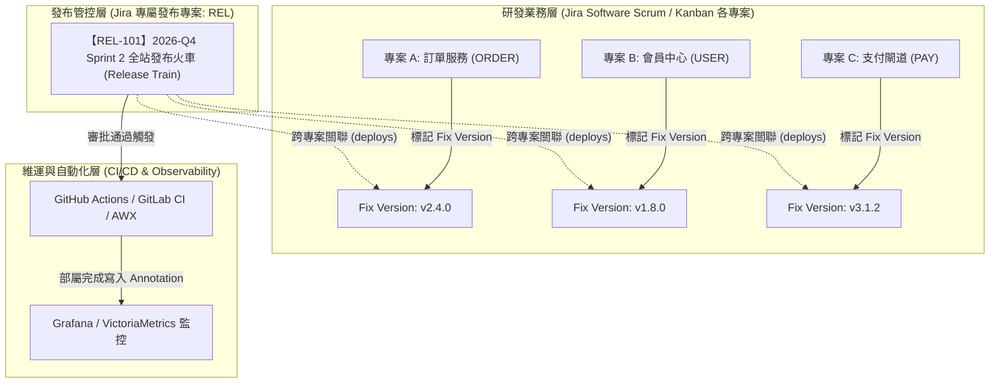
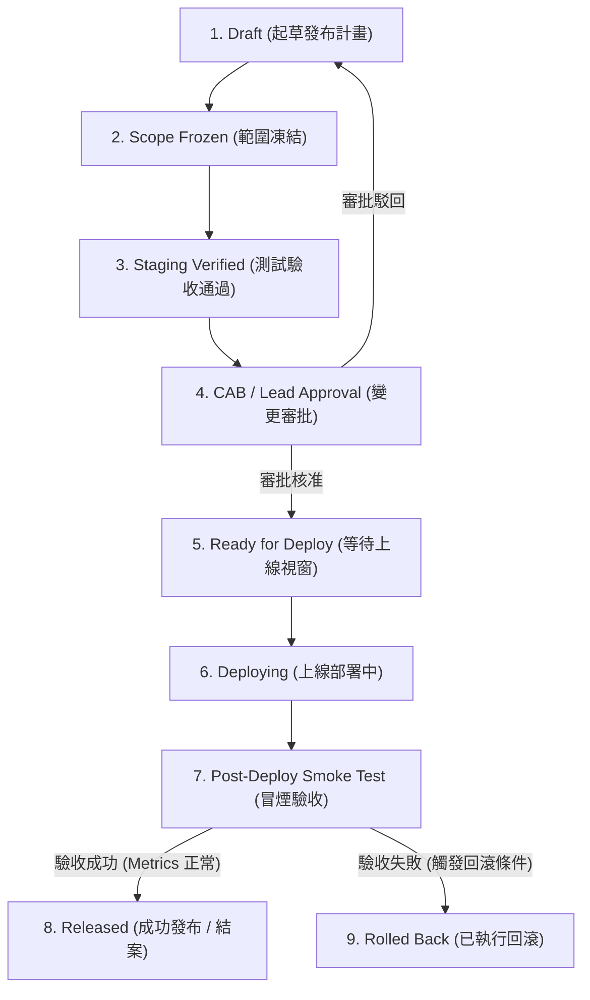
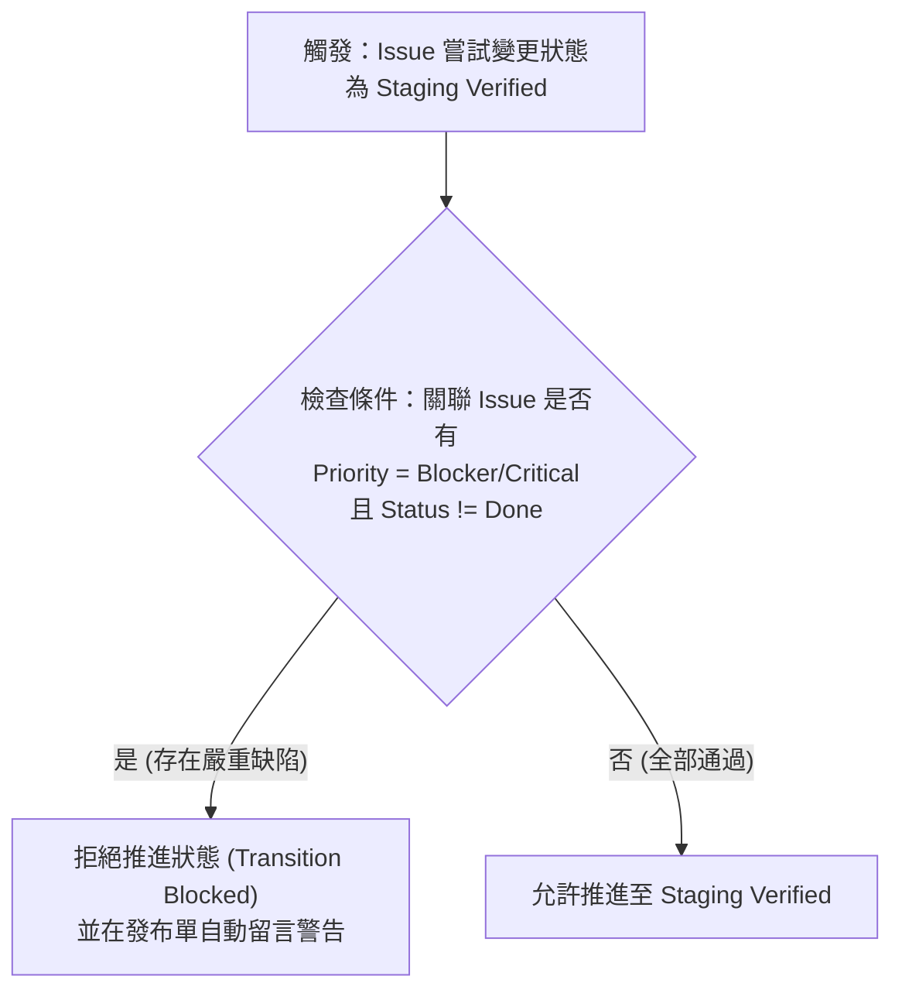

# Jira 企業級發布管理專案設計與落地實戰 :material-source-branch:

> 在雲原生、微服務與分散式架構日益普及的今天，單一系統往往由數十個甚至上百個獨立服務組成。當各業務團隊以不同的節奏進行迭代時，若缺乏統一的**發布管理（Release Management）**機制，極易引發跨服務版本衝突、環境配置遺漏、未預期的停機或緊急回滾。本文深入探討如何透過 Jira 打造企業級專屬發布管理專案（專案代碼通常為 `REL` 或 `RELEASE`），結合敏捷開發、ITIL 變更審核（CAB）與現代 DevOps 自動化，建立安全、透明、可回溯的上線防禦體系。

---

## 1. 核心痛點與雙層發布設計哲學

### 1.1 傳統發布模式的典型痛點

- **依賴黑洞與上線順序混亂**：微服務 A 依賴微服務 B 的新 API，但因發布無序，微服務 A 提早上線導致線上報錯。
- **缺乏強制性品質門禁**：開發者逕自標記完成，但 Staging 環境冒煙測試尚未執行，或存在未結案的嚴重缺陷（Critical Bug）。
- **回滾計畫流於形式**：上線遭遇重大障礙時，現場手忙腳亂，缺乏事前核准且可執行的資料庫相容性與降級回滾 SOP。
- **缺乏審計與可觀測性標記**：事後無法追溯特定時間點部署了哪些代碼變更；監控系統出現錯誤率陡增時，無法直觀關聯到哪一次發布。

### 1.2 雙層發布管理架構 (Two-Tier Model)

為了解決上述痛點，企業應建立**「業務研發」與「發布管控」分離但緊密聯動**的雙層架構：



- **業務層（下層）**：各研發團隊在自身專案（如 `ORDER`, `USER`）中管理 Story、Task、Bug。當需求測試完畢，統一打上對應模組的 `Fix Version`。
- **發布管控層（上層）**：由 Release Manager、Tech Lead 或 SRE 在專屬的 `REL` 專案中開立發布火車單，將多個團隊的 Fix Version 或關鍵 Issue 匯整納入，集中進行變更審批、風險評估與發布排程。

---

## 2. Issue Types（工單類型與分級設計）

在 `REL` 發布管理專案中，不建議使用通用的 Task 或 Story，應定義專屬的 Issue Types 以體現不同的風險分級與審批通道：

| Issue Type | 圖示 | 說明與適用場景 | 審批通道 (Approval Gate) |
| :--- | :--- | :--- | :--- |
| **Release Train** | :material-train: | **定期發布火車**：例行性排程發布（如雙週常規發布、大版本上線），匯整多系統交付物。 | 需經架構師、QA 負責人與 CAB 委員會共同審核。 |
| **Standard Change** | :material-checkbox-marked-circle: | **標準變更**：低風險、流程標準化且常態執行的變更（如環境配置同步、前端靜態資產更新）。 | 走預先核准（Pre-approved）通道，主管複核即可上線。 |
| **Emergency / Hotfix** | :material-fire: | **線上緊急修復**：針對線上 P1/P0 事故或零日漏洞（0-day）的緊急熱修復。 | 走加急綠色通道，On-Call 主管口頭/即時核准後上線，事後補齊單據。 |
| **Rollback Ticket** | :material-undo: | **發布回滾單**：上線驗收不符預期而執行回滾時建立，用於記錄降級過程與事後覆盤。 | 需記錄回滾起止時間與受影響範圍，直接觸發事後覆盤（Post-Mortem）。 |

---

## 3. 發布工作流與八階段品質門禁 (Workflow & Gates)

發布工作流必須具備嚴格的狀態條件（Conditions）、欄位驗證器（Validators）與後處理動作（Post Functions），確保無人可繞過安全審查。



### 3.1 各階段門禁規則 (Quality Gates) 詳解

```text
+-------------------------------------------------------------------------------+
| 發布階段              門禁檢查條件 (Gates & Validators)                       |
+-------------------------------------------------------------------------------+
| 1. Draft             - 建立發布計畫，初步排定發布視窗與預計交付項目。          |
| 2. Scope Frozen      - 發布視窗前 48 小時鎖定範圍，禁止再掛載新 Feature；     |
|                      - 僅允許標註為 Blocker 的 Bug 修復進入發布分支。          |
| 3. Staging Verified  - 自動檢查關聯的所有業務 Issue：                         |
|                        * 所有 Linked Issues 必須為 Done / Resolved；          |
|                        * 不得有任何開啟狀態的 Blocker / Critical 缺陷。       |
| 4. CAB Approval      - 必填驗證：                                             |
|                        * 「回滾計畫 (Rollback Plan)」不得為空；               |
|                        * 「資料庫結構變更 (DB Migration)」需標註是否具相容性；|
|                        * 「預估停機時段 (Downtime)」必須明確填寫。            |
| 5. Ready for Deploy  - 審批通過，鎖定待命，系統自動發布 Slack/Teams 預告。    |
| 6. Deploying         - 執行 CI/CD 部署流水線，對外服務進入維持或維護狀態。    |
| 7. Smoke Testing     - 上線後進入 15~30 分鐘驗證期：                          |
|                        * QA 執行核心業務主流程測試；                          |
|                        * SRE 監控 APM 錯誤率與 P99 延遲未破警戒線。           |
| 8. Released          - 驗收完畢，自動向 Grafana 發布 Annotation，工單結案。   |
| 9. Rolled Back       - 若指標異常超標，依回滾 SOP 降級並建立 Rollback 單。    |
+-------------------------------------------------------------------------------+
```

---

## 4. 核心自訂欄位配置 (Custom Fields)

為了確保發布資訊完備，建議在 Jira 欄位配置中建立專屬 Screen，並依主題分類：

| 欄位名稱 (Field Name) | 欄位型態 | 必填性 | 說明與標準範例 |
| :--- | :--- | :--- | :--- |
| **Release Version** | Single Select / Text | 必填 | 發布版本標籤（例如：`v2026.11.0` 或 `2026-Sprint-4`）。 |
| **Target Environment** | Checkbox / Multi-Select | 必填 | 目標環境：`Staging`、`Pre-Prod`、`Production`。 |
| **Impacted Services** | Multi-Select / Component | 必填 | 受影響之微服務清單（如 `order-service`, `payment-gw`）。 |
| **Deployment Window** | Date Time Range | 必填 | 排定之上線維護視窗（如 `2026-10-25 02:00 ~ 04:00 UTC+8`）。 |
| **Downtime Required** | Radio (`Yes` / `No`) | 必填 | 是否需暫停對外服務。若為 `Yes` 需附上公關與客服通知方案。 |
| **Change Risk Level** | Select (`Low`, `Med`, `High`, `Crit`) | 必填 | 風險評級。`High` 與 `Crit` 需額外進行架構長簽核。 |
| **Rollback Plan** | Multi-line Text (Markdown) | 必填 | **關鍵合規欄位**：詳細回滾指令、資料庫回退腳本與耗時預估。 |
| **DB Migration Involved**| Radio (`None`, `Compatible`, `Breaking`) | 必填 | 資料庫結構異動屬性。嚴禁在熱部署中包含破壞性改動。 |
| **CI/CD Pipeline Link** | URL | 選填 | GitHub Actions / GitLab Pipeline 執行連結。 |
| **Observability Dashboard** | URL | 選填 | 該次發布對應之 Grafana / VictoriaMetrics 儀表板 URL。 |

---

## 5. Jira Automation 自動化實戰

善用 Jira 內建的 **Automation for Jira**，能將發布流程與 GitHub、通訊軟體及監控平台完全打通，大幅降低手動同步的疏漏。

### 5.1 自動防禦檢查：阻擋存在嚴重缺陷的發布

當發布單嘗試從 `Scope Frozen` 推進至 `Staging Verified` 時，自動檢查所有被本次發布包含的關聯問題：



### 5.2 與 GitHub Release Tag 雙向聯動

當工程師在 GitHub 建立正式 Release Tag 或觸發生產部署時，透過 Webhook 呼叫 Jira Automation：

```yaml
# GitHub Actions 工作流程範例：通知 Jira 發布單推進狀態
name: Notify Jira on Production Deploy

on:
  release:
    types: [published]

jobs:
  notify-jira:
    runs-on: ubuntu-latest
    steps:
      - name: Transition Jira Release Ticket
        run: |
          # 呼叫 Jira Automation Webhook 觸發器
          curl -X POST -H "Content-Type: application/json" \
            -d '{
              "issues": ["${{ github.event.release.name }}"],
              "data": {
                "releaseTag": "${{ github.event.release.tag_name }}",
                "pipelineUrl": "${{ github.server_url }}/${{ github.repository }}/actions/runs/${{ github.run_id }}"
              }
            }' \
            "${{ secrets.JIRA_AUTOMATION_WEBHOOK_URL }}"
```

### 5.3 上線狀態跨平台即時廣播

設定自動化規則：當 `REL` 工單狀態進入 `Deploying` 或 `Released` 時，透過 Incoming Webhook 同步推播至 Microsoft Teams、Slack 或 Pushover：

```json
// 發送至 Slack / Teams 頻道的廣播 JSON 範例
{
  "text": "🚀 *【生產環境發布通知】* 狀態已變更為：*{{issue.status.name}}*\n- **發布版本**：`{{issue.Release Version}}`\n- **發布單號**：<{{issue.url}}|{{issue.key}}>\n- **維護時段**：{{issue.Deployment Window}}\n- **受影響服務**：{{issue.Impacted Services}}\n- **執行負責人**：{{issue.assignee.displayName}}"
}
```

### 5.4 於 Grafana / VictoriaMetrics 打上發布標記 (Annotation)

當發布單狀態變更為 `Released` 時，自動發送 HTTP POST 至 Grafana API，在監控圖表上劃出一道發布垂直線，使 SRE 能一目了然該變更與指標趨勢的因果關係：

```bash
# Jira Automation 發送 HTTP 請求動作
POST https://grafana.example.com/api/annotations
Headers:
  Authorization: Bearer <GRAFANA_API_KEY>
  Content-Type: application/json
Body:
{
  "dashboardUID": "order-observability-360",
  "time": {{now.toEpochMilli}},
  "tags": ["release", "{{issue.Release Version}}", "production"],
  "text": "正式發布完成：{{issue.key}} ({{issue.summary}})"
}
```

---

## 6. JQL 查詢與發布看板運作

### 6.1 必備 JQL 快速查詢過濾器 (Filters)

**過濾本週即將上線、但尚未完成審查的發布單**：

```sql
project = REL AND issuetype in ("Release Train", "Standard Change") 
  AND "Deployment Window[Start]" >= startOfWeek() 
  AND status not in ("Ready for Deploy", "Released", "Rolled Back")
```

**查詢掛載於本次發布中，但開發狀態尚未完成的業務工作**：

```sql
issue in linkedIssues("REL-101", "deploys") AND statusCategory != Done
```

**查詢最近 30 天內曾經觸發回滾的發布紀錄**：

```sql
project = REL AND (issuetype = "Rollback Ticket" OR status = "Rolled Back") 
  AND updated >= -30d ORDER BY created DESC
```

### 6.2 結合 Jira Release Hub (Fix Versions)

在 Jira 各業務專案的 **Releases** 頁籤中：

1. **版本狀態即時燃盡**：直觀呈現未開始（To Do）、進行中（In Progress）與已完成（Done）的 Story 比例。
2. **警示未預期的變更**：若有問題在發布分支建立後才被硬塞入該版本，Release Hub 會自動標示「Issues added after release creation」警告。
3. **自動產生 Release Notes**：點擊右上角「Release」，Jira 可一鍵匯出符合本次發布範圍的 HTML / Markdown 變更摘要（包含 Bug 修復、新功能與技術重構清單），直接作為產品上線公告。

---

## 7. 最佳實踐總結

1. **嚴禁跳過回滾計畫**：無論變更看似多小，均必須具備經審核的回滾 SOP，落實「未思進，先思退」。
2. **落實雙層關聯 (Issue Linking)**：永遠透過 `REL` 專案主導全局，透過 `deploys` / `is deployed by` 關聯底層各業務 Issue，保持整體脈絡透明。
3. **主動聯動觀測性**：將發布事件與 APM / TSDB 監控標記結合，讓每一次代碼異動都在可觀測性雷達下透明運行。
