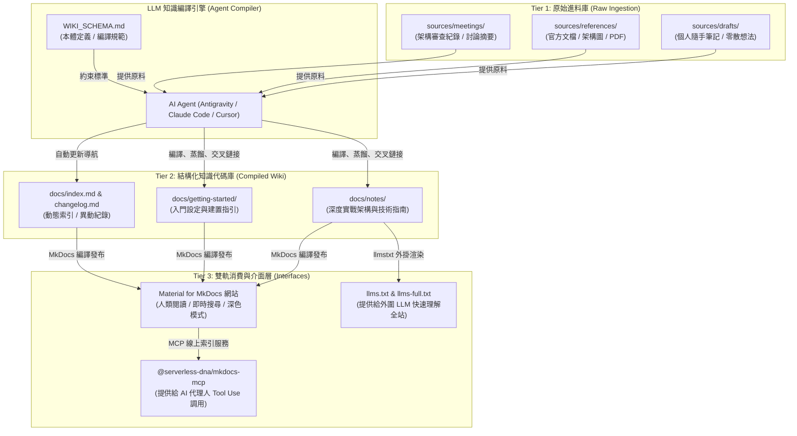

# LLM-Wiki + MkDocs 智慧知識庫架構與實戰指南 :material-brain:

> 傳統的個人與團隊知識管理長期面臨兩大困境：人工整理維護成本過高導致文檔迅速過期；而新興的檢索增強生成（RAG）又具備無狀態（Stateless）、片段化與缺乏全局脈絡的局限。AI 研究員 **Andrej Karpathy** 提出了 **「LLM-Wiki」** 的全新知識管理範式——**「Markdown 是代碼庫，LLM 是編譯器，IDE/網站是展示運行時」**。本文深入剖析本專案如何將 LLM-Wiki 理念與 **Material for MkDocs** 完美融合，打造一套兼顧人類閱讀體驗與 AI 代理人持續進化的現代化智慧知識庫。

---

## 1. 核心理念：從傳統 RAG 到持續編譯式知識庫

### 1.1 傳統筆記、RAG 與 LLM-Wiki 的本質差異

| 比較維度 | 傳統人工筆記 (Notion / Obsidian) | 傳統 RAG 檢索管線 | LLM-Wiki + MkDocs (本架構) |
| :--- | :--- | :--- | :--- |
| **知識整理者** | 人類手工梳理、打標籤、排版 | 無人整理，直接將文字切塊 (Chunking) | **LLM 作為編譯器**，自動蒸餾與結構化 |
| **知識狀態** | 容易斷更、資訊孤島嚴重 | 無狀態（每次問答臨時算向量重組） | **具備狀態與累積演進 (Stateful & Compounding)** |
| **關聯性與脈絡** | 仰賴人類記憶手動鏈接 | 片段切片，遺失跨章節宏觀因果 | **主動維護雙向鏈接與主題圖譜 (Cross-Linked)** |
| **人機協作分工** | 人類負責所有粗活與細活 | 人類僅提問，難以驗證檢索品質 | 人類專注於**素材篩選與審查**，AI 負責**結構化編譯** |

### 1.2 經典隱喻：軟體工程與知識編譯

Karpathy 將個人知識庫比喻為大型軟體專案：

- **Raw Sources（原始素材）**：如同需求規格書、客戶反饋與第三方庫。
- **LLM（大型語言模型）**：如同軟體工程師與編譯器，負責將需求轉化為清晰、模組化且相互引用的代碼。
- **Markdown Docs（知識本體）**：如同乾淨、重構完備的源代碼庫。
- **MkDocs / Material（渲染平台）**：如同編譯產出的可執行檔案與現代化 Web 介面。

---

## 2. LLM-Wiki + MkDocs 三層全景架構

本專案採用明確的三層架構（Three-Tier Architecture），確保原始素材進料、結構化沉澱與對外發布權責分離：



---

## 3. 四階段知識編譯流水線 (The 4-Stage Pipeline)

當使用者將新素材放置於 `sources/`，AI Agent 會遵循 [WIKI_SCHEMA.md](file:///Users/luke.chen/Documents/github/windcold-kb/WIKI_SCHEMA.md) 規範執行四個階段：

### 階段一：Ingest（素材攝取）

- 掃描 `sources/` 下的新進文件，分析主題屬於可觀測性、容器編排、DevOps 還是架構設計。
- 檢查知識庫現有目錄與檔案，確認是「擴充既有主題」還是「開闢全新主題」。

### 階段二：Synthesize & Structure（概念蒸餾與結構化）

- 撰寫具備清晰層次的繁體中文技術手冊，必須包含：
  - 標準 **YAML Frontmatter**（包含 `icon`、精確 `description`、3~8 個精準 `tags`）。
  - **問題背景與架構全景**（附 Mermaid 圖表）。
  - **生產可用代碼 / 配置**（嚴禁虛擬偽代碼，確保即用性）。
  - **踩坑排查與最佳實踐對比表**。

### 階段三：Cross-Link & Graph Integration（雙向交叉鏈接）

- **杜絕知識孤島**：每篇新文檔必須主動引用關聯頁面。例如：
  - 討論分散式鏈路追蹤時，主動引用 [OpenTelemetry + VictoriaMetrics 實戰指南](otel-victoriametrics-fullstack-guide.md)。
  - 討論上線部署門禁時，主動引用 [Jira 企業級發布管理實戰](jira-release-management-guide.md)。
  - 討論 K8s 故障自動修復時，主動引用 [RunWhen 智慧排障實戰](runwhen-kubernetes-guide.md)。

### 階段四：Quality Assurance & Verification（嚴格品質驗證）

- 執行本地語法與建置雙重檢核：

  ```bash
  # 1. Markdown 語法檢驗 (0 errors)
  npm run lint:md

  # 2. MkDocs 嚴格建置檢驗 (0 warnings)
  source .venv/bin/activate
  mkdocs build --strict
  ```

- 更新 `mkdocs.yml` 導覽列與 `changelog.md`。

---

## 4. 機器與 AI 存取層：llms.txt 與 MCP 整合

本知識庫不僅面向人類讀者，更原生設計為**「AI-Native（AI 原生友善）」**：

### 4.1 標準 `llms.txt` 與 `llms-full.txt`

透過 `mkdocs.yml` 中的 `llmstxt` 外掛，網站建置時會自動生成：

- **`/llms.txt`**：提供給任何 LLM 客戶端（如 ChatGPT、Claude）讀取的精簡結構化清單，包含全站頁面摘要與鏈接。
- **`/llms-full.txt`**：將全站技術手冊組裝為單一高密度的純文字檔，便於直接灌入 Context Window 進行全庫推理。

### 4.2 內建 Model Context Protocol (MCP)

透過 `@serverless-dna/mkdocs-mcp`，任何終端 AI 助理皆可免安裝環境，直接將本知識庫作為外部資料來源：

```bash
# 啟動本知識庫線上 MCP 服務端點
npx -y @serverless-dna/mkdocs-mcp https://windcoldchen.github.io/windcold-kb/ "Windcold 知識庫"
```

---

## 5. 人機協同日常工作流指南

在「LLM-Wiki + MkDocs」體系下，日常知識維護變得極其輕盈自然：

```text
1. 收集素材 ───> 將粗糙的靈感、文章或會議筆記儲存至 sources/drafts/
2. 發起編譯 ───> 對 AI 說：「請依據 WIKI_SCHEMA.md 將 sources/drafts/xxx.md 編譯入知識庫」
3. 自動作業 ───> AI 自動開立分支、完成撰寫、建立雙向鏈接、更新 mkdocs.yml
4. 品質驗證 ───> 本地執行 npm run lint:md 與 mkdocs build --strict
5. 自動發布 ───> AI 發起 PR ➔ GitHub Actions CI 綠燈 ➔ 自動 Squash & Merge ➔ 上線！
```

透過此工作流，知識不再堆積於個人的收藏夾中發霉，而是像高品質開源專案一樣，在 AI 的協助下持續編譯、重構與長青。
