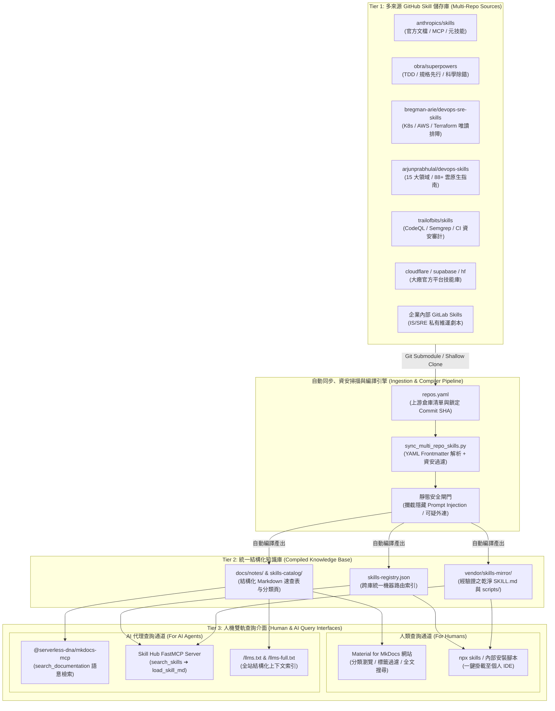

# 建構「多 GitHub Repo AI Skills 聚合知識庫」：人機雙軌查詢架構與實戰指南 :material-database-search:

> 當開源社群湧現數十個高品質的 **AI Agent Skills (`SKILL.md`)** GitHub 儲存庫（如 `anthropics/skills`、`obra/superpowers`、`bregman-arie/devops-sre-skills`、`trailofbits/skills` 等），加上企業內部自建的維運與開發技能庫時，團隊很快會面臨**「技能散落多庫、人類難以跨庫檢索、AI 全量載入塞爆 Context Window」**的新痛點。本文提供一套完整的架構與實作方案，將多個 GitHub 儲存庫聚合為**同時供人類工程師視覺化檢索、以及供 AI 代理人透過 MCP / JSON 索引按需動態調用**的雙軌智慧知識庫。

---

## 1. 為什麼需要「多 Repo AI Skills 聚合知識庫」？

### 1.1 多儲存庫分散管理的四大痛點

1. **人類檢索碎片化**：工程師想找「Kubernetes OOMKilled 排障」或「GitHub Actions 資安審計」技能時，需要逐一翻找 10 多個 GitHub Repo 的目錄，缺乏統一的全文搜尋、標籤過濾與風險等級比較。
2. **AI Context Window 溢位與路由混淆**：若直接將 10 個外部 GitHub Repo（共計 500+ 個 `SKILL.md`）全數安裝進本地 `.agents/skills/` 或 `.claude/skills/`，光啟動階段（Discovery）就會消耗數萬 Tokens，且名稱相近的技能會導致 AI 發生路由誤判。
3. **缺乏安全審查與版本鎖定中樞**：直接從外部多個上游倉庫拉取最新分支，一旦某個外部 Repo 遭植入惡意 Prompt Injection，將直接威脅內部開發與生產環境。
4. **私有知識與開源技能割裂**：開源技能庫缺乏企業內部的環境字典（如內部 Harbor、VictoriaMetrics 端點），需要一個中間編譯層將兩者融合。

### 1.2 人機雙軌查詢（Human & AI Dual-Native）設計目標

| 消費對象 | 核心查詢需求 | 知識庫提供的介面與產出物 | 查詢延遲與 Token 成本 |
| :--- | :--- | :--- | :--- |
| **人類工程師 (For Humans)** | 瀏覽分類全景、比較不同 Repo 技能優劣、查看安全等級、一鍵複製安裝指令或 SOP | **Material for MkDocs 視覺化入口**：分類速查表、標籤索引、全文即時搜尋、渲染後的高可讀性流程圖 | 瀏覽器秒級全文檢索（`search_index.json`） |
| **AI 代理人 (For AI Agents)** | 根據當前任務意圖，從數百個跨 Repo 技能中精準找出 1–2 個最匹配的 `SKILL.md` 並按需載入 | **機器原生介面**：`skills-registry.json` 統一路由清單、`llms.txt`、`@serverless-dna/mkdocs-mcp` 與專屬 **Skill Hub FastMCP Server** | **極低**：僅檢索匹配項，按需載入單一 `SKILL.md`（< 3k Tokens） |

---

## 2. 多 Repo AI Skills 知識庫全景架構

本架構延續本專案 [LLM-Wiki + MkDocs 三層知識架構](llm-wiki-architecture.md) 哲學，將上游多個 GitHub 儲存庫視為 **Tier 1 原料**，經由自動化同步與資安掃描管線編譯為 **Tier 2 結構化目錄**，最終透過 **Tier 3 雙軌介面**同時服務人類與 AI：



---

## 3. 跨儲存庫 AI Skills 結構化速查主索引 (Human & AI Unified Query Matrix)

!!! tip "人機雙向最佳化設計"
    下方速查矩陣同時針對**人類查閱**與 **AI 代理（透過 `mkdocs-mcp` 檢索本頁）**進行結構化設計。每一列皆明確定義了 **`skill_id`**、**所屬 GitHub Repo**、**精確觸發條件 (`when_to_use`)** 與**安全執行邊界**。當 AI 代理搜尋本知識庫時，可直接依據此表決定該載入哪一個技能。

### 3.1 軟體工程紀律、架構設計與元技能索引

| 技能識別碼 (`skill_id`) | 來源 GitHub Repo | 技能路徑 / 名稱 | 核心觸發條件 (`when_to_use` — 供人與 AI 檢索匹配) | 安全等級 | 一鍵按需載入 / 安裝指令 |
| :--- | :--- | :--- | :--- | :--- | :--- |
| **`meta/skill-creator`** | [`anthropics/skills`](https://github.com/anthropics/skills) | `skills/skill-creator` | 當需要從零建立、重構或驗證符合規範的 `SKILL.md` 技能包與目錄結構時 | `L1` 唯讀/生成 | `npx skills add anthropics/skills --skill skill-creator` |
| **`meta/mcp-builder`** | [`anthropics/skills`](https://github.com/anthropics/skills) | `skills/mcp-builder` | 當需要以 Python (FastMCP) 或 TypeScript 開發、除錯與封裝自訂 MCP Server 時 | `L2` 起草代碼 | `npx skills add anthropics/skills --skill mcp-builder` |
| **`eng/brainstorming`** | [`obra/superpowers`](https://github.com/obra/superpowers) | `skills/brainstorming` | 在撰寫任何新功能程式碼或大型架構變更前，強制釐清需求邊界、取捨與設計規格時 | `L1` 互動規劃 | `npx skills add obra/superpowers --skill brainstorming` |
| **`eng/writing-plans`** | [`obra/superpowers`](https://github.com/obra/superpowers) | `skills/writing-plans` | 當需要將複雜架構拆解為 2–5 分鐘顆粒度、具備明確驗收條件的實作計畫書時 | `L1` 規格撰寫 | `npx skills add obra/superpowers --skill writing-plans` |
| **`eng/tdd-workflow`** | [`obra/superpowers`](https://github.com/obra/superpowers) | `skills/test-driven-development` | 當開發新功能或修復 Bug 時，強制執行 `RED ➔ GREEN ➔ REFACTOR` 測試驅動開發循環 | `L2` 測試與實作 | `npx skills add obra/superpowers --skill test-driven-development` |
| **`eng/systematic-debugging`** | [`obra/superpowers`](https://github.com/obra/superpowers) | `skills/systematic-debugging` | 當遭遇未知測試失敗、線上異常或複雜 Bug，需執行四階段科學根因定位而非盲目試錯時 | `L1/L2` 診斷修復 | `npx skills add obra/superpowers --skill systematic-debugging` |
| **`eng/subagent-dev`** | [`obra/superpowers`](https://github.com/obra/superpowers) | `skills/subagent-driven-development` | 當任務包含多個獨立子模組，需由主代理派發多個子代理平行實作並執行雙階段 Code Review 時 | `L2` 多代理協同 | `npx skills add obra/superpowers --skill subagent-driven-development` |

---

### 3.2 DevOps、SRE、Kubernetes 與混合雲維運技能索引

| 技能識別碼 (`skill_id`) | 來源 GitHub Repo | 技能領域 / 名稱 | 核心觸發條件 (`when_to_use` — 供人與 AI 檢索匹配) | 安全等級 | 一鍵按需載入 / 安裝指令 |
| :--- | :--- | :--- | :--- | :--- | :--- |
| **`sre/k8s-troubleshooting`** | [`bregman-arie/devops-sre-skills`](https://github.com/bregman-arie/devops-sre-skills) | `kubernetes` | 當 EKS / RKE2 發生 `CrashLoopBackOff`、`OOMKilled`、`ImagePullBackOff`、Node `NotReady` 或 CNI 網路異常需唯讀排障時 | `L1` 預設唯讀 | `npx skills add bregman-arie/devops-sre-skills` |
| **`sre/terraform-ops`** | [`bregman-arie/devops-sre-skills`](https://github.com/bregman-arie/devops-sre-skills) | `terraform` | 當需要編寫模組化 Terraform、處理 State Drift、執行 `plan` 爆炸半徑評估與安全回滾時 | `L2` 起草與預檢 | `npx skills add bregman-arie/devops-sre-skills` |
| **`sre/incident-response`** | [`nik-kale/sre-skills`](https://github.com/nik-kale/sre-skills) | `incident-response` | 當生產環境觸發 P1/P2 告警，需執行標準事故指揮（IC）、止血分級與事後 Post-Mortem 覆盤報告撰寫時 | `L1` 診斷與報告 | `npx skills add nik-kale/sre-skills` |
| **`devops/observability-field`** | [`arjunprabhulal/devops-skills`](https://github.com/arjunprabhulal/devops-skills) | `observability` | 當設計 OpenTelemetry 採集流水線、Prometheus/VictoriaMetrics 告警規則、SLI/SLO 與黃金訊號儀表板時 | `L2` 配置生成 | `npx skills add arjunprabhulal/devops-skills` |
| **`devops/gitops-cicd`** | [`arjunprabhulal/devops-skills`](https://github.com/arjunprabhulal/devops-skills) | `cicd & gitops` | 當建置或優化 GitLab CI / GitHub Actions 流水線、ArgoCD / Fleet / AWX 部署與自動修剪策略時 | `L2` 流水線起草 | `npx skills add arjunprabhulal/devops-skills` |
| **`ops/terminal-k8s-linux`** | [`chaterm/terminal-skills`](https://github.com/chaterm/terminal-skills) | `kubectl & linux` | 當需要在終端機執行深層 Linux 核心網路診斷（`ss`/`tcpdump`/`journalctl`）與 Helm Release 除錯時 | `L1` 終端機唯讀 | `npx skills add chaterm/terminal-skills` |

---

### 3.3 DevSecOps、資安審計與雲端資料平台技能索引

| 技能識別碼 (`skill_id`) | 來源 GitHub Repo | 技能路徑 / 名稱 | 核心觸發條件 (`when_to_use` — 供人與 AI 檢索匹配) | 安全等級 | 一鍵按需載入 / 安裝指令 |
| :--- | :--- | :--- | :--- | :--- | :--- |
| **`sec/ci-actions-auditor`** | [`trailofbits/skills`](https://github.com/trailofbits/skills) | `agentic-actions-auditor` | 當審查 `.github/workflows` 或 `.gitlab-ci.yml` 是否存在命令注入、Prompt Injection 或過大 Token 權限時 | `L1` 靜態資安審計 | `npx skills add trailofbits/skills --skill agentic-actions-auditor` |
| **`sec/differential-review`** | [`trailofbits/skills`](https://github.com/trailofbits/skills) | `differential-review` | 當對關鍵 PR / MR 的程式碼或 IaC Diff 執行深度安全退化審查與攻擊面分析時 | `L1` PR/MR 審查 | `npx skills add trailofbits/skills --skill differential-review` |
| **`sec/static-analysis`** | [`trailofbits/skills`](https://github.com/trailofbits/skills) | `static-analysis` | 當整合 CodeQL、Semgrep 規則並解析 SARIF 漏洞報告以過濾誤報時 | `L1` 掃描分析 | `npx skills add trailofbits/skills --skill static-analysis` |
| **`sec/cloud-k8s-hardening`** | [`BagelHole/DevOps-Security-Agent-Skills`](https://github.com/BagelHole/DevOps-Security-Agent-Skills) | `k8s & cloud-security` | 當強化 K8s `SecurityContext`、`NetworkPolicy`、AWS IAM 最小權限與容器映像檔加固時 | `L2` 合規配置 | `npx skills add BagelHole/DevOps-Security-Agent-Skills` |
| **`cloud/cloudflare-edge`** | [`cloudflare/skills`](https://github.com/cloudflare/skills) | `workers-best-practices` | 當部署 Cloudflare Pages / Workers、Zero Trust Access 或配置 Wrangler 時 | `L2` 邊緣配置 | `npx skills add cloudflare/skills` |
| **`db/postgres-optimization`** | [`supabase/agent-skills`](https://github.com/supabase/agent-skills) | `supabase-postgres-best-practices` | 當設計 PostgreSQL 索引、排查慢查詢、配置連線池或撰寫 RLS 安全策略時 | `L1/L2` DB 調優 | `npx skills add supabase/agent-skills` |
| **`ai/hf-llm-ops`** | [`huggingface/skills`](https://github.com/huggingface/skills) | `hf-cli & trainer` | 當下載開源權重模型、評估硬體VRAM需求或執行模型微調時 | `L2` AI 基建 | `npx skills add huggingface/skills` |

---

## 4. 實戰落地一：多 GitHub Repo 自動聚合與索引編譯器

為了將多個外部 GitHub 儲存庫的 `SKILL.md` 自動收斂進本知識庫，我們可以建立一個宣告式配置檔 `repos.yaml` 與自動編譯腳本 `scripts/sync_multi_repo_skills.py`。

### 4.1 宣告式多庫清單 (`repos.yaml`)

```yaml
# repos.yaml — 定義欲納入知識庫索引的外部與內部 AI Skill 儲存庫
repositories:
  - id: anthropics-official
    repo: "anthropics/skills"
    url: "https://github.com/anthropics/skills.git"
    branch: "main"
    category: "Official & Meta"
    default_tier: "L1"

  - id: obra-superpowers
    repo: "obra/superpowers"
    url: "https://github.com/obra/superpowers.git"
    branch: "main"
    category: "Engineering Methodology"
    default_tier: "L2"

  - id: devops-sre-bregman
    repo: "bregman-arie/devops-sre-skills"
    url: "https://github.com/bregman-arie/devops-sre-skills.git"
    branch: "main"
    category: "DevOps & SRE"
    default_tier: "L1"

  - id: devops-field-guides
    repo: "arjunprabhulal/devops-skills"
    url: "https://github.com/arjunprabhulal/devops-skills.git"
    branch: "main"
    category: "DevOps & Cloud Native"
    default_tier: "L2"

  - id: trailofbits-security
    repo: "trailofbits/skills"
    url: "https://github.com/trailofbits/skills.git"
    branch: "main"
    category: "SecOps & Auditing"
    default_tier: "L1"
```

### 4.2 多庫 `SKILL.md` 萃取、資安掃描與雙軌編譯腳本 (`scripts/sync_multi_repo_skills.py`)

此腳本會自動從各 GitHub 倉庫抓取所有 `SKILL.md`，解析其 YAML Frontmatter（`name`、`description`），執行靜態安全掃描，並同時產出：

1. **供 AI 代理毫秒級查詢的 `docs/skills-registry.json`**。
2. **供人類工程師在 MkDocs 網站閱讀與搜尋的 Markdown 總覽表**。

```python
#!/usr/bin/env python3
"""
多 GitHub Repo AI Skills 自動聚合、資安掃描與雙軌索引編譯器
同時產出供人類閱讀之 MkDocs Markdown 目錄與供 AI 查詢之 skills-registry.json
"""
from pathlib import Path
import json
import re
import subprocess
import tempfile
import yaml

SUSPICIOUS_PATTERNS = [
    r"curl\s+.*\|\s*(ba)?sh",
    r"wget\s+.*\|\s*(ba)?sh",
    r"ignore\s+all\s+previous\s+instructions",
    r"<\!--.*(system|override|exfiltrate).*-->",
]


def parse_skill_frontmatter(md_content: str) -> dict:
    """解析 SKILL.md 頂部的 YAML Frontmatter"""
    match = re.match(r"^---\s*\n(.*?)\n---\s*\n", md_content, re.DOTALL)
    if not match:
        return {}
    try:
        data = yaml.safe_load(match.group(1))
        return data if isinstance(data, dict) else {}
    except yaml.YAMLError:
        return {}


def scan_security_risks(md_content: str) -> list[str]:
    """靜態掃描 SKILL.md 是否包含可疑的 Prompt Injection 或高風險遠端執行指令"""
    warnings = []
    for pattern in SUSPICIOUS_PATTERNS:
        if re.search(pattern, md_content, re.IGNORECASE | re.DOTALL):
            warnings.append(f"Matched high-risk pattern: {pattern}")
    return warnings


def sync_and_compile_catalog(manifest_path: str, output_json: str, output_md: str) -> None:
    manifest = yaml.safe_load(Path(manifest_path).read_text(encoding="utf-8"))
    registry_entries = []

    with tempfile.TemporaryDirectory() as tmpdir:
        for repo_cfg in manifest.get("repositories", []):
            repo_name = repo_cfg["repo"]
            repo_dir = Path(tmpdir) / repo_cfg["id"]

            # 淺層複製最新分支
            subprocess.run(
                ["git", "clone", "--depth", "1", "--branch", repo_cfg["branch"], repo_cfg["url"], str(repo_dir)],
                check=True,
                capture_output=True,
            )
            commit_sha = subprocess.check_output(
                ["git", "-C", str(repo_dir), "rev-parse", "--short", "HEAD"],
                text=True,
            ).strip()

            # 掃描倉庫內所有的 SKILL.md
            for skill_file in sorted(repo_dir.rglob("SKILL.md")):
                rel_path = skill_file.relative_to(repo_dir).as_posix()
                content = skill_file.read_text(encoding="utf-8", errors="ignore")
                meta = parse_skill_frontmatter(content)
                sec_warnings = scan_security_risks(content)

                skill_name = meta.get("name") or skill_file.parent.name
                description = str(meta.get("description", "No description provided.")).strip().replace("\n", " ")

                registry_entries.append({
                    "skill_id": f"{repo_cfg['id']}/{skill_name}",
                    "name": skill_name,
                    "repo": repo_name,
                    "commit_sha": commit_sha,
                    "category": repo_cfg["category"],
                    "governance_tier": repo_cfg["default_tier"],
                    "relative_path": rel_path,
                    "raw_url": f"https://raw.githubusercontent.com/{repo_name}/{commit_sha}/{rel_path}",
                    "install_cmd": f"npx skills add {repo_name} --skill {skill_name}",
                    "description": description,
                    "has_scripts": (skill_file.parent / "scripts").is_dir(),
                    "has_references": (skill_file.parent / "references").is_dir(),
                    "security_verified": len(sec_warnings) == 0,
                    "security_warnings": sec_warnings,
                })

    # 1. 輸出供 AI Agent 與 MCP Server 查詢的結構化 JSON 索引
    Path(output_json).write_text(
        json.dumps({"total_skills": len(registry_entries), "skills": registry_entries}, ensure_ascii=False, indent=2),
        encoding="utf-8",
    )

    # 2. 輸出供人類閱讀與 MkDocs 全文檢索的 Markdown 表格
    lines = [
        "# 自動編譯跨儲存庫 AI Skills 總覽表",
        "",
        "| 技能名稱 | 所屬倉庫 | 分類 | 治理層級 | 功能與觸發條件摘要 | 安裝指令 |",
        "| :--- | :--- | :--- | :--- | :--- | :--- |",
    ]
    for item in registry_entries:
        if not item["security_verified"]:
            continue
        lines.append(
            f"| **`{item['name']}`** | `{item['repo']}` (`{item['commit_sha']}`) "
            f"| {item['category']} | `{item['governance_tier']}` "
            f"| {item['description'][:120]} | `{item['install_cmd']}` |"
        )
    Path(output_md).write_text("\n".join(lines) + "\n", encoding="utf-8")


if __name__ == "__main__":
    sync_and_compile_catalog(
        manifest_path="repos.yaml",
        output_json="docs/skills-registry.json",
        output_md="docs/notes/compiled-skills-index.md",
    )
```

---

## 5. 實戰落地二：為 AI 代理打造的專屬 Skill Hub MCP Server

若要讓任何 AI 代理人（Claude Desktop、Antigravity、Cursor 或內部 KeepHQ AIOps Agent）**無須在本地預先安裝數百個技能**，就能即時查詢上述聚合知識庫並動態載入所需的 `SKILL.md`，我們可以提供兩個層次的 MCP 接入方案：

### 方案 A：零代碼免部署 — 直接使用本知識庫內建的 `mkdocs-mcp`

由於本指南第 3 節的「跨儲存庫 AI Skills 結構化速查主索引」已編譯進 MkDocs 的 `search_index.json`，任何 AI 代理只需掛載 `@serverless-dna/mkdocs-mcp`（詳見 [mkdocs-mcp 使用指南](mkdocs-mcp-guide.md)），即可直接用自然語言查詢跨庫技能：

```json
{
  "mcpServers": {
    "windcold-skills-kb": {
      "command": "npx",
      "args": [
        "-y",
        "@serverless-dna/mkdocs-mcp",
        "https://windcoldchen.github.io/windcold-kb/",
        "Windcold 知識庫與跨 Repo AI Skills 檢索中心"
      ]
    }
  }
}
```

### 方案 B：進階動態按需載入 — 建立 `skill_hub_mcp.py` (FastMCP Server)

若希望 AI 不僅能「查到哪個 Repo 有這個技能」，還能**在對話中途直接將遠端經過安全鎖定（Commit SHA）的 `SKILL.md` 原文動態拉入 Context 執行**，可部署以下輕量級 FastMCP 伺服器：

```python
"""
Multi-Repo AI Skill Hub MCP Server
讓 AI 代理跨多個 GitHub Skill 儲存庫執行三階段漸進式查詢與按需載入 (On-Demand Skill Loading)
"""
from mcp.server.fastmcp import FastMCP
import json
import urllib.request

mcp = FastMCP("Windcold-MultiRepo-Skill-Hub")
REGISTRY_URL = "https://windcoldchen.github.io/windcold-kb/skills-registry.json"


def _load_registry() -> list[dict]:
    with urllib.request.urlopen(REGISTRY_URL, timeout=5) as resp:
        data = json.loads(resp.read().decode("utf-8"))
        return data.get("skills", [])


@mcp.tool()
def search_ai_skills(query: str, category: str = "", max_results: int = 5) -> str:
    """
    [Stage 1: Discovery] 跨多個開源與內部 GitHub Skill 儲存庫搜尋匹配的 AI 技能。
    回傳精簡的 skill_id、repo、觸發條件摘要與治理等級，僅消耗極少 Token。
    """
    keywords = [k.lower() for k in query.split() if k.strip()]
    results = []

    for skill in _load_registry():
        if not skill.get("security_verified", False):
            continue
        if category and category.lower() not in skill["category"].lower():
            continue

        searchable_text = f"{skill['skill_id']} {skill['description']} {skill['category']}".lower()
        score = sum(1 for kw in keywords if kw in searchable_text)
        if score > 0:
            results.append((score, skill))

    results.sort(key=lambda x: x[0], reverse=True)
    matched = [
        {
            "skill_id": s["skill_id"],
            "repo": s["repo"],
            "governance_tier": s["governance_tier"],
            "description": s["description"],
            "install_cmd": s["install_cmd"],
        }
        for _, s in results[:max_results]
    ]
    return json.dumps(matched, ensure_ascii=False, indent=2)


@mcp.tool()
def load_skill_instructions(skill_id: str) -> str:
    """
    [Stage 2: Activation] 根據 search_ai_skills 查到的 skill_id，
    動態從經過 Commit SHA 安全鎖定的儲存庫拉取完整 SKILL.md 指令本體供 AI 執行。
    """
    for skill in _load_registry():
        if skill["skill_id"] == skill_id and skill.get("security_verified", False):
            with urllib.request.urlopen(skill["raw_url"], timeout=5) as resp:
                return resp.read().decode("utf-8")
    return f"找不到或未通過安全驗證之技能: {skill_id}"


if __name__ == "__main__":
    mcp.run()
```

---

## 6. 人機協同查詢實戰指南 (How Humans & AI Query This KB)

### 6.1 人類工程師的 3 種日常查詢方式

1. **Web 全文與標籤檢索**：
   - 開啟知識庫網站，按下快捷鍵 `/` 或 `S` 喚出搜尋框，輸入關鍵字（例如 `Trail of Bits`、`TDD`、`K8s 排障`、`Terraform`），即可秒級定位本頁第 3 節的對應儲存庫與一鍵安裝指令。
2. **CLI 終端機即時探索**：
   - 在終端機執行 `npx skills find <keyword>`，或對照本頁表格執行精準單一技能安裝：

     ```bash
     # 僅安裝單一需要的技能，保持本地 Context 乾淨
     npx skills add trailofbits/skills --skill differential-review
     ```

3. **團隊專案級配置共享**：
   - 將挑選出的高價值技能寫入專案根目錄的 `.agents/skills/`（供 Google Antigravity 使用）或 `.claude/skills/`（供 Claude Code 使用），提交至 Git 與全團隊共享。

### 6.2 AI 代理人的自動路由查詢提示詞 (System Prompt / Rule 範本)

在專案的 `AGENTS.md` 或 `GEMINI.md` 中加入以下路由規則，即可讓 AI 自動將本知識庫當作「跨 Repo 技能路由器」：

```markdown
## AI 技能庫動態查詢規範 (Dynamic Skill Routing Rule)

當遇到不熟悉的領域任務（如複雜 K8s 跨層排障、CI/CD 資安審計、TDD 重構、特定雲端服務配置），且本地 `.agents/skills/` 尚未安裝對應技能時：
1. 優先調用 `windcold-kb` MCP 的 `search_documentation` 工具，搜尋 `multi-repo-ai-skills-kb-architecture` 或 `ai-agent-skills-github-repos-guide`。
2. 從檢索到的「跨儲存庫 AI Skills 結構化速查主索引」中，比對最符合當前任務的 `skill_id` 與 `repo`。
3. 若環境已掛載 `Skill-Hub-MCP`，直接調用 `load_skill_instructions(skill_id)` 動態載入該 `SKILL.md` 的專家級 SOP 並嚴格依步驟執行。
```

---

## 7. 延伸閱讀與關聯知識地圖

- **AI Agent Skills 生態與工具鏈深度解析**：
  - [開源 AI Agent Skills (`SKILL.md`) 核心 GitHub 知識庫全景與實戰指南](ai-agent-skills-github-repos-guide.md)
  - [全能型 IS / SRE 團隊 AI 工作流與知識庫架構藍圖](is_sre_team_ai_workflow_blueprint.md)
  - [VS Code 四大訂閱制 AI 整合實戰指南 (Claude Code + ChatGPT + Grok + Google AI Pro)](vscode-multi-ai-integration-guide.md)
- **LLM-Wiki 知識編譯與 MCP 基礎設施**：
  - [LLM-Wiki + MkDocs 智慧知識庫架構與實戰指南](llm-wiki-architecture.md)
  - [使用 mkdocs-mcp 整合 AI 助理指南](mkdocs-mcp-guide.md)
  - [RunWhen 智慧排障與自動化實戰指南](runwhen-kubernetes-guide.md)
