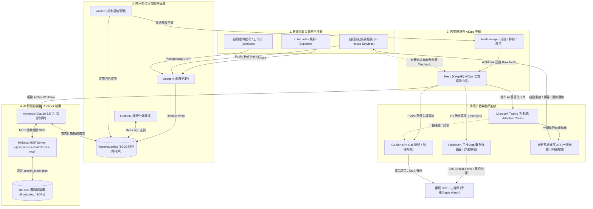

# 新世代智慧可觀測性與 AIOps 告警自癒架構方案 :material-monitor-dashboard:

> 結合 **Grafana**、**VictoriaMetrics**、**Alertmanager** 打造高效時序監控基石，透過 **Keep**、**GoAlert** 與 **Pushover** 實現智慧告警收斂、On-Call 輪值與穿透靜音強提醒，並深度串接 **Claude AI**、**MkDocs 知識庫 (MCP)**、**自研系統** 與 **Microsoft Teams**，建構自動化故障診斷與 ChatOps 一鍵自癒閉環。

---

## 1. 方案概述與核心挑戰

### A. 傳統監控與告警機制的困境

在微服務與分散式架構日益複雜的環境中，企業傳統的監控體系常面臨以下挑戰：

1. **告警疲勞 (Alert Fatigue) 與降噪不足**：單一底層故障（例如資料庫磁碟空間耗盡）可能引發數十個微服務相依性連鎖報警，值班人員被淹沒在重複或次要的告警中。
2. **缺乏即時上下文與根因分析 (RCA)**：傳統通知僅提供冷冰冰的指標數值，排錯需人工翻查各儀表板、日誌與程式碼，無法迅速指出根本成因。
3. **知識庫 (Runbooks/SOP) 割裂**：維運手冊與 SOP 散落在內部文件系統或 Wiki，事故發生當下值班人員難以第一時間查得對應的處置指南。
4. **On-Call 輪值與升級機制不完善**：重要事故因缺乏強制的階梯升級政策 (Escalation Policy) 或電話/語音催辦，容易造成嚴重的延遲處理。
5. **故障處置無法形成自動化閉環**：排查與修復操作需跳轉多個內部系統（自研控制台、K8s CLI、資料庫後台），缺乏標準化的 ChatOps 協同與一鍵自癒能力。

### B. 新世代 AIOps 方案核心價值

本方案針對上述痛點，設計了整合 **監控 ➔ 告警 ➔ 降噪 ➔ AI 診斷 ➔ 知識庫檢索 ➔ On-Call 排班 ➔ ChatOps 協同 ➔ 自研系統自癒** 的完整技術棧：

- **極致高效的監控基石**：採用 **VictoriaMetrics** 替代傳統 Prometheus TSDB，提供高出數倍的寫入吞吐量、低至 1/5 的儲存空間與 1/7 的記憶體消耗，完整相容 PromQL (MetricsQL)。
- **智慧告警編排與 AIOps 中樞**：透過 **Keep (KeepHQ)** 作為跨平台告警匯流排，統一 Alertmanager、Grafana 與自研系統的告警資料模型，執行關聯分析與去重。
- **Claude AI 賦能與 MkDocs 知識庫連動**：在告警觸發第一時間，**Claude** 透過 **Model Context Protocol (MCP)** 自動調閱 **MkDocs 技術知識庫** 內的專屬 Runbook，並調用 VictoriaMetrics 指標趨勢，即時生成根因診斷與修復建議。
- **分級 On-Call 輪值與緊急強提醒 (GoAlert + Pushover)**：整合 **GoAlert** 處理排班與電信語音/SMS 階梯升級；同時結合 **Pushover** 的 **iOS Critical Alerts** 機制，當發生 P1 致命故障時強制穿透值班人員手機的「實體靜音開關與勿擾模式」，並以每 30 秒奪命連環催確保半夜絕不漏接。
- **Teams 互動卡片與自研系統閉環**：透過 **Microsoft Teams Adaptive Cards**，讓值班人員直接在群組內檢閱 AI 診斷摘要、查閱 SOP 連結，並直接點擊自癒按鈕回呼自研系統執行修復動作。

---

## 2. 全景系統架構與資料流向

### A. 整體架構拓撲圖



### B. 告警全生命週期步驟詳解

| 階段 | 負責組件 | 執行動作與核心邏輯 | 預期時效 |
| :--- | :--- | :--- | :--- |
| **1. 異常偵測** | 自研系統 / VM | 自研業務或基礎架構指標突破閾值（如 API 5xx 比例 > 5%），寫入 VictoriaMetrics。 | $T + 0\text{s}$ |
| **2. 規則評估** | vmalert | 依排程頻率（如每 15 秒）評估 PromQL 規則，滿足 `for: 1m` 後向 Alertmanager 發送 Alert。 | $T + 15\text{s}$ |
| **3. 初步收斂** | Alertmanager | 依據標籤（如 `cluster`, `env`, `service`）進行抑制、分組與靜音，透過 Webhook 轉交 Keep。 | $T + 20\text{s}$ |
| **4. AIOps 編排** | KeepHQ | 接收結構化告警，依據工作流引擎分派：呼叫 Claude 進行分析、準備通知頻道。 | $T + 22\text{s}$ |
| **5. AI 根因研判** | Claude + MkDocs MCP | Claude 透過 MCP 查閱 MkDocs 對應的故障排查手冊，比對 VM 近期指標，產出 150 字 RCA 與建議。 | $T + 30\text{s}$ |
| **6. 協同與呼叫** | Teams + Pushover + GoAlert | Teams 呈現豐富化卡片；Pushover 針對值班人員發動穿透靜音的強制強提醒 (每 30 秒催促)；若逾時無人認領，GoAlert 發動電話語音叫醒。 | $T + 35\text{s}$ |
| **7. 一鍵自癒** | Teams ➔ 自研系統 | 工程師在 Teams 卡片點擊「執行隔離/重啟」，WebHook 呼叫自研維運 API，系統恢復正常。 | $T + 60\text{s}$ |

---

## 3. 各組件職責定位與選型優勢

### A. VictoriaMetrics vs 傳統 Prometheus

| 評比維度 | VictoriaMetrics | 傳統 Prometheus |
| :--- | :--- | :--- |
| **記憶體消耗** | **極低**（約 Prometheus 的 $1/5 \sim 1/7$） | 較高，大規模時間序列易發生 OOM |
| **磁碟儲存效率** | **極高壓縮比**（ZSTD 演算法，減少 $70\%\sim80\%$ 空間） | 標準區塊壓縮，歷史數據佔比大 |
| **長期歷史查詢** | 原生支援單機或叢集無限橫向擴展 | 需外掛 Thanos / Cortex 等複雜組件 |
| **查詢語法** | **MetricsQL**（完全向後相容 PromQL，並提供多項延伸函數） | 標準 PromQL |
| **輕量架構** | 單一二進位檔即可運行，組態極簡 | 需要額外維護 TSDB retention 與 WAL |

### B. Keep (KeepHQ) AIOps 引擎

- **多來源統一資料格式**：可同時接收 Prometheus Alertmanager、Datadog、Sentry、AWS CloudWatch 以及自研系統的自定義 Webhook，消除監控孤島。
- **告警降噪與關聯**：透過拓撲與時間滑動窗口，自動將數十個次生告警合併為單一事件群組 (Incident)。
- **宣告式 Workflow**：使用 YAML 格式定義工作流，原生支援整合 Claude / OpenAI、Slack、Teams、Jira、PagerDuty、GoAlert。

### C. GoAlert 開源 On-Call 管理

- **靈活的輪替排班 (Rotations & Schedules)**：支援按週、按日、白夜班輪值排班，解決休假與代理人換班需求。
- **階梯式升級策略 (Escalation Policies)**：若第一線值班者於 5 分鐘內未 Acknowledge，自動升級呼叫第二線主管或主管群，並支援語音電話呼叫。
- **純開源與無授權費用**：企業完全自主掌控數據與隱私，降低昂貴的商業 SaaS (如 PagerDuty / Opsgenie) 費用。

### D. Claude + MkDocs 知識庫 (MCP 連線架構)

- **傳統痛點**：告警內容通常只有 `summary` 與 `description`，缺乏處置智慧，新進同仁常不知如何下手。
- **本方案創新**：MkDocs 透過 `@serverless-dna/mkdocs-mcp` 將企業內部積累的所有技術 SOP、Runbook、架構文檔封裝為 MCP 工具。Claude 接收到告警後，直接調用 `search_documentation` 獲取「該故障的官方標準處置流程」，並結合自研系統標籤與即時指標，組合成客製化診斷報告。

### E. Pushover 專屬行動推播與緊急強提醒

- **補足開源工具無手機 App 缺口**：GoAlert 原生未提供官方 iOS/Android App，結合 Pushover 即可獲得成熟的行動端與 Apple Watch 即時推播能力。
- **iOS Critical Alerts 穿透靜音開關**：針對 P1 致命故障發送 `priority=2`，可強制突破 iPhone 實體靜音鍵與系統「勿擾/睡眠模式」，發出高分貝警報。
- **定時奪命連環催**：支援 `retry=30`（每 30 秒重複鳴響），直到工程師在手機上點擊確認 (Acknowledge) 才會停止。
- **極致性價比**：相較於商業 SaaS 每人每月數十美元的費用，Pushover 個人端為 **$4.99 USD 一次性買斷制**（終生零月費），每月享 10,000 則免費額度。
- **專屬文件參考**：完整功能介紹、API 呼叫與費用方案請參閱 [Pushover 即時推播服務指南](pushover-guide.md)。

---

## 4. 端到端核心組態與設定實戰

### A. VictoriaMetrics 與 vmalert 規則配置

在 `vmalert` 的規則檔案中定義告警條件，標註自研系統標籤與 MkDocs 知識庫 Runbook 連結：

```yaml
# /etc/vmalert/rules/inhouse-alerts.yml
groups:
  - name: InHouseServiceAlerts
    rules:
      - alert: InHouseApiHighErrorRate
        expr: |
          (
            sum(rate(http_requests_total{status=~"5.."}[2m])) by (service, environment)
            /
            sum(rate(http_requests_total[2m])) by (service, environment)
          ) * 100 > 5
        for: 1m
        labels:
          severity: critical
          tier: backend
          service: "{{ $labels.service }}"
          environment: "{{ $labels.environment }}"
        annotations:
          summary: "自研系統服務 {{ $labels.service }} API 錯誤率超過 5%"
          description: "在過去 2 分鐘內，{{ $labels.service }} 的 HTTP 5xx 錯誤率達到 {{ $value | printf \"%.2f\" }}%，已超過 SLA 警示閾值。"
          runbook_url: "https://windcoldchen.github.io/windcold-kb/notes/workflow/#incident-response"
          dashboard_url: "https://grafana.internal.windcold.com/d/inhouse-api?var-service={{ $labels.service }}"
```

### B. Alertmanager 轉送設定

配置 Alertmanager 將接收到的告警轉送至 KeepHQ 的 Webhook 端點：

```yaml
# /etc/alertmanager/alertmanager.yml
global:
  resolve_timeout: 5m

route:
  group_by: ['alertname', 'service', 'environment']
  group_wait: 10s
  group_interval: 30s
  repeat_interval: 2h
  receiver: 'keep-aiops-hub'

receivers:
  - name: 'keep-aiops-hub'
    webhook_configs:
      - url: 'http://keep-backend.monitoring.svc.cluster.local:8080/v1/alerts/event/prometheus'
        send_resolved: true
        http_config:
          bearer_token: 'KEEP_INGEST_API_KEY_SECRET'
```

### C. Keep AIOps 工作流編排 (Keep Workflow)

在 Keep 中定義自動化工作流，負責協調 Claude、MkDocs 檢索、Teams 訊息派發與 GoAlert 升級：

```yaml
# /etc/keep/workflows/aiops_incident_enrichment.yml
workflow:
  id: inhouse-incident-aiops-workflow
  description: "接收 Alertmanager 告警，調用 Claude + MkDocs MCP 分析，發布 Teams 卡片與 GoAlert"
  triggers:
    - type: alert
      filters:
        - key: severity
          value: "critical|high"
  steps:
    # 步驟一：呼叫內部 Claude MCP Agent 進行研判
    - name: claude-rca-analysis
      provider:
        type: http
        config:
          url: "http://ai-agent-service.internal.windcold.com/v1/analyze"
          method: POST
          headers:
            Content-Type: "application/json"
          body:
            alert_name: "{{ alert.name }}"
            service: "{{ alert.labels.service }}"
            description: "{{ alert.annotations.description }}"
            runbook_url: "{{ alert.annotations.runbook_url }}"
            metrics_query: "{{ alert.generatorURL }}"

    # 步驟二：重大告警同步派案至 GoAlert 進行 On-Call 呼叫
    - name: trigger-goalert
      if: "alert.labels.severity == 'critical'"
      provider:
        type: http
        config:
          url: "https://goalert.internal.windcold.com/api/v2/generic/incoming?token=GOALERT_INTEGRATION_KEY"
          method: POST
          headers:
            Content-Type: "application/json"
          body:
            summary: "[{{ alert.labels.environment }}] {{ alert.name }} - {{ alert.labels.service }}"
            details: "Claude 診斷摘要：{{ steps.claude-rca-analysis.output.summary }}\nRunbook: {{ alert.annotations.runbook_url }}"

    # 步驟三：P1 致命告警發送 Pushover Priority 2 穿透靜音警報 (奪命連環催)
    - name: notify-pushover-emergency
      if: "alert.labels.severity == 'critical'"
      provider:
        type: http
        config:
          url: "https://api.pushover.net/1/messages.json"
          method: POST
          headers:
            Content-Type: "application/x-www-form-urlencoded"
          body:
            token: "ENV_PUSHOVER_APP_TOKEN"
            user: "ENV_PUSHOVER_ONCALL_GROUP"
            title: "🔥 [CRITICAL] {{ alert.name }} - {{ alert.labels.service }}"
            message: "Claude 診斷摘要：{{ steps.claude-rca-analysis.output.summary }}\n請立即檢視 SOP 處置！"
            priority: "2"
            retry: "30"
            expire: "3600"
            url: "{{ alert.annotations.runbook_url }}"
            url_title: "📖 開啟 MkDocs Runbook"

  # 動作：發送 Teams Adaptive Card
  actions:
    - name: notify-teams-channel
      provider:
        type: teams
        config:
          webhook_url: "https://windcold.webhook.office.com/webhookb2/TEAMS_WORKFLOW_KEY"
          template: "teams-adaptive-card-template.json"
          params:
            alert: "{{ alert }}"
            claude_analysis: "{{ steps.claude-rca-analysis.output }}"
```

### D. Claude + MkDocs MCP 智慧診斷引擎後台實作

以下為微服務（如 FastMCP 或 Python FastAPI 服務）調用 Claude 與 MkDocs MCP 的核心邏輯：

```python
"""
Claude AI RCA 診斷微服務：
整合 Anthropic Claude 3.5 Sonnet 與 MkDocs MCP Server，
結合即時指標與知識庫 Runbook 產出高精確度診斷結果。
"""
from anthropic import Anthropic
import os
import requests

anthropic_client = Anthropic(api_key=os.getenv("ANTHROPIC_API_KEY"))

def get_mkdocs_runbook_content(query_keyword: str) -> str:
    """
    透過 HTTP 查詢已發布的 MkDocs search_index.json 或本地 MCP Server，
    精確抓取相應故障處置章節內容。
    """
    search_url = "https://windcoldchen.github.io/windcold-kb/search/search_index.json"
    try:
        resp = requests.get(search_url, timeout=5)
        if resp.status_code == 200:
            docs = resp.json().get("docs", [])
            for doc in docs:
                if query_keyword.lower() in doc.get("title", "").lower() or query_keyword.lower() in doc.get("text", "").lower():
                    return f"### 文件標題: {doc.get('title')}\n{doc.get('text')[:1200]}"
    except Exception as e:
        print(f"查詢 MkDocs 知識庫失敗: {e}")
    return "無直接匹配的 Runbook，請參考基礎維運總則。"

def analyze_incident(alert_name: str, service: str, description: str) -> dict:
    # 1. 檢索知識庫 SOP
    sop_content = get_mkdocs_runbook_content(service)

    # 2. 構建 Prompt 請 Claude 評估
    system_prompt = (
        "你是一位擁有 10 年經驗的 Site Reliability Engineer (SRE) 專家。"
        "請根據傳入的告警資訊、當前系統指標以及 MkDocs 知識庫 Runbook，"
        "以客觀、精簡的繁體中文給出：\n"
        "1. 故障可能成因 (Root Cause Hypothesis, 80字內)\n"
        "2. 建議即時處置操作 (Actionable Recommendations, 2~3項條列)\n"
        "3. 是否建議執行自研系統自動重啟/流量降級 (布林值)"
    )

    user_prompt = f"""
    【告警名稱】：{alert_name}
    【影響服務】：{service}
    【告警描述】：{description}
    【MkDocs Runbook 參考內容】：
    {sop_content}
    """

    response = anthropic_client.messages.create(
        model="claude-3-5-sonnet-20241022",
        max_tokens=600,
        temperature=0.2,
        system=system_prompt,
        messages=[{"role": "user", "content": user_prompt}]
    )

    return {
        "analysis_markdown": response.content[0].text,
        "runbook_reference": sop_content[:200] + "..."
    }
```

---

## 5. Microsoft Teams 互動式 Adaptive Card 設計

當告警經過 Keep 與 Claude 豐富化後，會向 Teams SRE 告警頻道推送符合 **Adaptive Cards 1.5** 規範的卡片。

### A. 卡片視覺結構

```text
┌─────────────────────────────────────────────────────────────────┐
│ 🚨 [CRITICAL] InHouseApiHighErrorRate - 支付網關 API            │
│ 環境: Production | 觸發時間: 2026-10-21 23:25:00 CST            │
├─────────────────────────────────────────────────────────────────┤
│ 💡 Claude AI 根因研判摘要:                                     │
│ 經分析近 5 分鐘 VictoriaMetrics 數據，主要為 MySQL 連線池耗盡引發 │
│ 504 Gateway Timeout。比對 MkDocs Runbook，建議優先清理長事務。 │
├─────────────────────────────────────────────────────────────────┤
│ 📖 MkDocs SOP: [支付系統故障排查手冊](https://windcoldchen.github.io/windcold-kb/) │
│ 📊 Grafana:    [檢視支付系統監控盤](https://grafana.internal.windcold.com/)   │
├─────────────────────────────────────────────────────────────────┤
│ [ ⚡ 一鍵重啟 Pod ]   [ 🛡️ 切換降級開關 ]   [ 📞 GoAlert 認領 ] │
└─────────────────────────────────────────────────────────────────┘
```

### B. Adaptive Card JSON 完整定義檔

```json
{
  "$schema": "http://adaptivecards.io/schemas/adaptive-card.json",
  "type": "AdaptiveCard",
  "version": "1.5",
  "msteams": {
    "width": "Full"
  },
  "body": [
    {
      "type": "Container",
      "style": "attention",
      "bleed": true,
      "items": [
        {
          "type": "TextBlock",
          "text": "🚨 系統告警：InHouseApiHighErrorRate",
          "weight": "Bolder",
          "size": "Medium",
          "color": "Attention"
        },
        {
          "type": "TextBlock",
          "text": "服務名稱: payment-gateway-api | 環境: Production",
          "isSubtle": true,
          "spacing": "None"
        }
      ]
    },
    {
      "type": "Container",
      "spacing": "Medium",
      "items": [
        {
          "type": "TextBlock",
          "text": "🤖 Claude AI 根因診斷與修復建議",
          "weight": "Bolder",
          "size": "Default",
          "color": "Accent"
        },
        {
          "type": "TextBlock",
          "text": "比對 VictoriaMetrics 指標趨勢與 MkDocs 知識庫，發現資料庫連線池使用率達 100%，導致下游訂單連鎖超時。建議立即執行臨時連線池動態擴容，並隔離慢查詢交易。",
          "wrap": true
        }
      ]
    },
    {
      "type": "FactSet",
      "facts": [
        { "title": "目前錯誤率", "value": "12.8% (閾值 5%)" },
        { "title": "持續時間", "value": "2 分 45 秒" },
        { "title": "On-Call 值班", "value": "Luke Chen (GoAlert 階梯一)" }
      ]
    }
  ],
  "actions": [
    {
      "type": "Action.OpenUrl",
      "title": "📖 MkDocs 知識庫 SOP",
      "url": "https://windcoldchen.github.io/windcold-kb/notes/workflow/"
    },
    {
      "type": "Action.OpenUrl",
      "title": "📊 Grafana 即時監控盤",
      "url": "https://grafana.internal.windcold.com/"
    },
    {
      "type": "Action.Execute",
      "title": "⚡ 呼叫自研 API 一鍵擴容/自癒",
      "verb": "trigger_remediation",
      "data": {
        "action": "scale_db_pool",
        "service": "payment-gateway-api",
        "environment": "production"
      }
    }
  ]
}
```

---

## 6. 自研系統雙向整合架構

### A. 自研系統暴露與推送 Metrics

自研系統透過官方 Prometheus SDK 或定時工作推送指標至 VictoriaMetrics：

```python
# 自研系統中介軟體 (Python 範例)
from prometheus_client import Counter, Histogram

REQUEST_COUNT = Counter(
    "inhouse_api_requests_total",
    "自研系統業務請求計數",
    ["service", "method", "endpoint", "status"]
)

LATENCY_HISTOGRAM = Histogram(
    "inhouse_api_latency_seconds",
    "自研系統處理延遲分布",
    ["service", "endpoint"]
)
```

### B. 自研自癒 Controller (Webhook Receiver)

當值班者在 Teams 卡片點選「一鍵自癒」動作時，Teams 後台會發起安全 HTTP POST 請求至自研維運 API：

```python
# /app/remediation_controller.py
from fastapi import FastAPI, Header, HTTPException, Depends
from pydantic import BaseModel
import hmac
import hashlib

app = FastAPI()
WEBHOOK_SECRET = "IN_HOUSE_SECURE_HMAC_SECRET"

class RemediationPayload(BaseModel):
    action: str
    service: str
    environment: str

def verify_teams_signature(x_signature: str = Header(None)):
    if not x_signature:
        raise HTTPException(status_code=401, detail="缺少簽章標頭")
    # 進行 HMAC SHA256 驗證
    # ...

@app.post("/v1/remediation/execute", dependencies=[Depends(verify_teams_signature)])
async def execute_remediation(payload: RemediationPayload):
    if payload.action == "scale_db_pool":
        # 呼叫 K8s 或雲端資料庫 API 調配連線池
        print(f"執行自癒: 動態擴大 {payload.service} 連線池")
        return {"status": "success", "message": "連線池已成功擴大至 200"}
    elif payload.action == "restart_pod":
        # 執行 Pod 滾動重啟
        print(f"執行自癒: 重啟服務 {payload.service}")
        return {"status": "success", "message": "已觸發滾動重啟"}
    
    raise HTTPException(status_code=400, detail="不支援的自癒動作")
```

---

## 7. 最佳實踐與資安架構守則

### A. 資安與憑證管控

1. **Webhook 簽章驗證**：Teams 卡片回呼自研系統必須嚴格實施 HMAC SHA-256 簽署機制，杜絕偽造請求。
2. **敏感金鑰統一管理**：所有 API Key（Claude、Keep、GoAlert Token）應儲存於 HashiCorp Vault、AWS Secrets Manager 或 Kubernetes Secrets 中，禁止硬編碼。
3. **MkDocs 知識庫私密性**：若知識庫包含內部架構機密，應透過 [Cloudflare Pages + Access (Entra ID)](file:///Users/luke.chen/Documents/github/windcold-kb/docs/notes/cloudflare-pages-entra-id.md) 施加零信任防護，Claude 查詢時使用專用 Service Token。

### B. 告警治理與防風暴機制 (Anti-Alert Fatigue)

1. **智慧降噪三道防線**：
   - **第一道 (vmalert)**：使用 `for: 3m` 避免瞬間抖動 (Flapping)。
   - **第二道 (Alertmanager)**：使用 `group_by` 與 `inhibit_rules`，底層網路或機房中斷時自動抑制數百個上層 API 告警。
   - **第三道 (KeepHQ)**：藉由時間窗口與拓撲關聯分析，聚合多源告警為單一 Incident。
2. **知識庫 (Runbooks) 維護規範**：
   - 每條告警規則的 `annotations.runbook_url` 必須強制通過 CI 檢查，確保不是無效連結 (Broken Link)。
   - 當架構重構時，MkDocs 知識庫內的故障排查指引需同步在 Pull Request 中修訂。

---

## 8. 總結架構矩陣

```text
┌────────────────────────────────────────────────────────────────────────┐
│                   新世代 AIOps 可觀測性閉環管理架構                      │
├────────────────────┬───────────────────────────────────────────────────┤
│ 時序數據與指標儲存 │ VictoriaMetrics (高效能、超低資源、MetricsQL)       │
│ 視覺化監控面板     │ Grafana (即時儀表板與日誌聯動)                     │
│ 告警收斂與路由     │ Alertmanager ➔ KeepHQ (多源彙整與拓撲關聯)         │
│ AI 智慧大腦       │ Anthropic Claude 3.5 (根因假設分析與處置指引)       │
│ 團隊智慧技術中樞   │ MkDocs 知識庫 (透過 MCP 實現 SOP 即時自動檢索)     │
│ 階梯式 On-Call 輪值│ GoAlert (開源無許可證費用、支援電話/簡訊/語音升級)   │
│ 個人行動推播強提醒 │ Pushover (支援 iOS Critical Alerts 穿透勿擾模式)    │
│ ChatOps 協同平台   │ Microsoft Teams (互動式 Adaptive Cards)           │
│ 維運自癒執行端     │ 自研系統 (Prometheus Metrics + 安全 Webhook API)  │
└────────────────────┴───────────────────────────────────────────────────┘
```
