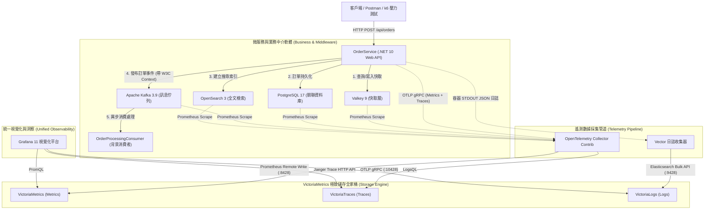

# .NET 10 + OpenTelemetry + VictoriaMetrics 全家桶實戰專案 :material-microsoft-azure-devops:

> 本文為開源專案 **[otel-victoriametrics-dotnet-demo](https://github.com/windcoldchen/otel-victoriametrics-dotnet-demo)** 的完整架構實戰指南，展示如何以最新 **.NET 10** 微服務（OrderService）整合 **PostgreSQL 17、Valkey 9、Apache Kafka 3.9 與 OpenSearch 3**，並透過 **OpenTelemetry Collector + Vector** 雙軌收集機制，全量流轉至 **VictoriaMetrics、VictoriaLogs 與 VictoriaTraces**，實現百萬級高吞吐遙測數據之統一儲存、秒級查詢與 Grafana 360 度跨維度聯動。

---

## 1. 專案定位與核心亮點

本專案旨在提供雲原生環境下**「極致可觀測性」**與**「企業級標準開發治理」**的典範實現：

- **現代化技術棧**：全量採用 **.NET 10 (C# 14)** 與最新主流中介軟體版本。
- **全維度可觀測性 (Observability 360)**：涵蓋 Metrics、Logs、Traces 三大支柱，並具備 Exemplar、Trace-to-Logs 跨維度一鍵下鑽。
- **雙軌日誌與遙測架構**：OTel Collector（4317/4318 OTLP 原生分流）+ Vector（容器 STDOUT 日誌極致效能轉發）。
- **完整中介軟體生態監控**：涵蓋 Valkey 9 快取、Kafka 3.9 訊息隊列、OpenSearch 3 搜尋引擎與 PostgreSQL 17 關聯資料庫。
- **標準企業級 5 階段 CI/CD**：包含靜態語法檢查、零警告編譯、單元測試覆蓋率、Trivy 容器與相依性安全掃描，以及在合併至 `main` 且 .NET 程式變更時自動發布映像檔至 **GitHub Container Registry (`ghcr.io`)**。

---

## 2. 系統拓撲架構圖



---

## 3. OrderService 微服務架構與 OTel 深度整合

微服務採用 .NET 10 開發，透過標準 `System.Diagnostics.ActivitySource` 與 `System.Diagnostics.Metrics.Meter` 宣告領域埋點：

### A. 可觀測性核心指標與診斷定義 (`AppMetrics.cs`)

```csharp
namespace OrderService.Diagnostics;

public static class AppMetrics
{
    public const string ServiceName = "OrderService";
    public const string ServiceVersion = "1.0.0";

    public static readonly ActivitySource ActivitySource = new(ServiceName, ServiceVersion);
    public static readonly Meter Meter = new(ServiceName, ServiceVersion);

    // 業務指標
    public static readonly Counter<long> OrdersCreatedCounter = Meter.CreateCounter<long>("orders_created_total");
    public static readonly Histogram<double> OrderAmountHistogram = Meter.CreateHistogram<double>("order_amount_usd");
    public static readonly UpDownCounter<long> ActiveProcessingOrders = Meter.CreateUpDownCounter<long>("orders_processing_active");

    // 中介軟體專屬指標
    public static readonly Counter<long> ValkeyCacheHitsCounter = Meter.CreateCounter<long>("valkey_cache_hits_total");
    public static readonly Counter<long> ValkeyCacheMissesCounter = Meter.CreateCounter<long>("valkey_cache_misses_total");
    public static readonly Counter<long> KafkaMessagesPublishedCounter = Meter.CreateCounter<long>("kafka_messages_published_total");
    public static readonly Counter<long> OpenSearchDocumentsIndexedCounter = Meter.CreateCounter<long>("opensearch_docs_indexed_total");
    public static readonly Counter<long> PostgresOrdersInsertedCounter = Meter.CreateCounter<long>("postgres_orders_inserted_total");
}
```

### B. W3C TraceContext 跨進程傳播 (Kafka Producer & Consumer)

當訂單建立並推送至 Kafka 時，利用 `OpenTelemetry.Context.Propagation` 將 Trace 鏈路嵌入 Kafka Headers：

```csharp
// 生產者端：注入 W3C TraceContext 至 Kafka Headers
var activity = AppMetrics.ActivitySource.StartActivity("KafkaPublishOrderCreated");
var headers = new Headers();
Propagators.DefaultTextMapPropagator.Inject(
    new PropagationContext(activity?.Context ?? Activity.Current?.Context ?? default, Baggage.Current),
    headers,
    (carrier, key, value) => carrier.Add(key, Encoding.UTF8.GetBytes(value))
);
```

背景消費者 (`OrderProcessingConsumer`) 自佇列取得訊息後，提取該 Header 並建立子 Span，達成非同步事件驅動鏈路的無縫串聯：

```csharp
// 消費者端：提取 Context 延續鏈路追蹤
var parentContext = Propagators.DefaultTextMapPropagator.Extract(
    default,
    consumeResult.Message.Headers,
    (carrier, key) =>
    {
        var header = carrier.FirstOrDefault(h => h.Key == key);
        return header != null ? new[] { Encoding.UTF8.GetString(header.GetValueBytes()) } : Enumerable.Empty<string>();
    }
);
using var consumerActivity = AppMetrics.ActivitySource.StartActivity("KafkaConsumeOrderCreated", ActivityKind.Consumer, parentContext.ActivityContext);
```

---

## 4. 遙測收集管道與後端儲存配置

### A. OTel Collector 路由設計 (`otel-collector-config.yaml`)

OTel Collector 作為中央數據網關，設定多組 Pipelines 分流：

1. **Traces 導向 VictoriaTraces**：透過 `otlp/victoriatraces` exporter 發送至 `victoria-traces:10428`。
2. **Metrics 導向 VictoriaMetrics**：透過 `prometheusremotewrite/victoriametrics` exporter 批量寫入 `http://victoria-metrics:8428/api/v1/write`。
3. **中介軟體 Prometheus Scrapers**：定期拉取 PostgreSQL Exporter (:9187)、Redis/Valkey Exporter (:9121)、Kafka JMX Exporter (:5556) 與 OpenSearch Exporter (:9114)。

### B. Vector 容器日誌管道 (`vector.yaml`)

Vector 直接讀取 Docker Daemon 輸出的容器日誌，經由 JSON 結構化解析與打標後，以高壓縮批次透過 `elasticsearch` 相容協議推送至 **VictoriaLogs (:9428)**，大幅降低記憶體與 CPU 開銷。

---

## 5. Grafana 5 大可觀測性儀表板矩陣

專案預載 5 套專業級 Grafana 看板，開箱即用：

| 儀表板名稱 | 檔案路徑 | 核心監控維度與功能 |
| :--- | :--- | :--- |
| **Order Observability 360** | `order-observability-360.json` | 業務訂單量、金額分佈、RED 指標 (Rate/Errors/Duration)、跨維度 Trace 瀑布圖與關聯日誌。 |
| **Valkey 9 專屬監控** | `valkey-dashboard.json` | 快取命中率、內存記憶體碎片率、連線數與 Command 處理時延。 |
| **Apache Kafka 3.9 專屬監控** | `kafka-dashboard.json` | Broker 入/出流量、消費延遲 (Consumer Lag)、Under-replicated 分區與 ISR 狀態。 |
| **OpenSearch 3 專屬監控** | `opensearch-dashboard.json` | 節點健康度 (Green/Yellow/Red)、JVM Heap 壓力、索引寫入 RPS 與查詢延遲。 |
| **PostgreSQL 17 專屬監控** | `postgresql-dashboard.json` | 連線池使用率、活躍交易數、慢查詢時延、Tuple 讀寫統計與 Cache 命中率。 |

---

## 6. 企業級標準 CI/CD 與 DevSecOps 流程

本專案於 `.github/workflows/ci.yml` 建立了嚴格的 5 階段品質門禁：

```mermaid
flowchart LR
    subgraph S1["階段 1: 靜態語法與規範"]
        L1["YAML / JSON Lint"]
        L2["Docker Compose Config"]
        L3["Hadolint Dockerfile"]
        L4["otelcol validate"]
        L5["dashboard-linter"]
    end

    subgraph S2["階段 2: 編譯與測試"]
        B1["dotnet format"]
        B2["dotnet build --warnaserror"]
        B3["xUnit 單元測試"]
        B4["Cobertura 覆蓋率報告"]
    end

    subgraph S3["階段 3: 軟體供應鏈安全"]
        SC1["dotnet list package --vulnerable"]
        SC2["Aqua Trivy SCA 弱點掃描"]
    end

    subgraph S4["階段 4: 容器構建與發布"]
        D1["Docker Buildx (GHA 快取)"]
        D2["Trivy 容器鏡像 CVE 掃描"]
        D3["條件推送至 ghcr.io (main + dotnet 變更)"]
    end

    subgraph S5["階段 5: 品質決策"]
        QG["$GITHUB_STEP_SUMMARY 決策報告"]
    end

    S1 --> S2 --> S3 --> S4 --> S5
```



### 自動發布至 GitHub Container Registry (`ghcr.io`)

- **智慧變更檢測**：使用 `dorny/paths-filter@v3` 搭配 `fetch-depth: 0`，精確判斷只有在合併至 `main` 且 `src/**` 或 `OrderService.sln` 有修改時觸發。
- **DevSecOps 安全阻斷**：映像檔先在 Runner 本地載入並經過 Trivy 安全掃描，確認零重大 CVE 漏洞後才推送到 GHCR。
- **發布映像檔標籤**：
  - `ghcr.io/windcoldchen/otel-victoriametrics-dotnet-demo:latest`
  - `ghcr.io/windcoldchen/otel-victoriametrics-dotnet-demo:sha-<short>`
  - `ghcr.io/windcoldchen/otel-victoriametrics-dotnet-demo/orderservice:latest`

---

## 7. 本地快速啟動與開發驗證

### 一鍵啟動完整可觀測性環境

```bash
# 複製儲存庫並啟動 11 大核心服務
git clone https://github.com/windcoldchen/otel-victoriametrics-dotnet-demo.git
cd otel-victoriametrics-dotnet-demo
docker compose up -d
```

### 服務端點一覽

- **OrderService API**：`http://localhost:8080/swagger`
- **Grafana 視覺化平台**：`http://localhost:3000` (帳密：`admin / admin`)
- **VictoriaMetrics 儀表**：`http://localhost:8428`
- **VictoriaLogs 檢索**：`http://localhost:9428`
- **VictoriaTraces (Jaeger UI)**：`http://localhost:10428`
- **OpenSearch 儀表板**：`http://localhost:9200`

### 本地 CI 驗證腳本

開發者可在本機直接運行與 CI 一致的檢驗：

```bash
# 完整 CI 流程驗證 (語法檢查 + C# 格式化 + 單元測試 + Docker 建構)
./scripts/run-ci-local.sh

# 快速語法與規範檢查 (包含 otelcol validate 與 dashboard-linter)
./scripts/validate-syntax.sh
```

---

## 8. 總結

`otel-victoriametrics-dotnet-demo` 完整展現了：

1. **.NET 10 與 OpenTelemetry 原生生態的完美契合**。
2. **VictoriaMetrics 全家桶在極高資料吞吐量下的成本優勢與極速體驗**。
3. **企業級標準軟體工程、DevSecOps 品質門禁與自動化發布流程**。

更多技術細節與原始碼，請參閱 GitHub 專案：[windcoldchen/otel-victoriametrics-dotnet-demo](https://github.com/windcoldchen/otel-victoriametrics-dotnet-demo)。
