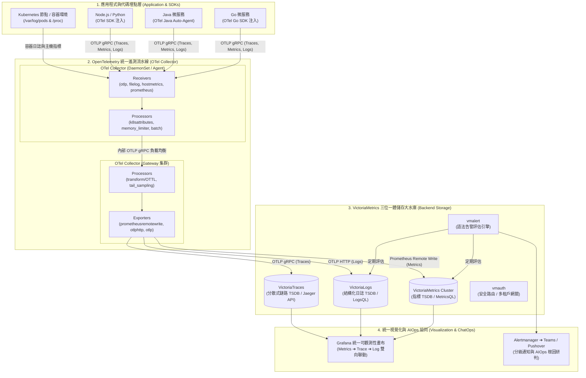

# OpenTelemetry + VictoriaMetrics 全家桶架構與落地實戰指南 :material-rocket-launch:

> 在現代分散式架構與微服務體系中，**OpenTelemetry (OTel)** 憑藉其開放標準、跨語言 SDK 與無與倫比的代碼層生態，已成為全球遙測數據**收集與語意規範**的公認王者；而 **VictoriaMetrics 全家桶 (VictoriaMetrics + VictoriaLogs + VictoriaTraces)** 則憑藉自研 MergeTree 儲存引擎、超高壓縮比與零外部依賴特性，成為**海量數據儲存與秒級查詢**的性價比之巔。本文將兩者深度結合，提供從 OTel 採集流水線、後端三位一體儲存、微服務埋點到 Grafana 跨維度聯動的完整企業級實戰藍圖。

---

## 1. 方案概述與端到端全景架構

本架構遵循**「前端採集大一統，後端儲存極致化」**的核心設計哲學：



### 核心協同優勢

1. **業務零廠商鎖定 (Vendor-Neutral)**：業務應用僅需依賴 CNCF 官方 OpenTelemetry SDK 埋點，無需在代碼中引入任何特定的第三方監控函式庫。
2. **三位一體無外部依賴 (Zero External Dependencies)**：後端指標（VictoriaMetrics）、日誌（VictoriaLogs）與鏈路（VictoriaTraces）皆可直接掛載本地 SSD / 區塊儲存落盤，**徹底擺脫對 AWS S3、MinIO、Elasticsearch 或 ZooKeeper 的繁重維運依賴**。
3. **超高儲存性價比**：相比 Prometheus + Loki + Tempo 組合，整體硬體資源開銷（CPU、記憶體與磁碟儲存）降低 **$60\%\sim80\%$**。

---

## 2. 後端儲存三位一體極簡部署

以下提供在 Kubernetes 或單機 Docker 環境中部署 VictoriaMetrics、VictoriaLogs 與 VictoriaTraces 的生產級配置示範：

### Docker Compose 快速實戰堆疊

```yaml
# docker-compose.observability.yml
version: "3.8"

networks:
  obs-net:
    driver: bridge

volumes:
  vmdata:
  vlogsdata:
  vtracesdata:

services:
  # 1. VictoriaMetrics (時序指標資料庫)
  victoria-metrics:
    image: victoriametrics/victoria-metrics:v1.106.0
    container_name: victoria-metrics
    restart: always
    ports:
      - "8428:8428"
    volumes:
      - vmdata:/victoria-metrics-data
    command:
      - "-storageDataPath=/victoria-metrics-data"
      - "-httpListenAddr=:8428"
      - "-retentionPeriod=30d"
      - "-memory.allowedPercent=60"
    networks:
      - obs-net

  # 2. VictoriaLogs (結構化日誌資料庫)
  victoria-logs:
    image: victoriametrics/victoria-logs:v1.8.0
    container_name: victoria-logs
    restart: always
    ports:
      - "9428:9428"
    volumes:
      - vlogsdata:/victoria-logs-data
    command:
      - "-storageDataPath=/victoria-logs-data"
      - "-httpListenAddr=:9428"
      - "-retentionPeriod=14d"
    networks:
      - obs-net

  # 3. VictoriaTraces (分散式鏈路追蹤資料庫)
  victoria-traces:
    image: victoriametrics/victoria-traces:v0.1.0
    container_name: victoria-traces
    restart: always
    ports:
      - "10428:10428" # Web UI / Jaeger Query 相容埠
      - "4317"        # 內部 OTLP gRPC 埠
    volumes:
      - vtracesdata:/victoria-traces-data
    command:
      - "-storageDataPath=/victoria-traces-data"
      - "-httpListenAddr=:10428"
      - "-retentionPeriod=7d"
    networks:
      - obs-net
```

---

## 3. OpenTelemetry Collector 生產級流水線配置

OTel Collector 作為全域數據處理中樞，負責同時匯聚指標、容器日誌與鏈路數據，並分別分流外發至 VictoriaMetrics、VictoriaLogs 與 VictoriaTraces：

```yaml
# /etc/otelcol/config.yaml
receivers:
  # 1. 接收應用程式推送之 OTLP 數據 (Metrics / Logs / Traces)
  otlp:
    protocols:
      grpc:
        endpoint: 0.0.0.0:4317
      http:
        endpoint: 0.0.0.0:4318

  # 2. 抓取主機節點指標
  hostmetrics:
    collection_interval: 30s
    scrapers:
      cpu:
      memory:
      disk:
      network:
      load:

  # 3. 收集 Kubernetes 容器日誌 (若以 DaemonSet 運行)
  filelog:
    include:
      - /var/log/pods/*/*/*.log
    exclude:
      - /var/log/pods/kube-system_*/*/*.log
    start_at: end
    operators:
      - type: regex_parser
        regex: '^(?P<time>[^ ]+) (?P<stream>stdout|stderr) (?P<logtag>[^ ]*) (?P<log>.*)$'
        timestamp:
          parse_from: attributes.time
          layout: '%Y-%m-%dT%H:%M:%S.%L%z'

processors:
  # 記憶體安全保護，防止大量並發時觸發 OOM
  memory_limiter:
    check_interval: 1s
    limit_percentage: 75
    spike_limit_percentage: 20

  # 批次打包提升網路吞吐與寫入壓縮效率
  batch:
    timeout: 5s
    send_batch_size: 2048

  # 注入 Kubernetes Pod、命名空間與節點等元數據
  k8sattributes:
    auth_type: "serviceAccount"
    passthrough: false
    extract:
      metadata:
        - k8s.pod.name
        - k8s.pod.uid
        - k8s.namespace.name
        - k8s.node.name
        - k8s.deployment.name

  # 使用 OTTL (OpenTelemetry Transformation Language) 進行語意清理
  transform:
    error_mode: ignore
    log_statements:
      - context: log
        statements:
          - set(attributes["env"], "production") where attributes["env"] == nil

exporters:
  # 1. 指標輸出至 VictoriaMetrics (Prometheus Remote Write 協議)
  prometheusremotewrite:
    endpoint: "http://victoria-metrics:8428/api/v1/write"
    resource_to_telemetry_conversion:
      enabled: true # 將 OTel Resource 標籤自動拍平為時序標籤

  # 2. 日誌輸出至 VictoriaLogs (原生 OTLP HTTP 端點)
  otlphttp/victorialogs:
    endpoint: "http://victoria-logs:9428/insert/opentelemetry"
    tls:
      insecure: true

  # 3. 鏈路追蹤輸出至 VictoriaTraces (原生 OTLP gRPC 端點)
  otlp/victoriatraces:
    endpoint: "victoria-traces:10428"
    tls:
      insecure: true

service:
  telemetry:
    logs:
      level: info
  pipelines:
    # 指標處理通道
    metrics:
      receivers: [otlp, hostmetrics]
      processors: [memory_limiter, k8sattributes, batch]
      exporters: [prometheusremotewrite]

    # 日誌處理通道
    logs:
      receivers: [otlp, filelog]
      processors: [memory_limiter, k8sattributes, transform, batch]
      exporters: [otlphttp/victorialogs]

    # 鏈路處理通道
    traces:
      receivers: [otlp]
      processors: [memory_limiter, k8sattributes, batch]
      exporters: [otlp/victoriatraces]
```

---

## 4. 應用微服務 OTel SDK 埋點最佳實踐 (Go 範例)

以下示範微服務如何以標準 OpenTelemetry Go SDK 進行初始化，同時導出 Metrics、Logs 與 Traces，並實現 **W3C TraceContext** 跨進程透傳與日誌鏈路綁定（Log Correlation）：

```go
package main

import (
 "context"
 "log"
 "net/http"
 "time"

 "go.opentelemetry.io/otel"
 "go.opentelemetry.io/otel/exporters/otlp/otlptrace/otlptracegrpc"
 "go.opentelemetry.io/otel/propagation"
 "go.opentelemetry.io/otel/sdk/resource"
 sdktrace "go.opentelemetry.io/otel/sdk/trace"
 semconv "go.opentelemetry.io/otel/semconv/v1.26.0"
 "go.opentelemetry.io/otel/trace"
)

var tracer = otel.Tracer("order-service")

func initTracer(ctx context.Context) (*sdktrace.TracerProvider, error) {
 // 1. 設定 OTLP gRPC Exporter (發送給本機或 Kubernetes 節點上的 OTel Collector)
 exporter, err := otlptracegrpc.New(ctx,
  otlptracegrpc.WithInsecure(),
  otlptracegrpc.WithEndpoint("otel-collector:4317"),
 )
 if err != nil {
  return nil, err
 }

 // 2. 定義統一資源屬性 (Semantic Conventions)
 res, err := resource.Merge(
  resource.Default(),
  resource.NewWithAttributes(
   semconv.SchemaURL,
   semconv.ServiceNameKey.String("order-service"),
   semconv.ServiceVersionKey.String("1.0.0"),
   semconv.DeploymentEnvironmentKey.String("production"),
  ),
 )
 if err != nil {
  return nil, err
 }

 // 3. 註冊全域 TracerProvider
 tp := sdktrace.NewTracerProvider(
  sdktrace.WithBatcher(exporter),
  sdktrace.WithResource(res),
  sdktrace.WithSampler(sdktrace.AlwaysSample()),
 )
 otel.SetTracerProvider(tp)

 // 4. 設定 W3C TraceContext 傳播器
 otel.SetTextMapPropagator(propagation.NewCompositeTextMapPropagator(
  propagation.TraceContext{},
  propagation.Baggage{},
 ))

 return tp, nil
}

func handleCreateOrder(w http.ResponseWriter, r *http.Request) {
 // 跨進程接收 Context
 ctx := otel.GetTextMapPropagator().Extract(r.Context(), propagation.HeaderCarrier(r.Header))
 ctx, span := tracer.Start(ctx, "CreateOrderHandler")
 defer span.End()

 // 取得當前 TraceID 與 SpanID
 traceID := span.SpanContext().TraceID().String()
 spanID := span.SpanContext().SpanID().String()

 // 結構化日誌輸出 (自動嵌入 trace_id，利於 VictoriaLogs 檢索)
 log.Printf("[INFO] trace_id=%s span_id=%s 收到訂單建立請求, payload處理中...", traceID, spanID)

 w.WriteHeader(http.StatusOK)
 w.Write([]byte(`{"status":"success","trace_id":"` + traceID + `"}`))
}

func main() {
 ctx := context.Background()
 tp, err := initTracer(ctx)
 if err != nil {
  log.Fatalf("初始化 Tracer 失敗: %v", err)
 }
 defer tp.Shutdown(ctx)

 http.HandleFunc("/api/order", handleCreateOrder)
 log.Println("Order 服務已啟動，監聽埠 :8080")
 http.ListenAndServe(":8080", nil)
}
```

---

## 5. Grafana 統一畫布與跨維度聯動實戰

在 Grafana 中配置三個數據源，即可體驗**「指標異常 ➔ 點擊 Exemplar 查看鏈路水瀑圖 ➔ 點擊 Data Link 檢索相關日誌」**的三位一體閉環：

### A. 數據源配置清單

1. **時序指標數據源**：
   - 類型：`Prometheus`
   - URL：`http://victoria-metrics:8428`
   - Scrape Interval：`15s`
2. **分散式鏈路數據源**：
   - 類型：`Jaeger`
   - URL：`http://victoria-traces:10428`（VictoriaTraces 完整支援 Jaeger Query HTTP API）
3. **結構化日誌數據源**：
   - 類型：安裝官方 `victorialogs-datasource` 插件
   - URL：`http://victoria-logs:9428`

---

### B. 雙向跨維度聯動設定 (Trace ➔ Log ➔ Metric)

#### 1. 指標關聯鏈路 (Metric ➔ Trace via Exemplars)

在 VictoriaMetrics 中收集的 Prometheus 指標若帶有 Exemplar（例如 API 延遲直方圖包含 `trace_id`）：

- 在 Grafana 的 Prometheus 數據源中啟用 **Exemplars**。
- 設定 Internal Link：`Label Name = trace_id`，目標導向 **Jaeger (VictoriaTraces)** 數據源。
- **效果**：工程師在點擊指標異常突波星號時，瞬間展開 VictoriaTraces 的呼叫鏈路水瀑圖。

#### 2. 鏈路關聯日誌 (Trace ➔ Log via Data Links)

在 Grafana 的 Jaeger 數據源中設定 **Trace to Logs**：

- Target Data Source：選擇 **VictoriaLogs** 數據源。
- 查詢範本 (Query Template)：

  ```text
  _time:15m AND trace_id:"${__trace.id}"
  ```

- **效果**：在水瀑圖中點擊任何慢 Span，右側即刻無縫過濾出該 Span 執行期間列印的所有詳細日誌。

#### 3. 日誌關聯指標 (Log ➔ Metric via LogsQL)

VictoriaLogs 的 LogsQL 原生具備強大的即時聚合運算能力，可直接在日誌面版中繪製時序趨勢：

```text
# 過去 1 小時按服務統計 5xx 錯誤數趨勢
_time:1h status:5* | stats by (_time:1m, service) count() as error_rate
```

---

## 6. 告警閉環與 AIOps 智能診斷 (vmalert + KeepHQ)

架構中整合 `vmalert` 針對指標與日誌同時發動告警，並將結構化事件送入 **[KeepHQ AIOps 引擎](file:///Users/luke.chen/Documents/github/windcold-kb/docs/notes/observability-aiops-architecture.md)** 進行自動化根因研判：

```yaml
# /etc/vmalert/rules/alert-rules.yml
groups:
  # 1. 基於 VictoriaMetrics 指標之規則
  - name: MetricAlerts
    rules:
      - alert: ApiHigh5xxErrorRate
        expr: |
          (
            sum(rate(http_requests_total{status=~"5.."}[2m])) by (service)
            /
            sum(rate(http_requests_total[2m])) by (service)
          ) * 100 > 5
        for: 1m
        labels:
          severity: critical
        annotations:
          summary: "服務 {{ $labels.service }} 錯誤率高於 5%"
          description: "近 2 分鐘內 HTTP 5xx 比例突破 SLA 臨界線。"

  # 2. 基於 VictoriaLogs 日誌之規則 (LogsQL 報警)
  - name: LogAlerts
    rules:
      - alert: DatabaseConnectionPoolExhausted
        expr: |
          count_over_time(_time:2m "connection pool exhausted" OR "deadlock detected")[2m] > 10
        for: 0m
        labels:
          severity: critical
        annotations:
          summary: "資料庫連線池枯竭警告"
          description: "在過去 2 分鐘內日誌中累計超過 10 次連線池耗盡事件。"
```

`vmalert` 將觸發之告警拋轉至 Alertmanager，並由 KeepHQ 調用 Claude 3.5 結合 VictoriaMetrics 指標趨勢與 MkDocs 知識庫，產出 AI 根因研判（RCA）並推送至 Microsoft Teams 與 Pushover 強提醒。

---

## 7. 生產環境維運與調優守則

### A. OTel Collector 記憶體保護配置

- **`memory_limiter`** 必須置於 `processors` 鏈的第一位，建議設定 `limit_percentage: 75` 與 `spike_limit_percentage: 20`。
- 對於高並發 Gateway 節點，配置 `sending_queue` 之 `queue_size: 5000` 與 `num_consumers: 10`，避免網路抖動時爆發進程記憶體崩潰。

### B. VictoriaMetrics 全家桶磁碟配置建議

- **儲存硬體選型**：VictoriaMetrics 與 VictoriaLogs 建議使用本地高效能 NVMe SSD。
- **儲存目錄分離**：
  - 指標資料：掛載於獨立磁碟（如 `/mnt/disks/vmdata`）。
  - 日誌資料：掛載於獨立大容量磁碟（如 `/mnt/disks/vlogsdata`）。
- **秒級無鎖備份**：

  ```bash
  # 執行 VictoriaMetrics 增量快照備份
  vmbackup -storageDataPath=/victoria-metrics-data \
    -snapshot.createURL=http://localhost:8428/snapshot/create \
    -dst=fs:///mnt/backup/vm
  ```

---

## 8. 總結

- **標準與採集無死角**：透過 **OpenTelemetry** 解決跨語言代碼埋點、上下文透傳與資料治理規範，確保企業可觀測性標準化。
- **儲存與查詢極致化**：透過 **VictoriaMetrics 全家桶**（VictoriaMetrics + VictoriaLogs + VictoriaTraces）承接全量資料，實現零 S3 外部依賴、極致資源壓縮與卓越的秒級查詢響應。
- **企業最佳實踐**：**「OTel 管採集，VictoriaMetrics 全家桶管儲存，Grafana 管視覺化」**，構成了當前雲原生生態中最具性價比、維運負擔最低的終極可觀測性架構。
