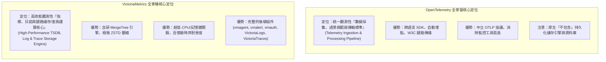
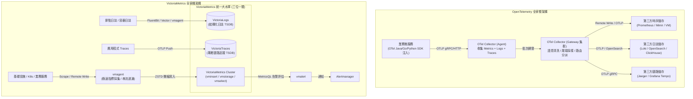
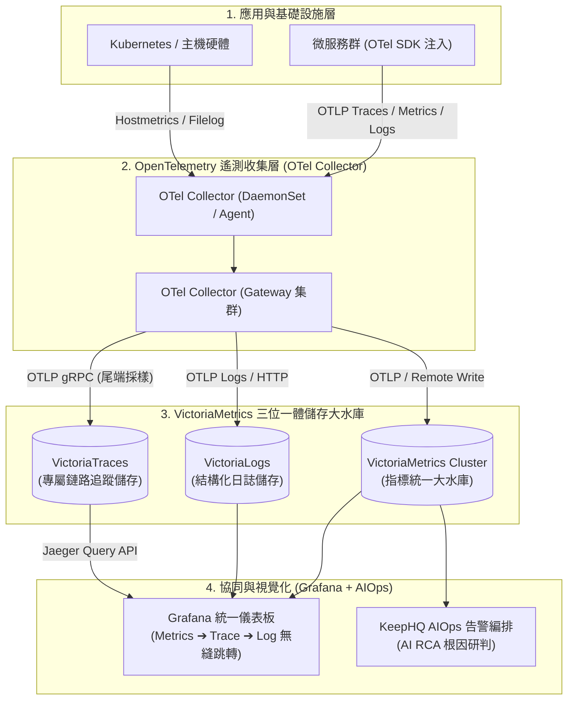
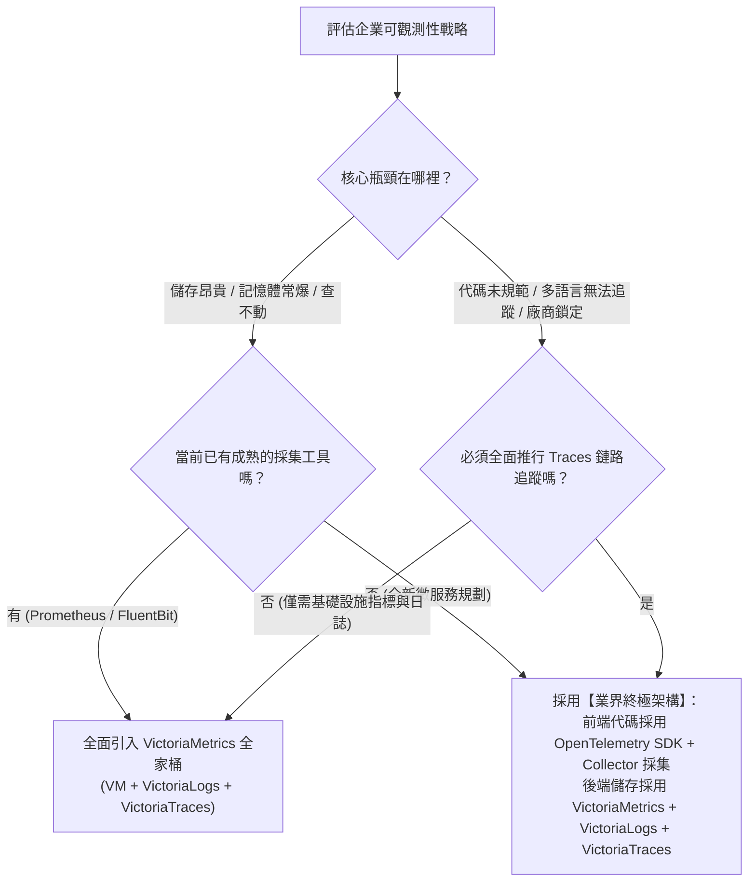

# OpenTelemetry vs VictoriaMetrics 可觀測性全家餐深度評比（Metrics、Logs、Traces） :material-view-dashboard-variant-outline:

> 在雲原生可觀測性（Observability）的世界中，**Metrics（指標）**、**Logs（日誌）** 與 **Traces（分散式鏈路追蹤）** 被公認為維運監控的三大黃金支柱。目前業界有兩大備受矚目的「全家餐」解決方案：一個是背靠 CNCF 基金會、致力於成為全球遙測數據**採集與語意標準**的 **OpenTelemetry (OTel)**；另一個則是以極致效能、超高壓縮比與極低資源消耗聞名，提供完整**儲存與分析引擎**的 **VictoriaMetrics 全家桶**（包含 VictoriaMetrics、VictoriaLogs 與 VictoriaTraces）。本文將從核心本質、三維能力、資源消耗到實戰架構進行全面剖析，協助企業打造最優技術棧。

---

## 1. 核心定位與本質差異：管線標準 vs 儲存運算引擎

在展開細節評比前，必須釐清兩者在本質定位上的根本分工：



### A. OpenTelemetry：標準化遙測管線 (The Standard Pipeline)

- **核心價值**：OTel 本身**不是**資料庫或儲存系統，而是一套由 CNCF 主導的**全球開放標準**。它定義了應用程式如何暴露數據（API & SDK）、數據格式（OTLP 協議）、以及在傳輸過程中如何接收、過濾、聚合與路由（OTel Collector）。
- **後端依賴**：OTel 產出的資料必須匯入專屬儲存後端（例如 Prometheus、VictoriaMetrics、VictoriaTraces、Jaeger、Tempo、Loki、ClickHouse 或 Elasticsearch）。

### B. VictoriaMetrics：極致效能儲存引擎 (The Engine & Storage Suite)

- **核心價值**：VictoriaMetrics 是一套專門解決「巨量可觀測性數據存不下、查不動、太耗錢」的**高性能儲存與運算引擎**。它具備成熟的採集代理（vmagent）、告警引擎（vmalert）、安全網關（vmauth）、時間序列資料庫（vmstorage/vmsingle）、專用日誌儲存（VictoriaLogs）、以及專屬分散式鏈路追蹤資料庫（VictoriaTraces）。
- **協定支援**：完全相容 Prometheus/PromQL 生態，並全面支援以 OTLP 格式直接接收 Metrics、Logs 與 Traces 數據。

---

## 2. 全家餐架構拓撲對比



---

## 3. 三大支柱深度評比（Metrics, Logs, Traces）

### A. Metrics（時序指標）

| 評比維度 | OpenTelemetry 生態 (OTel Metrics) | VictoriaMetrics 生態 (vmagent + TSDB) | 深度技術分析與選型建議 |
| :--- | :--- | :--- | :--- |
| **數據模型** | OTel Metric Data Model（Gauge, Sum, Histogram, ExponentialHistogram, Summary） | Prometheus 扁平時序模型（Metric Name + Labels + Timestamp + Value） | **OTel 模型語意更完整**，內建 Resource 與 Scope；**VM 扁平模型運算效率最高**。 |
| **採集機制** | 支援 Pull（Prometheus Receiver）與 Push（OTLP gRPC/HTTP） | 以 Pull（Prometheus Scrape）為主，支援 Push（Remote Write、OTLP） | **OTel 擅長主動 Push**（Serverless/微服務）；**vmagent 擅長海量 Pull**。 |
| **儲存與壓縮** | **無內建儲存**，需轉送至後端 TSDB | **自研 TSDB**，ZSTD 演算法，磁碟空間僅為 Prometheus 的 $1/5 \sim 1/7$ | **VictoriaMetrics 絕對勝出**，單節點可支撐數百萬 samples/sec 寫入。 |
| **查詢語言** | 無原生查詢語言，依賴後端 TSDB 語言 | **MetricsQL**（完全相容 PromQL，並大幅擴充滾動窗口與延遲計算函數） | **VictoriaMetrics 查詢效能極高**，支援子查詢平行化與快取。 |
| **記憶體消耗** | 中～高（處理百萬時序約需 $300\sim800\text{ MB}$） | 極低（處理百萬時序僅需 $50\sim100\text{ MB}$） | **vmagent 極致省資源**，邊緣與 DaemonSet 部署首選。 |

---

### B. Logs（結構化日誌）

| 評比維度 | OpenTelemetry 生態 (OTel Logs) | VictoriaMetrics 生態 (VictoriaLogs) | 深度技術分析與選型建議 |
| :--- | :--- | :--- | :--- |
| **數據收集** | OTel Filelog Receiver、Stanza 引擎、Log SDK Bridge | Vector、FluentBit、Fluentd、vmagent、OTel Collector 轉送 | **OTel 具備標準 Log SDK 與自動埋點**；**VictoriaLogs 相容多種主流 Shipper**。 |
| **儲存架構** | **無內建儲存**（常見搭配 Elasticsearch、Loki、ClickHouse） | **VictoriaLogs** 專用日誌儲存（無倒排索引設計，依賴區塊壓縮與高效過濾） | **VictoriaLogs 儲存空間比 ES/Loki 省 $70\%\sim80\%$**，不爆記憶體。 |
| **高基數支援** | 取決於儲存後端（Loki 懼怕 High Cardinality，ES 索引容易膨脹） | **原生免疫高基數 (High-Cardinality)**，IP、UserID、TraceID 任意檢索 | **VictoriaLogs 完勝**，無須為每個標籤預建昂貴索引。 |
| **查詢語法** | 取決於後端（LogQL、Lucene/DSL、SQL） | **LogsQL**（直觀簡潔的管線過濾語法，如 `_time:1h service:payment AND error`） | **LogsQL 學習曲線平緩**，支援快速聚合與日誌轉指標。 |

---

### C. Traces（分散式鏈路追蹤）

| 評比維度 | OpenTelemetry 生態 (OTel Traces) | VictoriaMetrics 生態 (VictoriaTraces) | 深度技術分析與選型建議 |
| :--- | :--- | :--- | :--- |
| **應用程式埋點** | **業界絕對統治者**（Java/Python/Go/.NET 自動 Agent 與手動 SDK） | 無專屬 Trace 埋點 SDK，**全面建議採用 OpenTelemetry SDK 埋點** | **OTel 統治代碼層**，W3C TraceContext 上下文跨進程透傳為全球標準。 |
| **採樣機制** | 支援 Head-based（SDK 端）與 **Tail-based Sampling**（Collector 網關端） | 無專門鏈路採樣器，依賴前端採集代理（如 OTel Collector）實施採樣 | **OTel 尾端採樣能力強大**（可保留所有 5xx 錯誤與慢查詢鏈路）。 |
| **儲存實現** | 通常外發至 **Grafana Tempo**、**Jaeger** 或 **ClickHouse** | **VictoriaTraces** 專屬分散式鏈路追蹤儲存引擎（亦可選擇儲存至 VictoriaLogs） | **VictoriaTraces 無需物件儲存 (S3)**，直接高效落盤 SSD，資源消耗比 Tempo 更低且無外部依賴。 |
| **鏈路視覺化** | 透過 Jaeger UI、Grafana Tempo 檢視水瀑圖 (Flame Graph) 與依賴拓撲 | 內建 **VMUI** (`/select/vmui`) 即開即用，且 **100% 相容 Jaeger Query API** | VictoriaTraces 可無縫掛載為 Grafana 的 Jaeger 數據源，享有同等的水瀑圖視覺化體驗。 |

---

## 4. 全方位維度詳細對比矩陣

| 評比指標 | OpenTelemetry 全家餐 (OTel Stack) | VictoriaMetrics 全家桶 (VM Stack) | 架構團隊綜合評語 |
| :--- | :--- | :--- | :--- |
| **核心本質** | 遙測數據傳輸與語意規範標準 | 高吞吐、超低成本的儲存與查詢大腦 | 一個管「收與轉」，一個管「存與查」。 |
| **開箱即用度** | 中等（需自行拼裝各類後端資料庫與視覺化介面） | **極高**（指標 + 日誌 + 鏈路 + 告警 + 網關一應俱全，單一二進位即可起跑） | VM 部署簡單，維運難度遠低於拼裝各類大數據庫。 |
| **硬體資源開銷** | 較高（Collector 解析多層模型 + 多套後端儲存開銷） | **極低**（Go 靜態編譯，超低記憶體與高壓縮演算法） | **VictoriaMetrics 具備壓倒性的硬體性價比**。 |
| **廠商鎖定風險** | **零風險**（CNCF 頂級中立標準，所有主流廠商皆相容） | **極低**（完全相容 Prometheus 生態、OTLP 與開源標準） | 兩者皆為開源楷模，無被商業軟體綁架疑慮。 |
| **維運複雜度 (TCO)** | 涉及 Collector 集群管理、多儲存組件生命週期維護 | 極簡（無外部依賴、無 JVM/ZooKeeper、備份僅需一個二進位檔） | **VictoriaMetrics 總維運成本 (TCO) 顯著低於複雜開源堆疊**。 |

---

## 5. 生產級落地架構藍圖

在實務架構設計中，我們無需陷入「二選一」的思維陷阱。以下提供三種不同維運規模的標準落地藍圖：

### 藍圖一：極簡高效型架構（純 VictoriaMetrics 全家桶技術棧）

適合以指標、日誌與鏈路為核心、伺服器資源受限、追求極致維運效率的中小型團隊或私有雲環境：

```text
┌────────────────────────────────────────────────────────────────────────┐
│                   純 VictoriaMetrics 極簡高效可觀測性架構                │
├────────────────────┬───────────────────────────────────────────────────┤
│ 指標採集與儲存     │ vmagent ➔ VictoriaMetrics Cluster (MetricsQL)    │
│ 日誌收集與儲存     │ Vector / FluentBit ➔ VictoriaLogs (LogsQL)        │
│ 鏈路追蹤 (Traces)  │ OTel SDK / Agent ➔ VictoriaTraces (OTLP 接收)      │
│ 告警與路由中樞     │ vmalert ➔ Alertmanager ➔ Teams / GoAlert          │
│ 視覺化分析前端     │ VMUI (內建) 或 Grafana (統一儀表板與 Jaeger 數據源) │
└────────────────────┴───────────────────────────────────────────────────┘
```

- **核心優勢**：架構極簡，只需維護 VM 全家桶組件（VictoriaMetrics + VictoriaLogs + VictoriaTraces），整套系統記憶體消耗可能只需原本 Prometheus + ELK + Tempo 堆疊的 $1/5$。

---

### 藍圖二：企業級大一統混合架構（OTel 採集前端 + VM 儲存大腦）★ 業界最強推薦

此方案結合了 **OTel 在代碼應用層的統治力** 與 **VictoriaMetrics 在儲存運算層的極致性價比**，是現代大型微服務架構的終極典範：



#### 組態示範：OTel Collector 分流輸出至 VictoriaMetrics、VictoriaLogs 與 VictoriaTraces

```yaml
# /etc/otelcol/config.yaml
receivers:
  otlp:
    protocols:
      grpc:
        endpoint: 0.0.0.0:4317
      http:
        endpoint: 0.0.0.0:4318

processors:
  batch:
    timeout: 5s
    send_batch_size: 2048
  memory_limiter:
    check_interval: 1s
    limit_percentage: 75

exporters:
  # 1. 指標輸出至 VictoriaMetrics
  prometheusremotewrite:
    endpoint: "http://victoria-metrics:8428/api/v1/write"

  # 2. 日誌輸出至 VictoriaLogs (OTLP HTTP 格式)
  otlphttp/victorialogs:
    endpoint: "http://victoria-logs:9428/insert/opentelemetry"

  # 3. 鏈路追蹤輸出至 VictoriaTraces (OTLP gRPC 格式)
  otlp/victoriatraces:
    endpoint: "victoria-traces:10428"
    tls:
      insecure: true

service:
  pipelines:
    metrics:
      receivers: [otlp]
      processors: [memory_limiter, batch]
      exporters: [prometheusremotewrite]
    logs:
      receivers: [otlp]
      processors: [memory_limiter, batch]
      exporters: [otlphttp/victorialogs]
    traces:
      receivers: [otlp]
      processors: [memory_limiter, batch]
      exporters: [otlp/victoriatraces]
```

---

## 6. 選型決策指南

面對兩大生態，團隊該如何下決定？請參考以下決策路徑：



---

## 7. 總結

1. **不可替代的採集標準（OpenTelemetry）**：在代碼層與傳輸層，OTel 是無可爭議的贏家。它的跨語言 SDK、自動注入、上下文透傳與 OTLP 協議，能確保企業代碼永遠具備開放性，徹底告別特定監控商綁定。
2. **不可忽視的儲存王者（VictoriaMetrics）**：在數據儲存與查詢運算層，VictoriaMetrics 則是性價比的極致代表。無論是時序資料庫、VictoriaLogs 還是專屬鏈路追蹤 **VictoriaTraces**，其令人驚嘆的高壓縮比、超低資源佔用與簡單架構，徹底解決了海量遙測數據帶來的伺服器成本焦慮。
3. **終極解法**：**「採集用 OTel，儲存用 VictoriaMetrics」**。讓 OpenTelemetry 負責標準化的數據收集與治理，讓 VictoriaMetrics 三位一體（VictoriaMetrics + VictoriaLogs + VictoriaTraces）承接巨量數據的持久儲存與秒級查詢，兩者互補共生，方能打造出最具擴展性與性價比的現代 AIOps 觀測平台。
