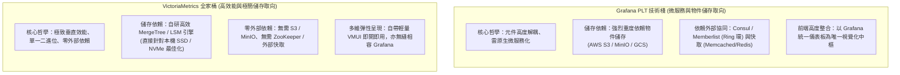
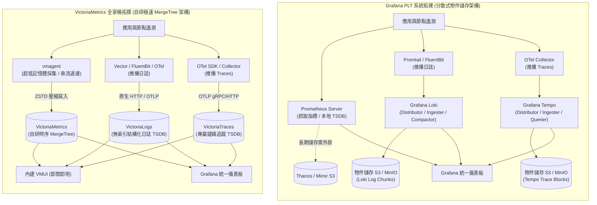
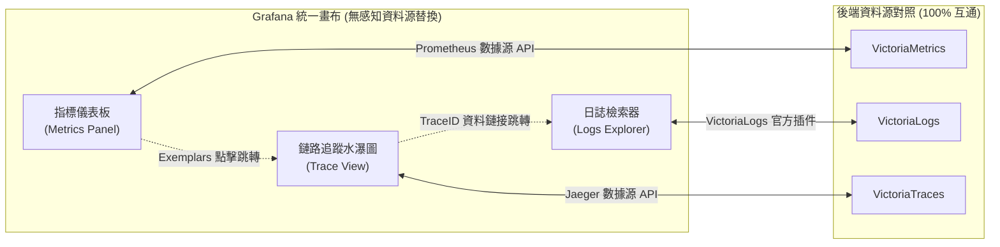
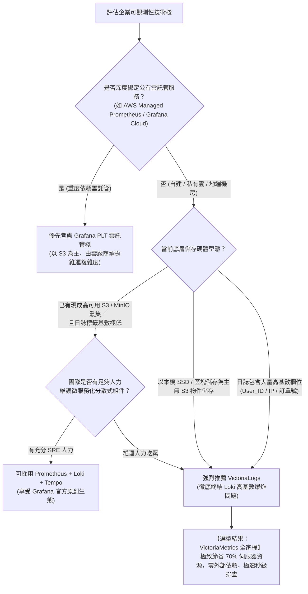

# Prometheus + Loki + Tempo (PLT) vs VictoriaMetrics 全家桶深度架構評比 :material-layers-triple-outline:

> 在現代雲原生與 Kubernetes 可觀測性（Observability）領域中，圍繞「**Metrics（指標）**、**Logs（日誌）** 與 **Traces（鏈路追蹤）**」的三位一體架構已成為大型企業監控的標準規範。目前業界最具代表性的兩大完整開源方案分別為：以 Grafana 生態為核心的 **Prometheus + Loki + Tempo (PLT 技術棧)**，以及近年以極致效能、超低資源開銷與極簡架構強勢崛起的 **VictoriaMetrics 全家桶 (VictoriaMetrics + VictoriaLogs + VictoriaTraces)**。本文將從底層儲存哲學、三大支柱技術細節、維運複雜度與總體擁有成本 (TCO) 等維度進行深度對比。

---

## 1. 核心哲學與儲存架構對比

兩大技術棧在底層儲存理念與架構設計上有著截然不同的取向：

### A. Grafana PLT 架構（雲原生解耦與物件儲存導向）

- **儲存設計**：Prometheus 負責近期時序落盤，長期需外掛 Thanos/Mimir；Loki 與 Tempo 則從設計第一天起即**以便宜的物件儲存（Object Storage，如 S3、GCS 或 MinIO）為核心**。
- **架構特點**：每個組件皆拆分為多個微服務角色（如 Ingester、Distributor、Compactor、Querier、Query Frontend 等），需要透過 Gossip 協議（Memberlist）或 Consul 維護 Hash Ring，並依賴 Memcached/Redis 作為查詢快取。

### B. VictoriaMetrics 全家桶（自研 MergeTree 與極致本機磁碟導向）

- **儲存設計**：承襲 ClickHouse 與 LSM-Tree 的工程精髓，全家族（Metrics、Logs、Traces）皆採用自研的高壓縮比 MergeTree 架構，**直接針對本機檔案系統（SSD / NVMe / 區塊儲存）進行深度寫入優化**。
- **架構特點**：組件極度簡潔（單機版皆為單一靜態 Go 二進位檔），完全不需要 S3、MinIO、Consul、ZooKeeper 或外部快取資料庫。叢集版僅由 3 個無狀態/儲存節點角色組成，維運負載極低。

---

## 2. 全景系統架構拓撲對比

---

## 3. 三大支柱逐項深度對比

### A. Metrics（時序指標）：Prometheus vs VictoriaMetrics

Prometheus 是雲原生指標的事實標準，但 VictoriaMetrics 在其基礎上進行了徹底的效能重構：

| 評估維度 | Prometheus (標準/Agent 模式) | VictoriaMetrics (vmsingle / vmcluster) | 技術優勢與架構評析 |
| :--- | :--- | :--- | :--- |
| **記憶體消耗** | **高**（需將近期時間序列 Head Chunks 保留在記憶體中，容易觸發 OOM） | **極低**（採用串流處理與即時壓縮緩衝，記憶體僅為 Prometheus 的 $1/5 \sim 1/7$） | **VictoriaMetrics 壓倒性勝出**，海量時序環境不崩潰。 |
| **磁碟儲存與壓縮** | 標準 Gorilla 演算法，磁碟空間需求大 | **自研 ZSTD 壓縮**，磁碟空間僅為 Prometheus 的 $1/7$（壓縮比達 $85\%\sim90\%$） | **VictoriaMetrics 勝出**，大幅降低儲存成本。 |
| **高基數（High-Cardinality）耐受度** | 較弱（標籤維度爆炸時記憶體與查詢時延劇烈上升） | **極高**（原生針對數千萬級活躍時間序列進行索引優化） | **VictoriaMetrics 勝出**，適應大型多租戶微服務環境。 |
| **水平擴充能力** | 原生不支援叢集，需額外引進 Thanos 或 Cortex/Mimir | **原生支援叢集模式**（`vminsert`, `vmstorage`, `vmselect`），支援水平無縫擴容 | **VictoriaMetrics 運維架構更簡單俐落**。 |
| **查詢語法與相容性** | 標準 PromQL | **MetricsQL**（100% 向後相容 PromQL，並增加滾動視窗、延遲計算等豐富延伸語法） | **VictoriaMetrics 查詢速度快 5~10 倍**，且支援子查詢平行化。 |

---

### B. Logs（日誌檢索）：Grafana Loki vs VictoriaLogs

Loki 號稱「像 Prometheus 一樣操作日誌」，而 VictoriaLogs 則針對日誌高基數問題帶來了革命性突破：

| 評估維度 | Grafana Loki | VictoriaLogs | 技術優勢與架構評析 |
| :--- | :--- | :--- | :--- |
| **索引哲學** | **僅索引標籤 (Label-only Index)**，不索引日誌內容，依賴 grep 暴力解壓掃描 | **全文字段解析與動態 Token 索引**，採用無倒排索引設計（Index-Free Dynamic Tokenization） | Loki 避免了 ES 龐大的倒排索引；VictoriaLogs 則在無倒排前提下實現精確欄位過濾。 |
| **高基數標籤困境** | **嚴重痛點**：嚴禁將 `ip`、`user_id`、`trace_id`、`request_id` 設為標籤，否則會引發 Stream 爆炸導致記憶體 OOM | **原生完全免疫高基數**：任何屬性（IP、UserID、TraceID）皆可作為篩選欄位，無序列膨脹問題 | **VictoriaLogs 完勝**，徹底解放開發者與 SRE 的日誌打標約束。 |
| **磁碟空間與壓縮比** | 區塊壓縮（Gzip / Snappy），儲存佔比中等 | **自研超高壓縮比引擎**，比 Loki 額外再省 **$70\%\sim80\%$** 儲存空間 | **VictoriaLogs 儲存費用最低**。 |
| **查詢語法** | **LogQL**（類似 PromQL，組合管道語法如 `{app="foo"} \|~ "error" \| json`） | **LogsQL**（極簡直觀的管線過濾語法，如 `service:foo AND error`，並支援即時統計） | LogsQL 學習曲線更平緩，日誌數值聚合計算效能極佳。 |
| **維運難度與穩定度** | 較高（需調優 Ingester 刷新、Compactor 壓縮、Chunks 留存與 S3 權限） | 極低（單一二進位檔直接指定資料目錄即可，無外部依賴） | **VictoriaLogs 幾乎零運維**，沒有 S3 慢請求與記憶體抖動隱患。 |

---

### C. Traces（鏈路追蹤）：Grafana Tempo vs VictoriaTraces

鏈路追蹤數據具有體積龐大、查詢低頻但故障時必須秒級調閱的特點：

| 評估維度 | Grafana Tempo | VictoriaTraces | 技術優勢與架構評析 |
| :--- | :--- | :--- | :--- |
| **儲存架構與模型** | **純物件儲存 (S3 / MinIO)** 為核心，以 Block 形式切片落盤 | **本地 SSD / 高速儲存** 為核心，採用自研 MergeTree 分散式追蹤索引 | Tempo 依賴低成本物件儲存；VictoriaTraces 依賴本機高速 IO 與超高壓縮。 |
| **檢索方式** | 早期僅能透過 TraceID 點對點檢索；現支援 TraceQL（需 Parquet 索引與較大運算資源） | **內建多維檢索能力**（支援按 Service、Operation、Duration、Tags 進行高維檢索） | VictoriaTraces 檢索延遲更穩定，無需等待 S3 下載 Block。 |
| **外部架構依賴** | 必須架設物件儲存（MinIO / S3），大規模需搭配 Memcached 快取 | **零外部依賴**，直接以單一二進位檔或儲存節點落盤 | **VictoriaTraces 架構極致輕量**，非常適合私有雲或邊緣機房。 |
| **協議與查詢相容** | 原生支援 OTLP、Jaeger、Zipkin，查詢依賴 Tempo API / TraceQL | 原生支援 OTLP 接收，查詢**100% 相容 Jaeger Query API** | VictoriaTraces 可無縫假扮為 Jaeger 數據源對接 Grafana，生態遷移成本為零。 |
| **視覺化介面** | 依賴 Grafana Tempo 專用面版 | 內建 **VMUI** 即可檢視水瀑圖 (Flame Graph)；亦可直接連線 Grafana | **VictoriaTraces 自帶輕量 UI**，應急排查無需依賴外部前端服務。 |

---

## 4. 維運複雜度與總體擁有成本 (TCO) 全方位對比

| 評估維度 | Prometheus + Loki + Tempo (PLT) | VictoriaMetrics 全家桶 (VM + Logs + Traces) | 架構實務點評 |
| :--- | :--- | :--- | :--- |
| **組件總數與進程** | 繁多（Prometheus + Loki 諸多微服務 + Tempo 諸多模組 + MinIO + 快取） | **極少**（單機版僅需 3 個執行檔；叢集版僅 3 類角色，無中介依賴） | VM 全家桶在架構複雜度上具備壓倒性優勢。 |
| **基礎設施依賴** | 必須維護物件儲存（MinIO/S3 叢集）、快取（Memcached/Redis）、Consul/Ring | **完全無依賴**，僅需一般 Linux 伺服器與本地 SSD / NVMe | 私有雲或邊緣環境下，維護高可用 MinIO 本身就是沈重負擔。 |
| **CPU / 記憶體整體開銷** | 較大（Java/Golang 混雜、多層模型反序列化、龐大記憶體佇列） | **極小**（純 Go 深度底層優化，無垃圾回收壓力，低資源占用） | **VM 技術棧整體硬體成本約為 PLT 的 $1/3 \sim 1/4$**。 |
| **備份與災難復原** | 需分別針對 Prometheus 本地目錄、S3 Bucket 進行多重策略備份 | 提供統一的 `vmbackup` / `vmrestore` 工具，支援秒級無鎖增量備份 | VM 備份邏輯高度統一，復原演練極快。 |
| **多租戶與安全網關** | 通常依賴外部 Nginx 反向代理或商業版 Enterprise 插件 | 官方標配 **`vmauth`**（輕量級驗證代理，支援多租戶路徑路由與速率限制） | VM 原生內建企業級多租戶權限隔離能力。 |
| **私有化 / Air-Gapped 友好度**| 較低（組件多、Helm Chart 依賴外部服務多、離線配置繁瑣） | **極高**（拷貝靜態二進位檔即可啟動，極度適合金融、國防與封閉網絡） | VM 在離線隔離網路環境中體驗極佳。 |

---

## 5. Grafana 視覺化聯動體驗 (Trace ➔ Log ➔ Metric)

許多團隊選擇 PLT 的最大理由是「Grafana 原生血統帶來的無縫跳轉體驗」。事實上，**VictoriaMetrics 全家桶對 Grafana 的相容性已達到「無縫平替」境界**：

1. **指標無縫對接**：Grafana 新增資料源直接選 `Prometheus`，URL 填入 VictoriaMetrics（如 `http://victoria-metrics:8428`），現有 Dashboards 零修改即可運作。
2. **日誌無縫對接**：安裝 VictoriaMetrics 官方維護的 `victorialogs-datasource` 插件，即可在 Grafana Explore 介面享受 LogsQL 毫秒級過濾。
3. **鏈路無縫對接**：VictoriaTraces 完整實作了 Jaeger HTTP 查詢協議，Grafana 新增資料源直接選 `Jaeger`，URL 填入 VictoriaTraces（如 `http://victoria-traces:10428`），水瀑圖、關鍵路徑分析與 Span 詳細資訊完整呈現。
4. **三位一體雙向跳轉**：
   - 透過 **Exemplars**：在指標圖表中的異常突波點，直接點擊跳轉至 VictoriaTraces 的具體 Trace。
   - 透過 **Data Links**：在 VictoriaTraces 的 Span 屬性中設定 TraceID 連結，一鍵跳轉至 VictoriaLogs 過濾該次請求的所有日誌。

---

## 6. 架構選型決策樹

---

## 7. 總結與評審建議

- **選擇 Prometheus + Loki + Tempo (PLT) 的情境**：
  - 企業完全採用公有雲架構，直接使用 S3 作為資料湖，且擁有充裕的雲端預算。
  - 深度採用 Grafana Cloud 或已採購 Grafana Enterprise 商業授權。
  - 團隊已有專職的 SRE 團隊負責管理複雜的 Kubernetes 分散式微服務狀態機。
- **選擇 VictoriaMetrics 全家桶 (VM + Logs + Traces) 的情境**：
  - **極度看重投資報酬率 (ROI) 與成本控制**：希望在最少伺服器資源下支撐最大業務量，省下高達 $70\%\sim80\%$ 的記憶體與磁碟支出。
  - **私有雲、混合雲或邊緣運算環境**：沒有或不願額外維運龐大的 MinIO/S3 物件儲存集群。
  - **深受日誌高基數所苦**：需要將用戶 ID、交易訂單號、容器 IP 作為直接日誌檢索過濾條件。
  - **追求極簡維運**：厭倦了頻繁排查 Loki Compactor OOM、Thanos 網路延遲或 Tempo Block 同步問題，希望「裝好即可穩定運作三年」。
