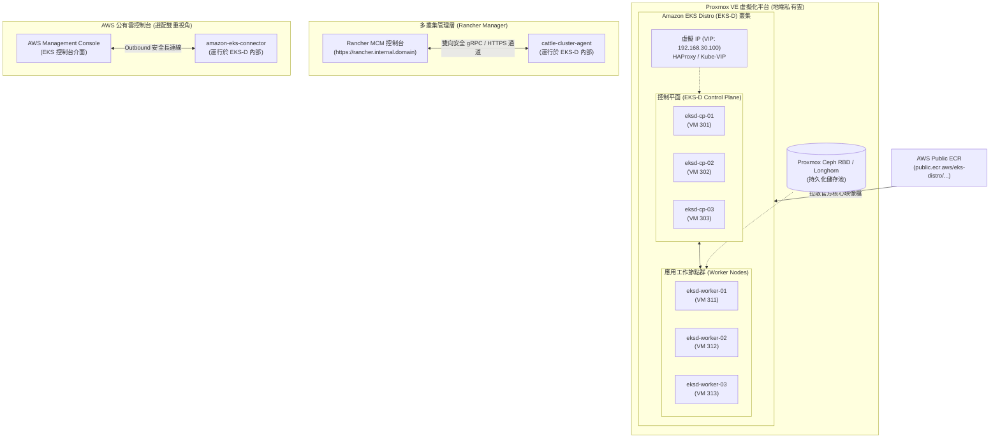
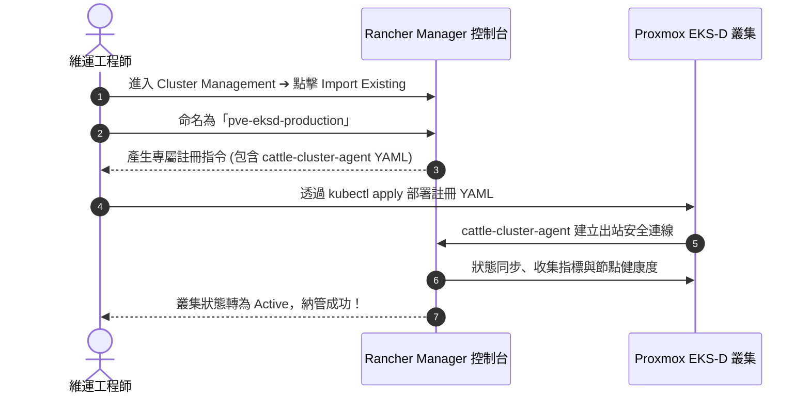
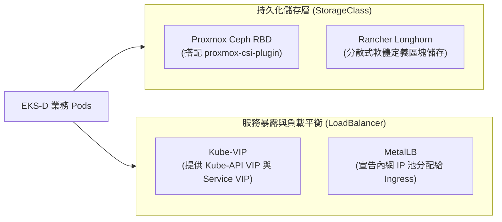
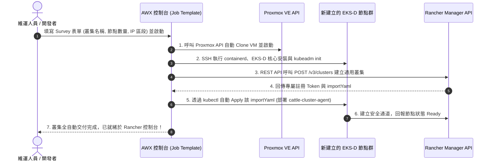

# Proxmox VE + Amazon EKS Distro + Rancher 混合雲容器平台落地指南 :material-aws:

> 本指南詳細介紹如何在 **Proxmox VE (PVE)** 虛擬化基座之上，部署與 AWS 公有雲 100% 同源的 **Amazon EKS Distro (EKS-D)** 核心叢集，並無縫接入 **Rancher Multi-Cluster Manager**，構建兼具「AWS 核心相容性」與「地端統一維運治理」的企業級現代化混合雲架構。

---

## 1. 方案背景與核心價值

在混合雲（Hybrid Cloud）與多雲（Multi-Cloud）策略中，許多企業面臨的最大痛點在於：**雲端公有雲（AWS EKS）與地端機房（On-Premises K8s）的容器發行版與底層組件版本不一致**。這種差異往往導致應用的行為產生微妙漂移、安全修補不同步，以及 CI/CD Pipeline 需針對不同環境維護多套發布邏輯。

透過 **Proxmox VE + Amazon EKS Distro + Rancher** 的黃金三角組合，能完美化解上述挑戰：

* **Proxmox VE (PVE)**：
  提供極低授權負擔的地端企業級虛擬化底座，整合 KVM 運算、軟體定義儲存（Ceph / ZFS）與快照備份能力。
* **Amazon EKS Distro (EKS-D)**：
  AWS 官方開源的 Kubernetes 發行版。它直接採用與 AWS EKS 相同的 Kubernetes 核心原始碼、安全補丁、`etcd`、`coredns` 與二進位組件（全數託管於 AWS 官方 Public ECR），**確保地端環境與 AWS 雲端擁有完全一致的 API 行為與安全基線**。
* **Rancher Multi-Cluster Manager**：
  提供地端多叢集的「指揮中心」，以非侵入方式匯入並納管 EKS-D 叢集，為其賦予企業級身分聯邦（Active Directory / LDAP / Entra ID）、統一 RBAC 授權、應用市集（Helm Catalog）與 Fleet GitOps 持續交付能力。

---

## 2. 總體架構拓撲圖

以下為基於 Proxmox VE 運行 EKS Distro，並由地端 Rancher 及雲端 AWS Console 雙向管理的架構圖：



---

## 3. 資源規劃與前置準備

### A. 節點規格與 IP 分配建議

| 節點名稱 | 角色 | 建議規格 | IP 位址 | 備註 |
| :--- | :--- | :--- | :--- | :--- |
| **`eksd-vip`** | 虛擬 IP (VIP) | N/A | `192.168.30.100` | Kube-VIP 或 HAProxy 浮動 IP |
| **`eksd-cp-01`** | EKS-D Master 1 | 4 vCPU / 8GB RAM / 60GB | `192.168.30.101` | etcd + 控制平面 |
| **`eksd-cp-02`** | EKS-D Master 2 | 4 vCPU / 8GB RAM / 60GB | `192.168.30.102` | etcd + 控制平面 |
| **`eksd-cp-03`** | EKS-D Master 3 | 4 vCPU / 8GB RAM / 60GB | `192.168.30.103` | etcd + 控制平面 |
| **`eksd-worker-01`** | EKS-D Worker 1 | 8 vCPU / 16GB RAM / 100GB | `192.168.30.111` | 業務應用容器執行節點 |
| **`eksd-worker-02`** | EKS-D Worker 2 | 8 vCPU / 16GB RAM / 100GB | `192.168.30.112` | 業務應用容器執行節點 |

---

### B. 虛擬機作業系統配置 (所有節點)

在 Proxmox VE 內建立 Ubuntu 22.04 LTS 或 Rocky Linux 9 虛擬機，執行以下前置指令：

```bash
# 1. 關閉 Swap (Kubernetes 運作硬性要求)
sudo swapoff -a
sudo sed -i '/swap/d' /etc/fstab

# 2. 載入必要內核模組
cat <<EOF | sudo tee /etc/modules-load.d/k8s.conf
overlay
br_netfilter
EOF

sudo modprobe overlay
sudo modprobe br_netfilter

# 3. 配置網路轉發核心參數
cat <<EOF | sudo tee /etc/sysctl.d/k8s.conf
net.bridge.bridge-nf-call-iptables  = 1
net.bridge.bridge-nf-call-ip6tables = 1
net.ipv4.ip_forward                 = 1
EOF

sudo sysctl --system

# 4. 安裝 containerd 執行時並配置 SystemdCgroup
sudo apt-get update && sudo apt-get install -y containerd curl apt-transport-https
sudo mkdir -p /etc/containerd
containerd config default | sudo tee /etc/containerd/config.toml
sudo sed -i 's/SystemdCgroup = false/SystemdCgroup = true/' /etc/containerd/config.toml
sudo systemctl restart containerd
sudo systemctl enable containerd
```

---

## 4. 第二階段：部署 Amazon EKS Distro (EKS-D) 核心叢集

### A. 下載 AWS 官方編譯之 EKS-D 二進位檔案

EKS-D 官方將 Kubernetes 二進位元件與 CNI 外掛託管於 AWS 官方儲存庫。

在所有節點執行：

```bash
# 設定目標 EKS 版本 (此處以 EKS-D 1.30 為例)
export K8S_VERSION="v1.30.2"
export EKSD_TARBALL_URL="https://distro.eks.amazonaws.com/kubernetes-1-30/releases/1/artifacts/kubernetes"

# 1. 下載並安裝標準 CNI 外掛
sudo mkdir -p /opt/cni/bin
curl -sSL "https://github.com/containernetworking/plugins/releases/download/v1.3.0/cni-plugins-linux-amd64-v1.3.0.tgz" | sudo tar -C /opt/cni/bin -xz

# 2. 下載 AWS EKS-D 客製編譯之 kubeadm, kubelet, kubectl
cd /usr/local/bin
sudo curl -LO "${EKSD_TARBALL_URL}/${K8S_VERSION}/bin/linux/amd64/kubeadm"
sudo curl -LO "${EKSD_TARBALL_URL}/${K8S_VERSION}/bin/linux/amd64/kubelet"
sudo curl -LO "${EKSD_TARBALL_URL}/${K8S_VERSION}/bin/linux/amd64/kubectl"
sudo chmod +x kubeadm kubelet kubectl

# 3. 配置 kubelet 系統服務
sudo curl -sSL "https://raw.githubusercontent.com/kubernetes/release/master/cmd/kubepkg/templates/latest/deb/kubelet/lib/systemd/system/kubelet.service" | sudo tee /etc/systemd/system/kubelet.service
sudo mkdir -p /etc/systemd/system/kubelet.service.d
sudo curl -sSL "https://raw.githubusercontent.com/kubernetes/release/master/cmd/kubepkg/templates/latest/deb/kubeadm/10-kubeadm.conf" | sudo tee /etc/systemd/system/kubelet.service.d/10-kubeadm.conf

sudo systemctl enable kubelet
```

---

### B. 初始化 EKS-D 第一台控制平面 (`eksd-cp-01`)

撰寫 `eksd-kubeadm-init.yaml`，關鍵在於**指定映像檔倉庫來源為 AWS 官方 Public ECR**：

```yaml
apiVersion: kubeadm.k8s.io/v1beta3
kind: InitConfiguration
localAPIEndpoint:
  advertiseAddress: "192.168.30.101"
  bindPort: 6443
---
apiVersion: kubeadm.k8s.io/v1beta3
kind: ClusterConfiguration
kubernetesVersion: "v1.30.2"
controlPlaneEndpoint: "192.168.30.100:6443" # 指向 VIP
# 核心映像檔全數來源於 AWS 官方 Public ECR
imageRepository: "public.ecr.aws/eks-distro/kubernetes"
dns:
  imageRepository: "public.ecr.aws/eks-distro/coredns"
  imageTag: "v1.11.1-eks-1-30-1"
etcd:
  local:
    imageRepository: "public.ecr.aws/eks-distro/etcd-io"
    imageTag: "v3.5.14-eks-1-30-1"
networking:
  podSubnet: "10.244.0.0/16"
  serviceSubnet: "10.96.0.0/12"
```

執行初始化：

```bash
sudo kubeadm init --config eksd-kubeadm-init.yaml --upload-certs
```

初始化完成後，複製 `kubeconfig` 並部署 CNI 網路外掛（以 Cilium 為例）：

```bash
mkdir -p ~/.kube
sudo cp /etc/kubernetes/admin.conf ~/.kube/config
sudo chown $(id -u):$(id -g) ~/.kube/config

# 安裝高效能 Cilium CNI
helm repo add cilium https://helm.cilium.io/
helm repo update
helm install cilium cilium/cilium --version 1.15.5 --namespace kube-system
```

依照 `kubeadm init` 終端輸出的指示，將 `eksd-cp-02`、`eksd-cp-03` 加入控制平面，並將各 Worker 節點加入叢集。

---

## 5. 第三階段：使用 Rancher 集中納管 EKS-D 叢集

當 EKS-D 叢集就緒後，我們透過 Rancher 的「**Import Existing Cluster**（匯入現有叢集）」機制，以非侵入方式接入 Rancher 管理平台：



### 具體步驟

1. 登入 Rancher Web 控制台（如 `https://rancher.internal.domain`）。
2. 進入 **Cluster Management** ➔ 點擊右上方 **Import Existing** 按鈕。
3. 選擇 **Generic**（通用標準 Kubernetes）。
4. 填入叢集識別名稱：`pve-eksd-production`，點擊 **Create**。
5. Rancher 會產生一段 `kubectl` 部署指令，例如：

   ```bash
   kubectl apply -f https://rancher.internal.domain/v3/import/<token>.yaml
   ```

6. 回到 `eksd-cp-01` 節點執行該指令。
7. Rancher 會在 EKS-D 內部建立 `cattle-system` 命名空間並運行 `cattle-cluster-agent`。
8. 數分鐘後，Rancher 控制台上的 `pve-eksd-production` 狀態即轉為 **Active**。

---

## 6. 第四階段（選配）：接入 AWS Console (AWS EKS Connector)

若企業在 AWS 公有雲上亦有運行 EKS，並希望在 **AWS Management Console 官方網頁** 同時檢視這座位於地端 Proxmox 的 EKS-D 叢集，可安裝 **AWS EKS Connector**：

```bash
# 1. 在 AWS 終端機註冊地端叢集
aws eks register-cluster \
  --name "pve-eksd-onprem" \
  --provider "OTHER" \
  --connector-config roleArn="arn:aws:iam::123456789012:role/EKSConnectorRole"

# 2. 下載產出的註冊 YAML 並於 EKS-D 本機套用
kubectl apply -f eks-connector.yaml
kubectl apply -f eks-connector-binding.yaml
```

如此一來，您將同時具備：

* **地端視角**：透過 Rancher 執行精細 RBAC、日常 Helm 部署與監控排障。
* **雲端視角**：在 AWS Console 獲得統一的資產大盤檢視。

---

## 7. 持久化儲存與負載平衡最佳實踐

在地端 Proxmox VE 上運行 EKS-D，建議搭配以下原生組件補齊儲存與網路能力：



* **儲存方案推薦**：
  * **Proxmox CSI Plugin**：若 PVE 底層已建立 Ceph 分散式儲存池，可直接透過 CSI 動態申請 Ceph RBD。
  * **Rancher Longhorn**：直接在 Rancher 應用市集一鍵部署，將 Worker 節點的本機磁碟池化為跨節點三複本高可用區塊儲存。
* **負載平衡方案推薦**：
  * **Kube-VIP**：負責控制平面的高可用虛擬 IP。
  * **MetalLB**：負責為 Ingress Controller 與資料庫提供地端實體內網 IP。

---

## 8. 自動化實戰：透過 AWX (Ansible) 一鍵部署 EKS-D 並自動納入 Rancher

手動在 Proxmox 上開立虛擬機、初始化 `kubeadm`、登入 Rancher 匯入雖然彈性高，但對於需要快速開拓多個業務或測試環境的團隊而言，**將全流程封裝至 AWX (Ansible Automation Platform) 達成全自動無人值守（Zero-Touch Provisioning）** 是邁向平台工程（Platform Engineering）的最佳實踐。



### A. 全自動化 Ansible Playbook 設計 (`deploy-eksd-to-rancher.yml`)

此 Playbook 整合了三層自動化：Proxmox 虛擬機開立 ➔ EKS-D 初始化 ➔ Rancher API 註冊匯入。

```yaml
---
- name: Zero-Touch Provisioning of EKS-D on Proxmox and Auto-Import to Rancher
  hosts: localhost
  gather_facts: false
  vars:
    pve_api_host: "192.168.10.11"
    pve_api_user: "root@pam"
    pve_template_id: 9000
    cluster_name: "{{ target_cluster_name | default('eksd-dev-01') }}"
    rancher_url: "https://rancher.internal.domain"
    rancher_token: "{{ lookup('env', 'RANCHER_BEARER_TOKEN') }}"

  tasks:
    # -------------------------------------------------------------
    # 階段 1：透過 Proxmox API 自動克隆並開機虛擬機
    # -------------------------------------------------------------
    - name: Clone Master and Worker VMs from Cloud-Init Template
      community.general.proxmox_kvm:
        api_host: "{{ pve_api_host }}"
        api_user: "{{ pve_api_user }}"
        api_token_id: "{{ lookup('env', 'PVE_TOKEN_ID') }}"
        api_token_secret: "{{ lookup('env', 'PVE_TOKEN_SECRET') }}"
        node: "pve-01"
        clone: "{{ pve_template_id }}"
        name: "{{ item.name }}"
        vmid: "{{ item.vmid }}"
        memory: "{{ item.memory }}"
        cores: "{{ item.cores }}"
        net0: "virtio,bridge=vmbr0"
        ipconfig0: "ip={{ item.ip }}/24,gw=192.168.30.1"
        state: started
      loop:
        - { name: "{{ cluster_name }}-cp-01", vmid: 401, cores: 4, memory: 8192, ip: "192.168.30.101" }
        - { name: "{{ cluster_name }}-worker-01", vmid: 411, cores: 8, memory: 16384, ip: "192.168.30.111" }
        - { name: "{{ cluster_name }}-worker-02", vmid: 412, cores: 8, memory: 16384, ip: "192.168.30.112" }

    - name: Wait for VMs to be reachable via SSH
      ansible.builtin.wait_for:
        host: "192.168.30.101"
        port: 22
        timeout: 180

- name: Bootstrap Amazon EKS Distro Cluster
  hosts: "{{ cluster_name }}-cp-01"
  tasks:
    - name: Install containerd and EKS-D components
      ansible.builtin.include_role:
        name: eks_distro_bootstrap

    - name: Initialize Kubernetes Control Plane
      ansible.builtin.command: >
        kubeadm init
        --image-repository public.ecr.aws/eks-distro/kubernetes
        --pod-network-cidr 10.244.0.0/16
      args:
        creates: /etc/kubernetes/admin.conf

    - name: Install Cilium CNI
      ansible.builtin.command: >
        cilium install --version 1.15.5
      environment:
        KUBECONFIG: /etc/kubernetes/admin.conf

- name: Register and Auto-Import EKS-D Cluster to Rancher
  hosts: localhost
  tasks:
    # -------------------------------------------------------------
    # 階段 2：呼叫 Rancher REST API 建立匯入型叢集並取得 Registration YAML
    # -------------------------------------------------------------
    - name: Create Generic Cluster entry in Rancher
      ansible.builtin.uri:
        url: "{{ rancher_url }}/v3/clusters"
        method: POST
        headers:
          Authorization: "Bearer {{ rancher_token }}"
          Content-Type: "application/json"
        body_format: json
        body:
          name: "{{ cluster_name }}"
          description: "Auto-provisioned EKS-D cluster on Proxmox via AWX"
        status_code: [201]
      register: rancher_cluster_resp

    - name: Extract Created Cluster ID
      ansible.builtin.set_fact:
        rancher_cluster_id: "{{ rancher_cluster_resp.json.id }}"

    - name: Retrieve Cluster Registration Token and Import Manifest
      ansible.builtin.uri:
        url: "{{ rancher_url }}/v3/clusterregistrationtokens?clusterId={{ rancher_cluster_id }}"
        method: GET
        headers:
          Authorization: "Bearer {{ rancher_token }}"
        status_code: [200]
      register: reg_tokens
      until: reg_tokens.json.data | length > 0
      retries: 10
      delay: 3

    - name: Save Import Manifest URL
      ansible.builtin.set_fact:
        import_manifest_url: "{{ reg_tokens.json.data[0].manifestUrl }}"

    # -------------------------------------------------------------
    # 階段 3：在新建立的 EKS-D 叢集中套用 Rancher Agent YAML
    # -------------------------------------------------------------
    - name: Deploy Rancher Cluster Agent into EKS-D
      kubernetes.core.k8s:
        src: "{{ import_manifest_url }}"
        state: present
        kubeconfig: /tmp/{{ cluster_name }}-kubeconfig

    - name: Verify Cluster State in Rancher
      ansible.builtin.uri:
        url: "{{ rancher_url }}/v3/clusters/{{ rancher_cluster_id }}"
        method: GET
        headers:
          Authorization: "Bearer {{ rancher_token }}"
      register: cluster_status
      until: cluster_status.json.state == "active"
      retries: 30
      delay: 10

    - name: Output Provisioning Result
      ansible.builtin.debug:
        msg: "EKS-D Cluster {{ cluster_name }} successfully provisioned and active in Rancher!"
```

---

### B. AWX 企業級實作配置亮點

1. **AWX Survey（自助服務入口）**：
   * 在 AWX 的 Job Template 中開啟 **Survey** 功能，將參數轉換為表單欄位：
     * `target_cluster_name`：字串輸入（如 `prod-payment-eksd`）。
     * `worker_nodes_count`：整數選單（1 ~ 10 台）。
     * `pve_resource_pool`：下拉選單（選定目標 PVE 叢集或專用節點）。
   * 開發或維運工程師只需要在 AWX 點擊 **Launch** 並填寫表單，其餘底層建立皆自動化完成。
2. **憑證安全集中保管（Credentials Management）**：
   * **Proxmox API Token**：儲存為 AWX 自訂 Credential，避免 Token 寫死於 Git 儲存庫。
   * **Rancher API Bearer Token**：透過 AWX 加密注入，確保敏感密鑰不在終端日誌洩漏。
3. **RBAC 與審計追蹤（Audit Trail）**：
   * 誰在何時、因應何種需求在 Proxmox 上開拓了哪一座 EKS-D 叢集，所有輸入參數、執行耗時與標準輸出全數保存在 AWX 的不可變日誌（Audit Log）中，完美滿足企業法規遵從（Compliance）要求。

---

## 9. 總結

透過 **Proxmox VE + Amazon EKS Distro + Rancher + AWX** 方案：

1. **核心一致性**：在地端私有雲中直接運行經過 AWS 安全強化的官方 EKS 核心元件，徹底消除地端與公有雲行為不一致的隱患。
2. **極致成本效益**：省去公有雲昂貴的託管費用，在自家 Proxmox VE 伺服器上壓榨出最大硬體效能。
3. **集中治理能力**：結合 Rancher 的多叢集身分管理與 App Catalog，讓地端 EKS-D 獲得與現代公有雲同等流暢的維運體驗。
4. **平台工程自動化**：透過 AWX 整合 Proxmox 與 Rancher API，實現從虛擬機開立、EKS-D 初始化到平台註冊納管的 100% 全無人值守自動化流程。
