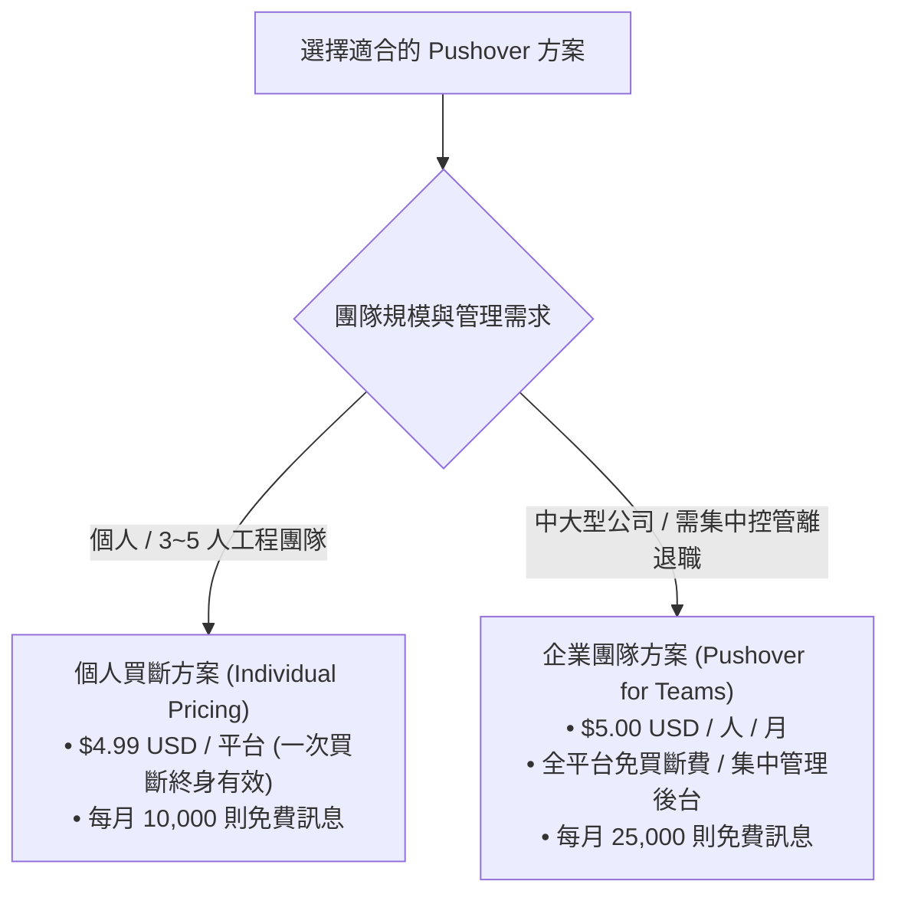

# Pushover 即時推播服務指南與費用解析 :material-bell-ring:

> **Pushover** 是一款專為開發者、SRE 與系統管理員設計的輕量級高可靠即時推播服務。透過極簡的 REST API，能將監控系統與業務警報以毫秒級延遲推播至工程師的手機、平板、智慧手錶與桌面電腦，並具備突破「勿擾模式」的緊急奪命連環催機制。

---

## 1. 方案概述與核心價值

在維運與 On-Call 實務中，工程師經常面臨以下痛點：

1. **通訊軟體通知易被忽略**：將告警推送到 Teams、Slack 或 Line，深夜值班時手機一旦開啟「勿擾模式 (Do Not Disturb)」或「睡眠排程」，所有通知皆會被強制靜音，導致嚴重漏失 P1/P2 故障。
2. **商業 On-Call 平台費用昂貴**：商業級告警平台（如 PagerDuty、Opsgenie）採人頭訂閱制，每人每月需支付 $21 ~ $41+ 美元，對中小型團隊或邊緣業務負擔較大。
3. **自建 App 推播維護成本極高**：自行開發 iOS/Android App 需要申請 Apple/Google 開發者帳號、自建 APNs/FCM 伺服器並維護長連線，技術複雜度高。

**Pushover** 以極低的成本與極簡的架構完美解決了上述問題：提供開箱即用的跨平台 Client、五級精細的優先級控制、一次性買斷的親民定價，以及穿透實體靜音開關的 **iOS Critical Alerts** 緊急報警能力。

---

## 2. 核心功能與技術特色

### A. 極簡 REST API 架構

Pushover 的發送機制非常直覺，任何支援 HTTP 的程式語言、Bash 腳本、甚至是終端機的單行 `curl` 指令皆可直接發動推播：

```bash
# 基本推播範例
curl -s \
  --form-string "token=YOUR_APPLICATION_TOKEN" \
  --form-string "user=YOUR_USER_KEY" \
  --form-string "title=🚨 生產環境資料庫警報" \
  --form-string "message=VictoriaMetrics 連線池使用率超過 95%，請立即處理！" \
  https://api.pushover.net/1/messages.json
```

### B. 五級精細優先級管理 (Priority -2 到 2)

Pushover 提供由低至高的 5 級優先級設定，精確適配不同等級的監控告警：

| Priority 數值 | 等級名稱 | 行動端表現行為 | 適用場景 |
| :---: | :--- | :--- | :--- |
| **`-2`** | **Lowest (最低)** | **完全無聲、無震動**，不會點亮螢幕，僅在 App 內留下紅點數字。 | 每日備份成功回報、批次作業定時完工通知。 |
| **`-1`** | **Low (低)** | **安靜通知**，點亮螢幕但不震動、不響鈴，依使用者在 App 內設定的安靜時間保持無聲。 | 測試環境警示、非關鍵邊界警告。 |
| **`0`** | **Normal (一般)** | **標準推播**，發出使用者設定的鈴聲與震動（預設級別）。 | 日常業務事件、一般系統告警、CI/CD 建置完成。 |
| **`1`** | **High (高)** | **強制發出高音量警報**，無視使用者在 App 內設定的安靜時間 (Quiet Hours)。 | 重要服務異常、API 錯誤率飆高。 |
| **`2`** | **Emergency (緊急)** | **SRE 救星機制**：<br>1. **支援 iOS Critical Alerts**：直接穿透手機側邊的「實體靜音切換鍵」與系統「勿擾/睡眠模式」，以最大音量鳴響。<br>2. **定時奪命連環催**：可指定 `retry=30`（每 30 秒響一次），直到工程師在手機上點擊確認 (Acknowledge) 才會停止。<br>3. **認領追蹤 (Receipts API)**：支援輪詢或 Webhook 回呼確認是哪位工程師認領。 | **P1 / Critical 致命故障、深夜緊急叫醒。** |

#### Priority 2 緊急告警呼叫範例

```bash
# 緊急告警：每 30 秒重複呼叫，最長持續 1 小時 (3600 秒)
curl -s \
  --form-string "token=YOUR_APPLICATION_TOKEN" \
  --form-string "user=YOUR_USER_KEY" \
  --form-string "title=🔥 [P1 CRITICAL] 支付服務中斷" \
  --form-string "message=支付網關連續 3 分鐘回傳 500 錯誤，請立即上線！" \
  --form-string "priority=2" \
  --form-string "retry=30" \
  --form-string "expire=3600" \
  https://api.pushover.net/1/messages.json
```

### C. 全平台與穿戴裝置支援

- **行動作業系統**：iOS (iPhone / iPad)、Android (手機 / 平板)。
- **智慧手錶支援**：**Apple Watch**、Wear OS（當發送緊急通知時，手錶會伴隨強烈震動與警笛聲）。
- **桌面作業系統**：macOS、Windows、Linux、桌面瀏覽器（Chrome、Firefox、Safari、Edge）原生桌面推播。

### D. 專屬 Email 轉推播閘道 (Email-to-Push Gateway)

Pushover 會為每位使用者提供專屬的電子信箱地址：

```text
username-randomstring@pomail.net
```

任何舊型系統、無法發起 Webhook 的網路設備（如機房防火牆、硬體交換機、UPS 不斷電系統），只需將告警發送至該 Email，Pushover 會在數秒內自動解析郵件標題與內文，轉化為手機 App 即時推播。

---

## 3. 詳細費用結構與計費模式

Pushover 具備業界罕見的**一次性買斷制**與**企業團隊月租制**，透明且無任何隱藏收費：



### A. 個人方案 (Individual Pricing) —— 一次買斷終身有效

適合個人開發者或成員固定的小型 SRE / DevOps 團隊：

| 評比項目 | 費用 | 詳細說明 |
| :--- | :--- | :--- |
| **免費試用期** | **$0 元** (全功能試用 30 天) | 下載 App 並註冊即可立即使用全部 API 與緊急告警功能，無功能閹割。 |
| **iOS 平台買斷** | **$4.99 USD**（約 NT$ 160） | **一次性買斷，終身有效**。同一 Apple ID 名下的 iPhone、iPad 與 Apple Watch 通通適用，不需重複收費。 |
| **Android 平台買斷** | **$4.99 USD**（約 NT$ 160） | **一次性買斷，終身有效**。同一 Google 帳號名下的 Android 手機、平板與智慧手錶通用。 |
| **Desktop 桌面端買斷** | **$4.99 USD**（約 NT$ 160） | **一次性買斷，終身有效**。支援所有主流瀏覽器接收桌面系統通知。 |
| **API 每月發送額度** | **免費 10,000 則 / 月** | 每個帳號每月享有 10,000 則免費 API 額度（每月 1 號自動歸零重置），由帳號下所有應用共享。 |
| **後續續約月費** | **$0 元（無訂閱費）** | 買斷後無任何強制月費或年費，不綁定信用卡。 |

### B. 企業團隊方案 (Pushover for Teams) —— 集中授權與管理

專門為企業團隊、外包維運組設計，簡化員工裝置授權與在職生命週期管理：

| 評比項目 | 費用 | 企業專屬功能 |
| :--- | :--- | :--- |
| **訂閱費用** | **$5.00 USD / 人 / 月**<br>（或年繳 **$60.00 USD / 人 / 年**） | 隨時依據在職人數彈性增減成員，依月計費，隨時可終止。 |
| **全平台跨裝置吃到飽** | **全免買斷費用** | 團隊成員無需個人付費，即可在 iOS、Android、Desktop 上任意下載使用。 |
| **團隊發送額度** | **免費 25,000 則 / 月** | 整個團隊帳號每月共享 25,000 則免費 API 發送額度。 |
| **中央化後台管理** | 內建管理儀表板 | IT 管理員可在後台一鍵邀請新員工、指派告警群組，或在員工離職時一鍵吊銷權限。 |
| **免密碼快速登入** | 支援 CSV 批次匯入 | 透過後台直接寄送 Instant Login 連結，同仁點擊即可自動配置並登入，無需手動建立密碼。 |
| **動態分組廣播** | Delivery Groups | 支援設定 `@sre-tier1`、`@dba-oncall` 等群組 Key，推播自動同步至群組所有成員。 |
| **高優先級傳輸** | Priority Message Queue | 享有專屬獨立的高優先級推送通道與官方優先客戶支援。 |

### C. 額外訊息擴充包 (Additional Message Capacity)

若監控告警頻率極高、超過了每月免費額度（個人 10,000 則 / 團隊 25,000 則），API 會回傳錯誤而**不會自動扣刷信用卡**。若需加購容量，可在官網直接購買預備點數（**加購額度永不過期，扣完為止**）：

| 加購訊息數量 | 費用 (USD) | 單則平均成本 (約) |
| :---: | :---: | :---: |
| **10,000 則** | **$25.00** | $0.0025 |
| **25,000 則** | **$57.50** | $0.0023 |
| **50,000 則** | **$100.00** | $0.0020 |
| **100,000 則** | **$150.00** | $0.0015 |
| **500,000 則** | **$500.00** | $0.0010 |

---

## 4. 解決方案對比：Pushover vs ntfy vs PagerDuty

| 比較維度 | Pushover | ntfy (開源自建) | PagerDuty (企業 SaaS) |
| :--- | :--- | :--- | :--- |
| **部署型態** | 託管型 SaaS（開箱即用） | 完全開源，可自架 Docker 伺服器 | 託管型 SaaS |
| **伺服器維護成本** | **0**（無需維護基礎架構） | 需自行維護伺服器、網域與憑證 | **0** |
| **費用方案** | **$4.99 一次買斷** 或 $5/人/月 | **完全免費**（自架） | **$21 ~ $41+ / 人 / 月** |
| **iOS Critical Alerts** | :white_check_mark: **原生支援**（穿透靜音/勿擾） | :white_check_mark: 支援（需設定 high priority） | :white_check_mark: 支援（且支援電信打電話） |
| **奪命連環催認領** | :white_check_mark: 內建 `retry` 與 `receipts` | :warning: 需自行於外部系統編寫重試 | :white_check_mark: 內建階梯式升級 |
| **排班系統 (Schedules)** | :x: 無（專注推播通知） | :x: 無（專注推播通知） | :white_check_mark: 內建強大排班系統 |
| **最適合場景** | **中小型團隊、追求極致性價比的 SRE** | **金融、國防或嚴格要求 100% 內網離線者** | **跨國超大型企業、需要法規稽核與電話語音者** |

---

## 5. 實戰整合範例

### A. Python 告警整合腳本

```python
import os
import requests

def send_pushover_alert(
    title: str,
    message: str,
    priority: int = 1,
    url: str = None,
    url_title: str = None
) -> dict:
    """
    發送 Pushover 推播通知
    :param priority: -2 (最低) 到 2 (緊急)
    """
    endpoint = "https://api.pushover.net/1/messages.json"
    payload = {
        "token": os.getenv("PUSHOVER_APP_TOKEN"),
        "user": os.getenv("PUSHOVER_USER_KEY"),
        "title": title,
        "message": message,
        "priority": priority,
    }

    # 若為緊急 P1 告警，設定每 30 秒催促一次，最多持續 1 小時
    if priority == 2:
        payload["retry"] = 30
        payload["expire"] = 3600

    if url:
        payload["url"] = url
        payload["url_title"] = url_title or "檢視詳情"

    response = requests.post(endpoint, data=payload, timeout=5)
    response.raise_for_status()
    return response.json()

# 呼叫範例
if __name__ == "__main__":
    send_pushover_alert(
        title="🚨 VictoriaMetrics 儲存警報",
        message="磁碟空間剩餘低於 10%，請立即執行保留週期清理！",
        priority=2,
        url="https://windcoldchen.github.io/windcold-kb/notes/observability-aiops-architecture/",
        url_title="📖 開啟知識庫排查手冊"
    )
```

### B. 與 Keep (KeepHQ) AIOps 告警工作流串接

在我們先前規劃的 **[AIOps 智慧可觀測性方案](file:///Users/luke.chen/Documents/github/windcold-kb/docs/notes/observability-aiops-architecture.md)** 中，可直接在 Keep 的 Workflow 定義一個 Pushover 動作步驟：

```yaml
# /etc/keep/workflows/pushover_urgent_escalation.yml
workflow:
  id: pushover-critical-escalation
  description: "當告警等級為 Critical 時，透過 Pushover 發動手機緊急穿透警報"
  triggers:
    - type: alert
      filters:
        - key: severity
          value: "critical"
  actions:
    - name: send-pushover-emergency
      provider:
        type: http
        config:
          url: "https://api.pushover.net/1/messages.json"
          method: POST
          headers:
            Content-Type: "application/x-www-form-urlencoded"
          body:
            token: "ENV_PUSHOVER_APP_TOKEN"
            user: "ENV_PUSHOVER_GROUP_KEY"
            title: "🔥 [CRITICAL] {{ alert.name }}"
            message: "服務: {{ alert.labels.service }}\n成因: {{ steps.claude-rca-analysis.output.summary }}"
            priority: "2"
            retry: "30"
            expire: "1800"
            url: "{{ alert.annotations.runbook_url }}"
            url_title: "檢視 MkDocs Runbook"
```

---

## 6. 總結與導入建議

1. **初期導入（3~5 人值班組）**：
   - 強烈建議採用 **個人買斷方案 ($4.99 USD)**，請同仁在手機安裝 App 並開啟 **Critical Alerts** 權限。
   - 每月享 10,000 則免費推播，基本上除了單次幾百元台幣的 App 購買費用外，**終生零維運月費**。
2. **與 Microsoft Teams 協同分工**：
   - **日常協同與 AI 診斷**：以 **Microsoft Teams 頻道** 為主，呈現豐富的 Adaptive Card、Claude 根因分析與一鍵自癒按鈕。
   - **深夜緊急催辦**：當重大故障在 3 分鐘內無人從 Teams 處理時，觸發 **Pushover Priority 2** 強制穿透手機靜音叫醒工程師，打造無死角的維運閉環。
