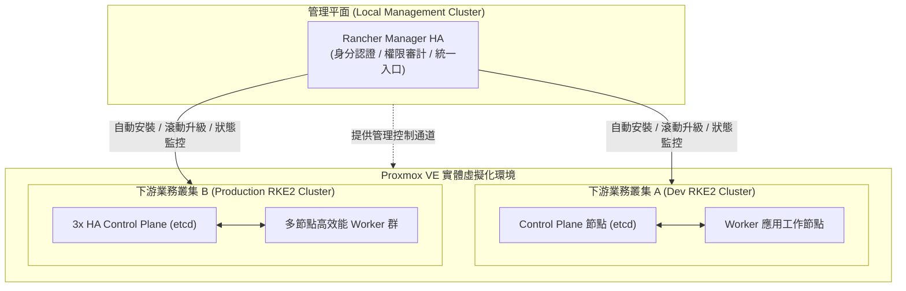
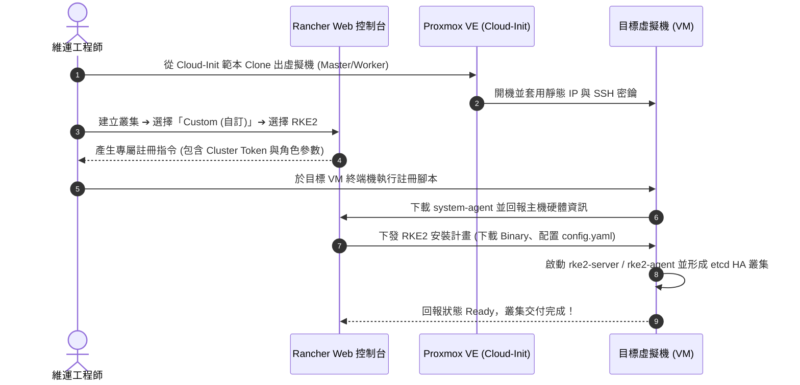
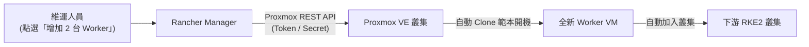
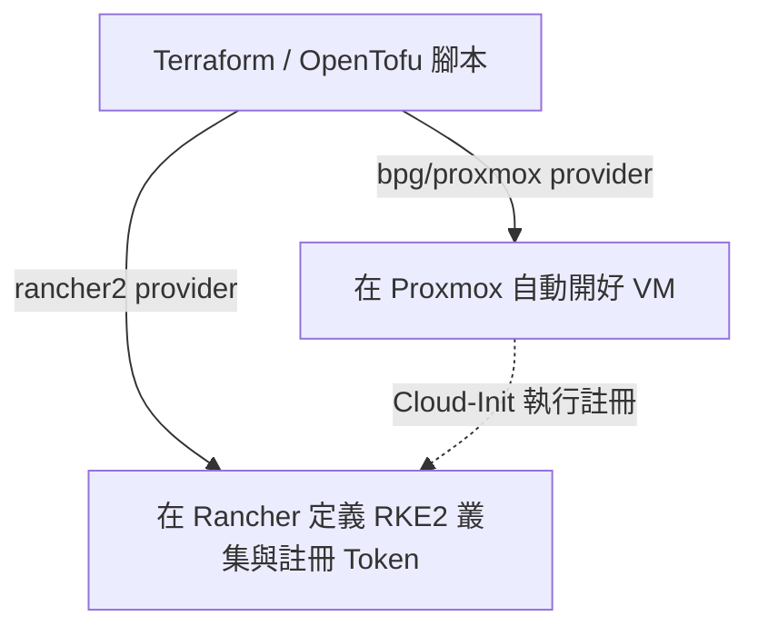

# 透過 Rancher 部署與管理下游 RKE2 業務叢集實戰指南 :material-kubernetes:

> 在企業私有雲架構中，最佳實踐是將 **Rancher 管理平台所在之管理叢集（Local Management Cluster）** 與實際運行企業應用的 **下游業務叢集（Downstream Workload Clusters）** 徹底解耦。本指南深入探討如何在 Proxmox VE 虛擬化基座之上，透過 Rancher 控制台快速開拓、部署並維運全新的高可用 RKE2 業務叢集。

---

## 1. 架構理念：管理叢集與下游業務叢集解耦

在生產環境中，強烈**不建議**直接將業務應用部署在安裝 Rancher Manager 的「Local 叢集」內。

透過將管理層與業務層分離，具備以下架構優勢：

1. **爆炸半徑隔離（Blast Radius Isolation）**：
   單一業務叢集的記憶體溢出（OOM）、網路風暴或故障崩潰，完全不會波及 Rancher 管理平台與其他業務叢集。
2. **彈性多環境生命週期管理**：
   可針對開發環境（Dev）、測試環境（Staging）與正式環境（Production）分別開立各自獨立的 RKE2 叢集，並隨時進行獨立的 Kubernetes 版本升級與維護。
3. **安全合規與統一 RBAC**：
   Rancher 扮演統一身分認證入口（整合 AD/LDAP/Entra ID），並將精細權限派發至各個下游 RKE2 叢集。



---

## 2. 方式一：自訂節點模式 (Custom Nodes) ——【最推薦、最穩健】

**自訂節點模式**是地端私有雲最通用、相容性最高的部署方式。其核心邏輯為：在 Proxmox VE 上預先建立好乾淨的 Linux 虛擬機（例如 Ubuntu 22.04 LTS），再由 Rancher 產生註冊指令並注入安裝代理（`system-agent`），全自動完成 RKE2 叢集引導。



### 實作步驟詳解

#### Step 1：在 Proxmox VE 上準備虛擬機

透過 Proxmox VE 上的 Cloud-Init 範本，Clone 出新叢集所需的虛擬機群，建議配置：

* **Control Plane（3 台）**：4 vCPU / 8GB RAM / 60GB 磁碟，設定固定 IP（如 `192.168.20.11` ~ `13`）。
* **Worker（3 台以上）**：8 vCPU / 16GB RAM / 100GB 磁碟，設定固定 IP（如 `192.168.20.21` ~ `23`）。

---

#### Step 2：在 Rancher 介面發起建立叢集

1. 登入 Rancher 網頁控制台（例如 `https://rancher.internal.domain`）。
2. 點選左上角選單 ➔ **Cluster Management** ➔ 點擊 **Create** 按鈕。
3. 叢集類型選擇 **Custom**（自訂）。
4. 在 **Cluster Configuration** 頁面進行細節配置：
   * **Cluster Name**：例如 `prod-app-rke2`。
   * **Kubernetes Version**：選擇目標 RKE2 版本（建議選擇最新 Stable 版）。
   * **CNI Network Provider**：
     * `Canal`（預設，兼具 Flannel 簡單連線與 Calico 網路策略防護）。
     * `Cilium`（適合需要 eBPF 極致網路效能與微服務可觀測性的場景）。
   * **Cloud Provider**：若搭配地端環境，可選擇 `None`（後續掛載 Proxmox CSI）或 `External`。
   * **etcd Snapshot Schedule**：建議設定每 6 小時一次，並填寫 S3 物件儲存認證資訊。

點擊 **Create** 進入節點註冊指引頁面。

---

#### Step 3：執行節點註冊與引導

在「Registration」介面中，Rancher 允許您勾選該節點的角色權限：

##### 1. 引導 Control Plane 節點（3 台）

勾選 **etcd** 與 **Control Plane**，並在「Node Address」填入該節點內網 IP。下方會產生單行註冊腳本：

```bash
curl -fL https://rancher.internal.domain/system-agent-install.sh | sudo sh -s - \
  --server https://rancher.internal.domain \
  --label 'topology.kubernetes.io/zone=pve-node-01' \
  --token <cluster-token> \
  --ca-checksum <ca-checksum> \
  --etcd --controlplane
```

登入至第一台、第二台與第三台 Master 節點的 Shell 中，分別執行該指令。

##### 2. 引導 Worker 節點

取消勾選 etcd 與 Control Plane，僅勾選 **Worker**，複製生成的註冊指令：

```bash
curl -fL https://rancher.internal.domain/system-agent-install.sh | sudo sh -s - \
  --server https://rancher.internal.domain \
  --label 'node-role.kubernetes.io/worker=true' \
  --token <cluster-token> \
  --ca-checksum <ca-checksum> \
  --worker
```

分別登入至所有 Worker 虛擬機中貼上執行。

---

#### Step 4：等待狀態就緒

回到 Rancher 介面，您可以在 **Cluster Management** 面板看到 `prod-app-rke2` 叢集進入 Provisioning 階段：

* Rancher 自動指派指令給 VM 上的 `rancher-system-agent`。
* 自動下載並校驗 RKE2 二進位發行檔。
* 自動建立 `/etc/rancher/rke2/config.yaml` 並啟動服務。
* 大約 5 ~ 8 分鐘後，所有節點亮綠燈，狀態變更為 **Active**。

---

## 3. 方式二：Proxmox Node Driver 模式 ——【全自動呼叫 PVE API 開 VM】

若希望體驗類似公有雲（AWS EKS / Azure AKS）「在介面輸入節點數量，底層自動開 VM」的體驗，可以藉由 **Proxmox 節點驅動 (Node Driver)** 實現。



### 核心組態步驟

1. **安裝 Proxmox 驅動**：
   * 進入 **Cluster Management** ➔ **Drivers** ➔ **Node Drivers**。
   * 點擊 **Add Node Driver**，加入開源社群維護的 Proxmox 驅動（例如：`docker-machine-driver-proxmox-ve`）。
   * 點選啟用（Active）。
2. **在 Proxmox 建立 API Token**：
   * 登入 PVE Web 控制台 ➔ **Datacenter** ➔ **Permissions** ➔ **API Tokens**。
   * 新增一個專用 Token（例如 `rancher@pve!automation`），並賦予 VM 開立、修改與開關機權限。
3. **在 Rancher 建立 Node Template**：
   * 設定 PVE 節點連線位址、API Token ID 與 Secret。
   * 指定 VM 模板來源（例如 ID `9000` 的 Cloud-Init 範本）。
   * 設定 VM 硬體規格（核心數、記憶體、硬碟大小、Bridge `vmbr0`）。
4. **建立 RKE2 叢集**：
   * 點擊 **Create Cluster** ➔ 選擇 **Proxmox VE** 驅動。
   * 設定 Node Pools（例如：Master Pool 填 3，Worker Pool 填 5）。
   * 點擊儲存後，Rancher 會主動發送 API 給 Proxmox，自動完成從建立 VM 到組建 K8s 叢集的全生命週期作業。

---

## 4. 方式三：Infrastructure as Code (Terraform / OpenTofu) 整合

對於成熟的 DevOps / Platform Engineering 團隊，更推薦將整個流程納入程式碼化（IaC）版本控管：



藉由結合 `bpg/proxmox` 與 `rancher2` Provider：

* 由 Terraform 先在 Rancher 宣告 `rancher2_cluster_v2`。
* 提取 Rancher 產出的 `cluster_registration_token`。
* 將該 Token 寫入 Proxmox 虛擬機的 Cloud-Init `user_data` 中。
* 只要執行一次 `terraform apply`，即可在無人值守的情況下完成完整私有雲 K8s 叢集的開立。

---

## 5. 下游叢集的關鍵生態補齊 (Storage & Ingress)

當下游 RKE2 叢集建立完成後，可直接透過 Rancher 的 **Apps (應用市集)** 進行周邊生態擴充：

### 1. 持久化儲存 (StorageClass)

* **Rancher Longhorn**：
  直接在 Rancher UI 進入該下游叢集 ➔ **Apps** ➔ 搜尋 **Longhorn** ➔ 一鍵點擊安裝。Longhorn 會自動調度 Worker 節點的本機硬碟組成軟體定義分散式區塊儲存，並提供 Web GUI 管理快照與異地備份。
* **Proxmox CSI Plugin**：
  若 PVE 本身已有健全的 Ceph 儲存池，可在下游叢集中安裝 `proxmox-csi-plugin`，使 PVC 直接調用 PVE 的 Ceph RBD。

### 2. 外部網路負載平衡 (LoadBalancer)

* 地端私有雲沒有公有雲的 ALB/NLB，建議在下游叢集中安裝 **Kube-VIP** 或 **MetalLB**，宣告一段內網專用 IP 池（例如 `192.168.20.200-192.168.20.250`），使下游叢集的 Ingress Controller 或業務資料庫可以直接獲取獨立的實體 IP。

---

## 6. 下游 RKE2 叢集 Day-2 維運最佳實踐

透過 Rancher 管理下游 RKE2 叢集，相較於手動維護能大幅降低維運負擔：

| 維運場景 | 傳統自建 K8s 做法 | Rancher + RKE2 做法 |
| :--- | :--- | :--- |
| **K8s 版本升級** | 手動依序登入多台主機、抽換二進位檔、逐台 drain 與 uncordon，稍有不慎即中斷服務 | 直接在 Rancher UI 下拉選單選擇新版本，Rancher 自動依照防護策略排程逐台滾動升級，**線上零停機** |
| **etcd 備份與還原** | 撰寫 cron 腳本使用 `etcdctl snapshot save`，手動同步至遠端並演練還原 | 在 UI 中設定自動備份至 S3，發生重大災難時直接在 Web UI 選擇歷史快照點擊 **Restore** 一鍵復原 |
| **安全合規掃描** | 自行編譯 `kube-bench` 跑指令解析日誌 | 內建 **CIS Benchmark 掃描**，點擊一次即產出可視化合規審計報告 |
| **權限控管與審計** | 手動簽發 Kubeconfig X.509 憑證，難以 revoke | 與企業 AD/LDAP 整合，員工離職自動失效，支援精細到 Namespace 的唯讀/讀寫授權 |

---

## 7. 總結

組合 A（Proxmox VE + RKE2 + Rancher）的終極目標，就是打造一個**完全自主可控、開源、且體驗媲美公有雲的企業私有容器雲**：

* **管理叢集** 穩定運作 Rancher，扮演多叢集指揮塔。
* **下游業務叢集** 依業務線、安全等級自由在 Proxmox VE 虛擬機中按需開拓。
* 透過「自訂節點模式」或「Proxmox 節點驅動」，享受一鍵部署、平滑升級、集中身分管控與自動災備還原的現代化雲原生維運體驗。
