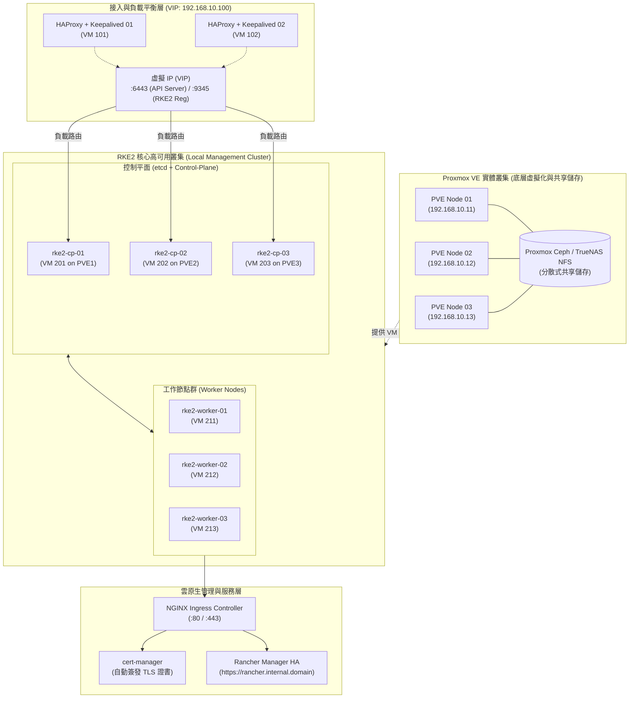

# Rancher + RKE2 + Proxmox VE 企業級高可用 Kubernetes 叢集落地指南 :material-server-network:

> 本指南詳細介紹如何在 **Proxmox VE (PVE)** 虛擬化平台之上，結合 Cloud-Init 自動化範本與 VIP 負載平衡，部署具備生產等級高可用（HA）的 **RKE2 (Rancher Kubernetes Engine Government)** 叢集，並於其上運行 **Rancher Multi-Cluster Manager**，構建統一管理私有雲多叢集之現代化雲原生架構。

---

## 1. 方案架構與技術選型

在企業地端（On-Premises）或私有雲環境中，構建穩定、安全且易於維運的 Kubernetes 平台通常面臨底層虛擬化、叢集生命週期管理與多叢集統一管控的挑戰：

- **Proxmox VE (PVE)**：
  基於 Debian 的開源企業級虛擬化平台，整合 KVM 虛擬化、LXC 容器、軟體定義儲存（Ceph / ZFS）與軟體定義網路（SDN），提供高可靠的底層運算與儲存資源。
- **RKE2 (Rancher Kubernetes Engine 2)**：
  又稱 RKE Government，是 SUSE/Rancher 開發的次世代 Kubernetes 發行版。它汲取了 K3s 的輕量、單一二進位部署優勢，同時完全遵循 **FIPS 140-2 密碼學標準**，開箱即預設通過 **CIS Kubernetes Benchmark** 安全加固，並原生採用 `containerd`，為企業私有雲提供極高安全合規性與穩定度。
- **Rancher Multi-Cluster Manager (MCM)**：
  業界領先的企業級多叢集管理平台，提供跨多雲與混合雲的統一入口、LDAP/AD/OIDC 身分認證整合、精細 RBAC、應用市集（Helm），以及基於 Fleet 的 GitOps 持續交付能力。

---

## 2. 總體架構拓撲圖

以下為基於 3 台 Proxmox VE 實體節點所構建的高可用 RKE2 與 Rancher 拓撲架構：



---

## 3. 網路規劃與資源清單

建議預先規劃好靜態 IP 與子網路，以下為標準生產配置參考：

| 主機名稱 | 角色 / 服務 | CPU / RAM / 磁碟 | IP 位址 | 部署位置 |
| :--- | :--- | :--- | :--- | :--- |
| **`rke2-vip`** | 虛擬 IP (VIP) | N/A | `192.168.10.100` | Keepalived 浮動 IP |
| **`lb-01`** | HAProxy + Keepalived 01 | 2 vCPU / 2GB / 20GB | `192.168.10.101` | PVE 01 |
| **`lb-02`** | HAProxy + Keepalived 02 | 2 vCPU / 2GB / 20GB | `192.168.10.102` | PVE 02 |
| **`rke2-cp-01`** | RKE2 Server (etcd / CP) | 4 vCPU / 8GB / 60GB | `192.168.10.111` | PVE 01 |
| **`rke2-cp-02`** | RKE2 Server (etcd / CP) | 4 vCPU / 8GB / 60GB | `192.168.10.112` | PVE 02 |
| **`rke2-cp-03`** | RKE2 Server (etcd / CP) | 4 vCPU / 8GB / 60GB | `192.168.10.113` | PVE 03 |
| **`rke2-worker-01`** | RKE2 Agent (Worker) | 8 vCPU / 16GB / 100GB | `192.168.10.121` | PVE 01 |
| **`rke2-worker-02`** | RKE2 Agent (Worker) | 8 vCPU / 16GB / 100GB | `192.168.10.122` | PVE 02 |
| **`rke2-worker-03`** | RKE2 Agent (Worker) | 8 vCPU / 16GB / 100GB | `192.168.10.123` | PVE 03 |

---

## 4. 第一階段：Proxmox VE 虛擬機範本與負載平衡配置

### A. 製作 Ubuntu 22.04 LTS Cloud-Init 範本

在任意 PVE 節點的 Shell 中執行以下腳本，下載官方 Cloud 映像檔並轉為快速複製範本：

```bash
# 1. 下載 Ubuntu 22.04 Cloud Image
wget https://cloud-images.ubuntu.com/jammy/current/jammy-server-cloudimg-amd64.img

# 2. 建立 VM (ID 9000)
qm create 9000 --name "ubuntu-2204-template" --memory 2048 --cores 2 --net0 virtio,bridge=vmbr0

# 3. 匯入硬碟並掛載至 SCSI
qm importdisk 9000 jammy-server-cloudimg-amd64.img local-lvm
qm set 9000 --scsihw virtio-scsi-pci --scsi0 local-lvm:vm-9000-disk-0

# 4. 新增 Cloud-Init 磁碟並設定開機引導
qm set 9000 --ide2 local-lvm:cloudinit
qm set 9000 --boot c --bootdisk scsi0
qm set 9000 --serial0 socket --vga serial0
qm set 9000 --agent enabled=1

# 5. 轉換為範本
qm template 9000
```

透過此範本可於 1 分鐘內快速 Clone 出 3 台 Control Plane 與 Worker 虛擬機，並直接於 Proxmox 介面填寫靜態 IP 與 SSH 公鑰。

---

### B. 配置 HAProxy + Keepalived 負載平衡器

Kubernetes API（`6443`）與 RKE2 節點註冊通道（`9345`）必須透過高可用接入點轉發，防止任一 Control Plane 離線時造成叢集通信中斷。

在 `lb-01` 與 `lb-02` 上安裝軟體：

```bash
sudo apt update && sudo apt install -y haproxy keepalived
```

`/etc/haproxy/haproxy.cfg` 配置範例：

```haproxy
frontend rke2_api_frontend
    bind 192.168.10.100:6443
    mode tcp
    option tcplog
    default_backend rke2_api_backend

backend rke2_api_backend
    mode tcp
    option tcp-check
    balance roundrobin
    server rke2-cp-01 192.168.10.111:6443 check fall 3 rise 2
    server rke2-cp-02 192.168.10.112:6443 check fall 3 rise 2
    server rke2-cp-03 192.168.10.113:6443 check fall 3 rise 2

frontend rke2_register_frontend
    bind 192.168.10.100:9345
    mode tcp
    option tcplog
    default_backend rke2_register_backend

backend rke2_register_backend
    mode tcp
    option tcp-check
    balance roundrobin
    server rke2-cp-01 192.168.10.111:9345 check fall 3 rise 2
    server rke2-cp-02 192.168.10.112:9345 check fall 3 rise 2
    server rke2-cp-03 192.168.10.113:9345 check fall 3 rise 2
```

---

## 5. 第二階段：RKE2 高可用叢集部署 (HA Bootstrap)

### A. 初始化第一台 Control Plane 節點 (`rke2-cp-01`)

1. **建立設定檔目錄與設定檔**：

   ```bash
   sudo mkdir -p /etc/rancher/rke2/
   sudo vim /etc/rancher/rke2/config.yaml
   ```

   寫入以下內容（自訂安全 Token 與憑證 SAN 網域名稱/IP）：

   ```yaml
   token: "K10a98f12c34d56e7890abcdef!SecretClusterToken"
   tls-san:
     - "192.168.10.100"
     - "rke2-api.internal.domain"
     - "192.168.10.111"
   cni: "canal" # 預設為 Canal (Flannel 網路 + Calico 網路安全策略)
   write-kubeconfig-mode: "0640"
   etcd-snapshot-schedule-cron: "0 */6 * * *" # 每 6 小時自動進行 etcd 快照
   etcd-snapshot-retention: 28 # 保留 7 天快照
   ```

2. **安裝並啟動 RKE2 Server**：

   ```bash
   curl -sfL https://get.rke2.io | sh -
   sudo systemctl enable rke2-server.service
   sudo systemctl start rke2-server.service
   ```

3. **設定環境變數與驗證狀態**：

   ```bash
   mkdir -p ~/.kube
   sudo cp /etc/rancher/rke2/rke2.yaml ~/.kube/config
   sudo chown $(id -u):$(id -g) ~/.kube/config
   
   # 將 RKE2 自帶的 kubectl 與 crictl 加入 PATH
   echo 'export PATH=$PATH:/var/lib/rancher/rke2/bin' >> ~/.bashrc
   source ~/.bashrc

   kubectl get nodes
   ```

---

### B. 加入第二與第三台 Control Plane (`rke2-cp-02`, `rke2-cp-03`)

在 `rke2-cp-02` 與 `rke2-cp-03` 上建立 `/etc/rancher/rke2/config.yaml`，指定註冊端點為 VIP：

```yaml
server: "https://192.168.10.100:9345"
token: "K10a98f12c34d56e7890abcdef!SecretClusterToken"
tls-san:
  - "192.168.10.100"
  - "rke2-api.internal.domain"
cni: "canal"
write-kubeconfig-mode: "0640"
```

啟動服務：

```bash
curl -sfL https://get.rke2.io | sh -
sudo systemctl enable rke2-server.service
sudo systemctl start rke2-server.service
```

三台 Control Plane 啟動完成後，在任意節點檢查，即可看到 3 節點 HA etcd 叢集已健全運作。

---

### C. 加入 Worker 節點 (`rke2-worker-01` ~ `03`)

在 Worker 機器上建立 `/etc/rancher/rke2/config.yaml`：

```yaml
server: "https://192.168.10.100:9345"
token: "K10a98f12c34d56e7890abcdef!SecretClusterToken"
```

以 Agent 模式安裝並啟動：

```bash
curl -sfL https://get.rke2.io | INSTALL_RKE2_TYPE="agent" sh -
sudo systemctl enable rke2-agent.service
sudo systemctl start rke2-agent.service
```

在 Control Plane 執行 `kubectl get nodes`，確認所有節點皆處於 `Ready` 狀態：

```text
NAME             STATUS   ROLES                       AGE     VERSION
rke2-cp-01       Ready    control-plane,etcd,master   30m     v1.30.2+rke2r1
rke2-cp-02       Ready    control-plane,etcd,master   25m     v1.30.2+rke2r1
rke2-cp-03       Ready    control-plane,etcd,master   20m     v1.30.2+rke2r1
rke2-worker-01   Ready    <none>                      15m     v1.30.2+rke2r1
rke2-worker-02   Ready    <none>                      12m     v1.30.2+rke2r1
rke2-worker-03   Ready    <none>                      10m     v1.30.2+rke2r1
```

---

## 6. 第三階段：持久化儲存與憑證管理

### A. 配置動態儲存卷 (StorageClass)

可選用以下方案之一：

1. **Rancher Longhorn**：
   輕量級雲原生分散式區塊儲存，具備跨節點複本備份、快照與簡單易用的 Web UI。
2. **Proxmox CSI Plugin**：
   利用 `proxmox-csi-plugin` 直接將 Kubernetes PersistentVolume 掛載至 PVE 叢集背後的 Ceph RBD 或 ZFS 儲存池。

若選擇安裝 Longhorn：

```bash
helm repo add longhorn https://charts.longhorn.io
helm repo update
kubectl create namespace longhorn-system
helm install longhorn longhorn/longhorn --namespace longhorn-system
```

---

### B. 安裝 `cert-manager`

Rancher Manager 依賴 `cert-manager` 自動產生與管理 Ingress TLS 憑證：

```bash
# 新增 Jetstack Helm Repository
helm repo add jetstack https://charts.jetstack.io
helm repo update

# 安裝 cert-manager CRDs 與應用程式
helm install cert-manager jetstack/cert-manager \
  --namespace cert-manager \
  --create-namespace \
  --set crds.enabled=true
```

確認 Pod 運作正常：

```bash
kubectl get pods --namespace cert-manager
```

---

## 7. 第四階段：部署高可用 Rancher Manager

### A. 使用 Helm 安裝 Rancher

1. **新增 Rancher Stable Repository**：

   ```bash
   helm repo add rancher-stable https://releases.rancher.com/server-charts/stable
   helm repo update
   ```

2. **建立專屬命名空間並執行安裝**：

   ```bash
   kubectl create namespace cattle-system

   helm install rancher rancher-stable/rancher \
     --namespace cattle-system \
     --set hostname=rancher.internal.domain \
     --set bootstrapPassword="admin-initial-strong-password" \
     --set replicas=3
   ```

3. **監控部屬進度**：

   ```bash
   kubectl -n cattle-system rollout status deploy/rancher
   ```

4. **完成初始設定**：
   - 確保內網 DNS 已將 `rancher.internal.domain` 解析至 Worker 節點或前端反向代理 IP。
   - 以瀏覽器開啟 `https://rancher.internal.domain`，即可進入現代化 Rancher 管理面板。

---

## 8. 生產級維運與最佳實踐 (Day-2 Operations)

### 1. RKE2 叢集原生地震備份 (etcd Snapshots)

RKE2 內建 etcd 自動快照機制，除儲存於本地 `/var/lib/rancher/rke2/server/db/snapshots` 外，強烈建議啟用 **S3 相容遠端備份**：

在 `/etc/rancher/rke2/config.yaml` 中新增：

```yaml
etcd-s3: true
etcd-s3-endpoint: "s3.internal.domain"
etcd-s3-bucket: "rke2-etcd-backups"
etcd-s3-access-key: "MY_ACCESS_KEY"
etcd-s3-secret-key: "MY_SECRET_KEY"
etcd-s3-folder: "production-rke2"
```

### 2. Proxmox VE 虛擬機備份整合 (PBS)

- 結合 **Proxmox Backup Server (PBS)** 針對 RKE2 虛擬機執行每日排程去重複（Deduplication）增量備份。
- 發生極端節點毀損時，可於 PVE Web 控制台數分鐘內快速將整台 VM 復原開機。

### 3. RKE2 零中斷平滑版本升級

升級 RKE2 遵循循序漸進原則：

1. **先升級 Control Plane 節點**（一次一台）：

   ```bash
   # 指定新版本重跑安裝腳本
   curl -sfL https://get.rke2.io | INSTALL_RKE2_VERSION=v1.30.3+rke2r1 sh -
   sudo systemctl restart rke2-server
   ```

2. **再驅逐並升級 Worker 節點**：

   ```bash
   kubectl drain <worker-node> --ignore-daemonsets --delete-emptydir-data
   curl -sfL https://get.rke2.io | INSTALL_RKE2_TYPE="agent" INSTALL_RKE2_VERSION=v1.30.3+rke2r1 sh -
   sudo systemctl restart rke2-agent
   kubectl uncordon <worker-node>
   ```

---

## 9. 總結

透過 **Proxmox VE + RKE2 + Rancher** 的黃金三角組合：

- 企業無須承擔公有雲昂貴託管費用，即可在自家資料中心建立具備容錯與彈性的私有雲基礎設施。
- RKE2 的 CIS 加固提供金融級容器安全防護。
- Rancher 則提供開箱即用的多叢集統一納管、身分聯邦與監控告警整合，是私有雲落地容器化的最佳實踐範本。
