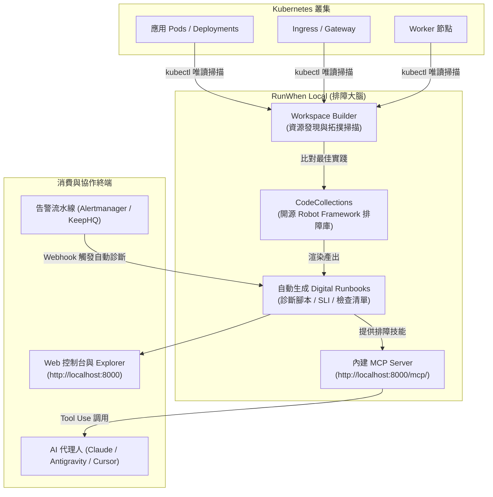
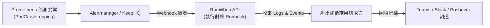

# RunWhen 智慧排障與自動化實戰指南 :material-robot-confused:

> 在雲原生 Kubernetes 架構下，當叢集出現異常告警時，SRE 與維運團隊往往需要手動執行大量 `kubectl` 指令檢查 Pod 狀態、事件（Events）、日誌（Logs）與資源配額，耗時耗力且排查知識難以沉澱與標準化。**RunWhen** 是一個專為 SRE 與雲端工程師打造的**開源智慧數位助理與故障排查自動化平台（Digital SRE Assistant）**。它能自動掃描並探索 Kubernetes 叢集拓撲，自動匹配開源社群維護的排障代碼庫（CodeCollections），為每個工作負載自動生成專屬的 **SLI（服務水準指標）**、**可執行的數位排障手冊（Digital Runbooks）**，並原生支援 **Model Context Protocol (MCP)** 讓 AI 代理人直接調用現場診斷能力。

---

## 1. 核心架構與設計原理

### 1.1 傳統排障模式 vs RunWhen 智慧自動化

- **傳統排障痛點**：工程師收到告警 ➔ 手動登入 VPN / 跳板機 ➔ 逐一執行 `kubectl describe pod`、`kubectl logs` ➔ 排查步驟容易遺漏、經驗無法跨人員傳承。
- **RunWhen 自動化閉環**：自動掃描叢集 ➔ 生成標準化 Robot Framework 排障任務 ➔ 告警觸發時自動執行第一線診斷（Level 1 Triage） ➔ 直接將診斷摘要與修復建議推播至通訊軟體或 AI 代理人。

### 1.2 RunWhen 端到端運作流程全景



---

## 2. RunWhen Local 安裝與部署實戰

RunWhen 支援兩種主流運行模式：**本機 Docker 獨立模式**（適合個人快速排查與本機 AI 串接）與 **Kubernetes 內部部署**（適合團隊級私有化部署）。

### 2.1 模式 A：本機 Docker 快速啟動（推薦入門與 AI 整合）

RunWhen 官方提供包裝完整的容器映像檔 `ghcr.io/runwhen-contrib/runwhen-local:latest`，內建掃描引擎、Web 控制台與 MCP 伺服器。

#### 步驟 1：準備工作目錄與 Kubeconfig

在本地建立一個工作目錄，並將 Kubernetes 叢集的 `kubeconfig` 檔案放入：

```bash
mkdir -p ~/runwhen-workspace
cd ~/runwhen-workspace

# 將當前環境的 Kubeconfig 複製至共用目錄
cp ~/.kube/config ./kubeconfig
```

#### 步驟 2：啟動 RunWhen Local 容器

```bash
docker run -d --name runwhen-local \
  -p 8000:8000 \
  -v "$(pwd):/shared" \
  ghcr.io/runwhen-contrib/runwhen-local:latest
```

- **`-p 8000:8000`**：暴露 Web UI 與 MCP 端點。
- **`-v "$(pwd):/shared"`**：容器會讀取掛載目錄內的 `kubeconfig`，並將掃描生成的 Workspace 與 Runbooks 產出至此目錄。

#### 步驟 3：訪問 Web 介面

容器啟動後，開啟瀏覽器即可訪問：

- **系統首頁**：`http://localhost:8000/`
- **工作區資源總覽 (Workspace Explorer)**：`http://localhost:8000/explorer/`
- **MCP 服務端點**：`http://localhost:8000/mcp/`

---

### 2.2 模式 B：Kubernetes 叢集內部署 (Helm 安裝)

若希望在測試或正式叢集內以私有 Runner 方式運作，可使用官方 Helm Chart：

#### 步驟 1：建立專用 Namespace 與 RBAC 權限

```bash
kubectl create namespace runwhen-local
```

建立最小權限之 `ClusterRole`（RunWhen 僅需唯讀權限，嚴禁寫入）：

```yaml
# runwhen-rbac.yaml
apiVersion: v1
kind: ServiceAccount
metadata:
  name: runwhen-runner
  namespace: runwhen-local
---
apiVersion: rbac.authorization.k8s.io/v1
kind: ClusterRole
metadata:
  name: runwhen-reader
rules:
  - apiGroups: ["", "apps", "batch", "networking.k8s.io"]
    resources:
      - pods
      - pods/log
      - deployments
      - daemonsets
      - statefulsets
      - jobs
      - services
      - ingresses
      - events
      - namespaces
      - nodes
    verbs: ["get", "list", "watch"]
---
apiVersion: rbac.authorization.k8s.io/v1
kind: ClusterRoleBinding
metadata:
  name: runwhen-reader-binding
subjects:
  - kind: ServiceAccount
    name: runwhen-runner
    namespace: runwhen-local
roleRef:
  kind: ClusterRole
  name: runwhen-reader
  apiGroup: rbac.authorization.k8s.io
```

套用 RBAC：

```bash
kubectl apply -f runwhen-rbac.yaml
```

#### 步驟 2：撰寫 Helm 自訂配置檔 (`values.yaml`)

```yaml
# values.yaml
serviceAccount:
  create: false
  name: runwhen-runner

workspaceInfo:
  workspaceName: "prod-cluster-workspace"

discovery:
  # 指定掃描目標命名空間，避免無謂掃描
  namespaces:
    - default
    - production
    - ingress-nginx
  includeK8s: true

resources:
  limits:
    cpu: 1000m
    memory: 1Gi
  requests:
    cpu: 200m
    memory: 256Mi
```

#### 步驟 3：加入 Helm Repo 並安裝

```bash
helm repo add runwhen-contrib https://runwhen-contrib.github.io/helm-charts
helm repo update

helm install runwhen-local runwhen-contrib/runwhen-local \
  --namespace runwhen-local \
  -f values.yaml
```

---

## 3. 客製化 Discovery 掃描規則與工作區設定

RunWhen 的掃描行為由 **`workspace-builder`** 驅動。您可以在本機或工作區目錄透過 `runwhen-local.yaml` 自訂掃描深度與擴充中介軟體庫：

```yaml
# runwhen-local.yaml
workspace:
  name: my-k8s-platform
  ownerEmail: sre@example.com

# 資源探索規則
discovery:
  namespaces:
    include:
      - "prod-*"
      - "staging-*"
    exclude:
      - "kube-system"
      - "cert-manager"
  
  # 啟用特定中介軟體專屬 CodeCollection 排障技能
  collectors:
    - kubernetes
    - ingress-nginx
    - postgresql
    - cert-manager
    - argo-cd
```

執行自訂掃描命令：

```bash
# 在已掛載目錄下重新執行探索掃描
docker exec -it runwhen-local runwhen-local discovery
```

掃描完成後，RunWhen 會自動在 `/shared/workspaces/<workspace-name>/` 下產生結構化的目錄樹，每一個被發現的 Deployment 或 Ingress 都會獲得對應的 `.robot` 診斷任務。

---

## 4. RunWhen 排障任務結構與使用方式

### 4.1 Robot Framework 排障任務解構

RunWhen 的底層排障任務以開源的 **Robot Framework** 語法撰寫，具備高度人機可讀性與確定性。以下為典型的 Pod 異常診斷腳本範例：

```robot
*** Settings ***
Documentation    自動診斷 Kubernetes Pod 重啟與 CrashLoopBackOff 根本原因
Library          RW.Core
Library          RW.K8s

*** Variables ***
${NAMESPACE}     production
${LABELS}        app=order-service

*** Test Cases ***
檢查 Pod 狀態與重啟次數 (Check Pod Restart Count)
    [Documentation]    檢視指定標籤的 Pod 近期是否有頻繁重啟
    ${pods}=    RW.K8s.Get Pods By Labels    namespace=${NAMESPACE}    labels=${LABELS}
    FOR    ${pod}    IN    @{pods}
        RW.K8s.Check Container Restarts    pod=${pod}    threshold=3
    END

擷取 OOMKilled 與崩潰事件 (Extract Crash Events)
    [Documentation]    排查是否有 OOMKilled 或致命 Exit Code
    ${events}=    RW.K8s.Get Warning Events    namespace=${NAMESPACE}
    RW.Core.Log Recommendation If Match
    ...    events=${events}
    ...    pattern=OOMKilled
    ...    action=請調高 Deployment resources.limits.memory 限制配額。
```

### 4.2 執行排障任務

#### 方式 1：透過 Web 控制台一鍵執行

開啟 `http://localhost:8000/explorer/`：

1. 在左側樹狀導覽選擇目標資源（例如：`production/deployments/order-service`）。
2. 右側會列出所有可用的診斷任務（如：*Troubleshoot High Latency*、*Inspect CrashLoopBackOff*）。
3. 點擊 **Run**，系統即刻在容器或背景執行診斷，並產出清晰的綠/紅檢查清單與建議。

#### 方式 2：透過命令列執行指定 Task

可在終端直接呼叫 RunWhen 內建 CLI 執行：

```bash
docker exec -it runwhen-local rw run \
  --workspace my-k8s-platform \
  --task "Inspect CrashLoopBackOff" \
  --namespace production
```

---

## 5. 整合 AI 代理人：RunWhen MCP 實戰

RunWhen Local 內建原生 **Model Context Protocol (MCP)** 伺服器，能讓 Claude Desktop、Cursor 或 Google Antigravity 直接將其作為排障外腦！

### 5.1 掛載至 Antigravity / Claude Desktop

在您的 MCP 設定檔（例如 `~/.gemini/config/mcp_config.json` 或 `claude_desktop_config.json`）中加入 RunWhen 伺服器：

```json
{
  "mcpServers": {
    "runwhen": {
      "serverUrl": "http://localhost:8000/mcp/"
    }
  }
}
```

或使用 Antigravity CLI 一鍵新增：

```bash
agy mcp add runwhen http://localhost:8000/mcp/
```

### 5.2 在 AI 對話中直接調用排障技能

掛載完成後，AI 代理人會自動發現 RunWhen 提供之拓撲查詢與診斷工具：

> **使用者提問**：
> 「目前 Kubernetes 叢集裡的 `production` 命名空間好像有服務掛了，請幫我檢查並提供修復建議。」
>
> **AI 代理人運作流程**：
>
> 1. AI 自動調用 RunWhen MCP 工具：`get_workspace_resources(namespace="production")`。
> 2. 發現 `order-service` Pod 重啟次數異常。
> 3. AI 自動調用：`execute_troubleshooting_task(resource="order-service", task="Inspect CrashLoopBackOff")`。
> 4. 取得診斷回傳：Exit Code 137 (OOMKilled)，記憶體限制為 512Mi。
> 5. AI 直接回答：「根本原因為 `order-service` 觸發 OOMKilled，建議修改 Deployment YAML 將記憶體上限由 512Mi 調高至 1Gi。」

---

## 6. AIOps 告警閉環：與 Prometheus / KeepHQ 聯動

為了達到無人值守的第一線故障排查（Level 1 Auto-Triage），可將 Prometheus Alertmanager 或 KeepHQ 告警管線與 RunWhen 串接：



### Alertmanager Webhook 配置範例

```yaml
# alertmanager.yaml
receivers:
  - name: "runwhen-auto-triage"
    webhook_configs:
      - url: "http://runwhen-local.runwhen-local.svc:8000/api/v1/webhook"
        send_resolved: false
```

當告警產生時，RunWhen 自動根據告警的 `namespace` 與 `deployment` 標籤執行專屬診斷任務，並將產出的報告附加於告警工單或 Slack/Teams 訊息中，SRE 看到通知時已經具備完整的根因分析報告！

---

## 7. 生產環境安全與最佳實踐

1. **嚴格限制 RBAC 權限**：
   - RunWhen 僅用於故障診斷與狀態檢查，給予的 ServiceAccount 必須嚴格限定為 `verbs: ["get", "list", "watch"]`，**切勿授予 `create`、`update`、`delete` 權限**。
2. **敏感資訊脫敏 (Masking)**：
   - 避免在日誌中輸出未遮罩的資料庫密碼或 Token。RunWhen 內建關鍵字過濾器，建議在自訂任務中確保環境變數（Env）中的密鑰已遮罩。
3. **限定掃描命名空間**：
   - 在大型多租戶叢集中，避免全局掃描所有 Namespaces，以減少 Kubernetes API Server 的查詢負載。建議透過 `runwhen-local.yaml` 的 `include` 規則精確指定核心業務業務命名空間。
