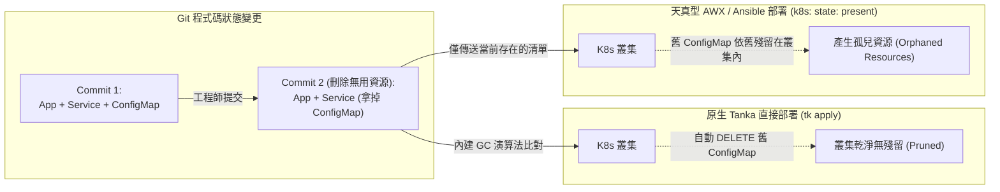
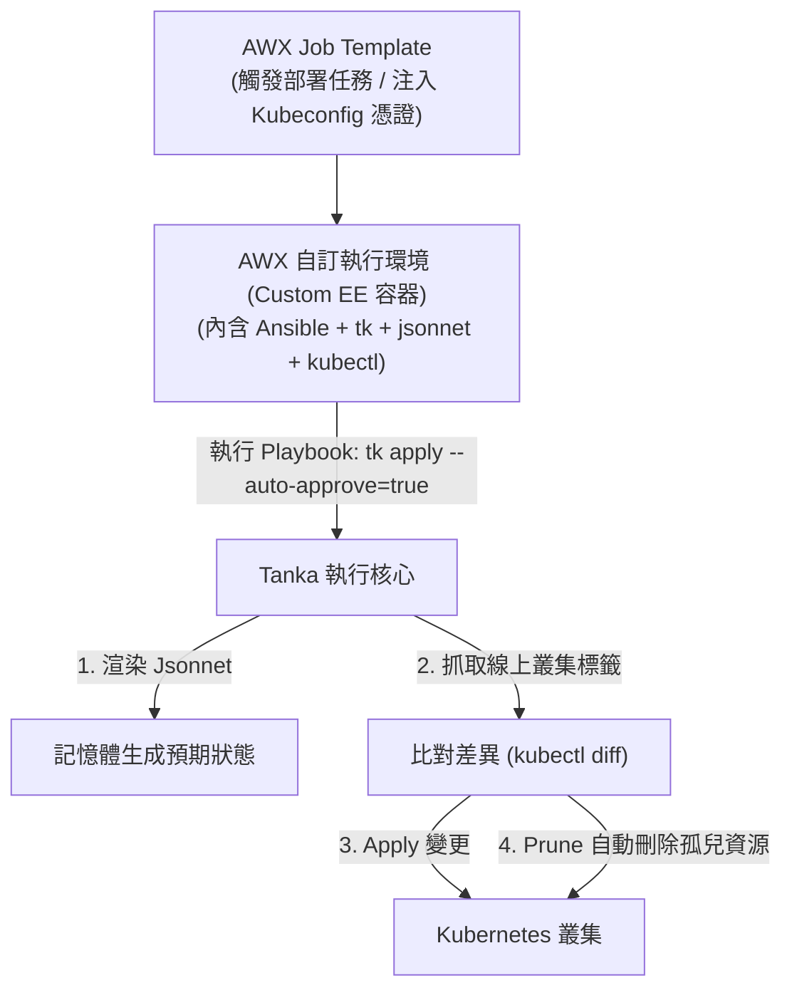
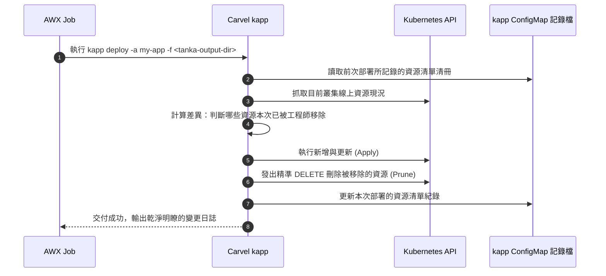

# Grafana Tanka 結合 AWX 實現 Kubernetes 資源自動修剪 (Pruning) 指南 :material-recycle:

> **Grafana Tanka** 是一套基於 Jsonnet 的宣告式 Kubernetes 資源編排工具，其最受歡迎的特性之一是內建的**垃圾回收機制（Garbage Collection / Prune）**——當工程師在程式碼中刪除某個資源定義時，Tanka 能自動在叢集中同步刪除該資源。然而，當企業要求**所有叢集變更必須由 AWX (Ansible Automation Platform) 統一排程、授權與審計**時，傳統的 Ansible Apply 模式往往無法感知「哪些資源已被刪除」。本指南深入分析此痛點，並提供四種成熟的架構解決方案。

---

## 1. 核心痛點剖析：宣告式修剪 vs 命令式推送

### 什麼是資源修剪 (Pruning)？

在標準的宣告式管理（Declarative Management / GitOps）中，Git 儲存庫被視為叢集的唯一信任來源（Single Source of Truth, SSOT）。

* **新增/修改資源**：Git 新增定義 ➔ 叢集建立或更新。
* **刪除資源（Prune）**：**Git 刪除定義 ➔ 叢集自動刪除該實體資源**。



### 為什麼純 Ansible 預設無法刪除舊資源？

傳統使用 Ansible 部署 Kubernetes 時，通常採用 `kubernetes.core.k8s` 模組：

```yaml
- name: Deploy Kubernetes Manifests
  kubernetes.core.k8s:
    state: present
    src: "{{ item }}"
  loop: "{{ current_manifest_files }}"
```

當您在 Git 中刪除了 `old-service.yaml`，Ansible 讀取到的檔案清單中根本沒有這個檔案，因此它**只會將現存的清單執行 `state: present`，完全不會知道叢集裡還躺著一個需要被刪除的 `old-service`**。

隨著時間推移，叢集內將累積大量的「孤兒資源」：

* **廢棄的 Service / Ingress**：可能佔用內網 IP 或引發流量路由錯亂。
* **孤兒 CronJob / Pod**：持續在背景消耗叢集運算資源。
* **過期的 ConfigMap / Secret**：造成潛在的安全配置洩漏。

---

## 2. 四大落地解決方案

為在 AWX 中重現 Tanka 的自動資源修剪（Prune）效果，我們依據維運難易度與業界成熟度，梳理出以下四種方案：

---

### 方案一：在 AWX Execution Environment (EE) 封裝 Tanka（最推薦、零額外邏輯）

**核心思維**：不要在 Ansible 內部重新發明「資源比對與刪除演算法」。Tanka 本身的垃圾回收演算法最懂 Jsonnet 的結構，我們只需要讓 **AWX 擔任安全管理員與調度引擎，底層直接驅動 Tanka CLI**。



#### 實作步驟

##### 1. 製作包含 Tanka 的自訂 AWX Execution Environment

建立 `Dockerfile`：

```dockerfile
FROM quay.io/ansible/awx-ee:latest
USER root

# 1. 安裝 Tanka 與 jsonnet-bundler
ARG TANKA_VERSION=v0.27.1
ARG JB_VERSION=v0.5.1

RUN curl -fSL -o /usr/local/bin/tk https://github.com/grafana/tanka/releases/download/${TANKA_VERSION}/tk-linux-amd64 && \
    chmod +x /usr/local/bin/tk && \
    curl -fSL -o /usr/local/bin/jb https://github.com/jsonnet-bundler/jsonnet-bundler/releases/download/${JB_VERSION}/jb-linux-amd64 && \
    chmod +x /usr/local/bin/jb

# 2. 安裝匹配的 kubectl
RUN curl -LO "https://dl.k8s.io/release/$(curl -L -s https://dl.k8s.io/release/stable.txt)/bin/linux/amd64/kubectl" && \
    chmod +x kubectl && mv kubectl /usr/local/bin/

USER 1000
```

將此映像檔建置並推播至企業內部容器倉庫，並在 AWX 管理介面的 **Execution Environments** 中註冊。

##### 2. 編寫簡潔的 Ansible Playbook (`playbooks/deploy-tanka.yml`)

```yaml
---
- name: Deploy Kubernetes Resources via Tanka with Native Pruning
  hosts: localhost
  connection: local
  gather_facts: false

  tasks:
    - name: Validate Tanka Environment
      ansible.builtin.command:
        cmd: tk show environments/{{ target_env }}
      changed_when: false

    - name: Apply Manifests and Auto-Prune Obsolete Resources
      ansible.builtin.command:
        cmd: tk apply environments/{{ target_env }} --auto-approve=true
      environment:
        KUBECONFIG: "{{ lookup('env', 'K8S_AUTH_KUBECONFIG') }}"
```

* **優勢**：100% 保持 Tanka 原生行為，支援完整的 Jsonnet 模組依賴，維護負擔最小。
* **AWX 賦能**：由 AWX 提供 RBAC 權限控管、審計記錄（Audit Logs）、密鑰安全管理與定時自動調度。

---

### 方案二：Tanka 僅做靜態渲染，AWX 呼叫 `kubectl apply --prune`

若企業架構規定「AWX 不能依賴第三方打包 CLI，必須使用標準 kubectl」，可採用解耦策略：**前置階段由 Tanka 導出靜態 YAML，再由 AWX 執行帶有修剪參數的 kubectl**。

#### 核心關鍵：Label 隔離

`kubectl apply --prune` 運作時**必須攜帶標籤過濾器 (`-l`)**，以限定修剪的命名空間與範圍，否則會誤刪叢集內其他系統元件。

#### 實作步驟

##### 1. 在 Tanka Jsonnet 中注入全域識別標籤

```jsonnet
// environments/production/main.jsonnet
local k = import 'ksonnet-util/kausal.libsonnet';

{
  _config:: {
    namespace: 'prod-workload',
    managed_by: 'tanka-awx',
    env_name: 'production',
  },

  // 為所有產出的資源打上統一標籤
  metadata+: {
    namespace: $._config.namespace,
    labels+: {
      'app.kubernetes.io/managed-by': $._config.managed_by,
      'app.kubernetes.io/environment': $._config.env_name,
    },
  },

  // 業務應用定義...
}
```

##### 2. 匯出 YAML 靜態清單

```bash
tk export /tmp/rendered-manifests/ environments/production
```

##### 3. Ansible Playbook 執行修剪指令

```yaml
- name: Apply Rendered Manifests with Strict Pruning
  hosts: localhost
  tasks:
    - name: Execute Kubectl Apply Prune
      ansible.builtin.command: >
        kubectl apply
        -f /tmp/rendered-manifests/
        --prune
        -l app.kubernetes.io/managed-by=tanka-awx,app.kubernetes.io/environment=production
        --prune-allowlist=core/v1/ConfigMap
        --prune-allowlist=core/v1/Service
        --prune-allowlist=core/v1/Secret
        --prune-allowlist=apps/v1/Deployment
        --prune-allowlist=apps/v1/StatefulSet
        --prune-allowlist=networking.k8s.io/v1/Ingress
      environment:
        KUBECONFIG: "{{ k8s_kubeconfig }}"
```

> **重要注意事項**：
>
> 1. `kubectl apply --prune` 預設只修剪內建的核心資源。若您的 Tanka 包含 CRD（如 PrometheusRule、CertManager Certificate），必須**顯式使用 `--prune-allowlist` 加入該 API Group 與 Kind**，否則廢棄的 CRD 實例不會被刪除。
> 2. 請務必加上精確的 `-l` 標籤，否則可能引發同 Namespace 下無標籤資源被全數清除的災難。

---

### 方案三：搭配 Carvel `kapp` 作為部署修剪引擎（業界公認最安全精密）

在 Kubernetes DevOps 領域，由 VMware Tanzu 主導維護的開源工具 **Carvel `kapp`** 被譽為「最強大的輕量級部署修剪器」。它能完美解決 `kubectl --prune` 的黑魔法痛點。



#### 實作步驟

1. 透過 `tk export` 產出完整 YAML 目錄。
2. 在 AWX Playbook 中呼叫 `kapp`：

   ```yaml
   - name: Deploy and Prune via Carvel kapp
     ansible.builtin.command: >
       kapp deploy
       -a my-tanka-project
       -n default
       -f /tmp/rendered-manifests/
       --yes
     environment:
       KUBECONFIG: "{{ k8s_kubeconfig }}"
   ```

* **核心優勢**：
  * `kapp` 不需要依賴複雜脆弱的 Label Selector。
  * 它會在叢集中維護一個專屬 ConfigMap 紀錄每一次部署的「指紋」。
  * 只要本次 YAML 裡不再出現該資源，`kapp` 能 **100% 精準刪除孤兒資源**，且絕無可能誤刪無關資源。

---

### 方案四：純 Ansible 模組方案（`k8s_info` + 集合差集比對 + `state: absent`）

若資安條款嚴格限制 AWX 環境**完全不允許執行外部二進位工具**，只能使用 Ansible 官方 `kubernetes.core` Collection，則必須在 Playbook 中以 Jinja2 演算「集合差集（Set Difference）」：

```yaml
---
- name: GitOps Pruning with Pure Ansible Modules
  hosts: localhost
  tasks:
    # 1. 讀取 Tanka 匯出的預期資源清單
    - name: Load Desired Resources
      ansible.builtin.set_fact:
        desired_resources: "{{ lookup('file', '/tmp/manifests.json') | from_json }}"

    # 2. 查詢目前叢集內所有帶有管理標籤的現存資源
    - name: Get Current Cluster Deployments
      kubernetes.core.k8s_info:
        kind: Deployment
        namespace: production
        label_selectors:
          - "app.kubernetes.io/managed-by=tanka-awx"
      register: current_deployments

    # 3. 提取名稱清單並計算差集 (現有資源 - 預期資源 = 孤兒資源)
    - name: Compute Orphaned Resources
      ansible.builtin.set_fact:
        orphaned_deployments: >-
          {{
            current_deployments.resources | map(attribute='metadata.name') | list
            | difference(
                desired_resources | selectattr('kind', 'equalto', 'Deployment') | map(attribute='metadata.name') | list
              )
          }}

    # 4. 針對孤兒資源執行刪除
    - name: Delete Orphaned Deployments
      kubernetes.core.k8s:
        state: absent
        kind: Deployment
        name: "{{ item }}"
        namespace: production
      loop: "{{ orphaned_deployments }}"

    # 5. 應用預期存在的資源
    - name: Apply Desired Resources
      kubernetes.core.k8s:
        state: present
        definition: "{{ item }}"
      loop: "{{ desired_resources }}"
```

> **缺點評估**：每新增一種資源類型（Kind），Playbook 就要增加一整組查詢與差集運算邏輯，程式碼冗長且極易產生邊界條件缺陷。

---

## 3. 四種方案深度綜合比較表

| 評估維度 | 方案一：AWX EE 內跑 Tanka | 方案二：`kubectl --prune` | 方案三：搭配 Carvel `kapp` | 方案四：純 Ansible 差集 |
| :--- | :--- | :--- | :--- | :--- |
| **Prune 準確度** | **極高 (原生支援)** | 中等 (需手動補 allowlist) | **極高 (專屬狀態記錄)** | 低至中等 (依賴手寫邏輯) |
| **誤刪風險** | **低** | 中高 (若 Label 設錯易誤殺) | **極低 (精確追蹤清單)** | 中等 |
| **實作與維護成本** | **極低 (僅需 EE 映像檔)** | 中等 (需統一 Label 與白名單) | 低 (需引入 `kapp` CLI) | 極高 (Playbook 複雜度暴增) |
| **支援 CRD 自動修剪** | **原生支援** | 需手動宣告 `--prune-allowlist` | **原生支援** | 需手動加寫 loop 任務 |
| **推薦指數** | :star::star::star::star::star: **(首選)** | :star::star::star: | :star::star::star::star: | :star::star: |

---

## 4. 企業級安全防護最佳實踐 (Safety Best Practices)

無論採用上述哪一種修剪架構，在生產環境中啟用 Pruning 時，強烈建議配置以下保護措施：

1. **不可修剪保護標籤（Prune Protection Annotation）**：
   對於極度關鍵的有狀態資源（如 Production 儲存卷 PVC、包含業務資料的 StatefulSet），可在 Jsonnet 中加入：

   ```yaml
   metadata:
     annotations:
       tanka.dev/prune: "false"
       kapp.k14s.io/disable-prune: ""
   ```

   如此即便原始碼中不慎將其移除，底層修剪引擎也會跳過刪除動作。

2. **AWX 雙階段流水線（Check Mode / Manual Approval）**：
   * 第一階段：AWX 執行 `tk diff` 或 `kapp --diff-changes`，產出變更審查報告（標記綠色為新增、紅色為即將被刪除的資源）。
   * 第二階段：設定 AWX 的 **Workflow Approval Node**，由資深架構師確認「被 Prune 的資源確實已不再使用」後，再點擊核准執行真正的 Apply。

---

## 5. 總結

透過 AWX 集中管理 Grafana Tanka 的 Kubernetes 發布時：

* **最佳解法** 是透過 **客製化 AWX Execution Environment (EE)**，在容器中預裝 `tk` 與 `kubectl`，並由 Ansible 呼叫 `tk apply`。
* 這樣能以最少的程式碼、零副作用地直接享有 Tanka 強大的垃圾回收能力，同時完整保留 AWX 在企業治理上的身分授權（SSO）、敏感憑證隔離與操作稽核軌跡。
