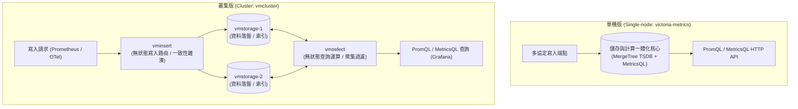
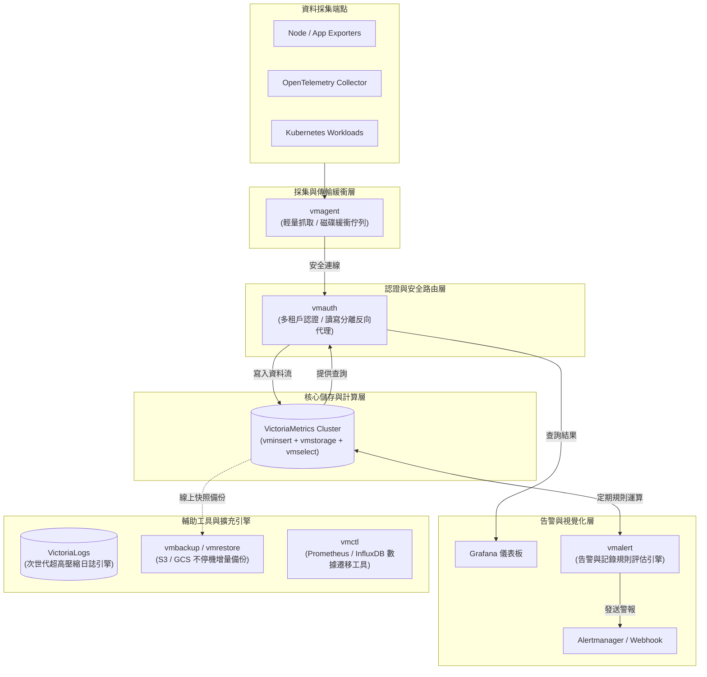

# VictoriaMetrics 全家桶生態解析與落地指南 :material-chart-timeline-variant:

> **VictoriaMetrics** 是一套專為海量時間序列資料（Time Series Data）設計的次世代高效能監控與存儲解決方案。以 Go 語言撰寫，具備**超高壓縮比（比 Prometheus 高出 7 倍以上）**、**極低記憶體與 CPU 佔用**、以及**對 Prometheus/PromQL 100% 相容**等特性，已成為現代雲原生架構中替代與增強 Prometheus 的業界標準首選。

---

## 1. 方案概述與核心價值

在大型微服務與 Kubernetes 叢集日益普及的今日，傳統的 Prometheus 監控架構在面臨海量指標時經常面臨以下瓶頸：

1. **記憶體暴增 (High Memory Consumption)**：Prometheus 採用記憶體快取維護大量時間序列的 Head Chunk，當指標維度（Cardinality）激增時容易引發 OOM（Out Of Memory）重啟。
2. **缺乏原生水平擴展能力**：Prometheus 本身被設計為單節點運作，欲實現長期儲存或分散式叢集，需額外導入 Thanos 或 Cortex 等複雜外部架構。
3. **磁碟空間消耗巨大**：長期保留歷史指標對磁碟空間需求極大，且備份與恢復需要操作大型資料夾快照，成本居高不下。

**VictoriaMetrics**（簡稱 VM）從儲存底層進行徹底重新設計，提供了極致的資源利用率，具備以下核心價值：

- **極低硬體成本**：相較於 Prometheus，記憶體消耗僅為其 **1/5 ~ 1/10**，磁碟佔用僅為其 **1/7**。
- **卓越寫入與查詢效能**：單節點即可支撐每秒數百萬樣本（samples/sec）的寫入頻率，查詢延遲大幅縮短。
- **全方位無縫相容**：完美相容 Prometheus Remote Write、PromQL、Grafana、InfluxDB、Graphite、OpenTelemetry (OTLP) 與 StatsD 協定。
- **完整生態「全家桶」**：涵蓋採集（vmagent）、安全網關（vmauth）、告警（vmalert）、日誌（VictoriaLogs）、備份（vmbackup）與遷移（vmctl）。

---

## 2. 系統架構型態：單機版 vs 叢集版

VictoriaMetrics 依據業務規模與可用性需求，提供兩種核心部署架構：



### A. 單機版 (`victoria-metrics` / `vmsingle`)

- **特色**：所有功能（採集接收、壓縮儲存、PromQL 查詢計算）全部整合於單一二進位執行檔（Binary）中。
- **優點**：架構極簡、零外部依賴、啟動只需數秒、日常維護成本近乎為零。
- **適用場景**：中小規模業務、每秒寫入樣本數低於 1,000 萬的場景、邊緣運算節點（Edge Computing）。

### B. 叢集版 (`vmcluster`)

當監控規模達到數千萬甚至億級時間序列時，叢集版將存儲與計算徹底解耦為三個無狀態與有狀態組件：

1. **`vmstorage`（有狀態儲存節點）**：
   - 負責指標時序資料的壓縮落盤與索引搜尋。
   - 每個節點相互獨立（Shared-Nothing），無複雜的分散式協商機制（如 Raft/Paxos），具備線性擴展能力。
2. **`vminsert`（無狀態寫入代理）**：
   - 接收來自 `vmagent` 或 Prometheus 的寫入請求。
   - 透過一致性雜湊演算法（Consistent Hashing），將不同的時間序列平均路由至各個 `vmstorage` 節點。
3. **`vmselect`（無狀態查詢聚合引擎）**：
   - 接收來自 Grafana、API 或 `vmalert` 的查詢請求。
   - 向所有 `vmstorage` 平行發起資料抓取，並在記憶體中執行 PromQL / MetricsQL 聚合與函數運算。

---

## 3. VictoriaMetrics 全家桶組件全景圖

VictoriaMetrics 生態提供了完備的端到端組件支援，覆蓋從採集到告警與災備的完整生命週期：



---

## 4. 全家桶關鍵組件深度解析

### 1. `vmagent` — 輕量採集器與資料轉發中樞

`vmagent` 是一款專門設計用來替代 Prometheus 抓取功能的極輕量 Agent：

- **本地磁碟緩衝（Disk Queue Buffer）**：
  當遠端存儲發生網路中斷或維護重啟時，`vmagent` 會自動將採集到的指標暫存至本機硬碟；待網路復原後，自動依序補發回放，**確保監控資料零遺失**。
- **多端點廣播（Fan-out Streaming）**：
  支援將同一批採集指標同時寫入多個後端（例如：同時寫入正式環境與災備環境、或寫入兩個獨立叢集進行雙活驗證）。
- **動態標籤重寫與精準過濾**：
  支援完整的 `relabel_configs` 與 `metric_relabel_configs`，可在邊緣端直接丟棄無用指標，降低網路流量傳輸與後端儲存負擔。

### 2. `vmauth` — 企業級安全認證與多租戶代理

`vmauth` 作為 VictoriaMetrics 前端的反向代理閘道（Reverse Proxy）：

- **原生多租戶隔離**：
  支援依據不同的 Basic Auth 帳號密碼或 Bearer Token，將請求透明對應到特定的租戶空間（如 `/select/account_10/prometheus`）。
- **讀寫自動分離**：
  根據 HTTP Path 或 Method，將寫入請求（`write`）轉發至 `vminsert`，將讀取請求（`query` / `query_range`）轉發至 `vmselect`。

### 3. `vmalert` — 獨立告警與記錄規則評估引擎

傳統 Prometheus 同時負責抓取、存儲與評估告警規則，容易在負載過重時造成告警延遲。`vmalert` 提供了獨立解耦的方案：

- **無狀態彈性擴展**：
  透過 HTTP 接口向 `vmselect`（或任意相容 PromQL 的端點）定時發出查詢運算，支援 Prometheus 標準的 Rule 格式。
- **相容 Alertmanager 與 Webhook**：
  一旦觸發告警，`vmalert` 會將標準告警資料派發給 Prometheus Alertmanager 或自定義 Webhook，無縫對接現有通知渠道（如 Teams、Slack、Pushover）。

### 4. `VictoriaLogs` — 次世代高效能日誌引擎

針對傳統日誌系統（如 Elasticsearch / OpenSearch 索引膨脹過快、Loki 查詢效率受限）的痛點，VictoriaMetrics 推出了專用日誌引擎：

- **極致壓縮比（15x ~ 30x）**：
  無須建立沉重的倒排索引（Inverted Index），大幅縮減磁碟儲存費用。
- **LogsQL 專屬查詢語法**：
  專為日誌管線設計，直覺支援關鍵字過濾、欄位擷取與時序聚合。

### 5. `vmbackup` & `vmrestore` — 企業級熱備份與災難復原

- **不停機即時快照**：
  備份程序完全在線上執行，無須暫停服務或鎖定資料庫。
- **物件儲存整合與增量備份**：
  原生支援 AWS S3、Google Cloud Storage (GCS)、Azure Blob Storage 與本地 NFS。僅傳輸自上次備份以來變更的資料塊，大幅節省時間與頻寬。

### 6. `vmctl` — 資料庫遷移工具箱

支援快速將歷史歷史資料一鍵遷移匯入至 VictoriaMetrics：

- **Prometheus**：直接讀取 Prometheus TSDB 本地資料目錄遷移。
- **InfluxDB**：支援 InfluxDB v1 與 v2 歷史數據匯出匯入。
- **OpenTSDB / ElasticSearch / Thanos**：支援格式轉換與批量批次寫入。

### 7. `victoria-metrics-operator` — Kubernetes 雲原生宣告式管理

- 透過 Kubernetes Custom Resource Definitions (CRDs) 自動化生命週期管理：
  - `VMSingle`、`VMCluster`、`VMAgent`、`VMAlert`、`VMAuth`
- 原生相容 Prometheus Operator 生態，可直接識別 `ServiceMonitor`、`PodMonitor` 與 `PrometheusRule`，使遷移至 VictoriaMetrics 的代價極低。

---

## 5. 業界主流時序資料庫深度橫向對比

| 比較維度 | Prometheus (原生) | Thanos | VictoriaMetrics (全家桶) | Mimir (Grafana) |
| :--- | :--- | :--- | :--- | :--- |
| **底層技術架構** | 單機 TSDB (分塊儲存) | Prometheus + Sidecar + StoreGateway | **原生 LSM-Tree (存儲計算分離)** | Cortex 演進架構 (微服務) |
| **長期儲存方式** | 僅本地磁碟（不建議超過半年） | 物件儲存 (S3 / GCS) | **高效本地磁碟壓縮 / 叢集擴展** | 物件儲存 (S3 / GCS) |
| **記憶體佔用** | 高 (指標基數激增時極易 OOM) | 中高 | **極低 (約為 Prometheus 的 10%~20%)** | 中高 |
| **磁碟儲存成本** | 基準 (~1.5 bytes/sample) | 中等 (依賴 S3 快取) | **極小 (~0.4 bytes/sample，7x 壓縮)** | 中等 |
| **架構複雜度** | 極低 (單一程序) | 高 (需維護多個獨立組件) | **低至中 (單機極簡，叢集模組職責清晰)** | 極高 (大量微服務組件) |
| **多租戶支援** | 無 | 需客製化反向代理 | **原生支援 (AccountID / ProjectID)** | 原生支援 |
| **查詢語言** | PromQL | PromQL | **PromQL + MetricsQL (高階擴展語法)** | PromQL |
| **斷網續傳能力** | 僅記憶體快取 (易丟失) | 依賴本地磁碟保留 | **`vmagent` 原生磁碟佇列 (保證不掉資料)** | 依賴 Client 端重試 |

---

## 6. 快速上手：Docker Compose 實戰範例

以下示範如何透過 `docker-compose.yml` 快速啟動包含 `victoria-metrics` 單機版、`vmagent` 採集器與 `vmalert` 的最小可行監控堆疊：

```yaml
version: "3.8"

services:
  # 1. VictoriaMetrics 核心存儲與查詢服務
  victoriametrics:
    image: victoriametrics/victoria-metrics:v1.99.0
    container_name: victoriametrics
    ports:
      - "8428:8428"
    volumes:
      - vmdata:/victoria-metrics-data
    command:
      - "-retentionPeriod=12m" # 資料保留期 12 個月
      - "-storageDataPath=/victoria-metrics-data"
    restart: always

  # 2. vmagent 採集器 (定時抓取 metrics 並寫入 VictoriaMetrics)
  vmagent:
    image: victoriametrics/vmagent:v1.99.0
    container_name: vmagent
    depends_on:
      - victoriametrics
    ports:
      - "8429:8429"
    volumes:
      - ./vmagent.yml:/etc/vmagent/vmagent.yml
      - vmagentdata:/vmagent-remotewrite-data
    command:
      - "-promscrape.config=/etc/vmagent/vmagent.yml"
      - "-remoteWrite.url=http://victoriametrics:8428/api/v1/write"
      - "-remoteWrite.tmpDataPath=/vmagent-remotewrite-data"
    restart: always

  # 3. vmalert 告警評估引擎
  vmalert:
    image: victoriametrics/vmalert:v1.99.0
    container_name: vmalert
    depends_on:
      - victoriametrics
    ports:
      - "8880:8880"
    volumes:
      - ./alerts.yml:/etc/vmalert/alerts.yml
    command:
      - "-rule=/etc/vmalert/alerts.yml"
      - "-datasource.url=http://victoriametrics:8428"
      - "-notifier.url=http://alertmanager:9093"
    restart: always

volumes:
  vmdata:
  vmagentdata:
```

---

## 7. 總結與架構落地建議

1. **中小團隊或邊緣環境**：
   直接使用 **單機版 `victoria-metrics`**，以極低的伺服器資源成本獲得數百萬時間序列的即時監控能力。
2. **已有健全 Prometheus 基礎設施**：
   無須重構採集邏輯，只需在現有 Prometheus 設定 `remote_write: url: "http://<vm-host>:8428/api/v1/write"`，立即獲得長期儲存與數倍的查詢加速能力。
3. **超大規模雲原生與多租戶架構**：
   全面部署 **`vmcluster` 叢集**，配合 **`vmagent`（跨節點邊緣採集與磁碟快取）**、**`vmauth`（統一權限切分）** 與 **`vmalert`（告警負載解耦）**，打造高可用、彈性水平擴展的次世代企業級可觀測性基座。
