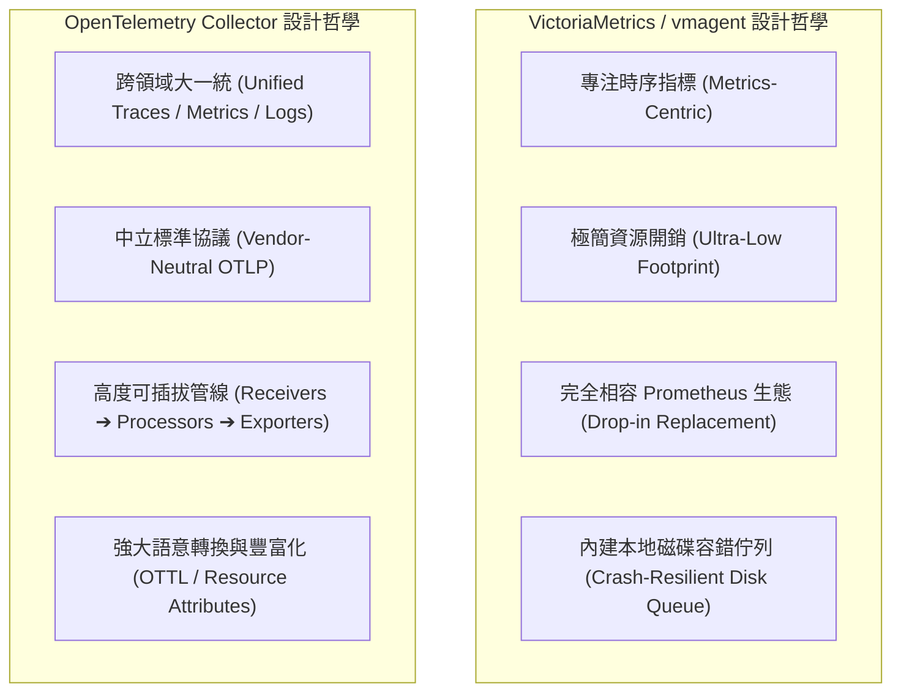
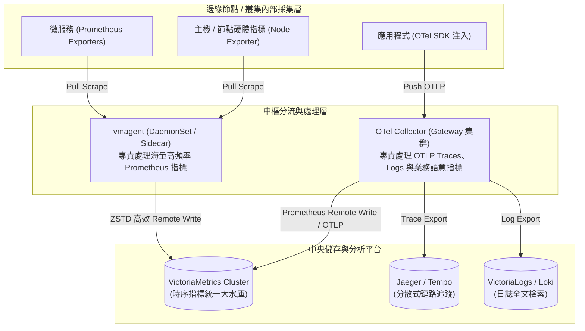
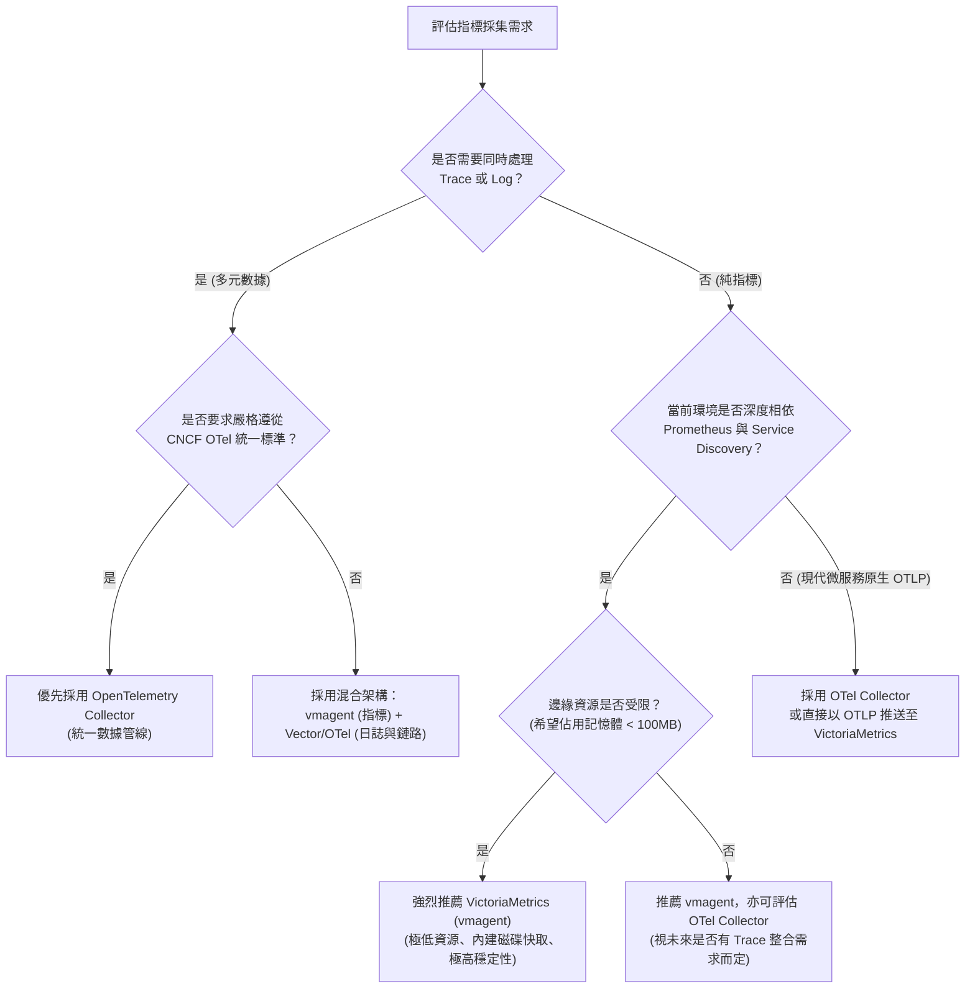

# VictoriaMetrics vs OpenTelemetry 指標採集架構深度評比與選型指南 :material-scale-balance:

> 在現代可觀測性（Observability）架構中，時間序列指標（Metrics）的採集與轉發是監控體系運作的生命線。目前業界兩大最具代表性的採集方案分別為：專注於極致效能與 Prometheus 生態的 **VictoriaMetrics (vmagent)**，以及致力於統一跨領域（Traces、Metrics、Logs）雲原生標準的 **OpenTelemetry Collector (OTel Collector)**。本文將從底層架構、資源消耗、資料處理能力、容錯緩衝及混合架構等維度進行深度評比，協助維運與架構團隊精準選型。

---

## 1. 核心定位與設計哲學

理解兩者的設計出發點，是評估選型的首要關鍵：



### A. VictoriaMetrics (vmagent)

- **定位**：專門為高效能指標採集、過濾與串流轉發設計的專用代理（Dedicated Metrics Agent）。
- **設計哲學**：
  - **極致輕量**：採用 Go 語言高度優化的串流管道架構，以最少 CPU 與記憶體完成海量樣本拉取（Scrape）與推播（Push）。
  - **Prometheus 完美無縫相容**：配置語法完全相容 `prometheus.yml`，開箱即可作為 Prometheus Agent 模式的原地替代方案。
  - **原生邊緣緩存容錯**：內建極度可靠的本機磁碟暫存緩衝區（Disk Buffer），在後端儲存故障或網路中斷時自動保護資料不流失。

### B. OpenTelemetry Collector (OTel Collector)

- **定位**：CNCF 旗艦級開源專案，提供跨領域、供應商中立的觀測性數據管線（Observability Data Pipeline）。
- **設計哲學**：
  - **三位一體 (M-E-L-T)**：同時處理分散式追蹤（Traces）、指標（Metrics）與日誌（Logs），消弭不同監控工具間的孤島。
  - **組件化流水線架構**：以 `Receivers`（接收）➔ `Processors`（處理/過濾/聚合）➔ `Exporters`（外派）建立高彈性資料管線。
  - **語意約定 (Semantic Conventions)**：建立通用的資源屬性標準（如 `service.name`、`host.id`、`k8s.pod.name`），讓跨系統關聯分析更為自然。

---

## 2. 架構全景與採集流程剖析

```mermaid
flowchart TD
    subgraph ArchitectureComparison["指標採集管線架構對比"]
        direction TB

        subgraph ModeVM["vmagent 採集架構"]
            VM_Target["Prometheus Exporters / Push Endpoints"] --> VM_Scrape["Scrape 模組<br/>(支援 Service Discovery)"]
            VM_Scrape --> VM_Relabel["Stream Relabeling<br/>(標籤重寫 / 指標過濾 / 串流降採樣)"]
            VM_Relabel --> VM_Disk["本地磁碟緩衝<br/>(-remoteWrite.tmpDataPath)"]
            VM_Disk --> VM_Push["Streaming Remote Write<br/>(高效 ZSTD 壓縮傳輸)"]
            VM_Push --> VM_Backend[("VictoriaMetrics / TSDB")]
        end

        subgraph ModeOTel["OTel Collector 採集架構"]
            OT_Target["OTLP SDK / Prometheus Exporters"] --> OT_Recv["Receivers<br/>(otlp, prometheus, hostmetrics)"]
            OT_Recv --> OT_Proc["Processors<br/>(memory_limiter, batch, transform/OTTL)"]
            OT_Proc --> OT_Queue["Sending Queue<br/>(記憶體佇列 / file_storage 擴充)"]
            OT_Queue --> OT_Export["Exporters<br/>(otlp, prometheusremotewrite, kafka)"]
            OT_Export --> OT_Backend[("TSDB / APM / Data Lake")]
        end
    end
```



### A. vmagent 的運作機制

1. **服務發現與抓取**：完全沿用 Prometheus 的 Kubernetes、Consul、DNS 或靜態配置機制，定時向 Target 的 `/metrics` 發起 HTTP 抓取。
2. **串流式標籤重寫 (Stream Relabeling)**：樣本一經抓取即在記憶體串流中執行過濾與標籤改寫，不符合條件的指標直接丟棄，完全不佔用後續緩存與頻寬。
3. **串流聚合 (Stream Aggregation)**：可在代理端直接將極高基數（High-Cardinality）的指標進行預先聚合（例如將每秒瞬時請求數直接匯總為每分鐘加總值），大幅降低中央 TSDB 儲存壓力。
4. **可靠傳輸佇列**：當遠端 TSDB 離線時，自動切換至磁碟佇列依序寫入；網路恢復後自動重播（Replay）並實施流量限制保護後端。

### B. OTel Collector 的運作機制

1. **接收層 (Receivers)**：可同時開啟 Push 端點（接收應用程式 OTLP gRPC/HTTP 推送）與 Pull 端點（透過 Prometheus Receiver 主動抓取指標）。
2. **通用內部數據結構 (pdata)**：所有接收到的指標皆標準化轉譯為 OpenTelemetry 內部物件模型（ResourceMetrics ➔ ScopeMetrics ➔ Metric ➔ NumberDataPoint / HistogramDataPoint）。
3. **處理層 (Processors)**：透過 `memory_limiter` 監控進程記憶體，利用 `batch` 處理批次打包，並可透過 `transform` 處理器執行強大的 OTTL (OpenTelemetry Transformation Language) 邏輯。
4. **外發層 (Exporters)**：將內部 pdata 模型封裝為目標儲存所需的協定（如轉為 Prometheus Remote Write 格式送往 VictoriaMetrics，或透過 OTLP 格式送往雲端平台）。

---

## 3. 全方位維度詳細對比矩陣

| 評估維度 | VictoriaMetrics (`vmagent`) | OpenTelemetry Collector | 優勢方與分析考量 |
| :--- | :--- | :--- | :--- |
| **主要定位** | 專為時序指標設計之極致傳輸代理 | 跨領域（Trace / Metric / Log）通用觀測中樞 | **各有專精**：純指標追求極限選 VM；多源融合選 OTel |
| **資料模型** | Prometheus 扁平模型（Metric Name + Labels + Time + Value） | OTel 階層模型（Resource + Scope + Attributes + Datapoint） | **OTel 語意更豐富**，但記憶體與運算代價較高 |
| **記憶體消耗** | **極低**（處理 100 萬活躍時序約需 $50\sim100\text{ MB}$） | **中～高**（處理 100 萬活躍時序通常需 $300\sim800\text{ MB}$） | **vmagent 大幅勝出**（節省 $70\%\sim85\%$ 記憶體開銷） |
| **CPU 消耗** | **極低**（高效率串流管道，低 GC 負載） | **中等**（多層模型序列化/反序列化與處理器開銷） | **vmagent 勝出** |
| **二進位檔體積** | 單一靜態編譯檔案，約 **$15\sim25\text{ MB}$** | Core 版約 **$40\sim60\text{ MB}$**，Contrib 版達 **$150\text{ MB}+$** | **vmagent 更輕量**，容器冷啟動迅速 |
| **協定接收支援** | Prometheus Scrape、Prometheus Remote Write、InfluxDB、Graphite、StatsD、OTLP | OTLP (gRPC/HTTP)、Prometheus、Jaeger、Zipkin、Fluent、Kafka 等數十種 | **OTel 勝出**（具備業界最廣泛的生態接收端點） |
| **資料加工能力** | Prometheus Relabeling、Stream Aggregation | OTTL (Transform Processor)、MetricsTransform、Filter、Batch | **OTel 勝出**（支援複雜條件判斷與自定義資料轉換） |
| **邊緣斷網暫存** | **原生內建本地磁碟佇列**（開箱即用，極度防崩潰） | 預設以記憶體佇列為主；需額外配置 `file_storage` 擴充 | **vmagent 運維更簡單**，本機快取無縫無痛 |
| **配置複雜度** | **極簡**（直接相容 `prometheus.yml`，幾條 Flag 即可運行） | **較高**（需定義 Receivers、Processors、Exporters 與 Pipelines） | **vmagent 學習曲線平緩** |
| **標準化程度** | 屬於 Prometheus / MetricsQL 專用生態標準 | CNCF 官方中立標準，各大公有雲與 SaaS 廠商全面支援 | **OTel 勝出**（避免廠商鎖定，業界最大共識） |

---

## 4. 實戰組態與代碼對比

### A. vmagent 採集與外發配置實例

vmagent 透過標準 Prometheus 語法進行 Kubernetes 服務發現，並外帶串流標籤重寫與磁碟暫存：

```yaml
# /etc/vmagent/scrape-config.yml
global:
  scrape_interval: 15s
  scrape_timeout: 10s

scrape_configs:
  - job_name: "kubernetes-pods"
    kubernetes_sd_configs:
      - role: pod
    relabel_configs:
      - source_labels: [__meta_kubernetes_pod_annotation_prometheus_io_scrape]
        action: keep
        regex: true
      - source_labels: [__meta_kubernetes_pod_annotation_prometheus_io_path]
        action: replace
        target_label: __metrics_path__
        regex: (.+)
      - source_labels: [__address__, __meta_kubernetes_pod_annotation_prometheus_io_port]
        action: replace
        regex: ([^:]+)(?::\d+)?;(\d+)
        replacement: $1:$2
        target_label: __address__
      - action: labelmap
        regex: __meta_kubernetes_pod_label_(.+)
      - source_labels: [__meta_kubernetes_namespace]
        action: replace
        target_label: namespace
      - source_labels: [__meta_kubernetes_pod_name]
        action: replace
        target_label: pod
```

vmagent 啟動指令參數（開啟磁碟容錯與推播）：

```bash
/usr/local/bin/vmagent \
  -promscrape.config=/etc/vmagent/scrape-config.yml \
  -remoteWrite.url=http://victoria-metrics:8428/api/v1/write \
  -remoteWrite.tmpDataPath=/var/lib/vmagent/buffer \
  -remoteWrite.maxDiskUsagePerURL=10GB \
  -memory.allowedPercent=60
```

---

### B. OTel Collector 採集與轉發至 VictoriaMetrics 實例

OTel Collector 透過 `prometheus` 接收器抓取指標，並利用 `prometheusremotewrite` 或 `otlphttp` 輸出器將指標傳入 VictoriaMetrics：

```yaml
# /etc/otelcol/config.yaml
receivers:
  # 1. 接收應用程式原生推送的 OTLP 數據
  otlp:
    protocols:
      grpc:
        endpoint: 0.0.0.0:4317
      http:
        endpoint: 0.0.0.0:4318

  # 2. 抓取主機節點指標
  hostmetrics:
    collection_interval: 30s
    scrapers:
      cpu:
      memory:
      disk:
      network:

  # 3. 透過 Prometheus 協定抓取微服務 Exporters
  prometheus:
    config:
      scrape_configs:
        - job_name: "inhouse-services"
          scrape_interval: 15s
          static_configs:
            - targets: ["payment-service:8080", "order-service:8080"]

processors:
  # 記憶體安全保護，防止 OOM
  memory_limiter:
    check_interval: 1s
    limit_percentage: 75
    spike_limit_percentage: 20

  # 打包批次以提高網路吞吐量
  batch:
    timeout: 5s
    send_batch_size: 1024

  # 利用 OTTL 進行標籤語意豐富化
  transform:
    metric_statements:
      - context: metric
        statements:
          - set(description, "Enriched by OTel Collector") where description == ""

exporters:
  # 方案一：以標準 Prometheus Remote Write 協定寫入 VictoriaMetrics
  prometheusremotewrite:
    endpoint: "http://victoria-metrics:8428/api/v1/write"
    resource_to_telemetry_conversion:
      enabled: true # 將 OTel Resource 屬性轉為標準 Prometheus Label

  # 方案二：以原生 OTLP 格式寫入 VictoriaMetrics (VM v1.82+ 原生支援)
  otlphttp/victoriametrics:
    endpoint: "http://victoria-metrics:8428/opentelemetry"
    tls:
      insecure: true

service:
  pipelines:
    metrics:
      receivers: [otlp, hostmetrics, prometheus]
      processors: [memory_limiter, batch, transform]
      exporters: [prometheusremotewrite]
```

---

## 5. 現代混合落地架構最佳實踐

在多數中大型雲原生或企業架構中，最佳解往往不是「二選一」，而是因地制宜採用**分層協同架構 (Tiered Hybrid Architecture)**：



### 三大典型落地模式

#### 模式一：純指標極致效能架構（專注於基礎架構與大規模集群監控）

- **架構**：`Exporters ➔ vmagent ➔ VictoriaMetrics`
- **適用場景**：百萬級至千萬級時間序列、僅需處理 Metrics、伺服器邊緣資源極度吃緊（如邊緣節點、物聯網網關、成本敏感型 K8s 節點）。
- **收益**：最小的 CPU/記憶體開銷、配置極簡、維運零負擔。

#### 模式二：全鏈路標準可觀測性架構（重視統一語意與多維觀測性）

- **架構**：`OTel SDK ➔ OTel Collector (Agent ➔ Gateway) ➔ VictoriaMetrics / Jaeger / VictoriaLogs`
- **適用場景**：全面推行 OpenTelemetry 標準、要求 Trace 與 Metric 的 `trace_id`、`service.name` 屬性嚴格對齊、多團隊協同的大型平台架構。
- **收益**：全技術棧標準化、防止廠商鎖定、強大的資料管道清洗與轉換能力。

#### 模式三：雙軌並行混合架構（企業級推薦）

- **架構**：
  - **系統/節點/中介軟體指標**（Kubernetes Pods、Node Exporter、MySQL/Redis Exporter）：由 **vmagent** 統一抓取與高倍率壓縮回傳，節省伺服器資源。
  - **業務層鏈路與應用指標**：由 **OTel Collector** 接收應用程式推送，執行資料清洗後，指標轉發至 **VictoriaMetrics**，鏈路資料轉發至 **Tempo/Jaeger**。
- **收益**：兼顧底層海量指標的極致吞吐與低資源消耗，同時保有應用程式層標準化的彈性。

---

## 6. 架構選型決策樹

依據團隊現況與業務目標，可透過以下決策路徑進行選型：



---

## 7. 總結

- **VictoriaMetrics (`vmagent`)** 是指標採集領域的**「性能特化重砲」**：在純指標場景下，其資源利用率、穩定性、原生磁碟容錯與 Prometheus 相容性無人能出其右，是取代 Prometheus Agent 的首選。
- **OpenTelemetry Collector** 則是現代可觀測性的**「瑞士萬能軍刀」**：憑藉中立標準、跨領域聚合能力與強大的 OTTL 資料處理能力，是構建企業級端到端可觀測性資料中樞的最佳基石。
- 在大規模現代化架構中，**「OTel 管應用全鏈路，vmagent 管基礎海量時序」** 的雙軌協同架構，往往能為企業帶來最佳的性價比與最高的架構彈性。
