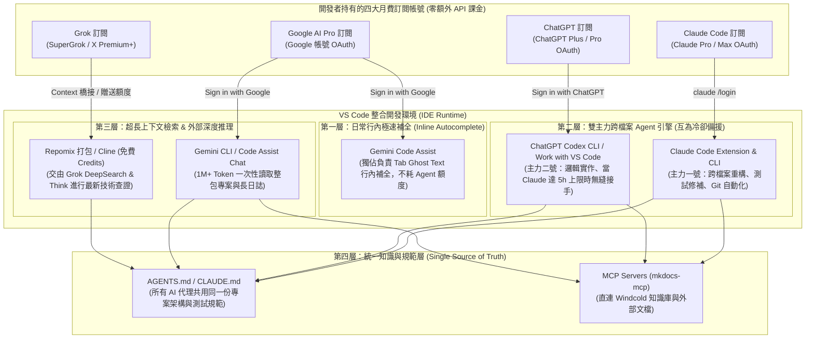
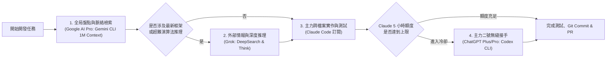

# VS Code 四大訂閱制 AI 整合實戰指南：Claude Code + ChatGPT + Grok + Google AI Pro :material-microsoft-visual-studio-code:

> 許多開發者手上同時訂閱了 **Claude Code (Claude Pro / Max)**、**ChatGPT (Plus / Pro)**、**Grok (SuperGrok / X Premium+)** 與 **Google AI Pro** 四大月費方案。然而，多數第三方 VS Code 外掛（如傳統設定下的 Cline 或 Continue）預設要求輸入「按量計費的 API Key」，導致已經付了月費的訂閱戶不知道如何直接榨乾現有訂閱額度。本指南專門針對**「純訂閱制帳號（Subscription-First / 零額外 API 課金）」**情境，完整解析如何透過官方 OAuth 通道、CLI 連動與桌面端橋接，在 **VS Code** 打造四大 AI 協同作戰的終極開發環境。

---

## 1. 四大訂閱制方案於 VS Code 的授權機制與定位全覽

### 1.1 訂閱制帳號能否直接登入 VS Code（免 API Key）

| 訂閱方案 | VS Code 訂閱 OAuth 直連支援度 | 免 API Key 整合載體 (推薦方式) | 最佳分工角色定位 |
| :--- | :--- | :--- | :--- |
| **Claude Code**<br/>*(Claude Pro / Max)* | **原生完整支援**<br/>(透過 `/login` 瀏覽器 OAuth) | 1. **Claude Code 官方 VS Code 擴充套件**<br/>2. **VS Code 終端機 `claude` CLI + `/ide`**<br/>3. **Cline / Roo Code** (選擇 `Claude Code` Provider) | **主力架構重構 & Agent 執行官**<br/>跨檔案精準改碼、執行測試、Git / PR 自動化 |
| **ChatGPT**<br/>*(Plus / Pro / Team)* | **原生完整支援**<br/>(透過 `Sign in with ChatGPT` OAuth) | 1. **OpenAI Codex VS Code 擴充套件 / `codex` CLI**<br/>2. **ChatGPT 桌面版 App `Work with VS Code`** | **雙核心備援 Agent & 互動式配對編程**<br/>與 Claude 輪替重構、演算法推導、視窗即時連動 |
| **Google AI Pro**<br/>*(Gemini Advanced)* | **原生完整支援**<br/>(透過 `Sign in with Google` OAuth) | 1. **Gemini Code Assist 官方擴充套件**<br/>2. **VS Code 終端機 `Gemini CLI`** | **極速行內補全 & 1M+ 超長上下文檢索王**<br/>獨佔 Ghost Text `Tab` 補全、整包 Repo 全局分析 |
| **Grok**<br/>*(SuperGrok / X Premium+)* | **無官方 IDE OAuth**<br/>(網頁訂閱與 xAI API 獨立) | 1. **VS Code `Repomix` 上下文打包 + Grok DeepSearch / Think**<br/>2. **xAI Console 免費贈送額度掛載至 Cline** | **即時技術情報員 & 深度推理第二意見**<br/>最新套件查證、複雜 Bug 交叉驗證 (Second Opinion) |

---

## 2. VS Code 四大訂閱制 AI 協同全景架構

以下架構展示如何在**不額外花錢購買按量計費 API** 的前提下，讓四大訂閱方案在 VS Code 內部各司其職，並透過統一規範檔與 [Model Context Protocol (MCP)](mkdocs-mcp-guide.md) 共享專案脈絡：



---

## 3. 四大訂閱帳號整合實戰步驟

### 3.1 整合 Claude Code 訂閱（主力 Agent 一號）

**Claude Code** 原生支援直接登入 **Claude Pro / Claude Max 訂閱帳號**，將網頁版訂閱額度直接轉化為 VS Code 內的自主編碼代理。

#### 步驟一：安裝 CLI 與 VS Code 官方擴充套件

```bash
# 1. 安裝官方全局 CLI (需 Node.js 18+)
npm install -g @anthropic-ai/claude-code

# 2. 安裝 VS Code 官方擴充套件
code --install-extension Anthropic.claude-code
```

#### 步驟二：使用訂閱帳號 OAuth 登入並綁定 IDE

1. 在 VS Code 開啟整合終端機（++ctrl+grave++），輸入 `claude`。
2. 輸入 `/login`，選擇第一項 **`Claude app (with Pro or Max subscription)`**，瀏覽器會自動開啟完成 OAuth 綁定。
3. 在 `claude` 內輸入 `/ide` 連接當前 VS Code 視窗：
   - **自動帶入選取區**：在編輯器反白選取的程式碼會即時同步給 Claude。
   - **自動讀取 Problems 面板**：VS Code 的 Linter 與編譯器紅字錯誤可直接由 Claude 讀取並修復。
   - **原生 Diff 視窗審查**：修改檔案時直接在 VS Code 彈出雙欄 Diff 供點擊 Accept / Reject。

> [!TIP]
> **在 Cline / Roo Code 中免費複用 Claude 訂閱**：若您喜歡 Cline 的介面，可在 Cline 的 API Provider 選擇 **`Claude Code`**，它會在背景直接調用您已登入訂閱的 `claude` CLI，完全不必填寫 API Key！

---

### 3.2 整合 ChatGPT 訂閱（主力 Agent 二號 & 桌面連動）

OpenAI 現已全面開放 **ChatGPT Plus / Pro / Team 訂閱用戶** 直接透過 OAuth 登入官方編碼工具，無須另外儲值 OpenAI API Platform。

#### 途徑 A：官方 `OpenAI Codex` 擴充套件與 CLI（推薦 Agent 模式）

1. **安裝官方 Codex CLI 與 VS Code 擴充套件**：

   ```bash
   # 安裝 OpenAI 官方開源 Codex CLI
   npm install -g @openai/codex

   # 安裝官方 VS Code 擴充套件
   code --install-extension openai.chatgpt
   ```

2. **使用 ChatGPT 訂閱登入（免 API Key）**：
   - 於 VS Code 終端機執行 `codex`（或點擊側邊欄 Codex 圖示）。
   - 選擇 **`Sign in with ChatGPT`**，透過瀏覽器登入您的 ChatGPT Plus / Pro 帳號即可直接使用訂閱內含的編碼代理額度！
   - 原生讀取專案根目錄的 `AGENTS.md`，支援自動修改多檔案與執行本地測試。

#### 途徑 B：ChatGPT 桌面版 App「Work with VS Code」配對模式

若使用 macOS 或 Windows 版 **ChatGPT Desktop App**：

1. 在 VS Code 安裝官方橋接擴充套件（於 ChatGPT 桌面設定點選 **Work with Apps** ➔ **Install VS Code Extension**）。
2. 按下快捷鍵（macOS 為 ++option+space++，Windows 為 ++alt+space++）喚出 ChatGPT 伴隨視窗，點選綁定 **VS Code**。
3. ChatGPT 視窗會自動讀取當前 VS Code 開啟的所有分頁、選取區與終端機報錯，並支援點擊 **Apply** 直接將程式碼寫回 VS Code 編輯器。

---

### 3.3 整合 Google AI Pro 訂閱（極速補全 & 1M+ 超長上下文檢索）

針對持有 **Google AI Pro** 訂閱的開發者，可直接透過 **Google 帳號 OAuth** 啟用以下兩大官方工具，完全免綁定信用卡 API 計費：

#### 途徑 A：官方 `Gemini Code Assist` 擴充套件（負責日常行內補全）

1. 安裝官方擴充套件（ID：`Google.geminicodeassist`）：

   ```bash
   code --install-extension Google.geminicodeassist
   ```

2. 點擊 VS Code 左側 **Gemini** 圖示 ➔ 點擊 **`Sign in with Google`**，登入您的 Google AI Pro 帳號。
3. **核心定位**：將其設為 VS Code **唯一啟用的行內自動補全（Inline Autocomplete）** 引擎。日常打字按 `Tab` 補全全由它負責，速度快且完全不消耗 Claude Code 與 ChatGPT 的寶貴 Agent 額度。

#### 途徑 B：官方 `Gemini CLI`（負責百萬 Token 全局檢索）

```bash
# 1. 安裝 Google 官方 Gemini CLI
npm install -g @google/gemini-cli

# 2. 啟動並選擇 Login with Google (OAuth 直連)
gemini
```

- **核心定位**：透過 Google OAuth 登入即可直接使用 **Gemini 2.5 Pro（1M Token 超長上下文）**。當需要「一次讀入整個專案數十個檔案」或「分析數萬行系統 Log」時，交由 `gemini` 進行全局梳理。

---

### 3.4 整合 Grok 訂閱（深度推理 & 最新技術情報查證）

> [!WARNING]
> **Grok 訂閱制的授權限制說明**：
> 與前三者不同，xAI 的 **SuperGrok / X Premium+ 網頁訂閱**目前**尚未開放**給 VS Code 或 CLI 透過 OAuth 直接登入調用（xAI 將網頁訂閱與 `console.x.ai` API 視為獨立系統）。

在「**不額外付費買 API**」的前提下，有兩種在 VS Code 發揮 Grok 戰力的實戰方式：

#### 方式一：VS Code `Repomix` 一鍵打包 + Grok `DeepSearch / Think`（零成本主力用法）

當 Claude 或 ChatGPT 遇到「剛發布的新框架版本 API 變更」或「極度燒腦的死結 / 演算法 Bug」時，Grok 的 **DeepSearch（即時全網 + X 開發者社群檢索）** 與 **Think（深度推理）** 是最強破局武器：

1. 在 VS Code 安裝 **`Repomix Runner`** 擴充套件（或直接於終端機執行 `npx repomix`）：

   ```bash
   # 將指定目錄或問題模組打包成單一 AI 友善的 Markdown/XML 並複製到剪貼簿
   npx repomix --include "src/auth/**" --copy
   ```

2. 切換至 **Grok 桌面端 PWA / 網頁版**，貼上打包好的上下文，開啟 **DeepSearch** 或 **Think** 取得最新解法與推理步驟。
3. 將 Grok 驗證過的方案貼回 VS Code 的 **Claude Code** 或 **ChatGPT Codex** 自動落地修改。

#### 方式二：領取 xAI Console 帳號免費 API 額度掛載至 `Cline`

1. 使用您的 X / Grok 帳號登入 [xAI Console (console.x.ai)](https://console.x.ai/)。
2. 檢查帳號是否具備促銷或資料共享計畫（Data Sharing Program）贈送的每月免費 API Credits。
3. 若有免費額度，可產生 `XAI_API_KEY` 並在 VS Code 安裝 **Cline**（`saoudrizwan.claude-dev`），將 Provider 設為 `xAI`（模型選 `grok-3` 或 `grok-3-mini`）直接在側邊欄調用。

---

## 4. 四大訂閱制 AI 黃金協同工作流（零停機接力開發）

訂閱制方案最大的限制在於**「滾動時間視窗額度上限（如 Claude Pro 每 5 小時重置一次）」**。當同時擁有這四大訂閱時，可以建立一套**永不斷電（Zero-Downtime）**的輪替分工流：



### 四大訂閱協同實戰分工表

1. **平時寫 Code 的每一秒（Google AI Pro - `Gemini Code Assist`）**：
   - 背景常駐，提供免費、極速的行內 `Tab` 自動補全。
2. **接手大專案或排查大型 Log（Google AI Pro - `Gemini CLI`）**：
   - 善用 1M Token 上下文，先請 Gemini 讀完所有相關檔案並輸出架構分析摘要至草稿。
3. **主力開發、重構與自動化測試（`Claude Code` ⇄ `ChatGPT Codex` 雙引擎輪替）**：
   - 優先使用 **Claude Code** 進行跨檔案修改、執行 `npm test` / `mkdocs build --strict`，並依據 [git-cliff 自動化變更日誌](git-cliff-changelog-guide.md) 與 [日常筆記與發布工作流](workflow.md) 發起 PR。
   - 一旦 Claude Code 觸發 5 小時滾動限額，立刻在同一個終端機輸入 `codex`，由 **ChatGPT 訂閱** 讀取同一份 `AGENTS.md` 無縫接力！
4. **卡關破局與最新技術查證（`Grok`）**：
   - 當本地代理陷入修補迴圈（Looping）或套件版本太新導致 AI 幻覺時，用 `npx repomix --copy` 丟給 **Grok DeepSearch / Think** 找出根因，再交回本地 Agent 執行。

---

## 5. 統一專案規範與 MCP 知識庫掛載

為了讓 **Claude Code**、**ChatGPT Codex** 與 **Gemini CLI** 在切換時擁有完全一致的記憶與行為準則，請在專案根目錄建立統一規範與 [MCP 知識庫連接](mkdocs-mcp-guide.md)：

### 5.1 透過軟連結（Symlink）統一四大 AI 讀取的專案規則

- **ChatGPT Codex** 原生讀取根目錄的 `AGENTS.md`（參考 [LLM-Wiki 智慧知識架構](llm-wiki-architecture.md)）。
- **Claude Code** 原生讀取 `CLAUDE.md`。
- **Gemini Code Assist / CLI** 原生讀取 `GEMINI.md` 或 `.gemini/styleguide.md`。

只需在專案根目錄執行以下指令，即可讓三大本機代理共用同一份規範：

```bash
# 以 AGENTS.md 作為單一事實來源 (Single Source of Truth)
ln -s AGENTS.md CLAUDE.md
ln -s AGENTS.md GEMINI.md
```

### 5.2 掛載 MCP 伺服器共享團隊知識庫

在 VS Code 終端機將本知識庫掛載至您的訂閱制代理中：

```bash
# 1. 為 Claude Code 掛載線上知識庫 MCP
claude mcp add windcold-kb -- npx -y @serverless-dna/mkdocs-mcp https://windcoldchen.github.io/windcold-kb/ "Windcold 知識庫"

# 2. 於 Gemini CLI / Codex 設定檔 (~/.gemini/settings.json 或 ~/.codex/config.toml) 加入相同 MCP 指令
```

---

## 6. VS Code 防衝突設定（`.vscode/settings.json`）

同時安裝多個官方擴充套件時，請在 `.vscode/settings.json` 加入以下配置，避免快捷鍵與行內補全互相搶奪：

```json
{
  // 啟用編輯器行內建議，並交由 Gemini Code Assist 獨佔負責
  "editor.inlineSuggest.enabled": true,
  "geminicodeassist.inlineSuggestions.enableAuto": true,

  // 確保 Claude Code 專注於側邊欄與終端機 Agent 互動
  "claude-code.enableNewConversationShortcut": true
}
```
