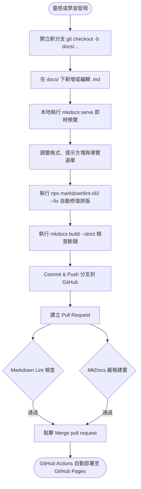

---
tags:
  - Git
  - 工作流
  - CI/CD
---

# 日常筆記與發布工作流

建立流暢的「閱讀-思考-記錄-發布」回饋循環，能顯著降低維護知識庫的心理負擔。

---

## 寫作與發布節奏



---

## 增添新頁面完整步驟

### 1. 開立新分支

```bash
git checkout -b docs/my-new-topic
```

### 2. 建立筆記檔案

在 `docs/` 下建立對應的 Markdown 檔案，例如 `docs/notes/my-new-topic.md`。

### 3. 在 `mkdocs.yml` 註冊選單

開啟 `mkdocs.yml`，在 `nav:` 區塊加入對應的路徑：

```yaml
nav:
  - 首頁: index.md
  - 知識筆記:
      - 範例筆記: notes/example.md
      - 新主題筆記: notes/my-new-topic.md
```

### 4. 本地即時預覽與檢查

啟動本地伺服器並進行格式與建置檢查：

```bash
# 啟動預覽
mkdocs serve

# 自動修復 Markdown 格式問題
npx markdownlint-cli2 --fix "**/*.md"

# 嚴格模式檢查（確認無語法錯誤或斷鏈）
mkdocs build --strict
```

### 5. 提交並推送分支

```bash
git add .
git commit -m "docs: 新增新主題筆記"
git push -u origin docs/my-new-topic
```

### 6. 發起 PR 與自動部署

1. 前往 GitHub 倉庫頁面發起 Pull Request 指向 `main`。
2. GitHub Actions 會自動執行 `Markdown Lint Check` 與 `MkDocs Build Check` 兩項檢驗。
3. 綠燈通過後，點擊 **Merge pull request** ➔ **Confirm merge**。
4. 合併後會自動觸發 `Deploy MkDocs to GitHub Pages`，約 1 分鐘內即可在線上知識庫查閱最新成果！

---

## 圖片與資源管理

建議將圖片與靜態資源放置於 `docs/assets/images/` 目錄：

```text
docs/
├── assets/
│   └── images/
│       └── diagram.png
└── notes/
    └── my-note.md
```

在 Markdown 中引用：

```markdown

```
