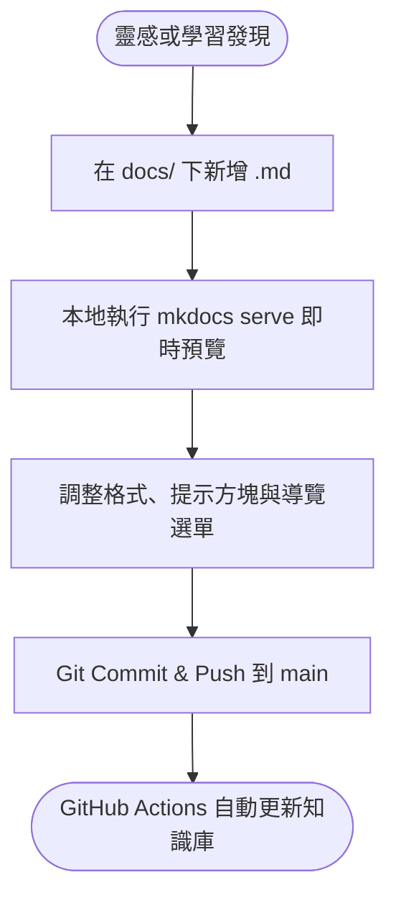

# 日常筆記與發布工作流

建立流暢的「閱讀-思考-記錄-發布」回饋循環，能顯著降低維護知識庫的心理負擔。

---

## 寫作與發布節奏



---

## 增添新頁面步驟

1. **建立檔案**：在 `docs/` 下建立對應的 Markdown 檔案，例如 `docs/notes/my-new-topic.md`。
2. **在 `mkdocs.yml` 註冊選單**：
   開啟 `mkdocs.yml`，在 `nav:` 區塊加入對應的路徑：
   ```yaml
   nav:
     - 首頁: index.md
     - 知識筆記:
         - 範例筆記: notes/example.md
         - 新主題筆記: notes/my-new-topic.md
   ```
3. **即時檢視**：終端機執行 `mkdocs serve`，前往瀏覽器預覽效果。
4. **推送更新**：
   ```bash
   git add docs/notes/my-new-topic.md mkdocs.yml
   git commit -m "docs: 新增新主題筆記"
   git push origin main
   ```

---

## 圖片與資源管理

建議將圖片與靜態資源放置於 `docs/assets/images/` 目錄：

```text
docs/
├── assets/
│   └── images/
│       └── diagram.png
└── notes/
    └── my-note.md
```

在 Markdown 中引用：

```markdown

```
